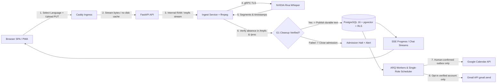

<div align="center">


# Maulwurf

**Privacy-first academic companion that turns class recordings into queryable knowledge, grounded study citations, human-confirmed Google Calendar events, and opt-in reminders — without storing audio.**

[](apps/api/app/main.py)
[](apps/api/app/main.py)
[](apps/web/src/App.tsx)
[](apps/api/alembic/versions/0001_core_schema_s1.py)
[](infra/docker-compose.yml)
[](infra/Caddyfile)
[](LICENSE)
[](#verification--ci-gates)

[Architecture](#-architecture--data-flow) · [Privacy & Guarantees](#-privacy--reliability-guarantees) · [Feature Matrix](#-delivered-features-vs-open-external-gates) · [Quick Start](#-3-step-quick-start) · [Documentation Hub](#-documentation--runbooks)

</div>

---

> [!NOTE]
> **Project Status (`2026-11-19`, `develop` branch):** The full **F1 + F2 + F3** codebase is implemented across `apps/api`, `apps/ingest`, `apps/web`, **22** sequential Alembic migrations (`apps/api/alembic/versions/0001_core_schema_s1.py` through `apps/api/alembic/versions/0022_s3_chat_tool_calls.py`), and `infra/docker-compose.prod.yml`.

> [!IMPORTANT]
> **External & Human Gates Still Open:** While software implementation and automated test suites are complete and passing, final live-provider and host operational sign-offs remain explicitly open until live accounts and the ARM reference host are provisioned: external F0 decisions (`D2`, `D3-Audio`, `D3-Text`, `D4`, `D6`), live Google OAuth/Calendar/Gmail tests (`J3.1`, `J3.9`, `J4.9` / `P-S4-JF-07`), live NVIDIA Riva stress (`J4.10`), live human multilingual `G4`/`G6` evaluations (`L2.7`, `L4.1`), 2x live staging rehearsals + rollback drill (`D4.7`, `A4.8`, `S4.6`), and independent peer signature on `docs/reviews/security-cross-review.md` (`L4.2`).

---

## Architecture & Data Flow

Maulwurf enforces a strict separation between **ephemeral binary audio** (streamed in RAM / `tmpfs` and verified deleted before publishing downstream jobs) and **durable structured text knowledge** (PostgreSQL + `pgvector` + FTS).



<details>
<summary><strong>View System Context, Container & Process Diagrams</strong></summary>

<br/>

| System Context (`arq-01`) | Container Topology (`arq-02`) | Process Map (`proc-00`) |
| :---: | :---: | :---: |
|  |  |  |

All architecture and flow diagrams live under [`docs/ARCH.md`](docs/ARCH.md) and [`docs/diagrams/`](docs/diagrams/arq-05-zonas-de-confianza.svg).

</details>

---

## Privacy & Reliability Guarantees

| Guarantee | Mechanism | Primary Code & Verification |
|---|---|---|
| **G1 — Zero Persistent Audio** | Audio stays strictly in memory/`tmpfs`; absence verification gates admission; browser has zero `<audio>` players or IndexedDB caches | `apps/api/app/services/uploads.py`, `apps/api/app/services/orphan_sweep.py`, `apps/web/tests/unit/g1-privacy.test.ts`, `docs/reviews/g1-client.md` |
| **Mandatory Pre-Upload Language** | Explicit language selection required before bytes stream; UI capabilities synced to validated backend limits | `apps/api/app/routers/ingestion.py`, `apps/api/app/services/limits.py`, `apps/web/src/components/upload/UploadForm.tsx` |
| **Stage State Isolation** | Upload, ASR, cleanup verification, indexation, LLM analysis, task review, Calendar sync, and notifications use decoupled state machines | `apps/api/app/services/state_machine.py`, `apps/api/app/services/index_job.py`, `apps/api/app/services/analysis.py` |
| **Human-Confirmed Calendar** | Extracted dates become reviewable proposals with verbatim spans (`segment N` fallback); Calendar writes happen only after confirmation | `apps/api/app/services/evidence.py`, `apps/api/app/services/task_lifecycle.py`, `apps/api/app/services/calendar_sync.py` |
| **Uncertainty-First Gmail & Digests** | Incremental `gmail.send` opt-in, fixed verified recipient (`parseaddr` checked), escaped HTML/text templates, no blind retries on `delivery_unknown` | `apps/api/app/services/gmail.py`, `apps/api/app/services/gmail_templates.py`, `apps/web/src/components/settings/DeliveryPanel.tsx` |
| **Structural `no-store` & PWA Exclusions** | Private API routes set `Cache-Control: no-store`; Service Worker caches only static shell and excludes all 15 private/stream prefixes | `apps/web/src/lib/api.ts`, `apps/web/public/sw.js`, `apps/web/tests/unit/pwa-sw.test.ts` |
| **Traceable Account Deletion (`DELETE /me`)** | Tombstone transaction revokes sessions, restricts session to observable/resumable deletion status, defaults `delete_maulwurf_events=false` | `apps/api/app/services/deletion.py`, `apps/web/src/components/settings/AccountDeletionPanel.tsx` |

---

## Delivered Features vs. Open External Gates

| Area / Phase | Delivered in Codebase (`develop`) | Open External / Human Gates |
|---|---|---|
| **F1 — Ingestion & Knowledge** | Google OAuth CSRF sessions, subjects CRUD, pre-upload language form, streaming binary PUT (`infra/Caddyfile` `max_size 220MB` / `read_body 40m`), real-time SSE progress, library & synced `TranscriptReader` + `.txt`/`.srt` export, hybrid pgvector + FTS search, streaming RAG chat with citations & read tools | Live NVIDIA Riva allowlist/ceiling confirmation (`D2`, `D3-Audio`, `D4`, `J4.10`); live `G4` multilingual retrieval eval (`L2.7`) |
| **F2 — Tasks & Google Calendar** | Versioned task extraction runs, provenance span reconstruction, task inbox/edit/human confirmation, atomic outbox writes, Google Calendar sync & conflict detection, reconnection prompts | Live Google OAuth verification & Calendar integration test (`D6`, `J3.1`, `J3.9`); live `G6` human faithfulness eval (`L4.1`) |
| **F3 — Notifications, UX & Prod Stack** | Public landing (`/`), notification preferences (`PATCH /me/notifications`), failed delivery panel (`DeliveryPanel` + manual duplicate-ack resend), `gmail.send` incremental opt-in, daily/weekly digests, global `Ctrl+K` (`CommandPalette`), metadata-only `SubjectStats`, PWA offline shell (`sw.js`), `DELETE /me` resume flow, `infra/docker-compose.prod.yml` | Live `P-S4-JF-07` Gmail send (`J4.9`); 2x live ARM reference-host rehearsals + rollback drill (`D4.7`, `A4.8`, `S4.6`); peer signature on `docs/reviews/security-cross-review.md` (`L4.2`) |

---

## 3-Step Quick Start

### 1. Boot the Local Compose Stack

Configure environment variables and Google OAuth credentials following [`docs/RUNBOOK-dev.md`](docs/RUNBOOK-dev.md), then launch the 8-service development topology (`caddy`, `web`, `api`, `ingest`, `worker`, `scheduler`, `postgres`, `redis`):

```bash
docker compose -f infra/docker-compose.yml up --build
```

### 2. Verification & CI Gates

Run the full automated verification suites locally across backend, ingestion, frontend, infrastructure linters, and documentation/secret scanners:

```bash
# API static checks & unit suite
cd apps/api && .venv/bin/ruff check . && .venv/bin/mypy . && .venv/bin/pytest tests/unit -q

# Ingest static checks & unit suite
cd ../ingest && .venv/bin/ruff check . && .venv/bin/mypy . && .venv/bin/pytest -q

# Web lint, TypeScript, Vitest & Vite bundle
cd ../web && npm run lint && npm run typecheck && npx vitest run && npm run build

# Repository-wide edge, env, reference, and secret checks
cd ../..
python3 scripts/ci/check_caddy_limits.py
python3 scripts/ci/check_compose_ingest_env.py
python3 scripts/docs/check_refs.py
bash scripts/ci/check_no_secrets.sh
```

### 3. Reference Production Deployment

For single-host ARM/Linux deployment with immutable image tags, single-job Alembic migrations (`migrate` profile), Redis password enforcement (`--requirepass`), and production Caddy TLS/limits (`infra/deploy/Caddyfile.prod`), follow [`docs/runbooks/deploy.md`](docs/runbooks/deploy.md) using [`infra/docker-compose.prod.yml`](infra/docker-compose.prod.yml).

---

## Documentation & Runbooks

- **Contracts & Planning:** [`docs/ESPECIFICACION.md`](docs/ESPECIFICACION.md) · [`docs/PLAN_IMPLEMENTACION.md`](docs/PLAN_IMPLEMENTACION.md) · [`docs/DISENO_BD_API_SPRINTS.md`](docs/DISENO_BD_API_SPRINTS.md) · [`docs/PLAN_SPRINTS.md`](docs/PLAN_SPRINTS.md) · [`docs/PLAN_TESTS.md`](docs/PLAN_TESTS.md)
- **Sprint & Governance Records:** [`docs/plan/S4.md`](docs/plan/S4.md) · [`docs/plan/F4-backlog.md`](docs/plan/F4-backlog.md) · [`docs/sprints/CLAIMS.md`](docs/sprints/CLAIMS.md) · [`docs/sprints/README.md`](docs/sprints/README.md)
- **Closure Reviews & Demo Script:** [`docs/reviews/consistency-checklist.md`](docs/reviews/consistency-checklist.md) · [`docs/reviews/g1-client.md`](docs/reviews/g1-client.md) · [`docs/reviews/security-cross-review.md`](docs/reviews/security-cross-review.md) · [`docs/demo/guion.md`](docs/demo/guion.md)
- **Operations & Runbooks:** [`docs/RUNBOOK-dev.md`](docs/RUNBOOK-dev.md) · [`docs/runbooks/README.md`](docs/runbooks/README.md) · [`docs/runbooks/deploy.md`](docs/runbooks/deploy.md) · [`docs/runbooks/cleanup.md`](docs/runbooks/cleanup.md) · [`docs/runbooks/restore.md`](docs/runbooks/restore.md) · [`docs/runbooks/account-deletion.md`](docs/runbooks/account-deletion.md) · [`docs/runbooks/provider-down.md`](docs/runbooks/provider-down.md) · [`docs/runbooks/tokens.md`](docs/runbooks/tokens.md) · [`docs/runbooks/budget-alerts.md`](docs/runbooks/budget-alerts.md)
