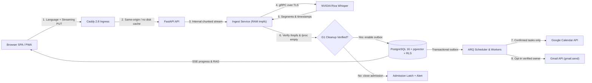
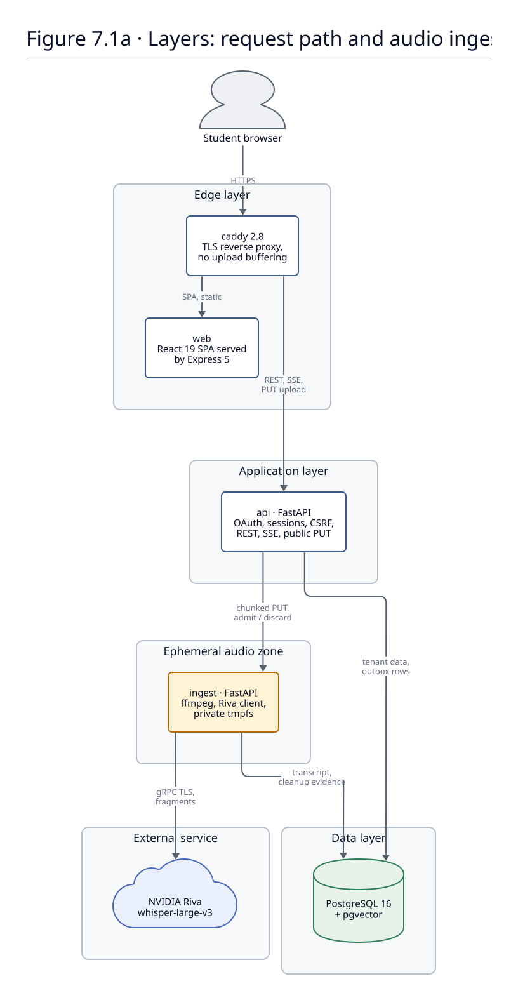
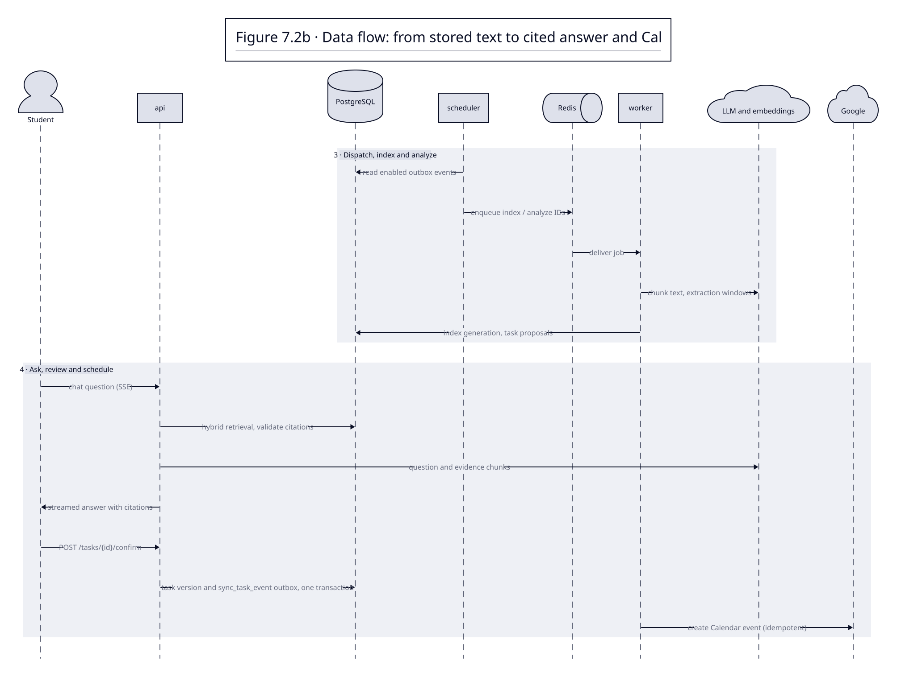

<div align="center">


# Maulwurf

**Privacy-first academic companion that turns class recordings into searchable transcripts, cited answers, human-confirmed Google Calendar events, and opt-in reminders — without ever storing audio.**

[](apps/api/app/main.py)
[](apps/api/app/main.py)
[](apps/web/src/App.tsx)
[](apps/api/alembic/versions/0001_core_schema_s1.py)
[](infra/docker-compose.yml)
[](infra/Caddyfile)
[](apps/web/src/i18n/index.ts)
[](.github/workflows/quality.yml)
[](LICENSE)

[How It Works](#-upload--find--decide) · [Features](#-key-capabilities) · [Architecture & Privacy](#-architecture--privacy-guarantees) · [Quick Start](#-quick-start) · [Production](#-production-deployment) · [Documentation](#-documentation--operations-hub)

<br />


</div>

---

## Upload → Find → Decide

Students record lectures and rarely listen to two-hour audio files again. **Maulwurf** converts class recordings into durable, structured study knowledge while enforcing a strict zero-audio-retention boundary:

1. **Upload without keeping audio** — Stream recordings up to **1 GiB** (`M4A`/`AAC`, `MP3`, `WAV`, `FLAC`, `OGG`/`Opus`, `WebM`) into an isolated `tmpfs` RAM workspace. Audio is normalized via sandboxed `ffmpeg`, transcribed with **NVIDIA Riva (`whisper-large-v3`)**, and **verified absent from RAM and `/proc`** before downstream indexing or analysis is unlocked. There is no audio player, no object storage bucket, and no disk spool.
2. **Find with verified citations** — Query all your subjects through **hybrid retrieval** (`pgvector` cosine similarity + PostgreSQL full-text search fused with Reciprocal Rank Fusion) and **streaming SSE RAG chat**. Every answer cites tenant-verified transcript segments that open directly in the synchronized transcript reader.
3. **Decide before anything is written** — Deadlines, exams, and assignments mentioned in class become structured proposals backed by verbatim evidence spans. **Nothing reaches Google Calendar until you explicitly confirm it**, and **Gmail reminders or digests require opt-in consent**.

---

## Key Capabilities

| Pillar | What Maulwurf Provides |
|---|---|
| **Ephemeral Audio Ingestion** | Mandatory pre-upload language & consent check, streaming binary `PUT` with TCP backpressure, up to **30 concurrent execution slots** (`1 GiB` API ceiling), `ffmpeg` normalization without shell/network access, 30 s overlap-reconciled ASR fragments, and real-time SSE stage progress (`apps/ingest/maulwurf_ingest/`). |
| **Knowledge Library & Cited Chat** | Subject-organized class library, timestamped `TranscriptReader` with `.txt` and `.srt` exports, global `Ctrl+K` search palette, hybrid RRF search, and streaming RAG chat with read-only context tools (`get_calendar_events`, `get_pending_tasks`) plus inbox-only `propose_task`. |
| **Human-Confirmed Planning** | Windowed LLM lecture analysis (summaries, key topics, and dated task proposals), provenance span validation against persisted transcripts, optimistic-concurrency task revisions, FullCalendar agenda view, and ETag-safe Google Calendar sync with external conflict detection. |
| **Opt-In Reminders & Digests** | Incremental `gmail.send` authorization, scheduled task reminders, daily/weekly study digests, strict recipient verification, and single-attempt uncertainty handling (`delivery_unknown` outcomes are surfaced for manual review and never resent blindly). |
| **Crafted Multilingual UX** | Full interface localization in **Spanish, English, and French** (`apps/web/src/locales/`), dual **Lavanda** (dark) & **Ámbar** (light) themes with 16-bit pixel-art visuals, self-hosted `Fira Code` and `VT323` fonts (zero third-party font tracking), offline-shell PWA (`apps/web/public/sw.js`), and public Privacy & Terms pages (`/privacidad`, `/terminos`). |
| **Sovereign Data Lifecycle** | Observable, resumable account deletion (`DELETE /me`) with tombstone revocation, optional cleanup of Maulwurf-created Google Calendar events, and encrypted text-only backup/restore scripts with tombstone replay (`scripts/ops/backup_restore.sh`). |

---

## Architecture & Privacy Guarantees

Maulwurf separates **ephemeral binary audio** (`ingest` on a private network with read-only rootfs and bounded `tmpfs`) from **durable tenant text** (PostgreSQL 16 + `pgvector` with forced Row-Level Security) behind a single same-origin **Caddy 2.8** ingress.



<details>
<summary><strong>Explore Detailed Architecture & Sequence Diagrams</strong></summary>

<br />

| Request Path & Audio Boundary | Async Outbox, RAG & Integrations |
| :---: | :---: |
|  |  |

| Upload, ASR & Verified Cleanup | Outbox Dispatch, Indexing & Calendar |
| :---: | :---: |
|  |  |

Full architectural documentation lives in [`Workshop-2/07-architecture.md`](Workshop-2/07-architecture.md), [`docs/ARCH.md`](docs/ARCH.md), and [`docs/diagrams/`](docs/diagrams/arq-05-zonas-de-confianza.svg).

</details>

### Non-Negotiable Security & Privacy Controls

| Control | Enforcement in Code & Infrastructure |
|---|---|
| **G1 — Zero Persistent Audio** | `apps/ingest/maulwurf_ingest/hardening.py` refuses startup unless rootfs is read-only, `/work/tmp` is `tmpfs` (`noexec,nosuid,nodev`), swap is off, and core dumps are `0`. `apps/ingest/maulwurf_ingest/cleanup.py` verifies file and `/proc` descriptor absence before outbox jobs activate. |
| **Defense-in-Depth Multi-Tenancy** | Composite `(user_id, id)` ownership checks plus `FORCE ROW LEVEL SECURITY` in PostgreSQL across dedicated least-privilege roles (`maulwurf_app`, `maulwurf_jobs`, `maulwurf_ingest`) bound per transaction (`apps/api/app/core/db.py`). |
| **Hardened Edge & Browser Boundary** | Caddy is the sole public ingress (`infra/Caddyfile`): `1100MB` upload ceiling, `/internal/*` blocked with `404`, OAuth query redaction, `Cache-Control: no-store` on all private routes, and a Service Worker restricted strictly to static assets (`apps/web/tests/unit/pwa-sw.test.ts`). |
| **Encrypted Credentials & Ephemeral Queue** | Google OAuth refresh tokens are encrypted at rest with **AES-GCM** and versioned keys (`apps/api/app/core/crypto.py`). Redis runs with RDB/AOF disabled and `noeviction`, storing only job IDs and rate-limit counters; the DB reconciler rebuilds lost queue state automatically. |
| **Fail-Closed Safety Defaults** | External side-effect and cloud-processing surfaces fail closed when unconfigured: ingestion reception, allowed embedding models (`MAULWURF_D3_TEXT_CLOSED_MODELS`), and Gmail notification crons remain disabled until explicitly enabled by the operator. |

---

## Quick Start

### Prerequisites

- **Docker Engine** with **Docker Compose v2** (recommended path for running the full 8-service topology: `caddy`, `web`, `api`, `ingest`, `worker`, `scheduler`, `postgres`, `redis`).
- For standalone local development outside Docker: **Python 3.12+** with [`uv`](https://docs.astral.sh/uv/), **Node.js 22 LTS**, and `ffmpeg` / `espeak-ng` (for synthetic-audio unit tests).

### 1. Try the Full Pipeline Offline (Zero Cloud Keys)

Maulwurf ships with deterministic local ASR, LLM, and embedding doubles (`infra/docker-compose.e2e.yml`) so you can boot and verify the entire upload → transcription → G1 cleanup → hybrid indexing → cited RAG pipeline without external credentials:

```bash
E2E_TLS_DIR="$(mktemp -d)"
bash scripts/e2e/gen_riva_tls.sh "$E2E_TLS_DIR"

E2E_ALLOW_EPHEMERAL_CREDENTIALS=1 \
E2E_TLS_DIR="$E2E_TLS_DIR" \
E2E_TLS_GID="$(id -g)" \
docker compose -f infra/docker-compose.yml -f infra/docker-compose.e2e.yml \
  up -d --build --wait postgres redis e2e-provider e2e-asr ingest worker scheduler api

docker compose -f infra/docker-compose.yml -f infra/docker-compose.e2e.yml \
  exec -T api python - < scripts/e2e/smoke_pipeline.py
```

### 2. Run the Local Self-Hosted Stack

1. Copy `.env.example` to `.env` and set your local secrets (`MAULWURF_SECRET_KEY`, `MAULWURF_ENCRYPTION_KEY`, `MAULWURF_OAUTH_STATE_SECRET`), Google OAuth client credentials, NVIDIA Riva endpoint, and OpenAI-compatible LLM/embedding settings following [`docs/RUNBOOK-dev.md`](docs/RUNBOOK-dev.md):
   ```bash
   cp .env.example .env
   ```
2. Launch all 8 services behind local HTTPS (`https://localhost`):
   ```bash
   docker compose -f infra/docker-compose.yml up -d --build --wait
   ```
   On startup, `api` automatically applies all **25** Alembic migrations (`0001`–`0025`) before serving traffic.

> [!IMPORTANT]
> **Operator Opt-In Gates:** By design, Maulwurf boots fail-closed. Set `MAULWURF_INGEST_URL` + matching `INGEST_CREDENTIAL_SECRET` to accept audio uploads, list approved embedding models in `MAULWURF_D3_TEXT_CLOSED_MODELS` to index transcripts, and enable `MAULWURF_NOTIFICATION_SCHEDULER_ENABLED=true` / `MAULWURF_NOTIFICATION_DELIVERY_ENABLED=true` only when Gmail reminders should be dispatched.

---

## Production Deployment

For single-host Linux (`x86_64` or `ARM64`) deployments, use [`infra/docker-compose.prod.yml`](infra/docker-compose.prod.yml) and [`infra/deploy/Caddyfile.prod`](infra/deploy/Caddyfile.prod) following [`docs/runbooks/deploy.md`](docs/runbooks/deploy.md):

- **Public TLS & HSTS** on `{$MAULWURF_DOMAIN}` with strict proxy IP trust (`CADDY_TRUSTED_PROXIES`) and OpenAPI disabled (`MAULWURF_ENV=production`).
- **Dedicated Migration Step** via the one-shot `migrate` Compose profile before rolling `api`, `worker`, and `scheduler` replicas.
- **Authenticated Redis & Internal Networks** (`--requirepass`, isolated `edge` and `data` networks with zero host ports exposed for `postgres`, `redis`, or `ingest`).
- **Prometheus Observability & Alerting** under the `observability` profile, scraping bearer-protected `/internal/metrics` endpoints with rules in [`infra/alerting/maulwurf.rules.yml`](infra/alerting/maulwurf.rules.yml).

---

## Repository Structure & Quality Gates

```text
Maulwurf/
├── apps/
│   ├── api/          # FastAPI REST/SSE API, SQLAlchemy + RLS models, 25 Alembic migrations, ARQ workers
│   ├── ingest/       # Isolated ephemeral audio receiver, ffmpeg pipeline, NVIDIA Riva gRPC client, G1 sweeper
│   └── web/          # React 19 + Vite SPA/PWA, Tailwind 4, i18next (es/en/fr), Express static shell
├── infra/            # Dev, E2E, and Production Docker Compose stacks, Caddyfiles, Prometheus alert rules
├── scripts/          # CI policy guards, deterministic E2E smoke & TLS helpers, D8 encrypted backup/restore
├── docs/             # Specification, architecture, ADRs, legal notices, security reviews, operational runbooks
└── Workshop-2/       # Comprehensive D2 architecture diagrams & compiled architectural reference
```

Run the same static analysis, unit suites, frontend bundle checks, and policy scanners enforced by [`.github/workflows/quality.yml`](.github/workflows/quality.yml):

```bash
# Backend & Ingest: Ruff, strict mypy, and unit tests (ingest requires espeak-ng)
cd apps/api && uv sync --frozen --extra dev && uv run ruff check . && uv run mypy . && uv run pytest -m "not integration and not provider and not load" -q
cd ../ingest && uv sync --frozen --extra dev && uv run ruff check . && uv run mypy . && uv run pytest -m "not integration and not provider and not load" -q

# Web SPA: ESLint, TypeScript, Vitest, production build, and npm audit
cd ../web && npm ci && npm run lint && npm run typecheck && npm test && npm run build

# Repository-wide edge, Compose, documentation reference, and secret guards
cd ../..
python3 scripts/ci/check_caddy_limits.py --caddyfile infra/Caddyfile --profile dev
python3 scripts/ci/check_caddy_limits.py --caddyfile infra/deploy/Caddyfile.prod --profile prod --public-tls
python3 scripts/ci/check_compose_ingest_env.py --compose-file infra/docker-compose.yml
python3 scripts/ci/check_compose_ingest_env.py --compose-file infra/docker-compose.prod.yml
python3 scripts/docs/check_refs.py
bash scripts/ci/check_no_secrets.sh
```

---

## Documentation & Operations Hub

- **Architecture & Contracts:** [`Workshop-2/07-architecture.md`](Workshop-2/07-architecture.md) · [`docs/ARCH.md`](docs/ARCH.md) · [`docs/ESPECIFICACION.md`](docs/ESPECIFICACION.md) · [`docs/DISENO_BD_API_SPRINTS.md`](docs/DISENO_BD_API_SPRINTS.md) · [`docs/NVIDIA_RIVA.md`](docs/NVIDIA_RIVA.md) · [`docs/adr/README.md`](docs/adr/README.md)
- **Development & Deployment:** [`docs/RUNBOOK-dev.md`](docs/RUNBOOK-dev.md) · [`docs/runbooks/deploy.md`](docs/runbooks/deploy.md) · [`infra/README.md`](infra/README.md) · [`docs/VERSIONES.md`](docs/VERSIONES.md)
- **Incident & Day-2 Runbooks:** [`docs/runbooks/README.md`](docs/runbooks/README.md) · [`docs/runbooks/cleanup.md`](docs/runbooks/cleanup.md) · [`docs/runbooks/restore.md`](docs/runbooks/restore.md) · [`docs/runbooks/account-deletion.md`](docs/runbooks/account-deletion.md) · [`docs/runbooks/provider-down.md`](docs/runbooks/provider-down.md) · [`docs/runbooks/tokens.md`](docs/runbooks/tokens.md) · [`docs/runbooks/budget-alerts.md`](docs/runbooks/budget-alerts.md)
- **Privacy, Legal & Security Reviews:** [`docs/reviews/g1-client.md`](docs/reviews/g1-client.md) · [`docs/reviews/security-cross-review.md`](docs/reviews/security-cross-review.md) · [`docs/reviews/consistency-checklist.md`](docs/reviews/consistency-checklist.md) · [`docs/legal/README.md`](docs/legal/README.md)
- **Engineering History & Demo:** [`docs/demo/guion.md`](docs/demo/guion.md) · [`docs/PLAN_IMPLEMENTACION.md`](docs/PLAN_IMPLEMENTACION.md) · [`docs/PLAN_TESTS.md`](docs/PLAN_TESTS.md) · [`docs/sprints/CLAIMS.md`](docs/sprints/CLAIMS.md)

---

## License

Maulwurf is free and open-source software licensed under the **GNU Affero General Public License v3.0** ([`LICENSE`](LICENSE)). Any network deployment of a modified version must make its complete corresponding source code available to users under §13 of the license.
