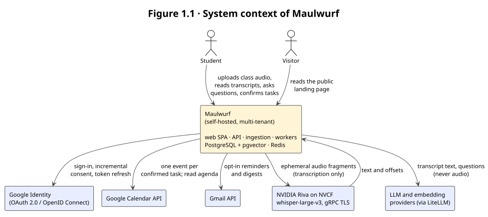
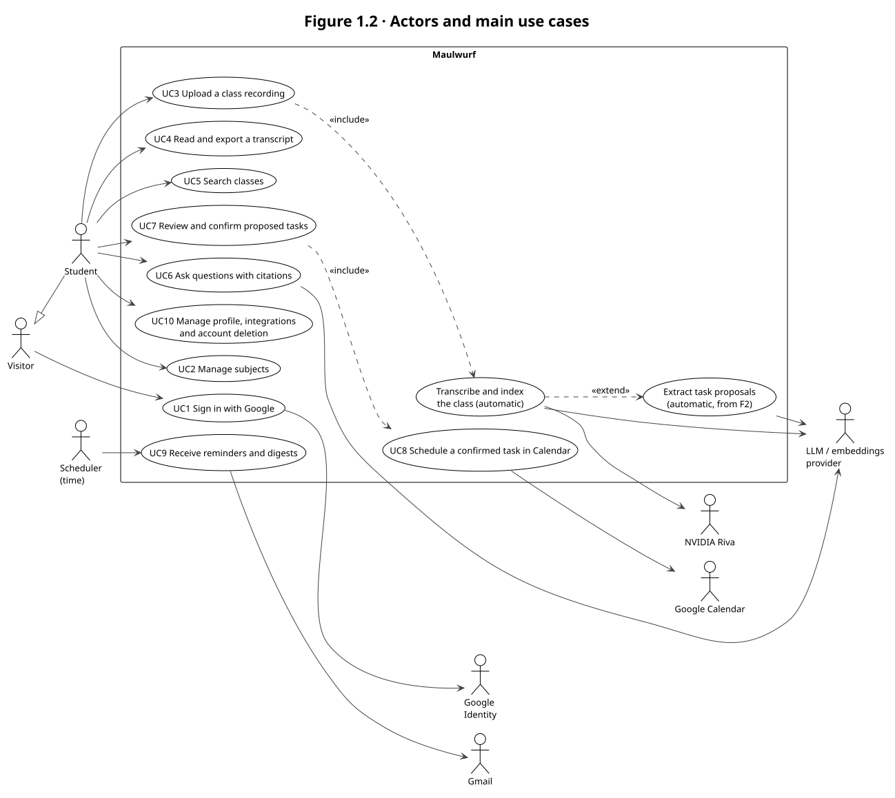

# 1. System Domain

## 1.1 System context

Students record their classes and accumulate hours of audio they rarely listen to again.
Exam dates, deadlines, readings and the teacher's warnings stay buried in that audio.
Lookup tools such as NotebookLM let the student chat with a document, but they do not turn
what the teacher said into scheduled, reviewable actions.

**Maulwurf** is a web study assistant that closes that gap. The student uploads a class
recording; the system keeps only its durable **text**:

1. it transcribes the audio in the language the student selects, through NVIDIA Riva;
2. it deletes the audio and verifies the deletion before any text processing starts;
3. it indexes the transcript for hybrid search and for a chat that answers **with citations**
   to the exact transcript segment;
4. it proposes tasks, exams and readings extracted from the transcript, which the student
   reviews and, only after explicit confirmation, writes to Google Calendar;
5. it sends opt-in reminders and digests through the student's own Gmail account.

**Boundary.** Everything inside the box is self-hosted and multi-tenant: a React single-page
application, a FastAPI API, an isolated ingestion service, ARQ workers and a scheduler,
PostgreSQL with pgvector, and Redis, behind a Caddy reverse proxy. Everything outside is a
third-party service reached through an adapter. Two flows cross the boundary with private data
and are therefore gated by the business rules below: **audio** goes only to NVIDIA Riva, as
ephemeral fragments, and **text** goes only to the LLM and embedding providers.

**Scope.** In scope for the MVP and v1: upload and transcription, structured extraction,
Calendar events after confirmation, hybrid search, RAG chat filtered by subject, reading the
agenda from chat, and email reminders and digests. Out of scope: diarization, video or link
ingestion, collaboration, audio playback or download, automatic language detection,
translation, a fully local mode, and native mobile apps (an installable PWA comes later).

**Delivery phases.** F0 foundation and provider spike; F1 upload → transcript → index → chat;
F2 extraction → review → Calendar; F3 reminders, digests and close-out. They map to sprints
S1–S4 of [PLAN_SPRINTS.md](../docs/PLAN_SPRINTS.md).

## 1.2 Actor characterization

| Actor | Type | Description | Goals | Interactions and permissions |
|---|---|---|---|---|
| **Student** | Primary, human | University student who records lectures (phone or laptop) in Spanish, English or French; uses a desktop or mobile browser; moderate technical skill; works alone (no shared spaces) | Not miss deadlines; find what was said in class; study from evidence | Signs in with Google; owns subjects, classes, transcripts, conversations and tasks; sees **only** their own data; is the only one who can confirm a Calendar write |
| **Visitor** | Primary, human | Anyone without a session | Understand the product and sign in | Public landing page and sign-in only; no private data |
| **Scheduler** | Internal, time | ARQ cron process with a single active role | Trigger reminders, digests and Calendar syncs on time | Acts on behalf of each tenant through the outbox; never reads audio |
| **Google Identity** | Secondary, external system | Google OAuth 2.0 / OpenID Connect | Authenticate the student by `sub`; grant incremental scopes | Called only by the API (state, PKCE, nonce); tokens stored encrypted |
| **NVIDIA Riva (NVCF)** | Secondary, external system | Hosted `whisper-large-v3` over gRPC TLS | Transcribe audio in the selected language | Receives audio fragments only from the ingestion service; transcription only, never translation; retention still unverified (decision D3-Audio) |
| **LLM and embedding providers** | Secondary, external system | Provisional `gpt-4o-mini` and `text-embedding-3-small` via LiteLLM | Embed chunks, answer chat questions, extract proposals | Receive text and questions, never audio or credentials; outputs are untrusted data validated against the database |
| **Google Calendar API** | Secondary, external system | The student's Google Calendar | Hold one event per confirmed task; provide the agenda | Written only after confirmation, through an idempotent job; read for the dashboard and chat tools |
| **Gmail API** | Secondary, external system | The student's own Gmail account | Deliver reminders and digests | Opt-in only; recipient is always the account owner |
| **Operator** | Supporting, human | Team member who deploys and monitors | Keep the service healthy and private | Infrastructure access; logs and metrics carry IDs only, never audio, transcripts or tokens |
| Teacher and classmates | Affected parties, not users | Voices in the recording | — | Never log in; the student acknowledges third-party voices before uploading |

## 1.3 Business rules

Each rule cites its normative source in the specification
([ESPECIFICACION.md](../docs/ESPECIFICACION.md)) or the database and API design
([DISENO_BD_API_SPRINTS.md](../docs/DISENO_BD_API_SPRINTS.md)).

| ID | Rule | Source |
|---|---|---|
| BR-01 | **No durable audio.** Audio exists only in bounded RAM (`tmpfs`) while it is received, validated, converted and transcribed: never on disk, object storage, Redis, logs, traces, caches or backups. There is no playback or download. | Spec §1 binding decisions 1–2 |
| BR-02 | **Deletion before text work.** Audio deletion starts when transcription ends or aborts; an attempt reaches `succeeded` only after the transcript is committed **and** cleanup is verified. Index and analysis jobs stay disabled until then. | Spec §1, §M3; Design §2.6 |
| BR-03 | **Lost audio means re-upload.** Without durable audio there is no server-side retranscription; analysis and indexing are retried from the stored text. | Spec §1 decision 5 |
| BR-04 | **Mandatory language.** The student selects the audio language from a published allowlist (`es`, `en`, `fr` today); no preselection, no autodetection, no `multi`, and the provider is never asked to translate. | Spec §1 decisions 3–4 |
| BR-05 | **Consent before bytes.** Uploading requires the current privacy-notice version, acceptance of cloud processing and acknowledgement of third-party voices; a missing or outdated version is rejected before capacity is reserved. | Spec §M2 |
| BR-06 | **Published limits.** Upload size and duration limits come from `/ingestion/capabilities` (target 200 MiB / 3 h, provisional until capacity decision D4); size is enforced while streaming and duration is measured with ffprobe. | Spec §M2 |
| BR-07 | **Deduplication by identity.** Identity = SHA-256 + language + subject + class date + timezone. An exact duplicate returns the existing class; the same audio with a different context requires an explicit, single-use, short-lived variant confirmation. | Spec §M2 |
| BR-08 | **Honest outcomes.** Silence or no usable text ends `rejected`; a technical loss ends `requires_reupload`; no empty transcript is padded or invented. | Spec §M2, §M3 |
| BR-09 | **Real timestamps only.** Precision is stored as `word`, `segment` or `none`; times are never invented by the LLM or interpolated; SRT export exists only with valid times. | Spec §M3 |
| BR-10 | **Tenant isolation.** Every business row belongs to one user; references use composite keys `(user_id, id)`; the user always comes from the server-side session, never from the request body or an LLM. | Spec §M1, §6; Design §2.1 |
| BR-11 | **One session authority.** The API issues an opaque `HttpOnly` cookie and requires CSRF token and same-origin `Origin` on every mutation; the ingestion service never sees the session, only a per-attempt internal credential. | Spec §M1; ADR-0008 |
| BR-12 | **Validated citations.** Chat answers cite only segments whose IDs were validated in the database for that tenant and version; without enough evidence the assistant says so. | Spec §M7 |
| BR-13 | **Human in the loop.** No Calendar write without explicit confirmation; recommendations never go straight to Calendar; chat tools are read-only. | Spec §1 principles, §M4, §M7 |
| BR-14 | **Dates against the class.** Dates are resolved from the class date and its timezone snapshot; `due_date` and `due_at` are mutually exclusive; ambiguous or missing dates go to review; `confidence_score` never authorizes auto-scheduling. | Spec §M4 |
| BR-15 | **Versioned edits.** Editing a confirmed task creates a pending revision; confirming needs the expected version, and a stale one fails with `409 version_conflict`. Re-analysis never overwrites edited, confirmed or scheduled tasks. | Spec §M4 |
| BR-16 | **Opt-in reminders.** Reminders at T-48 h, T-24 h and T-2 h for timed tasks, T-3 d and T-1 d at local time for all-day tasks, plus daily and weekly digests; a delivery whose outcome is unknown is never resent automatically. | Spec §M8 |
| BR-17 | **Deletion purges derivatives.** Deleting a class purges its transcript, chunks, embeddings, derived tasks and citations; existing Google events are kept unless the student explicitly asks to delete them. A subject with active classes is not deleted without explicit confirmation. | Spec §M2 |
| BR-18 | **Replaceable providers, versioned indexes.** Providers sit behind adapters; changing the embedding model or dimension creates a new index generation and a full reindex, never mixed vectors. | Spec §1 principles, §M6 |
