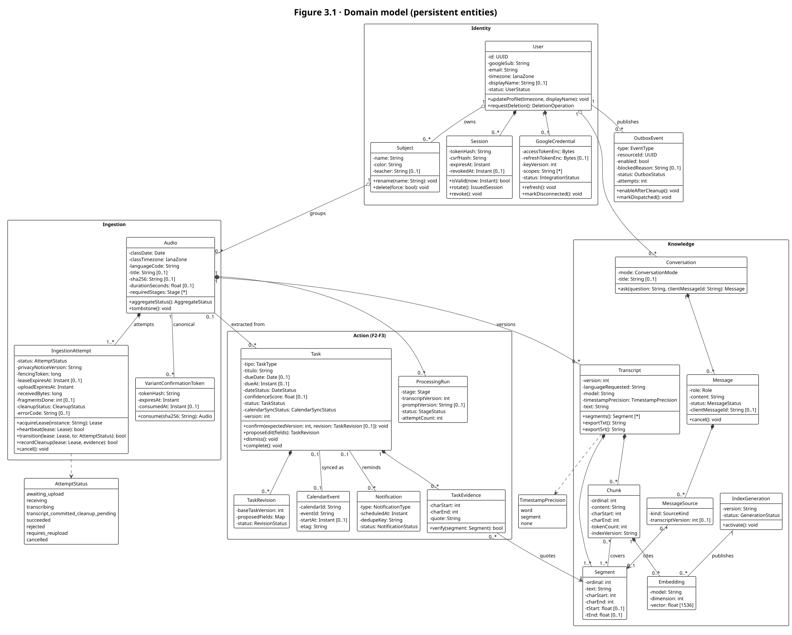
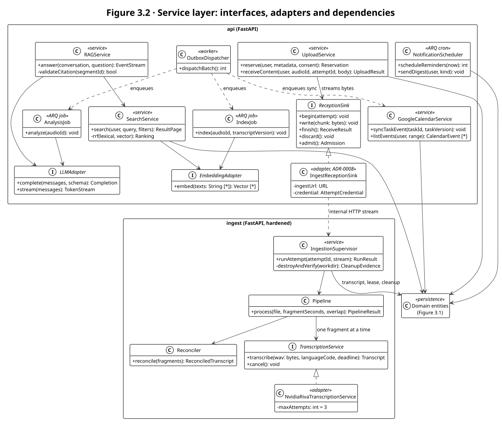

# 3. Class Diagram

The design is modelled with two UML class diagrams, following the notation summarized at
[uml-diagrams.org](https://www.uml-diagrams.org/class-diagrams-overview.html):

- **Figure 3.1** shows the persistent domain model: entities, their attributes with types and
  multiplicities, their domain operations, and the relationships between them.
- **Figure 3.2** shows the service layer: the services that run the business processes, the
  interfaces that isolate external providers, and the adapters that implement them.

## 3.1 Domain model

Notation: `-` private attribute, `+` public operation, `[0..1]` optional, `[*]` collection.

| Relationship | Kind | Meaning |
|---|---|---|
| User ◆— Session, GoogleCredential | Composition | A session or a Google credential cannot exist without its user; deleting the account deletes them |
| User ◇— Subject ◇— Audio | Aggregation | A subject groups classes; a class always belongs to exactly one subject of the same user |
| Audio ◆— IngestionAttempt | Composition, `1..*` | Every class has at least the attempt that created it; a re-upload adds another attempt |
| Audio ◆— Transcript ◆— Segment | Composition | Transcripts are versioned per class; segments are the unit of evidence |
| Chunk — Segment | Association, many-to-many | A chunk covers one or more segments; overlap between chunks is allowed (`chunk_segments`) |
| Chunk ◆— Embedding — IndexGeneration | Composition and association | One embedding per chunk and index generation; a generation is published atomically |
| Conversation ◆— Message ◆— MessageSource → Segment | Composition and directed association | Each answer records every source delivered to the model, so a deletion can purge it |
| Audio — Task | Association `0..1` to `0..*` | Extracted tasks come from one class; manual tasks have none |
| Task ◆— TaskEvidence → Segment | Composition and directed association | The quote and character span that justify a task |
| Task ◆— TaskRevision | Composition | Pending edits of a confirmed task (business rule BR-15) |
| Task — CalendarEvent, Notification | Association | At most one Calendar event per task; zero or more reminders |
| User — OutboxEvent | Association | Durable work published in the same transaction as its cause |

Design decisions visible in the model:

- **No audio attribute anywhere.** `Audio` is the record of a class, not a file: it has no
  storage key, path or blob (BR-01).
- **Tenant ownership.** Every entity belongs, directly or through its parent, to one `User`.
  In the database this becomes the composite keys of [section 4](04-relational-model.md).
- **Optimistic concurrency and fencing.** `Task.version` protects confirmations;
  `IngestionAttempt.fencingToken` prevents an expired owner from publishing a transcript.
- **Status enumerations** are closed sets. `AttemptStatus` and `TimestampPrecision` are drawn as
  examples; the others (`CleanupStatus`, `StageStatus`, `TaskStatus`, `CalendarSyncStatus`,
  `NotificationStatus`…) follow the state machines in
  [DISENO_BD_API_SPRINTS.md](../docs/DISENO_BD_API_SPRINTS.md) §2.10.

## 3.2 Service layer

- **Ports and adapters.** `TranscriptionService`, `LLMAdapter`, `EmbeddingAdapter` and
  `ReceptionSink` are interfaces. Today's adapters are `NvidiaRivaTranscriptionService`
  (NVIDIA Riva over gRPC) and `IngestReceptionSink` (the internal stream from the API to the
  ingestion service, [ADR-0008](../docs/adr/ADR-0008-api-ingest-reception.md)). Changing a
  provider means a new adapter plus contract tests, never a change in the services (BR-18).
- **Two processes for audio and text.** Everything that touches audio lives in the hardened
  `ingest` service; everything that works on text lives in `api` and its ARQ workers. Audio
  never crosses into Redis or the workers.
- **Asynchronous work goes through the outbox.** The `OutboxDispatcher` enqueues
  `IndexJob`, `AnalysisJob` and Calendar syncs only after the event is enabled; this is what
  enforces "deletion before text work" (BR-02).

## 3.3 Mapping to code

| Class | Location | Status |
|---|---|---|
| Domain entities of Identity, Ingestion and Knowledge | `apps/api/app/models/` | Implemented (migrations `0001`, `0002`) |
| Entities of the Action package | — | Planned (S3–S4) |
| `UploadService`, `ReceptionSink` | `apps/api/app/services/uploads.py`, `services/audios.py` | Implemented; `IngestReceptionSink` planned (A2.13) |
| `IngestionSupervisor`, `Pipeline`, `Reconciler` | `apps/ingest/maulwurf_ingest/supervisor.py`, `pipeline.py`, `audio/reconcile.py` | Implemented as a library (not reachable yet) |
| `TranscriptionService`, `NvidiaRivaTranscriptionService` | `apps/ingest/maulwurf_ingest/asr/riva_client.py` | Implemented, not wired (S2.10) |
| `OutboxDispatcher`, `IndexJob`, `AnalysisJob` | `apps/api/app/workers/` | Dispatcher implemented; jobs are stubs |
| `SearchService`, `RAGService`, `GoogleCalendarService`, `NotificationScheduler`, adapters | — | Planned (S2–S4) |

The method names in the diagrams describe the design contract; where code already exists the
real functions may be module-level (for example `services/uploads.py` exposes
`receive_content`) rather than methods of a class.
