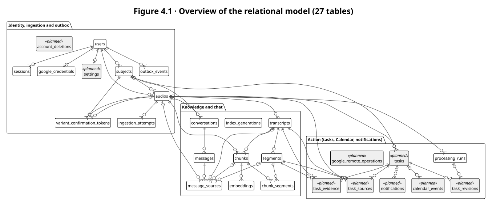
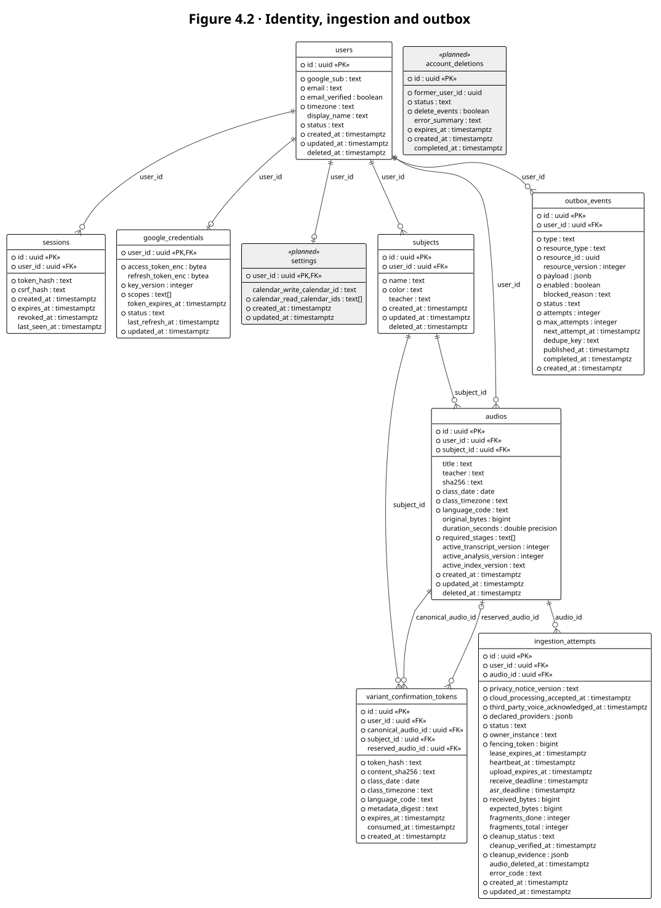
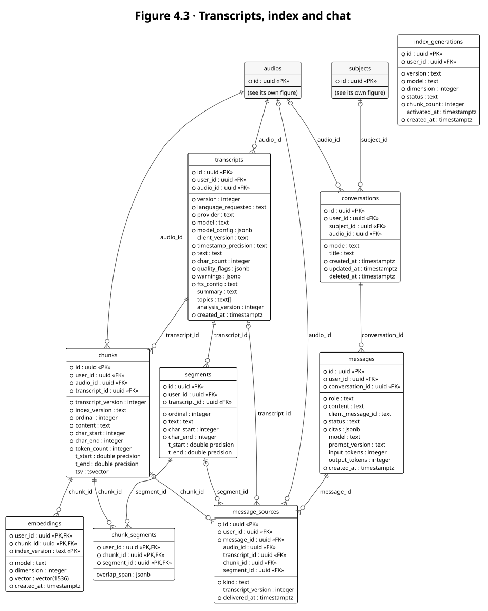
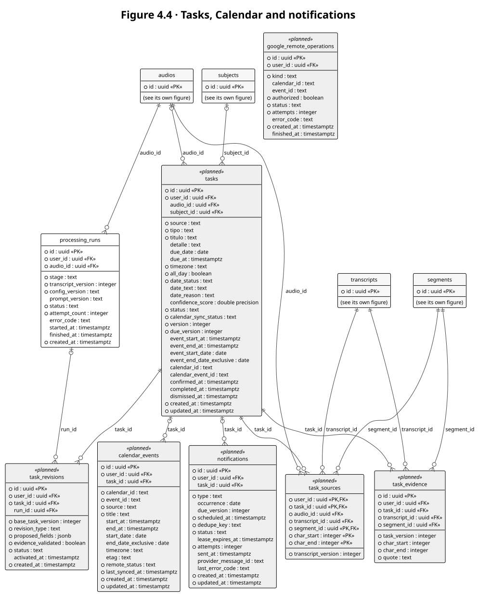

# 4. Relational Database Model

The database is **PostgreSQL 16 with the `pgvector` extension**: one database holds business
data, vectors and the outbox. The model has **27 tables**. 18 of them already exist in the
Alembic migrations `0001_core_schema_s1` and `0002_s2_schema`; the other 9 belong to sprints
S3–S4 and are designed but not migrated yet. The normative DDL, with every `CHECK` constraint
and index, is in [DISENO_BD_API_SPRINTS.md](../docs/DISENO_BD_API_SPRINTS.md) §2; the figures
below are generated from that DDL, column by column.

## 4.1 Conventions

| Convention | Rule |
|---|---|
| Primary keys | `uuid` generated with `gen_random_uuid()`; join tables use composite keys |
| Tenant ownership | Every business table has `user_id`. References between tenant tables are **composite foreign keys `(user_id, id)`**, so a row can never point to another user's row; each parent table therefore declares `UNIQUE (user_id, id)` |
| Deletion | Soft delete (`deleted_at` tombstone) on `users`, `subjects`, `audios` and `conversations`; derived rows are purged by cascades and purge jobs |
| Enumerations | `text` columns with a `CHECK (... IN (...))` list, so new values are added with a controlled migration |
| Time | `timestamptz` everywhere; `created_at`/`updated_at` default `now()`. Class dates are `date` with an explicit IANA timezone |
| No audio | No table has a storage key, path or blob for audio (BR-01); the outbox carries only IDs |
| Versioning | Transcripts by `(audio_id, version)`; chunks by `(transcript_id, index_version, ordinal)`; embeddings by `(chunk_id, index_version)`; runs by `(audio_id, stage, transcript_version, config_version)` |

## 4.2 ER diagrams

Legend: `○` marks a `NOT NULL` column; `«PK»` and `«FK»` mark key columns; white entities are
implemented, grey entities with `«planned»` are not migrated yet. Crow's-foot notation:
`||` exactly one, `|o` zero or one, `o{` zero or many. To keep the figures readable, the
`user_id → users` edge is drawn only for the root tables; every other tenant table also has it.

## 4.3 Table definitions

Foreign keys written as `(user_id, x)` are composite tenant keys.

| Table | Primary key | Foreign keys → table | Purpose | Status |
|---|---|---|---|---|
| `users` | `id` | — | Student identity (Google `sub`), profile and account status | Implemented (0001) |
| `sessions` | `id` | `user_id` → users | Opaque sign-in sessions; only token and CSRF hashes | Implemented (0001) |
| `google_credentials` | `user_id` | `user_id` → users | Encrypted Google tokens, scopes and key version | Implemented (0001) |
| `settings` | `user_id` | `user_id` → users | Calendar preferences (write and read calendars) | Planned |
| `account_deletions` | `id` | — | Residual record of an account deletion (no personal data) | Planned |
| `subjects` | `id` | `user_id` → users | Courses that group classes | Implemented (0001) |
| `audios` | `id` | `user_id` → users; `(user_id, subject_id)` → subjects | Class record: metadata and content identity, never the audio | Implemented (0001) |
| `ingestion_attempts` | `id` | `user_id` → users; `(user_id, audio_id)` → audios | Consent, lease and fencing, ASR state, progress and cleanup | Implemented (0001) |
| `variant_confirmation_tokens` | `id` | `user_id` → users; `(user_id, canonical_audio_id)` → audios; `(user_id, subject_id)` → subjects; `(user_id, reserved_audio_id)` → audios | Single-use confirmation to upload the same audio with another context | Implemented (0002) |
| `outbox_events` | `id` | `user_id` → users | Durable work items with IDs only; cleanup gate for index and analysis | Implemented (0001) |
| `transcripts` | `id` | `user_id` → users; `(user_id, audio_id)` → audios | Versioned transcript text, model and timestamp precision | Implemented (0002) |
| `segments` | `id` | `(user_id, transcript_id)` → transcripts | Ordered transcript segments with character offsets and optional times | Implemented (0002) |
| `chunks` | `id` | `(user_id, audio_id)` → audios; `(user_id, transcript_id)` → transcripts | Indexing units with offsets, token count and full-text vector | Implemented (0002) |
| `chunk_segments` | `user_id, chunk_id, segment_id` | `(user_id, chunk_id)` → chunks; `(user_id, segment_id)` → segments | Which segments each chunk covers (evidence) | Implemented (0002) |
| `embeddings` | `user_id, chunk_id, index_version` | `(user_id, chunk_id)` → chunks | One vector per chunk and index generation | Implemented (0002) |
| `index_generations` | `id` | `user_id` → users | Index versions per user; one active at a time | Implemented (0002) |
| `conversations` | `id` | `user_id` → users; `(user_id, subject_id)` → subjects; `(user_id, audio_id)` → audios | Chat scope: all classes, a subject or a class | Implemented (0002) |
| `messages` | `id` | `(user_id, conversation_id)` → conversations | Chat history with status, citations and token usage | Implemented (0002) |
| `message_sources` | `id` | `(user_id, message_id)` → messages; `(user_id, audio_id)` → audios; `(user_id, transcript_id)` → transcripts; `(user_id, chunk_id)` → chunks; `(user_id, segment_id)` → segments | Every source delivered to the model, for purging | Implemented (0002) |
| `processing_runs` | `id` | `user_id` → users; `(user_id, audio_id)` → audios | Idempotent index and analysis runs per transcript and config version | Implemented (0002) |
| `tasks` | `id` | `user_id` → users; `(user_id, audio_id)` → audios; `(user_id, subject_id)` → subjects | Extracted or manual tasks with dates, status and Calendar sync | Planned |
| `task_evidence` | `id` | `(user_id, task_id)` → tasks; `(user_id, transcript_id)` → transcripts; `(user_id, segment_id)` → segments | Literal quote and span that justify a task | Planned |
| `task_sources` | `user_id, task_id, segment_id, char_start, char_end` | `(user_id, task_id)` → tasks; `(user_id, audio_id)` → audios; `(user_id, transcript_id)` → transcripts; `(user_id, segment_id)` → segments | Segments a task was derived from | Planned |
| `task_revisions` | `id` | `(user_id, task_id)` → tasks; `(user_id, run_id)` → processing_runs | Pending edits and re-analysis results for a task | Planned |
| `calendar_events` | `id` | `user_id` → users; `(user_id, task_id)` → tasks | Local cache of Google Calendar events | Planned |
| `google_remote_operations` | `id` | `user_id` → users | Traceable remote Google operations (for example event deletion) | Planned |
| `notifications` | `id` | `user_id` → users; `(user_id, task_id)` → tasks | Scheduled reminders and digests with delivery status | Planned |

## 4.4 Key constraints and indexes

| Constraint or index | Table | Purpose |
|---|---|---|
| `audios_dedupe_identity` (unique, partial) | `audios` | Deduplication identity: user, SHA-256, language, subject, class date and timezone (BR-07) |
| `attempts_one_active` (unique, partial) | `ingestion_attempts` | At most one active attempt per class |
| `ck_outbox_events_cleanup_gate` | `outbox_events` | `index_requested` and `analyze_requested` are born disabled with `blocked_reason = 'cleanup_pending'` (BR-02) |
| `UNIQUE NULLS NOT DISTINCT (type, resource_id, resource_version, dedupe_key)` | `outbox_events` | Idempotent publication |
| `ck_transcripts_char_count_matches_text` and `timestamp_precision IN ('word','segment','none')` | `transcripts` | Consistent text length; honest timestamp precision (BR-09) |
| `embeddings_hnsw` (HNSW, cosine) and `chunks_fts` (GIN) | `embeddings`, `chunks` | Vector and full-text branches of hybrid search |
| `index_generations_one_active` (unique, partial) | `index_generations` | A single active index generation per user |
| `messages_client_idem` (unique, partial) | `messages` | Idempotent sending through `client_message_id` |
| `due_date` / `due_at` mutually exclusive, `confidence_score` in [0, 1] | `tasks` | Date rules of BR-14 |

Row-level security policies on every tenant table are the planned second barrier of
[ADR-0006](../docs/adr/ADR-0006-aislamiento-tenant.md) (ticket A2.17); today isolation is
enforced by application filtering and the composite foreign keys.
