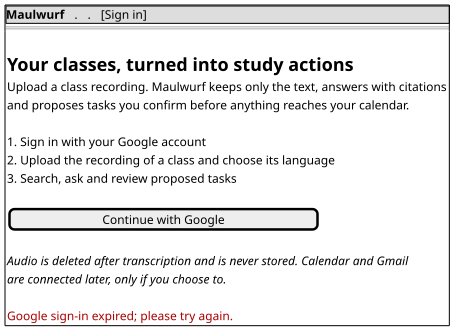
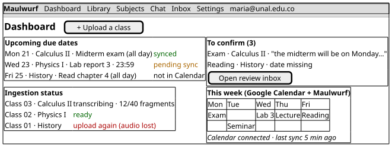
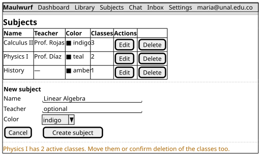
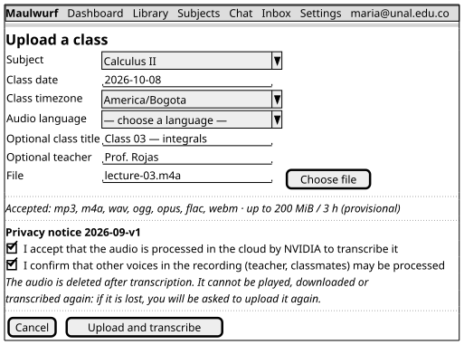
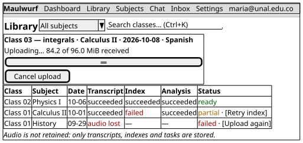
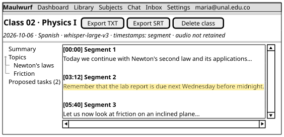
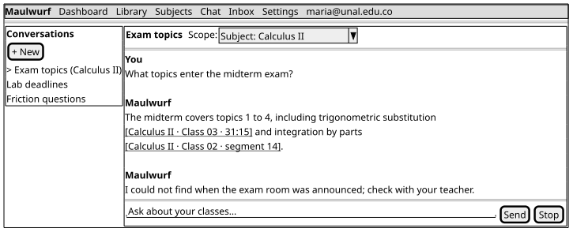
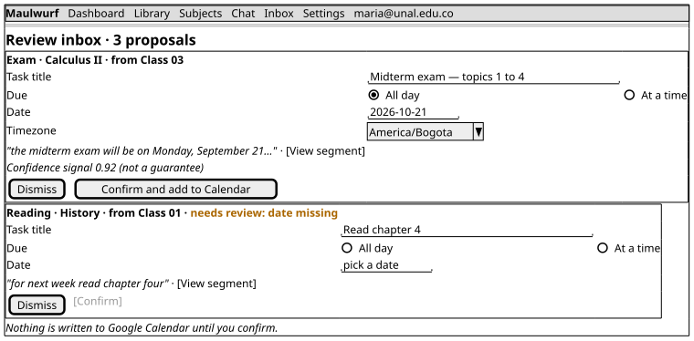
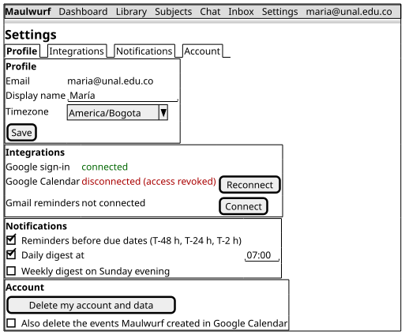

# 5. Mockups

The mockups are low-fidelity wireframes. They describe the primary screens and the information
architecture, not final visual styling. They use the current product vocabulary and preserve the
privacy and human-confirmation rules from section 1.

## 5.1 Screen inventory

| Screen | Route | User goal | Main states represented |
|---|---|---|---|
| Sign in | `/login` | Start or resume a session with Google | OAuth error and successful sign-in |
| Dashboard | `/` | See agenda, review work and ingestion status at a glance | ready, processing, partial, failed |
| Subjects | `/materias` | Create, edit and delete course subjects | active classes block deletion |
| Upload class | `/biblioteca/upload` | Provide metadata, consent and the recording before bytes move | language required, provisional limits |
| Library | `/biblioteca` | Browse classes and distinguish retry from upload again | per-stage status and real progress |
| Transcript reader | `/biblioteca/{audio_id}` | Read and export the durable transcript | segments, timestamps, summary and deletion |
| Chat | `/chat` | Ask across notes with validated citations | streaming, citations and abstention |
| Review inbox | `/inbox` | Review extracted tasks before Calendar writes | missing/ambiguous date and confirmation |
| Settings | `/settings` | Manage profile, integrations, notifications and deletion | disconnected integration and deletion option |

## 5.2 Wireframes

The sources are editable PlantUML Salt diagrams. Their SVGs are embedded in the PDF and can be
regenerated with `python3 Workshop-2/build.py diagrams`.

### Sign in

The screen does not request Google Calendar or Gmail scopes. Those permissions are incremental,
optional and requested only from the integrations settings.

### Dashboard

The dashboard deliberately shows stage status instead of an invented percentage. It combines
local Maulwurf tasks with the Calendar cache and explains when an integration is stale or
disconnected.

### Subjects

Deletion is guarded when a subject has active classes. The user must move the classes or explicitly
confirm the destructive operation, as required by M2.

### Upload class

The form requires subject, class date, timezone, language and two acknowledgements before the
`PUT` begins. It shows the effective limits from `/ingestion/capabilities`, while marking the
200 MiB / 3 h values as provisional until D4 is closed.

### Library

`Retry` is available for text-processing stages after a usable transcript exists. `Upload again`
is used when audio or the pre-commit temporary state was lost; the two actions must not be merged.

### Transcript reader

The reader never offers audio playback or download. SRT is visible only when timestamps are
valid. Segment links are stable evidence anchors, and the permanent notice says that audio was
not retained.

### Chat

The chat uses a scope selector and renders only database-validated citations. If the evidence is
insufficient, it says so instead of inventing a date, source or timestamp.

### Review inbox

A task proposal shows its literal quote, source segment and confidence signal. The signal is not
a probability and never schedules an event by itself. The Calendar write happens only when the
student presses **Confirm and add to Calendar**.

### Settings

The settings screen separates profile, integrations, notifications and account deletion. Deleting
the account has a separate choice for authorized deletion of events previously created by Maulwurf.
