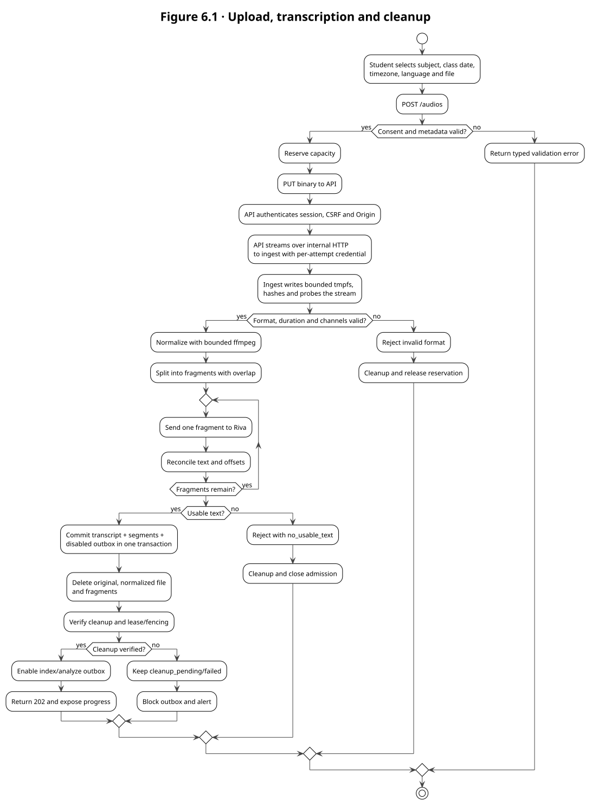
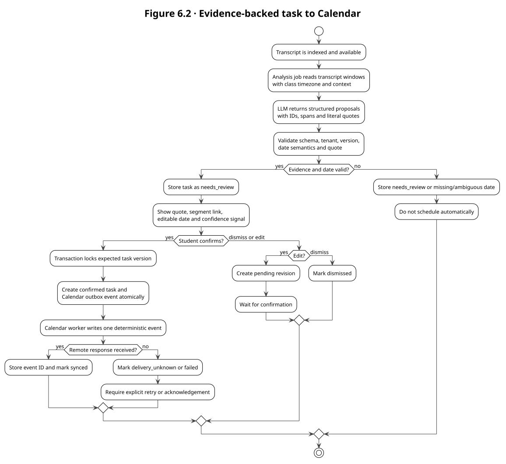
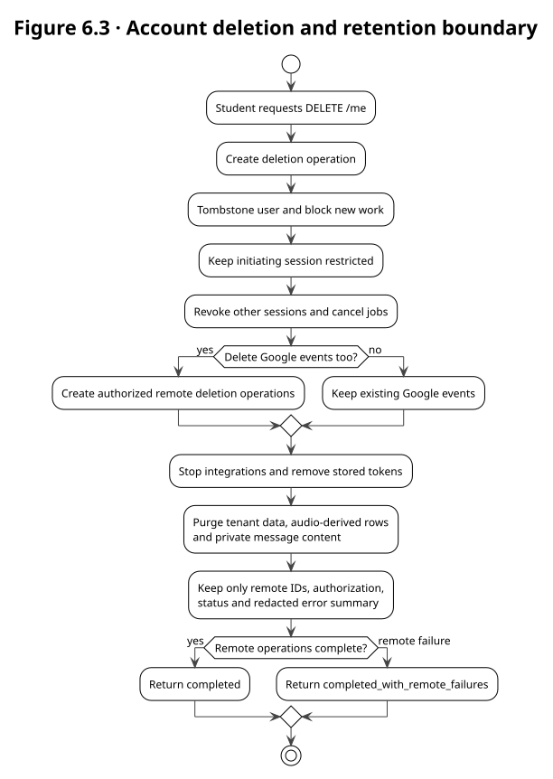

# 6. Business Model Processes

The process models use UML activity diagrams. The central process is the upload-to-transcript
vertical slice because it crosses the most important trust boundaries: browser → API → ingestion
service → NVIDIA Riva → durable text. The other two diagrams show the two irreversible business
flows that require explicit controls: Calendar confirmation and account deletion.

## 6.1 Upload, transcription and verified cleanup

**Inputs:** authenticated session, subject, class date, class timezone, selected language,
consent version and an audio stream. **Output:** a usable transcript and segments, or a typed
terminal status. The process has no branch that stores audio durably. `cleanup_pending` is not a
success state: the outbox remains blocked until a supervisor verifies the temporary files and
processes are gone.

## 6.2 Evidence-backed task to Calendar

The analysis worker is allowed to propose, not to schedule. The quote and source segment must be
validated against the immutable transcript before the proposal enters the review inbox. A stale
optimistic-locking version cannot confirm a task. A lost remote response is not retried blindly,
because Google Calendar does not provide exactly-once delivery; the operation becomes
`delivery_unknown` and requires an explicit decision.

## 6.3 Account deletion and retention boundary

Deletion is asynchronous (`202`) because it coordinates local tombstones, sessions, jobs, tokens,
derived data and optional authorized Google event deletion. The initiating session is restricted
while the operation runs. The residual operation contains only remote IDs, authorization, status
and a redacted error; it must not preserve the student's transcript or other private content.

## 6.4 Process controls and exception paths

| Process control | Normal path | Exception path | Business result |
|---|---|---|---|
| Upload admission | Consent and metadata validated before bytes | stale notice, invalid language, expired attempt | typed 4xx; no capacity or audio accepted |
| Reception | API streams with backpressure to private ingest tmpfs | disconnect, size limit, internal hop timeout | cancel/discard and verify cleanup |
| ASR | Riva returns text or valid offsets | transient retry, provider rejection, deadline | bounded retry; `rejected` or `requires_reupload` |
| Persistence | Transcript, segments and blocked outbox commit together | database failure | rollback; no partial transcript published |
| Cleanup | all temporary files and processes verified absent | cleanup check fails or host disappears | `cleanup_pending/failed`, outbox blocked, alert |
| Task extraction | validated JSON and source span | ambiguous date or invalid quote | `needs_review`; never Calendar write |
| Calendar | one confirmed task version creates one deterministic event | lost response or `invalid_grant` | `delivery_unknown`/`blocked`; explicit retry or reconnect |
| Account deletion | tombstone, revoke, purge and remote operations | remote deletion failure | `completed_with_remote_failures`, redacted residual record |
