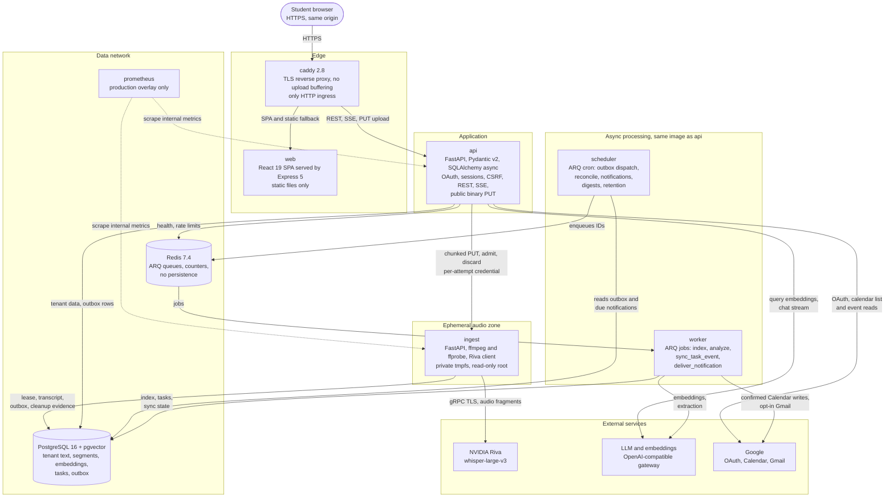
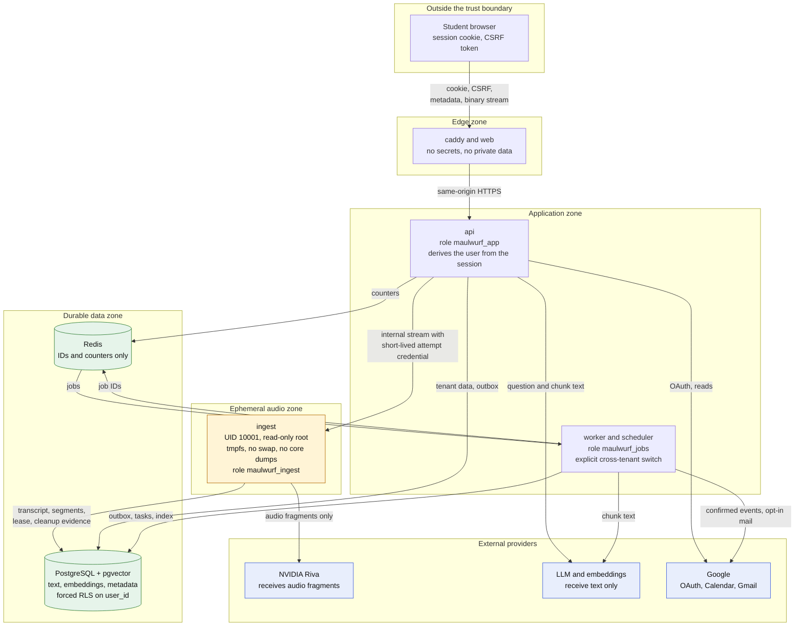

# 7. Architecture Diagram

The architecture follows the accepted decisions in [ADR-0005](../docs/adr/ADR-0005-redis.md)
(Redis policy), [ADR-0006](../docs/adr/ADR-0006-aislamiento-tenant.md) (tenant isolation),
[ADR-0007](../docs/adr/ADR-0007-web-stack.md) (Vite + React SPA),
[ADR-0008](../docs/adr/ADR-0008-api-ingest-reception.md) (the API terminates the public `PUT`
and streams to the internal ingestion service), [ADR-0009](../docs/adr/ADR-0009-run-fencing.md)
(run fencing) and [ADR-0010](../docs/adr/ADR-0010-ingress.md) (Caddy as the only HTTP ingress).

The diagrams are Mermaid blocks, so they render on GitHub and are validated with `mmdc`.
This view was checked against the `develop` code of 2026-11-24 (`7147401`). It describes what
is in the repository, and it separates a component that exists from a flow that is switched on
by default (see §7.6).

## 7.1 Component and deployment view

| Component | Technology / runtime | Responsibility | Network and data boundary |
|---|---|---|---|
| `caddy` | Caddy 2.8, `tls internal` locally, domain TLS in production | Same-origin reverse proxy; the upload route and the two SSE routes (`/audios/*/progress`, `/chat/conversations/*/messages`) are not buffered; `/internal/*` and scanner paths answer `404`; body limits per route | Edge network; the only HTTP ingress |
| `web` | React 19, Vite 7, React Router 7, Tailwind 4, i18next, FullCalendar; Express 5 serves `dist/public` and the SPA fallback | Pages: landing, login, register, welcome, dashboard, upload, library, transcript reader, chat, subjects, tasks, agenda, settings, legal; PWA shell-only service worker | Edge network; no environment, no secrets, no server-side private data |
| `api` | FastAPI, Pydantic v2, SQLAlchemy 2 async, Alembic (25 migrations) | Google OAuth, opaque sessions, CSRF and Origin checks, tenant filtering; routers for health, ingestion capabilities, `me`, subjects, audios (including the public `PUT`), search, chat SSE, tasks, calendar, integrations, notifications and `/internal/metrics`; account deletion (`DELETE /me`) | Edge and data networks; runtime role `maulwurf_app`; the only identity authority |
| `ingest` | FastAPI, asyncpg, ffmpeg/ffprobe 7.1, `nvidia-riva-client` | Internal reception (`PUT`, `admit`, `discard`), admission, lease and fencing, ffprobe validation, fragmentation, Riva transcription in a supervised subprocess, atomic transcript commit, cleanup verification, recovery sweeper | Data network only (not on the edge network); UID 10001; never receives browser cookies; runtime role `maulwurf_ingest` |
| `worker` | ARQ, same image as `api` | Jobs `index`, `analyze`, `sync_task_event` (Calendar) and `deliver_notification` (Gmail); works from persisted text and IDs | Data network; role `maulwurf_jobs`; `cap_drop: ALL` |
| `scheduler` | ARQ cron, same image as `api` | Crons: `dispatch_outbox` (every minute), `schedule_notifications` and `materialize_digests` (every minute, gated off by default), `reconcile` (every 5 minutes), `purge_residuals` (hourly) | Data network; role `maulwurf_jobs`; own queue `arq:scheduler` |
| PostgreSQL | PostgreSQL 16 + pgvector | Users, sessions, Google credentials (encrypted), subjects, audios, attempts, transcripts, segments, chunks, embeddings, conversations, tasks, calendar events, notifications, outbox, run and lease state | Data network; forced row-level security; no durable audio |
| Redis | Redis 7.4, `noeviction`, no RDB or AOF | ARQ queues with IDs, ARQ health keys, per-user chat-stream and search-quota counters | Data network; never audio, text, tokens or provider payloads |
| `prometheus` | Prometheus 2.55 (production compose only) | Scrapes the bearer-protected `/internal/metrics` of `api` and `ingest`; alert rules live in `infra/alerting/` | Data network |

### Layers inside the code

| Layer | `api` (`apps/api/app`) | `ingest` (`apps/ingest/maulwurf_ingest`) | `web` (`apps/web/src`) |
|---|---|---|---|
| Presentation / transport | `routers/` | `main.py`, `receptions.py` (internal routes) | `pages/`, `components/`, `server/` |
| Domain and use cases | `services/` (sessions, audios, uploads, dedupe, indexing, retrieval, RAG, citations, analysis, tasks, calendar, notifications, deletion, budgets) | `supervisor`, `admission`, `lease`, `cleanup`, `recovery`, `persistence`, `reconciler` | `lib/` (typed API client, upload, SSE, auth, i18n helpers) |
| Processing | `workers/` (ARQ settings, dispatcher, reconciler, jobs) | `audio/` (validate, ffmpeg, fragmenter, reconcile, timestamps), `asr/riva_client`, `asr_job` | — |
| Persistence and config | `models/`, `core/` (settings, db, crypto, redis), Alembic | `rls`, `config`, `hardening` | — |

## 7.2 Trust zones

The browser and the external providers are outside the application's trust boundary. The API is
the single identity authority: the user always comes from the server-side session, never from a
request body or an LLM output. Ingestion is isolated because it handles audio and the provider
call; it accepts only a short-lived internal credential and a fencing token, and it is not on the
edge network. The durable boundary holds text and metadata, not audio.

Tenant isolation is enforced twice. Services filter by `user_id` and use composite foreign keys,
and PostgreSQL applies `FORCE ROW LEVEL SECURITY` ([ADR-0006](../docs/adr/ADR-0006-aislamiento-tenant.md)):
every transaction runs `SET LOCAL ROLE` to a non-bypass runtime role and sets `app.user_id`.
Cross-tenant work (outbox dispatch, reconciliation, retention, metrics) exists only for the
`maulwurf_jobs` role through an explicit `app.cross_tenant` switch. `ingest` also has a narrow
cross-tenant policy on `ingestion_attempts` for its admission latch and recovery sweeper.

## 7.3 Communication flows

| # | Flow | Path and protocol | Guarantee |
|---|---|---|---|
| 1 | Browse and authenticate | Browser → `caddy` → `web` (static) or `api` (REST), HTTPS; Google OAuth with state, PKCE and nonce handled by `api` | Opaque `HttpOnly` session cookie; CSRF token and same-origin `Origin` on every mutation |
| 2 | Reserve an upload | `POST /audios` → `api` → PostgreSQL | Consent version, capacity slot, quota and deduplication checked before any byte is accepted |
| 3 | Upload audio | `PUT /audios/{id}/content` → `caddy` (no buffering) → `api` → chunked `PUT /internal/v1/receptions/{attempt}` → `ingest` | Backpressure end to end; nothing written to the `api` disk; `/internal/*` is never routed from the edge |
| 4 | Admit or discard | `api` → `POST …/admit` or `…/discard` on `ingest` | Two-phase reception: the attempt is held until the API decides |
| 5 | Transcribe | `ingest` → supervised `asr_job` subprocess → Riva over gRPC TLS | One fragment (30 s, 0.25 s overlap) at a time in the attempt's tmpfs; transcription only, never translation |
| 6 | Commit text | `ingest` → PostgreSQL | One transaction writes transcript, segments and **disabled** `index` and `analyze` outbox rows; a lost fencing token rolls it back |
| 7 | Clean up | `ingest` deletes the attempt directory and verifies it | Only after verified cleanup the outbox rows are enabled and the attempt becomes `succeeded` |
| 8 | Dispatch | `scheduler` `dispatch_outbox` reads `outbox_events` and enqueues IDs in Redis queue `arq:queue` | Cleanup gate in the publication policy; Redis carries IDs only |
| 9 | Index | `worker` job `index` → embeddings provider → PostgreSQL (`chunks`, `embeddings`, `index_generations`) | Idempotent by job key; versioned index generations |
| 10 | Analyze | `worker` job `analyze` → LLM → task proposals in PostgreSQL | Output is validated against the persisted transcript; proposals stay reviewable |
| 11 | Search and chat | `GET /search` and chat SSE → `api` → PostgreSQL hybrid retrieval (full-text + pgvector, fused with RRF) → LLM stream | Citations are validated against the tenant's segments; chat tools are read-only |
| 12 | Confirm a task | `POST /tasks/{id}/confirm` → `api` writes a `sync_task_event` outbox row in the same transaction → `worker` → Google Calendar | Calendar is written only after explicit human confirmation, through an idempotent job |
| 13 | Notify | `scheduler` claims due `notifications` under a lease and enqueues `deliver_notification` → `worker` → Gmail | Opt-in; never retried when the outcome is unknown; gated off by default |
| 14 | Recover and retain | `scheduler` crons `reconcile` and `purge_residuals`; `ingest` sweeper | Lost dispatches and stranded attempts are repaired from the database; residual deletion rows expire after the retention window |
| 15 | Observe | `prometheus` → `/internal/metrics` of `api` and `ingest` | Aggregate counts only; bearer token outside `local`; `caddy` answers `404` to `/internal/*` |

## 7.4 Deployment environments

| Environment | Definition | Differences that matter |
|---|---|---|
| Local development | `infra/docker-compose.yml`: `postgres`, `redis`, `api`, `worker`, `scheduler`, `ingest`, `web`, `caddy`; networks `edge` and `data`; digest-pinned third-party images; every service has a healthcheck except `caddy` | `MAULWURF_INGEST_URL` and the ingest credential are empty by default, so the upload sink answers `503`; providers are unset, so indexing and chat fail closed; Redis is published on `127.0.0.1` only |
| End-to-end smoke | `infra/docker-compose.yml` + `infra/docker-compose.e2e.yml`, run by the `e2e-smoke` CI job | Adds a Riva gRPC double over TLS (`e2e-asr`) and an OpenAI-compatible provider double (`e2e-provider`) with ephemeral credentials and synthetic RAM-generated audio; no real provider is called |
| Reference production | `infra/docker-compose.prod.yml` + `infra/deploy/Caddyfile.prod` | Adds a one-shot `migrate` job and `prometheus`; images from a registry by tag; the ingest URL and credential are required; Redis password, read-only roots, larger ingest tmpfs and memory limit; HSTS; metrics bearer tokens |

The `quality` GitHub Actions workflow runs lint and type checks, unit and integration tests
(with PostgreSQL and Redis service containers), web build, image builds, secret and license
scans, the compose and Caddy limit contract checks, the E2E smoke and the documentation
reference check.

## 7.5 Quality and security properties

- **Privacy:** no audio storage key, volume, blob, Redis payload, log, trace or backup is allowed.
  Audio exists only in the attempt's bounded tmpfs of `ingest`, and `hardening` refuses to serve
  if the root filesystem, tmpfs, swap or core-dump guarantees are missing.
- **Backpressure:** each hop streams; the API-to-ingest body moves through a one-item queue,
  `ingest` processes one fragment at a time and rejects over-limit input before unbounded memory
  growth.
- **Failure recovery:** lease, fencing token, cleanup evidence and the outbox gate prevent stale
  workers from publishing text work; a lost Redis queue is rebuilt from the database by
  `reconcile`; a lost ephemeral upload requires a new upload.
- **Tenant isolation:** composite foreign keys, service-level ownership filters and forced
  row-level security with three runtime roles keep users from crossing into one another's data.
- **Provider isolation:** Riva, LLM, embeddings, Google Calendar and Gmail sit behind adapters
  with bounded retries and contract tests; embeddings and LLM fail closed when unconfigured;
  provider budgets are tracked and exported as metrics.
- **Secrets:** Google tokens are stored encrypted with AES-GCM and a key version; the browser and
  `web` never see provider credentials.

## 7.6 Implementation status

| Capability | State in the repository |
|---|---|
| Eight-service local stack, healthchecks, Caddy edge limits, CI | Implemented |
| Sessions, CSRF, Google login, subjects, `me`, account deletion | Implemented |
| Reception, admission, supervisor, lease, cleanup, recovery, transcript commit | Implemented in `ingest`; switched off by default in the local stack (sink answers `503` without the ingest URL and credential) |
| Riva client | Implemented; exercised in CI only against the deterministic double. Real class recordings stay blocked by the open provider-retention decision D3-Audio |
| Outbox dispatcher, index job, reconciler, hybrid search, cited chat | Implemented API and worker side |
| Analysis, tasks, review, Calendar sync | Implemented; Calendar writes only after explicit confirmation |
| Notifications and Gmail delivery | Implemented; scheduler and delivery are disabled by default (`MAULWURF_NOTIFICATION_SCHEDULER_ENABLED`, `MAULWURF_NOTIFICATION_DELIVERY_ENABLED`) |
| Web upload form, library, reader, chat, tasks, agenda | Present in the SPA; the streaming upload client (D2.2) and the library (D2.4) are still `in progress` in `docs/sprints/CLAIMS.md` |
| Reference production stack and alerting | Merged, `in progress` (J4.7, J4.8) |

The open gates D2, D3-Audio, D4 and D6 are recorded in
[PLAN_IMPLEMENTACION.md](../docs/PLAN_IMPLEMENTACION.md); the claim registry
[CLAIMS.md](../docs/sprints/CLAIMS.md) is the authority for what is `done`.
