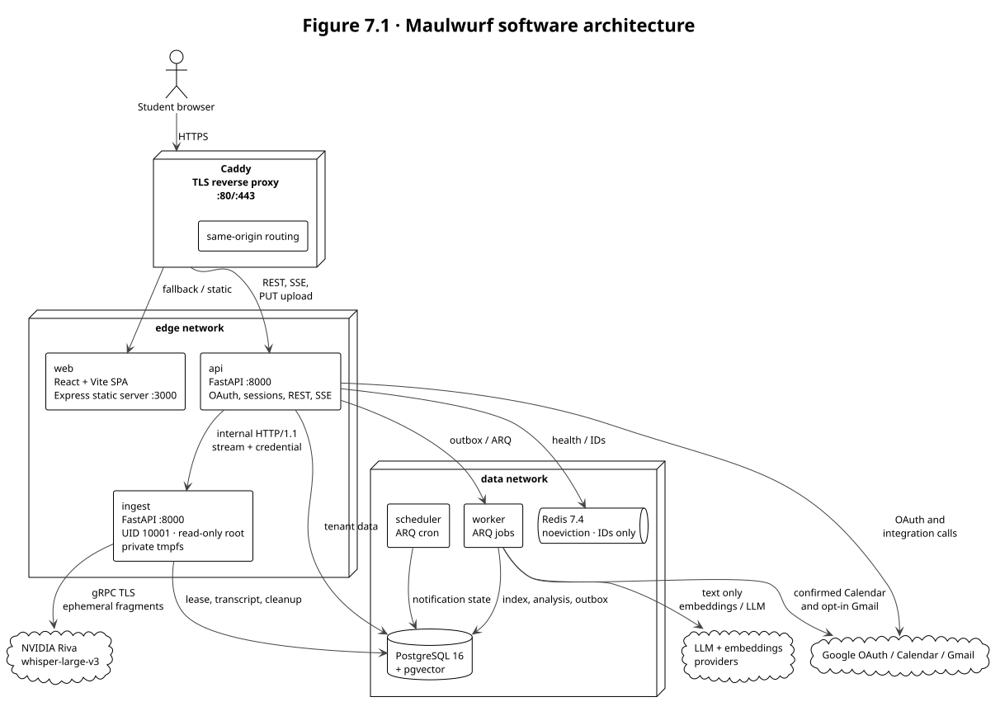
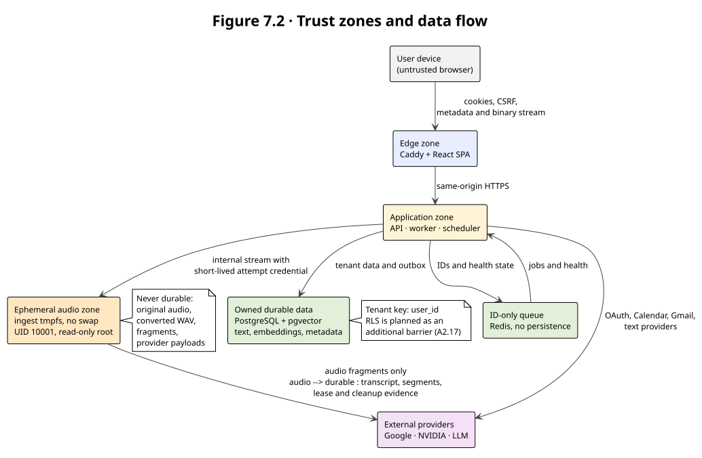

# 7. Architecture Diagram

The architecture follows the accepted decisions in [ADR-0007](../docs/adr/ADR-0007-web-stack.md)
(Vite + React SPA) and [ADR-0008](../docs/adr/ADR-0008-api-ingest-reception.md) (the API
terminates the public `PUT` and streams to the internal ingestion service).

## 7.1 Component and deployment view

| Component | Technology / runtime | Responsibility | Network and data boundary |
|---|---|---|---|
| Caddy | Caddy 2.8, local TLS | Same-origin reverse proxy and no-buffering upload route | Edge; public entry point |
| Web | React 19 + Vite 7 + TypeScript + Express 5 | Static SPA and client-side routes | Edge; no secrets and no server-side private data |
| API | FastAPI + Pydantic v2 + SQLAlchemy async | OAuth, sessions, CSRF, metadata, public REST/SSE and public binary `PUT` | Edge + data; authenticates all browser mutations |
| Ingest | FastAPI, ffmpeg/ffprobe, Riva adapter | Internal streamed reception, bounded tmpfs, ASR, cleanup and fencing | Edge + data; UID 10001; never receives browser cookies |
| PostgreSQL | PostgreSQL 16 + pgvector | Tenant metadata, text, segments, vectors, chat and outbox | Data only; no durable audio |
| Redis | Redis 7.4, `noeviction`, no persistence | IDs, ARQ queue and health state | Data only; never audio or provider payloads |
| Worker | ARQ | Indexing, analysis, Calendar and notification jobs | Data only; works from text and IDs |
| Scheduler | ARQ cron | Bounded reminder and digest scheduling | Data only; one active scheduler role |

### Data flow

1. The browser connects only to Caddy over same-origin HTTPS.
2. Caddy serves the SPA and sends REST/SSE and the binary `PUT` to the API.
3. The API owns session, CSRF, Origin, tenant and pre-byte checks. It streams the binary body
   over internal HTTP/1.1 to `ingest` using the per-attempt credential defined by ADR-0008.
4. `ingest` holds audio only in the attempt's bounded tmpfs, sends fragments to Riva, commits
   text and cleanup evidence, and never puts audio in Redis or an ARQ job.
5. Workers read durable text and IDs from PostgreSQL/outbox. They call LLM, embeddings, Calendar
   and Gmail adapters only according to the confirmation and opt-in rules.

## 7.2 Trust zones

The browser and external providers are outside the application's trust boundary. The API is the
single identity authority. Ingestion is isolated because it handles audio and provider calls;
it accepts only a short-lived internal credential and a fencing token. The durable boundary
contains text and metadata, not audio. PostgreSQL tenant isolation is application-enforced today;
`FORCE ROW LEVEL SECURITY` and `SET LOCAL app.user_id` are planned in A2.17.

## 7.3 Quality and security properties

- **Privacy:** no audio storage key, volume, blob, Redis payload, log, trace or backup is allowed.
- **Backpressure:** each hop streams; `ingest` processes one fragment at a time and rejects over-limit
  input before unbounded memory growth.
- **Failure recovery:** lease, fencing token, cleanup evidence and the outbox gate prevent stale
  workers from publishing text work.
- **Tenant isolation:** composite foreign keys, service-level ownership filters and the planned RLS
  barrier keep users from crossing into one another's data.
- **Provider isolation:** Riva, LLM, embeddings, Google Calendar and Gmail sit behind adapters and
  contract tests; external side effects are bounded and idempotent where the provider permits it.
