# 7. Architecture Diagram

This section describes the architecture of Maulwurf as it exists in the repository, checked against
the `develop` code of 2026-11-24 (`7147401`). It follows the accepted decisions in
[ADR-0005](../docs/adr/ADR-0005-redis.md) (Redis policy),
[ADR-0006](../docs/adr/ADR-0006-aislamiento-tenant.md) (tenant isolation),
[ADR-0007](../docs/adr/ADR-0007-web-stack.md) (Vite + React SPA),
[ADR-0008](../docs/adr/ADR-0008-api-ingest-reception.md) (API terminates the public `PUT` and streams
to ingestion), [ADR-0009](../docs/adr/ADR-0009-run-fencing.md) (run fencing) and
[ADR-0010](../docs/adr/ADR-0010-ingress.md) (Caddy as the only HTTP ingress). The normative contracts
stay in [ESPECIFICACION.md](../docs/ESPECIFICACION.md); the claim registry
[CLAIMS.md](../docs/sprints/CLAIMS.md) is the authority on what is `done`.

Paths in backticks are relative to the repository root.

## 7.1 Overview and architectural style

**Problem.** Students record classes and rarely listen to them again. Maulwurf turns a class
recording into durable **text**, searchable evidence, cited chat answers and reviewable task
proposals, and it writes to Google Calendar or Gmail only after explicit human confirmation or
opt-in. The central privacy contract is that **audio is never stored**: it exists only in a bounded
private `tmpfs` while it is received, transcribed and deleted.

**Style.** A containerised, multi-tenant **modular system with a transactional outbox**:

- **Layered services behind one ingress.** Caddy fronts a static SPA, a FastAPI API and an isolated
  ingestion service. The browser talks only to Caddy over same-origin HTTPS.
- **Isolation by trust zone.** Only `ingest` touches audio and the speech provider; only the API
  derives identity; only the jobs role crosses tenants.
- **Asynchronous work through a transactional outbox.** The API and `ingest` write `outbox_events`
  rows in the same transaction as the business change; a scheduler publishes IDs to Redis; ARQ
  workers do the slow work from persisted text.
- **Adapters at every external boundary.** Riva, LLM, embeddings, Google Calendar and Gmail sit
  behind adapters with bounded retries and fail-closed configuration.

**Principles observed in the code.**

| Principle | Where it shows |
|---|---|
| No durable audio | `apps/ingest/maulwurf_ingest/hardening.py` refuses to serve without a read-only root, tmpfs, no swap and no core dumps; `cleanup.py` verifies deletion before text work is enabled |
| Identity only from the backend | `apps/api/app/core/deps.py` resolves the user from an opaque session; request bodies and LLM output never carry a user |
| Defence in depth for tenants | `user_id` filters and composite keys in services, plus `FORCE ROW LEVEL SECURITY` and per-transaction roles (`apps/api/app/core/db.py`, `apps/ingest/maulwurf_ingest/rls.py`) |
| Fail closed | Missing embedding or LLM settings, an open D3-Texto decision or a missing ingest credential stop the feature instead of using a default |
| Honest outcomes | Typed terminal states (`rejected`, `requires_reupload`, `cancelled`), validated citations and evidence spans, no invented timestamps |
| Bounded everything | Streaming with backpressure, one fragment at a time, retry budgets, per-user quotas and provider budgets |

## 7.2 Architecture diagrams

Sources are D2 files in [`assets/diagrams/`](assets/diagrams/). Each view is split into two figures
so that the text stays legible on a printed page; each `.svg` is compiled with:

```bash
d2 --layout=elk --elk-nodeNodeBetweenLayers=20 --elk-edgeNodeBetweenLayers=15 \
   --theme=1 --pad=40 <name>.d2 <name>.svg
```

Figures 7.1 to 7.3 give the overview. Figures 7.4 to 7.18 zoom into one module or flow each and sit
next to the text they illustrate in §7.3 and §7.4.

### Figure 7.1a · Layers: request path and audio ingestion

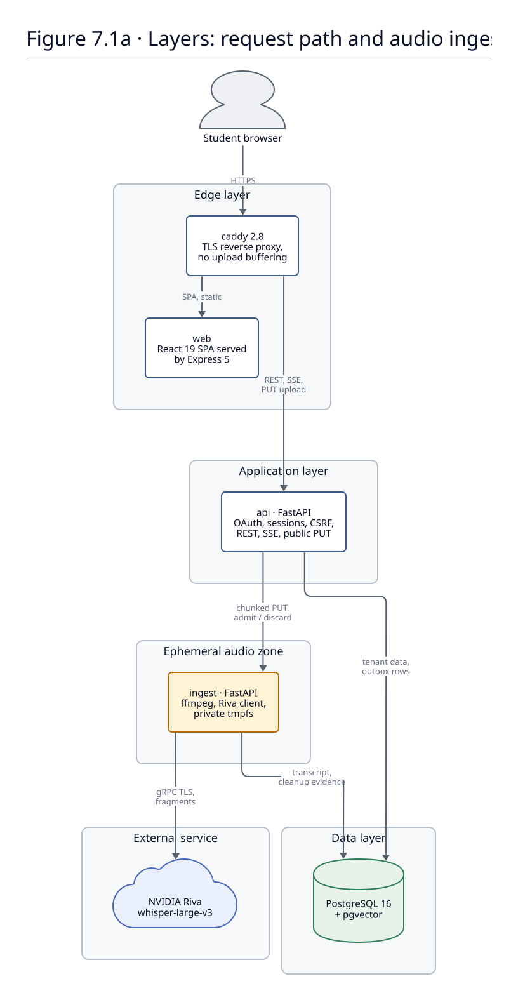

The browser reaches Caddy, which serves the SPA from `web` and forwards REST, SSE and the binary
upload to `api`. The API streams audio to `ingest` (amber, the only place audio exists) and reads
and writes tenant data in PostgreSQL. `ingest` writes the transcript and the cleanup evidence to
PostgreSQL and is the only component that talks to NVIDIA Riva.

### Figure 7.1b · Layers: asynchronous processing and integrations

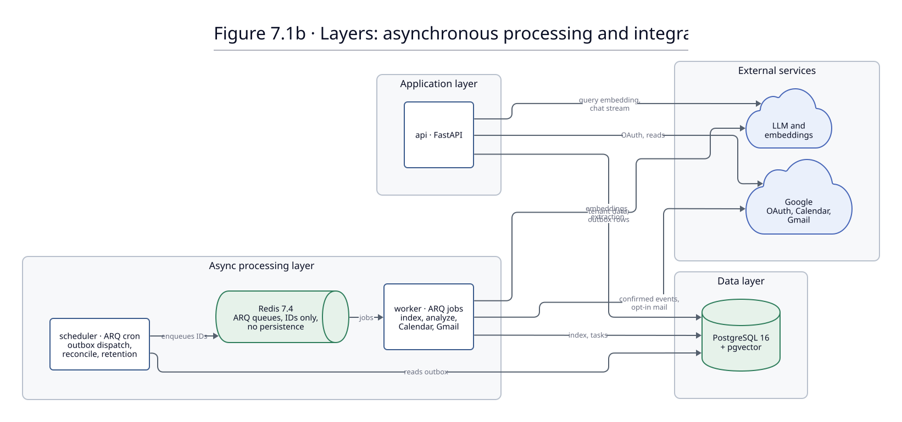

The `scheduler` reads the outbox from PostgreSQL and enqueues IDs in Redis; the `worker` consumes
them, writes indexes and tasks, and is the only component that writes Calendar events or sends
Gmail. `api` and `worker` call the LLM and embeddings gateway; `api` also calls Google for OAuth and
Calendar reads. Redis sits with the async layer because its main role is the ARQ queue; the API
additionally keeps rate-limit counters there (see §7.5).

### Figure 7.2a · Data flow: from upload to stored text

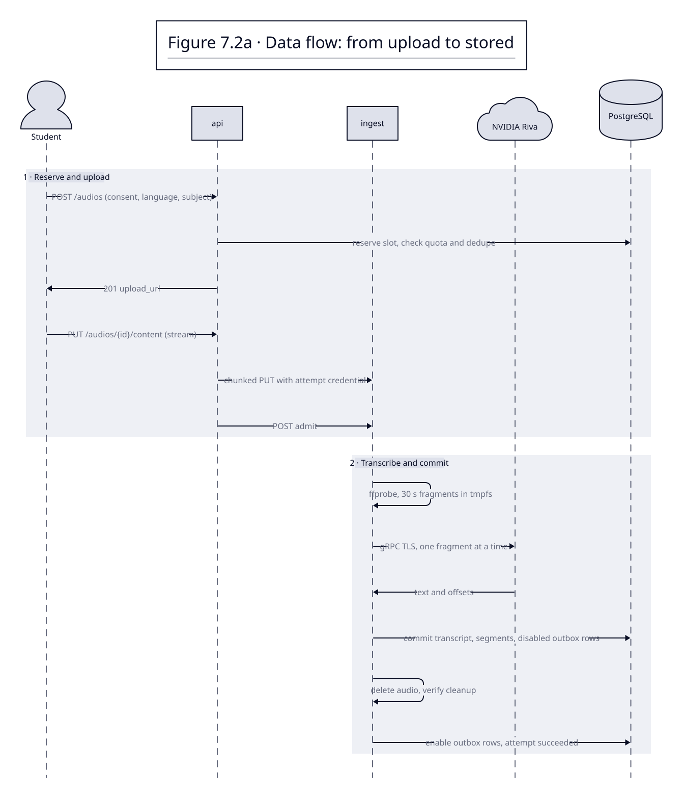

Stages 1 and 2 of §7.4 (flow B): reserve and stream the upload through `api` to `ingest`, then
transcribe with Riva, commit transcript and segments with disabled outbox rows, delete the audio and
verify cleanup. The cleanup verification precedes the enabling of the outbox rows.

### Figure 7.2b · Data flow: from stored text to cited answer and Calendar

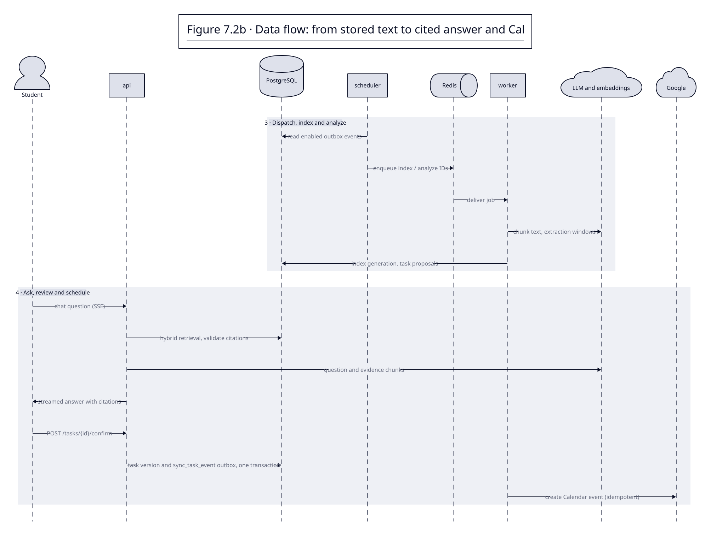

Stages 3 and 4 of §7.4 (flows C to E): the scheduler dispatches the enabled outbox events, the
worker indexes and analyzes the text, the student asks a cited question, and a confirmed task becomes
a Calendar event through a `sync_task_event` outbox row.

### Figure 7.3a · Deployment: Docker Compose networks and services

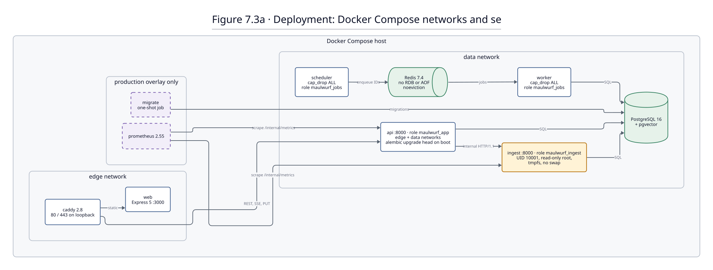

`caddy` and `web` are on the `edge` network; `api` is on both networks; everything else, including
`ingest`, is on the private `data` network and publishes no host port (Redis is published on
loopback in development only). The dashed purple elements exist only in the production compose
(`infra/docker-compose.prod.yml`).

### Figure 7.3b · External integrations and their configuration

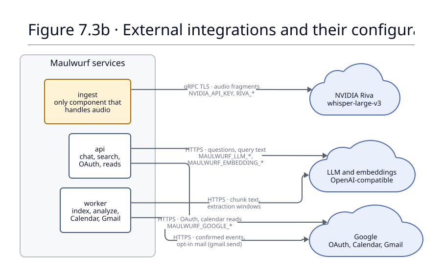

Which service calls which provider, what data it sends and which variables enable the integration.
Only `ingest` sends audio, and only to Riva; text goes only to the LLM and embeddings gateway.

## 7.3 Layers and modules

### 7.3.1 Edge: `infra/Caddyfile` and `infra/deploy/Caddyfile.prod`

| Concern | Behaviour |
|---|---|
| Role | The only HTTP ingress (ADR-0010). `tls internal` locally; the production file serves `{$MAULWURF_DOMAIN}` with HSTS |
| Routing order | `PUT /audios/*/content` → `api` (upload, 1100 MB body limit); `/internal/*` → `404`; SSE routes `/audios/*/progress` and `/chat/conversations/*/messages` → `api` with `flush_interval -1`; the API path allowlist (`/auth/*`, `/me`, `/subjects`, `/integrations/*`, `/audios`, `/ingestion/*`, `/search`, `/chat/*`, `/calendar`, `/tasks`, `/notifications`, `/healthz`, `/readyz`) → `api`; anything else → `web` |
| Limits | 10 MB body on every route except the upload; `read_body` 40m, `read_header` 30s, `write` 0 (SSE), `idle` 5m |
| Hardening | `admin off`, `-Server`, `nosniff`, `X-Frame-Options: DENY`, referrer policy; scanner paths (`/.env`, `/wp-admin`, `*.php`…) answer `404`; OAuth callback paths are skipped in the access log and `code`/`state` query values are redacted |

**Figure 7.4 · Caddy routing**

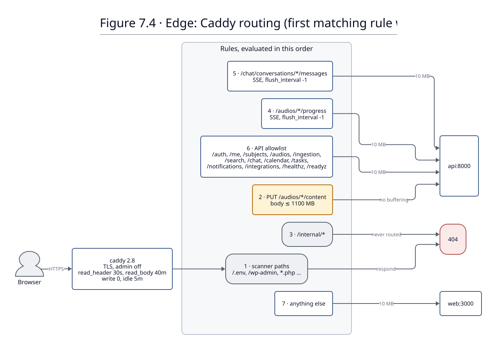

Rules are `handle` blocks in `infra/Caddyfile`; the first match wins, so scanner paths and `/internal/*` are answered with `404` before any proxying, and the upload and the two SSE routes get their own body limits and no buffering.

### 7.3.2 Web: `apps/web`

| Path | Responsibility |
|---|---|
| `apps/web/src/main.tsx`, `src/App.tsx` | SPA entry and React Router 7 route table: `/`, `/login`, `/register`, `/welcome`, `/privacidad`, `/terminos`, `/settings` and the authenticated `/gestion/{subir,biblioteca,biblioteca/:audioId,chat,materias,tareas,agenda}` area; legacy `/biblioteca`, `/chat` and `/materias` redirect there |
| `src/pages/` | One page per route (`SubirClasePage`, `BibliotecaPage`, `TranscriptReaderPage`, `ChatPage`, `MateriasPage`, `TareasPage`, `AgendaPage`, `SettingsPage`, `DashboardPage`, login and legal pages) |
| `src/components/` | Feature components (`auth`, `upload`, `library`, `transcript`, `chat`, `tasks`, `calendar` with FullCalendar, `settings`, `layout`, `ui`, `legal`) |
| `src/lib/` | Typed API client (`api.ts`, `csrf.ts`), upload and progress (`upload.ts`, `audios.ts`, `progress.ts`), SSE with polling fallback (`sse.ts`), chat stream (`chat.ts`, `stream.ts`), plus `auth`, `subjects`, `tasks`, `calendar`, `notifications`, `search` and `capabilities` helpers |
| `src/i18n/`, `src/locales/{es,en,fr}` | i18next translations |
| `src/server/index.ts`, `security.ts` | Express 5 server that serves only `dist/public` and the SPA fallback with security headers; it receives no environment and no secrets |
| `public/sw.js`, `manifest.webmanifest` | PWA shell-only service worker |

There is no server-side rendering: private data is fetched from the API after login. The streaming
upload client (D2.2) and the library (D2.4) are still `in progress` in `CLAIMS.md`.

**Figure 7.5 · SPA structure**

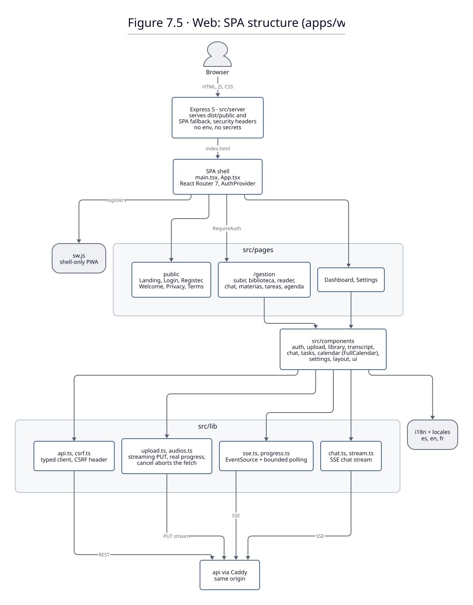

The Express server only delivers static files; every private datum is fetched through `src/lib` from the API on the same origin. `RequireAuth` guards the `/gestion` area.

### 7.3.3 API: `apps/api`

**Process.** `apps/api/app/main.py` assembles the FastAPI app: `RequestIdMiddleware`,
`NoStoreMiddleware` (private responses are `no-store`), the typed error handlers and the routers.
OpenAPI and `/docs` are exposed only when `MAULWURF_ENV=local`. On boot (`apps/api/Dockerfile`) the
container runs `alembic upgrade head` and then Uvicorn; production uses the separate `migrate` job.

**Figure 7.6 · API request pipeline**

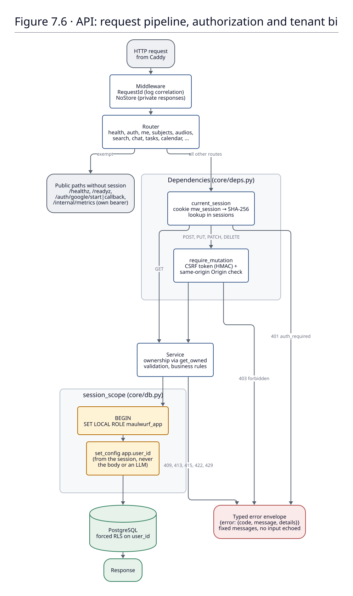

Every private route resolves the user from the session cookie, mutations also pass the CSRF and Origin check, and the service runs inside a transaction that first assumes the `maulwurf_app` role and sets `app.user_id`, so PostgreSQL row-level security applies even if a query forgets a filter.

**Routers** (`apps/api/app/routers/`):

| Router | Endpoints |
|---|---|
| `health.py` | `GET /healthz`, `GET /readyz` (PostgreSQL and Redis) |
| `auth.py` | `GET /auth/google/start`, `GET /auth/google/callback`, `POST /auth/logout` |
| `me.py` | `GET`/`PATCH /me`, `DELETE /me` (account deletion, `202`), `GET /me/deletion/{id}`, `POST /me/deletion/{id}/resume`, `GET`/`PATCH /me/notifications` |
| `subjects.py` | Subject CRUD |
| `ingestion.py` | `GET /ingestion/capabilities` (published limits and languages) |
| `audios.py` | `POST /audios` (reserve), `PUT /audios/{id}/content` (stream), list/detail, `transcript`, `transcript.txt`, `transcript.srt`, `runs`, SSE `progress`, `retry`, `reupload`, `cancel`, `DELETE`, `analysis/backfill` |
| `search.py` | `GET /search` (hybrid retrieval) |
| `chat.py` | Conversations CRUD; `POST /chat/conversations/{id}/messages` (SSE); message `cancel` |
| `tasks.py` | Task list/detail/create/edit; `confirm`, `dismiss`, `complete` |
| `calendar.py` | `GET /calendar/events`, `conflicts`, `calendars`; `POST /calendar/sync`; `GET`/`PUT /calendar/settings` |
| `integrations.py` | `GET /integrations/status`; Google Calendar and Gmail `connect` and `reconnect` |
| `notifications.py` | `GET /notifications`, `POST /notifications/test`, `POST /notifications/{id}/resend` |
| `internal_metrics.py` | `GET /internal/metrics` (Prometheus text, internal network only) |

**Services** (`apps/api/app/services/`, grouped by capability):

| Capability | Modules |
|---|---|
| Identity and credentials | `sessions`, `oauth_google`, `google_tokens`, `tenant` |
| Upload and ingestion client | `audios`, `uploads`, `dedupe`, `limits`, `progress`, `library`, `state_machine`, `ingest_sink`, `ingest_credential` |
| Indexing and retrieval | `chunking`, `embeddings`, `indexing`, `index_job`, `retrieval`, `search`, `search_quota` |
| RAG and chat | `rag`, `chat_prompt`, `chat_stream`, `chat_tools`, `tools`, `conversations`, `citations`, `evidence`, `llm`, `rate_limiter` |
| Analysis and tasks | `analysis`, `analysis_windows`, `analysis_validation`, `date_resolution`, `tasks`, `task_*`, `revisions`, `conflicts` |
| Calendar | `google_calendar`, `calendar_*` (connection, mirror, read, remote, resume, sync, window), `http_retry` |
| Notifications | `notifications`, `reminders`, `digests`, `gmail`, `gmail_templates`, `notification_*`, `scheduler_lease` |
| Outbox and recovery | `outbox`, `outbox_retry`, `outbox_metrics`, `reconciliation`, `runs`, `orphan_sweep`, `generation_cleanup` |
| Lifecycle and cost control | `deletion`, `provider_budget`, `exports` |

**Figure 7.7 · API modules**

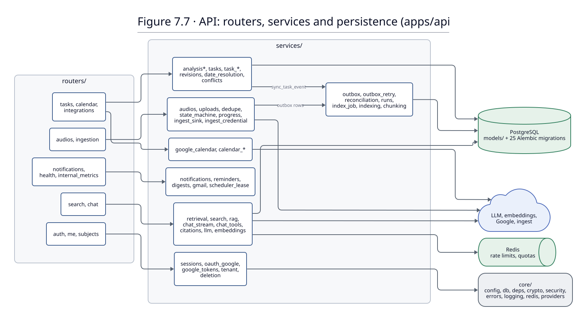

Routers stay thin and delegate to services grouped by capability. Services that change business state write `outbox_events` rows in the same transaction; only the worker side acts on them.

**Workers** (`apps/api/app/workers/`): `arq_app.py` defines `WorkerSettings` (queue `arq:queue`) and
`SchedulerSettings` (queue `arq:scheduler`); `dispatcher.py`, `outbox_delivery.py`,
`outbox_revalidation.py` and `reconciler.py` implement the outbox and recovery; `index_job.py` and
`jobs/{analyze,calendar_sync,deliver_notification}.py` are the jobs.

**Persistence** (`apps/api/app/models/`, `apps/api/alembic/versions/`): 25 migrations
(`0001`–`0025`) create users, sessions, Google credentials, subjects, audios, ingestion attempts,
variant confirmation tokens, transcripts, segments, chunks, embeddings, index generations,
conversations, messages and sources, processing runs, outbox events, tasks with sources, evidence
and revisions, calendar events, notifications, settings, scheduler leases and account deletions.
`apps/api/prompts/v1/` holds the versioned chat, extraction and summary prompts.

**Core** (`apps/api/app/core/`): `config.py` (Pydantic settings, `MAULWURF_*`, `extra="forbid"`,
fail-fast), `db.py` (async engine, per-transaction role and tenant binding), `deps.py` (session,
CSRF, Origin), `crypto.py` (AES-GCM), `security.py` (HMAC-signed OAuth state), `errors.py`,
`logging.py`, `request_context.py`, `redis.py`, `providers.py`, `prometheus.py`,
`cache_control.py`, `validation.py`.

### 7.3.4 Ingestion: `apps/ingest`

`apps/ingest/maulwurf_ingest/main.py` exposes `/healthz`, `/readyz` (hardening, tmpfs, PostgreSQL and
credential checks) and `/internal/metrics`; `receptions.py` adds the internal reception routes. The
package is a running service, not only a library.

**Figure 7.8 · Ingestion modules**

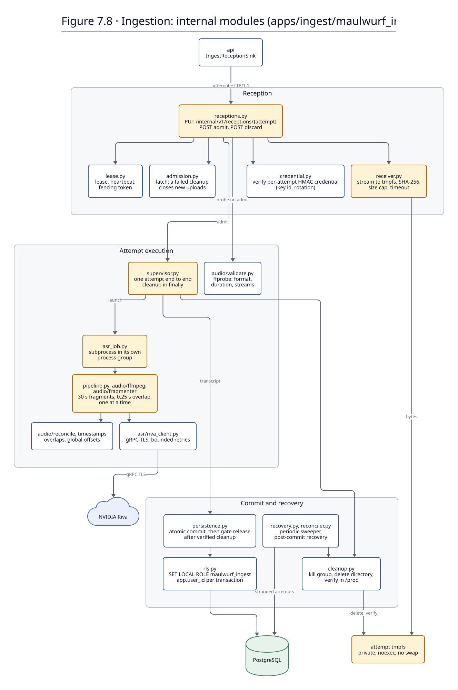

Amber boxes are the parts that touch audio. The supervisor is the single owner of an attempt: it launches the ASR subprocess, hands the transcript to `persistence.py` and always runs `cleanup.py`.

| Module | Responsibility |
|---|---|
| `receptions.py` | `PUT /internal/v1/receptions/{attempt_id}` (stream into the attempt tmpfs), `POST …/admit`, `POST …/discard`; verifies the per-attempt credential |
| `credential.py` | HMAC credential with key id and rotation (`INGEST_CREDENTIAL_*`) |
| `receiver.py`, `admission.py`, `lease.py`, `cancel.py` | Streaming reception with SHA-256 and size cap; instance admission latch; lease, heartbeat and fencing token per attempt; cancellation |
| `supervisor.py`, `asr_job.py` | One attempt end to end: ASR runs in a subprocess in its own process group so it can be killed whole; cleanup in `finally` |
| `audio/validate.py`, `audio/ffmpeg.py`, `audio/limits_exec.py`, `audio/fragmenter.py`, `pipeline.py` | `ffprobe` validation, ffmpeg without shell or network under CPU/memory limits, fragments of up to 30 s with 0.25 s overlap, one active fragment at a time |
| `asr/riva_client.py`, `asr/scripted.py` | gRPC TLS client for NVIDIA Riva (bounded retries with backoff for transient errors: 3 calls by default, 6 in the production ASR job) and a scripted transport for tests |
| `audio/reconcile.py`, `audio/timestamps.py` | Boundary and overlap reconciliation, global offsets |
| `persistence.py` | One transaction writes transcript, segments and **disabled** `index`/`analyze` outbox rows; after verified cleanup a second transaction enables them |
| `cleanup.py`, `recovery.py`, `reconciler.py`, `audio_absence.py` | Delete the attempt directory and verify it in `/proc`; periodic sweeper and post-commit recovery; the audio-absence sweep used by tests |
| `rls.py` | Per-transaction `SET LOCAL ROLE maulwurf_ingest` and `app.user_id` |
| `hardening.py`, `capacity.py`, `capabilities.py`, `config.py` | Startup self-check, RAM budget per slot, observed capabilities, `INGEST_*` settings |
| `metrics.py`, `logs.py`, `request_context.py` | Prometheus text, redacted JSON logs, request correlation |

**Figure 7.9 · Ingestion attempt states**

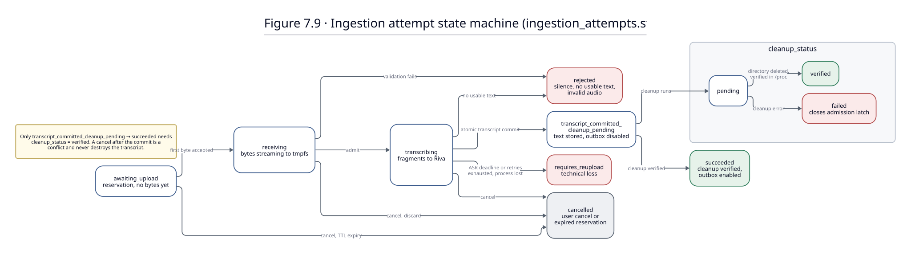

`transcript_committed_cleanup_pending` is never exposed as success: only a verified cleanup moves the attempt to `succeeded` and enables the outbox rows. Final states are absorbing.

## 7.4 End-to-end flows

### A. Sign in

1. The SPA calls `GET /auth/google/start`; the API signs `state`, `nonce` and the PKCE verifier into a
   short-lived cookie and redirects to Google.
2. `GET /auth/google/callback` verifies the cookie and the ID token, stores the Google credential
   encrypted with AES-GCM (`google_credentials`) and issues the opaque `mw_session` cookie
   (`Secure`, `HttpOnly`, `SameSite=Lax`; only its SHA-256 is stored).
3. `GET /me` returns the profile and a CSRF token derived from the session by HMAC; every mutation
   must send that token and a same-origin `Origin`.

**Figure 7.10 · Sign-in with Google**

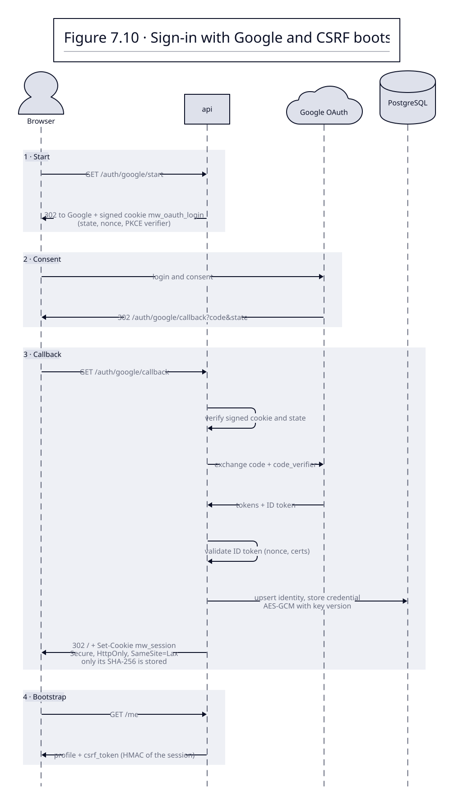

Calendar and Gmail consent reuse the same callback through separate signed cookies (`mw_oauth_calendar`, `mw_oauth_gmail`) and Calendar consent requires a live session of the same user.

### B. Upload, transcription and cleanup

1. `POST /audios` validates consent version, language (explicit selection), subject, class date and
   timezone; reserves an ingestion slot and quota; deduplicates by SHA-256, language, subject, date and
   timezone; returns `201` with the upload URL. The reservation expires after
   `MAULWURF_UPLOAD_TTL_MINUTES` (15 by default).
2. `PUT /audios/{id}/content` reaches `api` through Caddy without buffering. `services/uploads.py`
   streams the body to `IngestReceptionSink` (`services/ingest_sink.py`), which sends a chunked
   `PUT /internal/v1/receptions/{attempt}` to `ingest` with a 30 s credential. A one-item queue makes
   TCP backpressure reach the browser; nothing touches the API disk. Without
   `MAULWURF_INGEST_URL` and the credential the API uses `UnavailableReceptionSink` and answers `503`.
3. `ingest` writes the bytes to the attempt's private tmpfs, computing SHA-256 and enforcing the size
   cap, and holds the attempt. The API then calls `POST …/admit` (or `…/discard`).
4. On admit, `supervisor.py` takes the lease, runs `ffprobe`, and starts `asr_job` in its own process
   group. The job cuts one fragment at a time, sends it to Riva over gRPC TLS and reconciles overlaps
   into one transcript with global offsets.
5. `persistence.py` commits transcript, segments and disabled outbox rows in one transaction and
   moves the attempt to `transcript_committed_cleanup_pending`; a lost fencing token rolls it back.
6. `cleanup.py` kills the process group, deletes the directory and verifies it. Only then does a second
   transaction enable the outbox rows and move the attempt to `succeeded`. A crash in between is
   repaired by `reconciler.py` and the sweeper; a lost upload requires a new upload.
7. The browser follows `GET /audios/{id}/progress` (SSE, with polling fallback) for per-stage state.

Attempt states: `awaiting_upload → receiving → transcribing → transcript_committed_cleanup_pending →
succeeded`, with typed finals `requires_reupload`, `rejected` and `cancelled`
(`apps/api/app/services/state_machine.py`).

The sequence of flow B is Figure 7.2a, the module view is Figure 7.8 and the state machine is Figure 7.9.

### C. Outbox, indexing and analysis

1. The `scheduler` cron `dispatch_outbox` runs every minute. `workers/dispatcher.py` takes a batch of
   up to 100 events with `FOR UPDATE SKIP LOCKED`, applies the publication policy
   (`services/outbox.py`: `index_requested` and `analyze_requested` are gated by verified cleanup) and
   enqueues only IDs in Redis queue `arq:queue`.
2. `index` (`workers/index_job.py`) first applies the D3-Texto gate: real class text is indexed only for
   models listed in `MAULWURF_D3_TEXT_CLOSED_MODELS`, empty by default, so the job is a no-op until the
   decision is closed. When open, it claims a fenced `processing_runs` row, splits the transcript into
   chunks (about 800 tokens, 100 overlap, `services/chunking.py`), embeds them in batches
   through the embeddings gateway into `embeddings` (`vector(1536)`) and activates the new index
   generation in one transaction. It retries transient errors only (4 tries, 600 s timeout).
3. `analyze` (`workers/jobs/analyze.py`) plans bounded sentence-aligned windows (at most
   `MAULWURF_ANALYSIS_MAX_WINDOWS`, 24 by default), asks the LLM for structured proposals with the
   `prompts/v1` templates, validates every date and evidence span against the persisted transcript and
   writes summary, topics and task proposals in one transaction. Without a configured LLM it fails
   the run and writes no tasks.
4. `reconcile` (every 5 minutes) repairs lost dispatches, dead runs and orphan generations from the
   database, so a lost Redis queue loses nothing.

**Figure 7.11 · Transactional outbox**

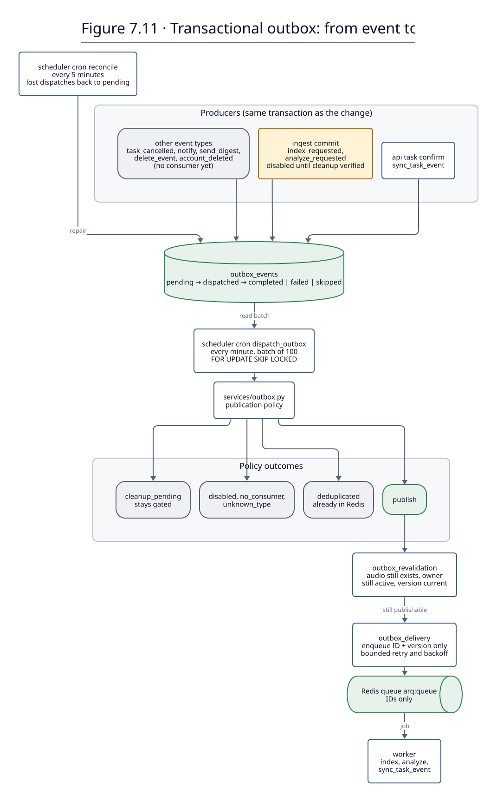

The dispatcher never trusts the queue: it applies the publication policy and revalidates the event right before enqueueing IDs, and the reconciler returns lost dispatches to `pending`.

**Figure 7.12 · Job `index`**

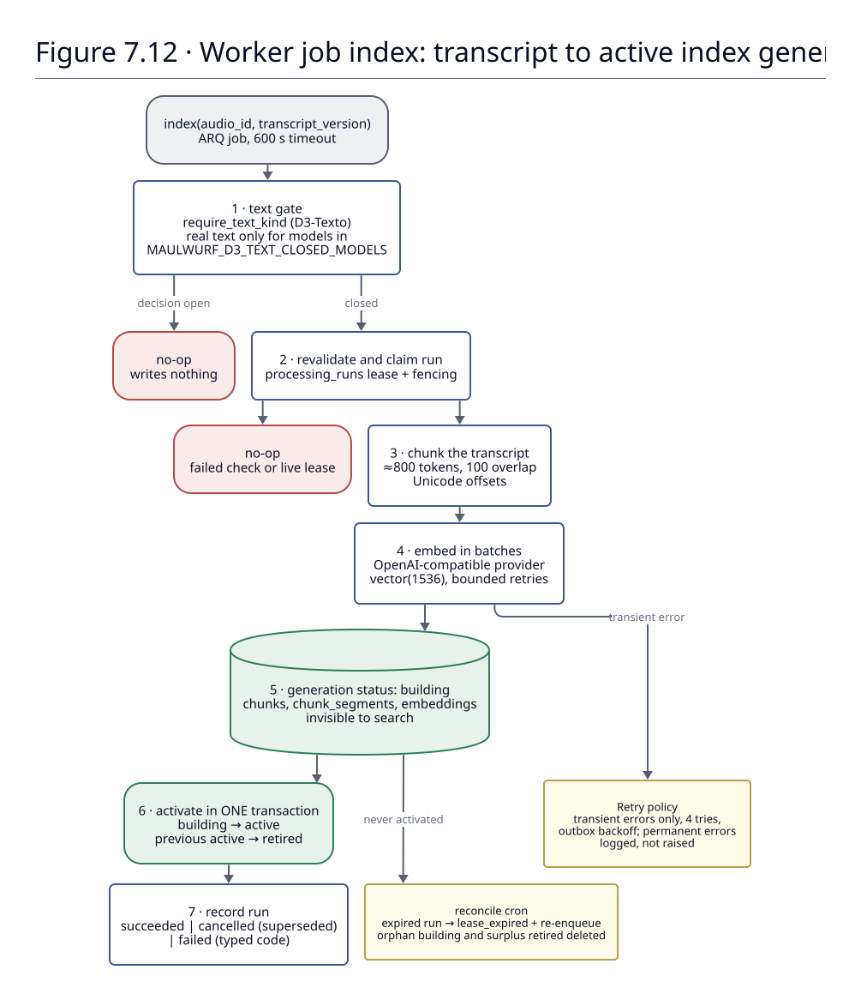

The new generation stays invisible (`building`) until one transaction activates it, so search never mixes vectors of two models or versions.

**Figure 7.13 · Job `analyze`**

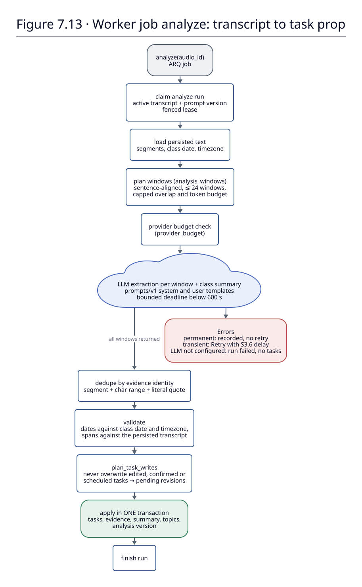

Nothing is written until every window and the summary have returned; edited, confirmed or scheduled tasks are never overwritten.

### D. Search and cited chat

1. `GET /search` embeds the query (after a per-user quota check in Redis), runs lexical
   (`ts_rank_cd` on `chunks.tsv`) and vector (cosine) branches filtered by tenant and active
   generation, and fuses them with RRF (`services/retrieval.py`, k = 60).
2. `POST /chat/conversations/{id}/messages` opens an SSE stream. `chat_prompt.py` builds the prompt from
   `prompts/v1/chat_system.txt` and retrieved evidence; `llm.py` streams the answer. At most two
   concurrent streams per user (Redis Lua limiter) and a 300 s ceiling per stream.
3. The model may call three tools through a JSON protocol (`services/chat_tools.py`):
   `get_calendar_events`, `get_pending_tasks` and `propose_task`. The last one only creates an inbox
   proposal. Tool results are data, never instructions.
4. `citations.py` and `evidence.py` validate every cited segment ID and span against PostgreSQL for the
   authenticated tenant; without enough evidence the assistant says so.

**Figure 7.14 · Cited chat**

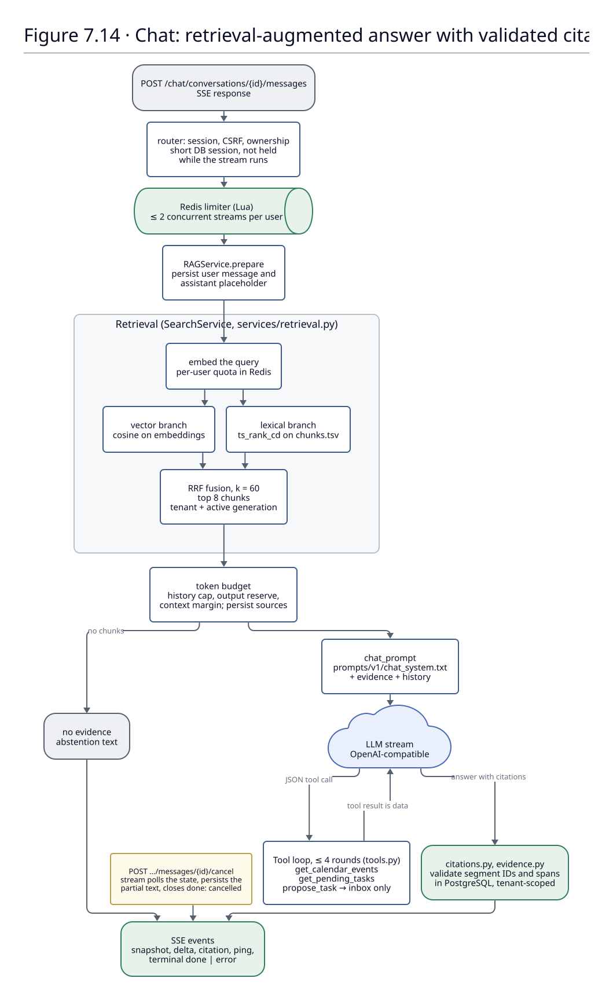

The database session is released before streaming starts; citations are validated against PostgreSQL after generation, and a cancel is cooperative and durable.

### E. Task review and Calendar

1. The student reviews proposals (`GET /tasks`, `PATCH /tasks/{id}`); editing a confirmed task creates a
   pending revision and uses an optimistic `version`.
2. `POST /tasks/{id}/confirm` validates date, Calendar block and evidence, bumps the version and, in the
   same transaction, creates or reuses one `sync_task_event` outbox row. Without a ready Calendar
   integration the task is confirmed but `calendar_sync_status='blocked'` and nothing is written.
3. The dispatcher publishes it; the `worker` job `sync_task_event` (4 tries) writes the event through
   `services/google_calendar.py` with bounded, jittered retries, `Retry-After` handling, `If-Match` ETags
   and `invalid_grant` handling that disconnects the credential. A `412` becomes an external conflict
   for review instead of an overwrite.
4. Dismissing or completing a task cancels unsent reminders and keeps the linked event with a notice.

**Figure 7.15 · Task lifecycle**

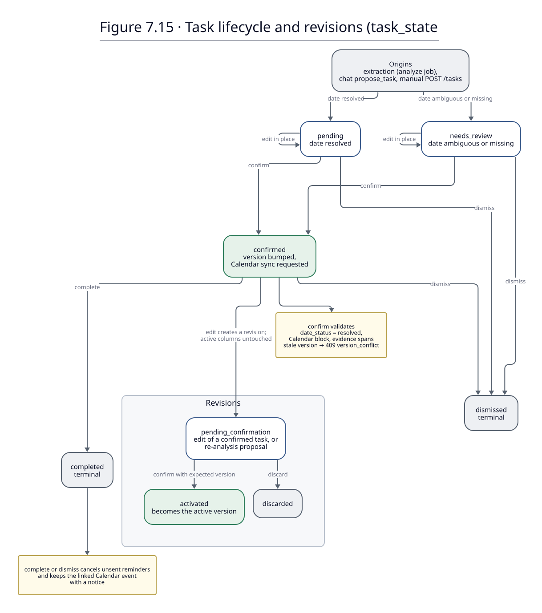

The transition table in `apps/api/app/services/task_state.py` is the single authority; `completed` and `dismissed` are terminal, and editing a confirmed task never touches the active version until the revision is confirmed.

**Figure 7.16 · Calendar sync**

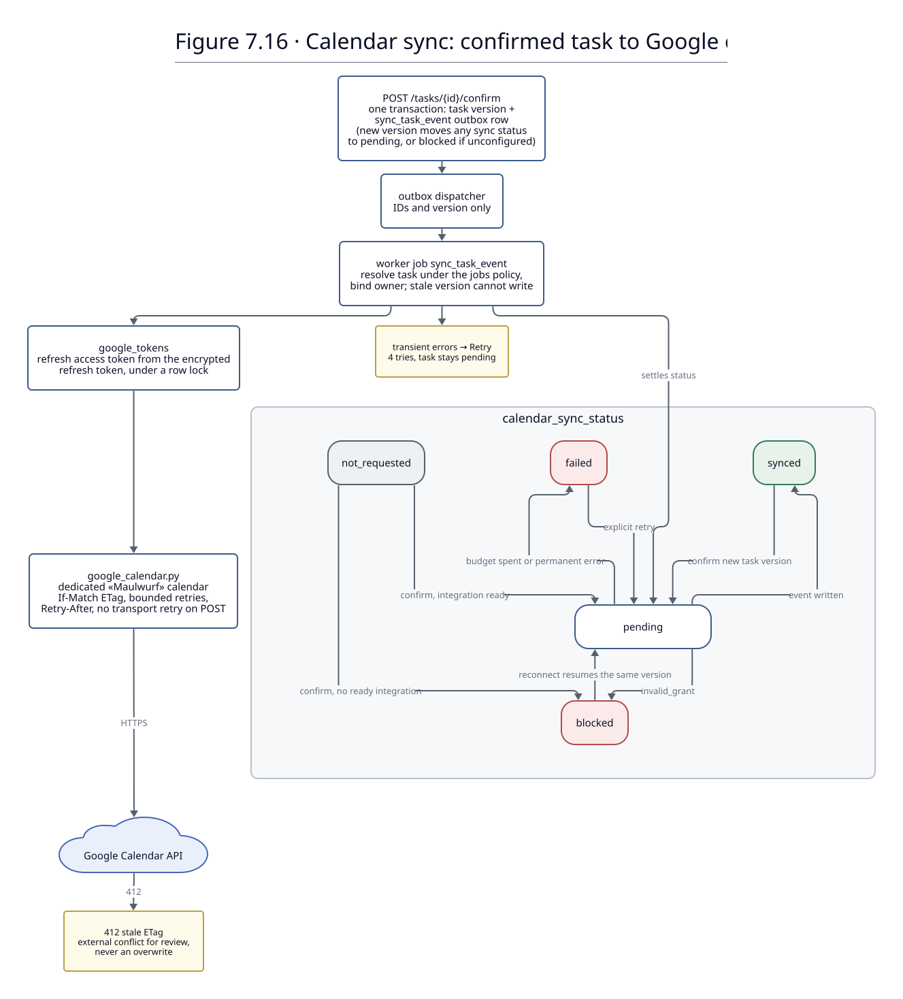

The Calendar status is independent of the task status. A job enqueued for an older task version can no longer write, and a revoked grant leaves the task `blocked` until reconnect.

### F. Reminders and digests

1. `schedule_notifications` (every minute) elects one scheduler role through `scheduler_leases`, claims
   due `notifications` and enqueues `deliver_notification`; `materialize_digests` creates the next
   daily or weekly digest occurrence.
2. `deliver_notification` (one attempt only) re-checks the fence, the opt-in, the verified email, the
   `gmail.send` scope and task currency before one Gmail call. A 2xx succeeds; a 4xx is `failed`; a
   timeout or 5xx is `delivery_unknown` and is never resent automatically.
3. Both crons are off by default: `MAULWURF_NOTIFICATION_SCHEDULER_ENABLED` and
   `MAULWURF_NOTIFICATION_DELIVERY_ENABLED` are `false`.

**Figure 7.17 · Reminders and digests**

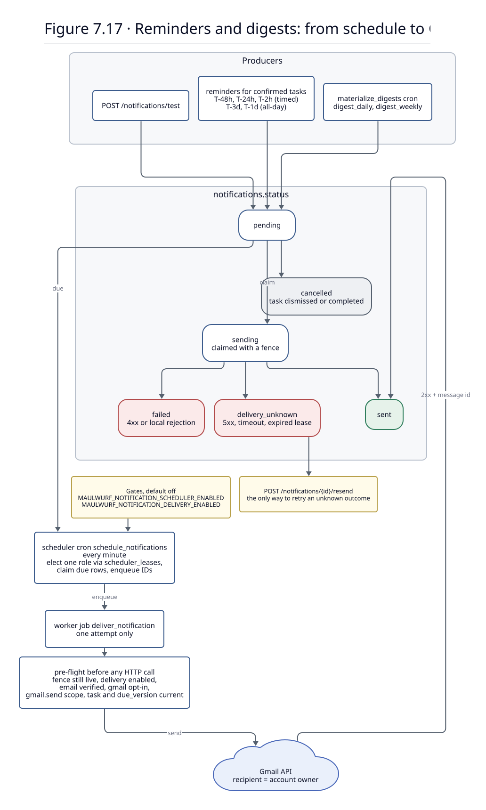

Delivery is one attempt only. An unknown outcome (`delivery_unknown`) is never resent automatically; only an explicit resend does it.

### G. Account deletion and retention

`DELETE /me` (`services/deletion.py`) applies a tombstone in one transaction (blocks the account,
revokes other sessions, creates `account_deletions`), then runs authorised Google deletions while the
encrypted credential still exists, and finally purges tenant data, profile and tokens. It is resumable
through `POST /me/deletion/{id}/resume`. The hourly `purge_residuals` cron deletes expired residual
rows in bounded batches.

**Figure 7.18 · Account deletion**

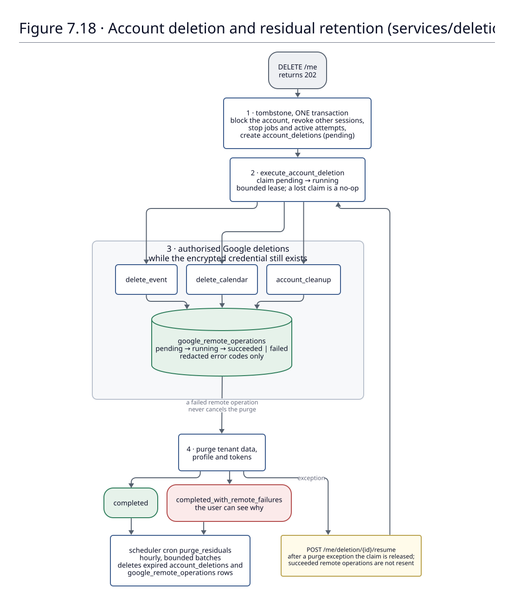

The deletion is observable and resumable; a failed remote operation is recorded but never cancels the purge of local data.

## 7.5 Integrations, storage and configuration

### 7.5.1 Storage

| Store | Contents | Rules |
|---|---|---|
| PostgreSQL 16 + pgvector | All tenant metadata, transcripts, segments, chunks, `vector(1536)` embeddings, chat, tasks, calendar mirror, notifications, outbox, runs, leases, residual deletion rows | Forced RLS; runtime roles `maulwurf_app` (API), `maulwurf_jobs` (worker, scheduler) and `maulwurf_ingest` (ingest); no audio; Google tokens only encrypted |
| Redis 7.4 | ARQ queues (`arq:queue`, `arq:scheduler`) and health keys, per-user chat-stream limiter, search-quota counters | No RDB/AOF, `noeviction`, IDs and counters only (ADR-0005) |
| `ingest` tmpfs | Audio, normalized audio and fragments of the active attempt | `noexec,nosuid,nodev`, no swap, deleted and verified per attempt, never a volume |

### 7.5.2 External integrations

| Service | Used by | Protocol and configuration | Data it receives |
|---|---|---|---|
| NVIDIA Riva (`whisper-large-v3`) | `ingest` | gRPC TLS; `NVIDIA_API_KEY`, `RIVA_SERVER`, `RIVA_FUNCTION_ID`, `RIVA_USE_SSL`, `RIVA_MAX_MESSAGE_LENGTH` | Audio fragments only. Real class audio stays blocked until D3-Audio closes |
| LLM | `api` (chat), `worker` (analysis) | OpenAI-compatible HTTP (`MAULWURF_LLM_BASE_URL`, `_API_KEY`, `_MODEL`, `_MODEL_WINDOW`) | Text and questions, never audio or credentials |
| Embeddings | `api` (query), `worker` (index) | OpenAI-compatible HTTP (`MAULWURF_EMBEDDING_*`); dimension fixed at 1536 by the schema | Chunk text and queries |
| Google OAuth, Calendar, Gmail | `api` (login, reads), `worker` (writes, mail) | HTTPS; `MAULWURF_GOOGLE_CLIENT_ID/SECRET`; scopes `calendar.app.created`, `calendar.events.readonly`, `calendar.calendarlist.readonly`, `gmail.send` | Confirmed events; opt-in mail to the account owner |

### 7.5.3 Key configuration

| Variable | Used by | Purpose |
|---|---|---|
| `MAULWURF_ENV`, `MAULWURF_PUBLIC_ORIGIN` | API | Environment and same-origin Origin check |
| `MAULWURF_SECRET_KEY`, `MAULWURF_OAUTH_STATE_SECRET`, `MAULWURF_ENCRYPTION_KEY` (+ `_VERSION`, `PREVIOUS_*`) | API, jobs | Session/CSRF derivation, OAuth state signing, AES-GCM with key rotation; required, never defaulted |
| `MAULWURF_DATABASE_URL`, `MAULWURF_DATABASE_ROLE`, `MAULWURF_REDIS_URL` | API, jobs, ingest | Connections and the runtime role to assume |
| `MAULWURF_SESSION_TTL_HOURS` (168) | API | Session lifetime |
| `MAULWURF_INGEST_URL`, `MAULWURF_INGEST_CREDENTIAL_SECRET`/`_KID` | API | Enable the reception sink; must be set together |
| `INGEST_CREDENTIAL_SECRET`, `INGEST_MAX_UPLOAD_BYTES`, `INGEST_SLOTS`, `INGEST_RECEPTION_TIMEOUT_S`, `INGEST_FRAGMENT_SECONDS`, `INGEST_FRAGMENT_OVERLAP_S`, `INGEST_TMPFS_BYTES` | ingest, compose | Credential and provisional capacity limits (pending decision D4) |
| `MAULWURF_NOTIFICATION_SCHEDULER_ENABLED`, `MAULWURF_NOTIFICATION_DELIVERY_ENABLED` | scheduler, worker | Gates for reminders and digests (default off) |
| `MAULWURF_D3_TEXT_CLOSED_MODELS` | worker | Models for which real-text indexing is allowed |
| `MAULWURF_BUDGET_LLM_TOKENS`, `_ASR_MINUTES`, `_GOOGLE_OPERATIONS` | API, jobs | Monthly provider budgets exported as metrics |
| `MAULWURF_METRICS_TOKEN`, `INGEST_METRICS_TOKEN` | API, ingest | Bearer for `/internal/metrics` outside `local` |

`.env.example` documents the names; `.env` is never committed. Settings validators reject partial
pairs (URL without key), secret reuse between roles outside `local`, and mismatched upload limits.

### 7.5.4 State

State lives only in PostgreSQL: attempt and stage state machines (`ingestion_attempts`,
`processing_runs`), index generations (`building` → active), task versions and revisions, outbox rows
and leases. Processes are stateless; Redis can be lost and rebuilt. The SPA keeps only UI state and
the CSRF token in memory.

## 7.6 Cross-cutting concerns

| Concern | Implementation |
|---|---|
| Authentication | Google OIDC with state, nonce and PKCE in signed cookies (`core/security.py`); opaque `mw_session` with only its SHA-256 stored (`services/sessions.py`) |
| CSRF and Origin | HMAC-derived token compared in constant time; same-origin `Origin` required on every mutation (`core/deps.py`); rotating the secret leaves sessions read-only (fail closed) |
| Authorisation and tenancy | Every router depends on an authenticated session; `services/tenant.py` `get_owned`; composite `(user_id, id)` keys; forced RLS with `SET LOCAL ROLE` and `app.user_id`; explicit `app.cross_tenant` switch only for the jobs role; ingest has a narrow policy on `ingestion_attempts` |
| Secrets at rest | AES-GCM with a nonce per blob and AAD bound to user, field and key version (`core/crypto.py`); previous key accepted for rotation |
| Ingest trust | Per-attempt HMAC credential with a 30 s TTL (not longer than the lease); `/internal/*` is never routed by Caddy |
| Error handling | One typed envelope `{"error": {code, message, details}}` (`core/errors.py`); fixed messages that never echo input; `409 invalid_transition`, `413`, `415`, `422`, `429` with `Retry-After`; provider errors map to `provider_unavailable`; jobs record permanent errors and raise `Retry` only for transient ones |
| Resilience | Outbox with retry and backoff, lease plus fencing (ADR-0009), reconciler, idempotent jobs, bounded provider retries with jitter, `invalid_grant` handling |
| Rate limits and budgets | Per-user chat streams (2) and search quota; per-minute auth and integration limits; monthly provider budgets with a warning ratio |
| Logging | Structured JSON with `request_id`, `audio_id`, `attempt_id`, `run_id`; a redaction filter removes tokens, cookies, prompts and transcripts; workers log error types only |
| Observability | `GET /internal/metrics` on `api` and `ingest` (outbox lag, cleanup/admission, budgets) scraped by Prometheus in production; alert rules in `infra/alerting/maulwurf.rules.yml`; runbooks in `docs/runbooks/` |
| Deployment | `infra/docker-compose.yml` (8 services, digest-pinned images, healthchecks), `infra/docker-compose.e2e.yml` (deterministic Riva and provider doubles), `infra/docker-compose.prod.yml` (registry images, `migrate` job, Prometheus, Redis password, larger ingest tmpfs) |
| CI | `.github/workflows/quality.yml`: Ruff and mypy, unit tests, web lint/typecheck/test/build, integration tests with PostgreSQL and Redis, image builds, secret and license scans, compose and Caddy limit checks, the E2E smoke and the documentation reference check |

## 7.7 Implementation status and open gates

| Capability | State |
|---|---|
| Eight-service stack, Caddy edge limits, healthchecks, CI | Implemented |
| Sessions, CSRF, Google login, subjects, `me`, account deletion | Implemented |
| Reception, admission, supervisor, lease, cleanup, recovery, atomic transcript commit | Implemented in `ingest`; off by default in the local stack (the sink answers `503` until the ingest URL and credential are set) |
| Riva client | Implemented; exercised in CI only against the deterministic double; real class recordings stay blocked by D3-Audio |
| Outbox dispatcher, reconciler, hybrid search, cited chat | Implemented |
| Real-text indexing | Closed by default until D3-Texto is recorded for the embedding model |
| Analysis, tasks, review, Calendar sync | Implemented; Calendar is written only after explicit confirmation |
| Reminders, digests, Gmail | Implemented; scheduler and delivery are disabled by default |
| Web SPA | Present; streaming upload (D2.2) and library (D2.4) still `in progress` |
| Reference production stack and alerting | Merged, `in progress` (J4.7, J4.8) |

The open gates D2, D3-Audio, D3-Texto, D4 and D6 are tracked in
[PLAN_IMPLEMENTACION.md](../docs/PLAN_IMPLEMENTACION.md). Until they close, no real class recording is
accepted and the system runs on synthetic data and deterministic doubles.
