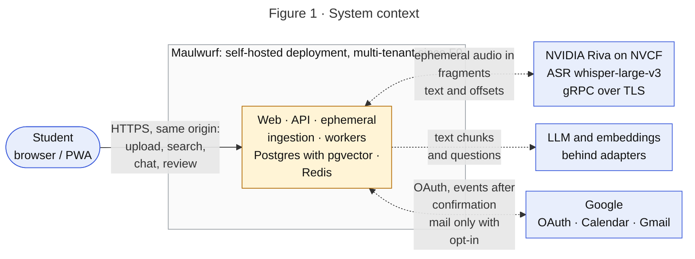
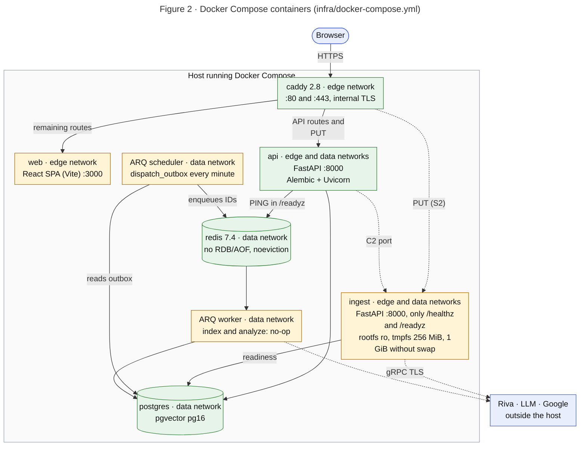
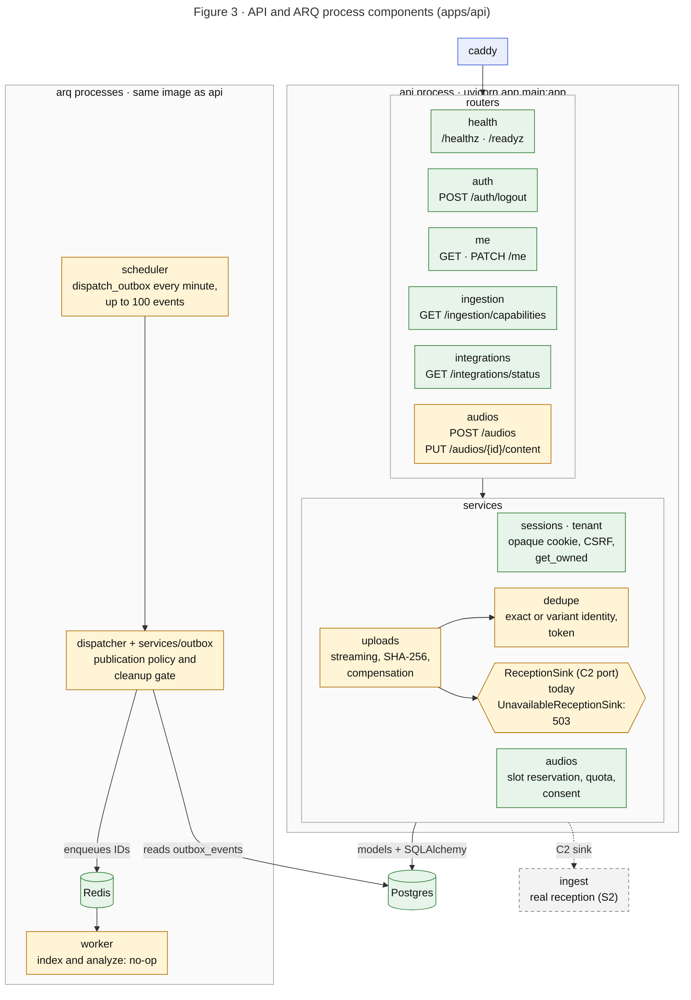
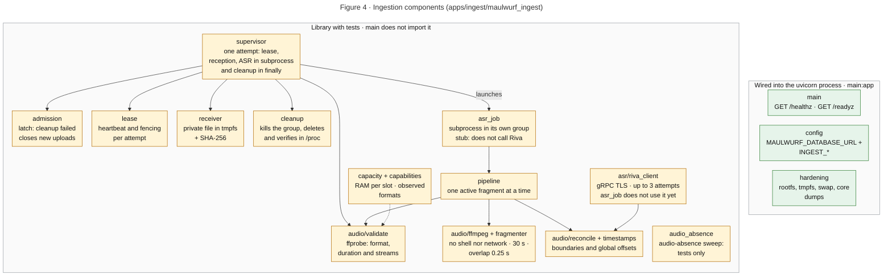
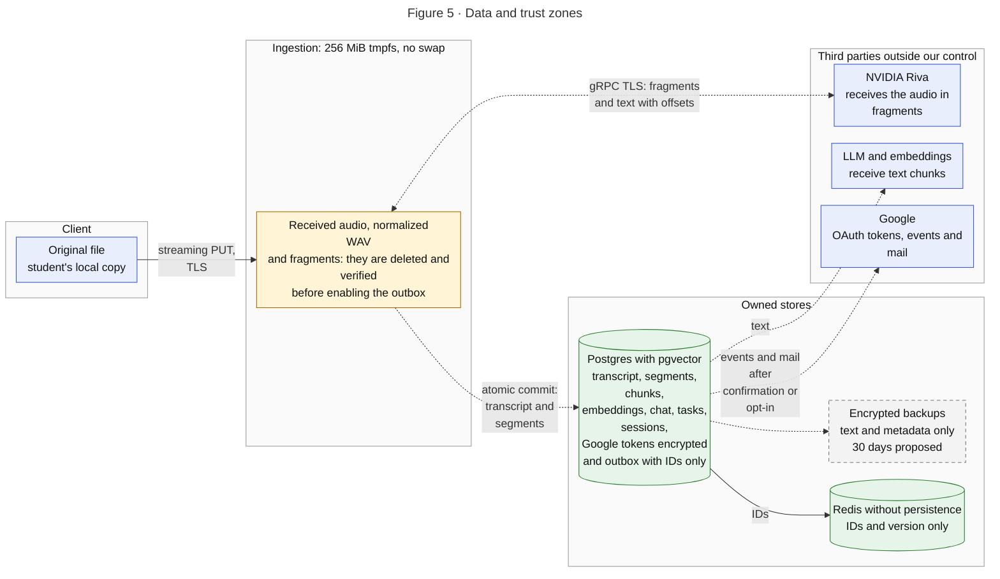

# System Architecture — Maulwurf

> **Status:** architecture view derived from [ESPECIFICACION.md](ESPECIFICACION.md), which is the
> normative source, and contrasted with the `develop` code at `44b576a` (2026-10-31). It creates
> no contracts: on any difference, the specification and the
> [implementation plan](PLAN_IMPLEMENTACION.md) prevail. Step-by-step flows are in
> [PROCESOS.md](PROCESOS.md).

The target architecture and the built one **still do not match**. S1 left a solid foundation
(Compose stack, schema, sessions, hardened ingestion as a library) and S2 is underway, but no
end-to-end flow exists. Each diagram marks what is implemented, what is partial, and what
remains planned.

## 1. How to Read the Diagrams

| Style | Meaning |
|---|---|
| Green fill, solid border | Implemented and wired into a process that runs |
| Amber fill | Exists in the code (endpoint or library with tests) but does not work end to end |
| Gray fill, dashed border | Specified or planned only |
| Blue fill | Actor or system outside the repository |
| Dashed line | Planned flow or not yet wired |

Each figure is exported to SVG in [diagrams/](diagrams/) (see §8). The status tables in
§4–§6 are the authoritative text when a figure's colors lag behind the code.

| Fig. | Diagram | SVG |
|---|---|---|
| 1 | System context | [arq-01-contexto.svg](diagrams/arq-01-contexto.svg) |
| 2 | Docker Compose containers | [arq-02-contenedores.svg](diagrams/arq-02-contenedores.svg) |
| 3 | API and ARQ process components | [arq-03-componentes-api.svg](diagrams/arq-03-componentes-api.svg) |
| 4 | Ingestion components | [arq-04-componentes-ingesta.svg](diagrams/arq-04-componentes-ingesta.svg) |
| 5 | Data and trust zones | [arq-05-zonas-de-confianza.svg](diagrams/arq-05-zonas-de-confianza.svg) |

## 2. System Context

<!-- svg: arq-01-contexto -->


Today Google OAuth is wired (A1.3). The Riva client exists behind a scripted transport and no
automated test opens a real NVIDIA channel; LLM and embedding adapters are implemented but CI
does not call a real provider.

| System | What it exchanges | Guarantees and limits | Status |
|---|---|---|---|
| Student | Uploads audio with chosen language and consent; consults, reviews and confirms | Every Calendar write requires explicit confirmation | API partial; the web SPA has login, subjects and upload-form pieces, without an end-to-end upload flow |
| NVIDIA Riva | Receives audio in fragments and returns text and offsets | `grpc.nvcf.nvidia.com:443`, `whisper-large-v3`, transcription only (never `task:translate`). Retention and region unverified: D3-Audio `blocked`; D2 contract `pending` | Client with a scripted transport (S2.4/S2.10); no real channel in CI |
| LLM and embeddings | Receive text chunks and questions | Provisional: `gpt-4o-mini` via LiteLLM and `text-embedding-3-small` (1536 dimensions). D3-Text is closed per provider and model before the first real transcript | Adapters and API-side search/chat (L2.x); real calls only in protected `P-*` tests |
| Google | OAuth login, Calendar events, mail via Gmail | Tokens only in the backend, encrypted with AES-GCM. Gmail is opt-in and only writes to the verified email | OAuth login implemented (A1.3); Calendar and Gmail planned for S3–S4 |

## 3. Containers

<!-- svg: arq-02-contenedores -->


| Service | Image or build | Networks | Exposed | Limits and hardening | Runs |
|---|---|---|---|---|---|
| `caddy` | `caddy:2.8-alpine` (pinned digest) | edge | 80 and 443 on the host (configurable) | Read-only Caddyfile, admin API disabled; upload `request_body` 220 MB and 10 MB on every other proxying route (JSON, SSE progress, web fallback); `read_body` 20m, `read_header` 30s, `write` 0 (SSE), `idle` 5m (ADR-0010); no healthcheck | Reverse proxy with internal TLS (`https://localhost`) |
| `web` | `apps/web` → `maulwurf-web:local` | edge | 3000, internal only | `USER node` | `node dist/server/index.js` (Express serving the Vite build, ADR-0007) |
| `api` | `apps/api` → `maulwurf-api:local` | edge, data | 8000, internal only | UID 10001 in the Dockerfile; compose adds no `read_only` nor `cap_drop` | Alembic migration and Uvicorn |
| `ingest` | `apps/ingest`, target `runtime` | edge, data | 8000, internal only | UID 10001, `read_only` rootfs, 256 MiB tmpfs at `/work/tmp` (`noexec,nosuid,nodev`), `cap_drop: ALL`, `no-new-privileges`, 1 GiB of RAM without swap, 2 CPU, 128 PIDs | Uvicorn `maulwurf_ingest.main:app` |
| `worker` | `api` image | data | — | `cap_drop: ALL`, `no-new-privileges`, 128 PIDs | `arq app.workers.arq_app.WorkerSettings` |
| `scheduler` | `api` image | data | — | Same as `worker` | `arq app.workers.arq_app.SchedulerSettings` |
| `postgres` | `pgvector/pgvector:pg16` (pinned digest) | data | None on the host | `pgdata` volume | PostgreSQL 16 with pgvector |
| `redis` | `redis:7.4-alpine` (pinned digest) | data | `127.0.0.1:6379`, loopback only | No RDB nor AOF, `maxmemory` 256 MB by default, `noeviction` (ADR-0005) | `redis-server` |

All services have a healthcheck except `caddy`, which waits for `web`, `api`, and `ingest` to be
healthy. The eight-service compose is ticket [J1.1](plan/tickets/J1.1.md); the hardened ingestion
image is J1.2, Caddy J1.3, the ARQ processes J1.5, and the Redis policy J1.6.

**Caddy routing** (`infra/Caddyfile`, in this order):

| Route | Destination | Notes |
|---|---|---|
| `PUT /audios/*/content` | `api:8000` | Streaming without compression or buffering. It stays on `api`, which streams to `ingest` internally ([ADR-0008](adr/ADR-0008-api-ingest-reception.md)); `/internal/*` is never routed |
| `/audios/*/progress` | `api:8000` with `flush_interval -1` | Progress SSE: the route exists in Caddy, but not in the API routers |
| `/auth/*`, `/me`, `/me/*`, `/subjects`, `/subjects/*`, `/integrations/*`, `/audios`, `/audios/*`, `/ingestion/*`, `/search`, `/chat/*`, `/readyz` | `api:8000` | Implemented routers; the `PUT` still answers `503` with the default ingest sink |
| Anything else | `web:3000` | Fallback |

**Ingress and edge limits (J2.10).** Caddy is the only HTTP ingress
([ADR-0010](adr/ADR-0010-ingress.md)): there is no Cloudflare Tunnel, CDN or HTTP proxy in
front of it. The upload route caps the body at 220,000,000 bytes and the JSON routes at
10,000,000 bytes; `read_body` is 20m, `read_header` 30s, `write` is 0 because
`/audios/*/progress` is SSE, and `idle` is 5m. The 220 MB ceiling is deliberately above the
provisional 200 MiB API limit so the API answers with its structured `413` envelope; the
published contract limit is still `null` until D4 closes. The synthetic-byte measurement and
the repeated no-buffering check are recorded in
[J2.10-ingress-limits.md](spike/J2.10-ingress-limits.md) (C-S2-JF-13).

**What is not connected yet**

- `ingest` serves the internal reception routes (S2.11), and `api` has an `IngestReceptionSink`
  client (A2.13). Compose leaves `MAULWURF_INGEST_URL` and the ingest credential unset by
  default, so the sink answers `503` until they are configured; `/internal/*` is never routed
  from the edge.
- `worker` registers `index` (real, J2.2) and `analyze` (still a log-only no-op until S3).
- `scheduler` runs `dispatch_outbox` every minute with bounded retries and revalidation
  (J2.1), plus the `reconcile` cycle (J2.4). A lost Redis queue is recovered from the database
  (J2.3).
- Search and chat are implemented as API routes (L2.3–L2.6) but the browser end-to-end flow
  (`D2.x`) is not. No automated test calls Riva, an LLM, an embedding provider, or Google.

## 4. Components

### 4.1 API and ARQ Processes

<!-- svg: arq-03-componentes-api -->


| Layer | Module | Purpose | Status |
|---|---|---|---|
| routers | `health` | `/healthz` and `/readyz` (Postgres and Redis) | Implemented |
| | `auth` | `GET /auth/google/start`, `/auth/google/callback`, `POST /auth/logout` | Implemented (A1.3) |
| | `me` | `GET /me` (profile and CSRF token) and `PATCH /me` | Implemented |
| | `subjects` | Subject CRUD with the active-classes deletion rule | Implemented (A1.6) |
| | `ingestion` | `GET /ingestion/capabilities` (A2.2) | Implemented; publishes `null` limits until D4 is closed |
| | `integrations` | `GET /integrations/status`, reads only the DB | Implemented |
| | `audios` | `POST /audios` (A2.3) and `PUT /audios/{id}/content` (A2.4) | Partial: the `PUT` responds 503 with the default sink |
| | `search`, `chat` | `GET /search` (A2.11) and chat SSE (L2.5/L2.6) | Implemented; real provider calls are protected `P-*` tests |
| services | `sessions`, `oauth_google` | Opaque session (`mw_session`), CSRF, Google OAuth and encrypted tokens | Implemented |
| | `tenant` | `get_owned`: access filtered by `user_id` (ADR-0006) | Implemented |
| | `audios`, `uploads` | Slot reservation, quota, versioned consent, streaming reception, SHA-256, dedupe and compensation | Implemented; the default sink is `503` (C2) |
| | `search`, `rag`, `citations`, `llm`, `embeddings` | Hybrid retrieval, prompt assembly, citation validation and provider adapters | Implemented; provider calls only in protected tests |
| | `outbox`, `indexing`, `index_job`, `reconciliation` | Publication policy, cleanup gate, index generations and recovery | Implemented |
| workers | `arq_app`, `dispatcher`, `index_job`, `reconciler` | `worker` and `scheduler` processes; outbox dispatch with retry/backoff, idempotent index job, periodic reconciliation | Implemented; `analyze` is still a no-op until S3 |
| core | `config`, `deps`, `db`, `errors`, `logging`, `validation` | `MAULWURF_*` settings with fail-fast validation, session, CSRF and Origin, async SQLAlchemy, error envelope, JSON logs and validators | Implemented |
| | `crypto` | AES-GCM with key version | Used by Google credentials |
| models | `core`, `ingestion`, `transcript`, `chunk`, `chat` | S1 and S2 tables (migrations `0001`–`0004`) | Schema implemented; services use ingestion, search and chat |
| schemas | `ingestion` | Capabilities contract | Implemented |
| | `analysis`, `chunk` | Pydantic contracts for extraction and chunks | Draft, unused at runtime |

### 4.2 Ingestion

<!-- svg: arq-04-componentes-ingesta -->


| Module | Purpose | Status |
|---|---|---|
| `main` | FastAPI app with `/healthz`, `/readyz` and the internal reception routes; it does not serve if a `hardening` guarantee is missing | Implemented |
| `config`, `hardening` | `MAULWURF_DATABASE_URL` and `INGEST_*` settings; self-check of rootfs, tmpfs, swap and core dumps by reading `/proc` and the cgroup | Implemented |
| `supervisor` | Orchestrates one attempt: lease, reception, ASR in a subprocess and cleanup in `finally`; kills the process group, deletes the directory and verifies in `/proc` | Library |
| `admission`, `lease` | Instance admission latch; lease, heartbeat and fencing of `ingestion_attempts` | Library |
| `receiver` | Streaming reception into a private file for the attempt; SHA-256 per chunk; cuts and deletes when the cap is exceeded | Library |
| `audio/validate` | ffprobe: decides to accept, normalize or reject by container, duration and streams | Library; `m4a` is listed as unverified |
| `audio/ffmpeg`, `audio/fragmenter` | ffmpeg with no shell nor network and with CPU, memory and output limits; fragments of up to 30 s with 0.25 s overlap | Library |
| `pipeline`, `asr_job` | One active fragment at a time; `asr_job` runs as a subprocess and uses the Riva client with a stub or scripted transport in tests | Library; no real provider channel in CI |
| `audio/reconcile`, `audio/timestamps` | Boundary and overlap reconciliation; global offsets | Library |
| `asr/riva_client` | Isolated gRPC TLS client; up to 3 attempts with backoff for transient errors | Library; used by `asr_job` |
| `cleanup` | Ephemeral directory per attempt and cleanup verification in `/proc`: descriptors, group processes and mounts | Library; used by the `supervisor` |
| `audio_absence` | Audio-absence sweep across disk, Redis, logs, traces and caches; returns only booleans and counts | Tests only: imported by `test_no_audio_persistence.py` |
| `capacity`, `capabilities` | RAM budget per slot; capabilities observed in the spike | Library; D4 remains blocked |
| `audio/synthetic` | Synthetic audio generated in RAM for tests (needs `espeak-ng`) | Tests only |

## 5. Data and Trust Zones

<!-- svg: arq-05-zonas-de-confianza -->


| Data | Where it may exist | Where it never does | Third party that receives it |
|---|---|---|---|
| Audio: original, normalized WAV and fragments | `ingest` tmpfs (RAM, no swap) while it is received, validated, converted and transcribed | Disk, S3 or MinIO, Postgres, Redis, logs, traces, caches, backups, CI artifacts | NVIDIA Riva receives the chunks; its retention is unverified (D3-Audio `blocked`) |
| Transcript and segments | Postgres and encrypted backups | Logs, traces, Redis, CI | LLM and embeddings, depending on the process (D3-Text) |
| Chunks, embeddings, chat and tasks | Postgres (pgvector, versioned) | Redis, logs | LLM and embeddings; Google only receives the event of a confirmed task |
| Google tokens | Postgres, encrypted with AES-GCM and `key_version` | Browser, logs, Redis | Google |
| Session | Opaque `mw_session` cookie in the browser; in Postgres only its hash | Tokens issued by the client or the LLM | — |
| Queue messages | Redis, with IDs and version only | Text, tokens, audio | — |

**How the guarantees are enforced**

| Guarantee | Mechanism | Status |
|---|---|---|
| No audio persistence | Swap-free tmpfs, read-only rootfs, `hardening` that prevents serving if a guarantee is missing, `cleanup` with verification in `/proc` and, in tests only, the `audio_absence` sweep | Partial: measures implemented in the container and the library; the full path is not wired |
| No verified cleanup, no index or analysis | Gate in `services/outbox` and dispatcher with `FOR UPDATE SKIP LOCKED` | Implemented (policy and dispatcher) |
| Redis holds IDs only | The dispatcher enqueues only IDs and version; Redis without RDB nor AOF and with `noeviction` (ADR-0005) | Implemented |
| Tenant isolation | `get_owned` on every read, foreign keys with `user_id`, and the A1.9 suite against real Postgres (ADR-0006) | Implemented for the existing routes |
| Identity only from the backend | `core/deps`: session, CSRF and Origin; never the request body or the LLM | Implemented |
| Calendar only with human confirmation | Confirmation transaction, outbox and worker | Planned (F2) |

## 6. Implementation Status and Gaps

| Capability | Status | Evidence |
|---|---|---|
| 8-service Compose stack with healthchecks and quality CI | Implemented | `infra/`, `.github/workflows/quality.yml`; CI green at `2298e1b` |
| Opaque session, CSRF, `GET` and `PATCH /me`, `POST /auth/logout` | Implemented | `test_session_csrf.py`, `test_a18_endpoints.py` |
| Google login | Implemented (A1.3, #42) | `test_oauth_google.py`; local test-client setup in `RUNBOOK-dev.md` |
| Subject CRUD | Implemented (A1.6, #50) | `test_subjects.py` |
| `POST /audios` and `PUT /audios/{id}/content` | Partial | A2.3 (#51), A2.4 (#52); the default sink responds 503 (C2) |
| Ephemeral ingestion: reception, admission, supervisor, lease, cleanup, ffprobe/ffmpeg, fragmentation, reconciliation and Riva client | Partial: internal routes and library implemented | S1.B*, S2.1–S2.13; the real Riva channel is not exercised |
| Transcript commit and post-commit reconciler | Implemented | S2.5–S2.7 (#75, #76) |
| Outbox dispatcher | Implemented | J2.1 (#85), J2.2 (#91), J2.3 (#95), J2.4 (#94) |
| Indexing, hybrid search and chat | Implemented API-side | L2.1–L2.6, A2.11; no browser end-to-end flow |
| Analysis, review, Calendar, Gmail and account deletion | Not implemented | S3 and S4 remain closed |
| Web | Partial | Vite SPA with login, base routes, subject CRUD and upload-form work (`D2.1` in progress) |
| Upload limits (200 MiB and 3 h target) | Not approved; edge limits set | `capabilities` publishes `null`; Caddy upload ceiling 220 MB, 10 MB on every other proxying route, 20m `read_body` and no-buffering measured (J2.10, ADR-0010) |

## 7. Open Decisions That Constrain the Architecture

| Decision | Status | Effect on the architecture | Source |
|---|---|---|---|
| D2 Riva contract | `pending` | Allowlist of languages, formats and limits published by `capabilities` | [F0.1 minutes](spike/F0.1-acta-decisiones.md) |
| D3-Audio | `blocked` | Without it, no real classes are accepted (NVIDIA retention and region unverified) | F0.1 minutes |
| D3-Text | No recorded status | LLM and embedding provider; changing it reopens the decision, and embeddings have a fixed dimension in the schema | ESPECIFICACION §12 |
| D4 Capacity | `blocked` | Upload limits, RAM per slot and deadlines | F0.1 minutes |
| D6 Temporality | `pending` (proposal `none`) | Decides `timestamp_precision`, the citation format and SRT | F0.1 minutes |
| D8 Retention and backups | The spec lists it as pending; `plan/S4.md` treats it as approved | Text and chat retention, and backup policy | ESPECIFICACION §12, `plan/S4.md` |
| `PUT` route (C2) | Decided ([ADR-0008](adr/ADR-0008-api-ingest-reception.md)); transport implemented, disabled by default | `api` terminates the `PUT` and streams to `ingest` in two phases (receive and hold, then admit or discard) with a per-attempt internal credential. The client landed with A2.13/S2.11; the default sink still responds 503 until `MAULWURF_INGEST_URL` and the credential are configured | `infra/Caddyfile`, `services/uploads.py`, `services/ingest_sink.py`; tickets A2.13, S2.11, J2.8 |
| Web framework | Closed 2026-10-11 | Vite + React SPA served by Express, decided by the lead | [ADR-0007](adr/ADR-0007-web-stack.md); PR #42; ticket L2.10 |
| Ingress and upload limit | Decided 2026-10-31 | Caddy is the only HTTP ingress: no Cloudflare Tunnel, CDN or HTTP proxy in front. The upload ceiling is 220 MB, above the provisional 200 MiB API limit, and the timeouts and no-buffering behavior are measured; the published limit is still `null` until D4. Adding an HTTP ingress later requires a new decision and a new measurement | [ADR-0010](adr/ADR-0010-ingress.md); `infra/Caddyfile`; [J2.10-ingress-limits.md](spike/J2.10-ingress-limits.md) |

## 8. Maintenance

1. The diagrams live in this file and in [PROCESOS.md](PROCESOS.md) as Mermaid blocks, which
   GitHub renders. Each exportable block is preceded by `<!-- svg: name -->`.
2. After editing a diagram, regenerate the SVGs:

   ```bash
   python3 scripts/docs/export_diagrams.py
   ```

   Requires Node 22 and Chrome or Chromium (variable `CHROME_PATH`). It pins
   `@mermaid-js/mermaid-cli` 12.0.0 (Mermaid 12.1.0) and writes text as `<text>`, without
   `foreignObject`, so the SVGs open in Word, PowerPoint or Inkscape.
3. When a ticket that changes what is implemented is merged, update the colors, the tables and
   the header commit. If a contract changes, update ESPECIFICACION.md and
   PLAN_IMPLEMENTACION.md first.
