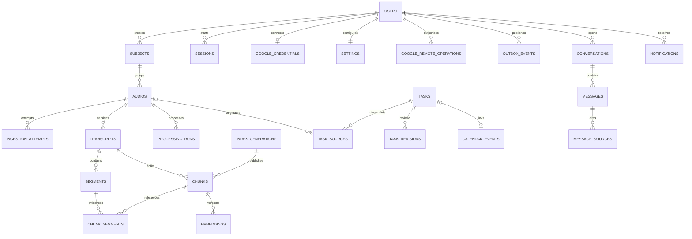
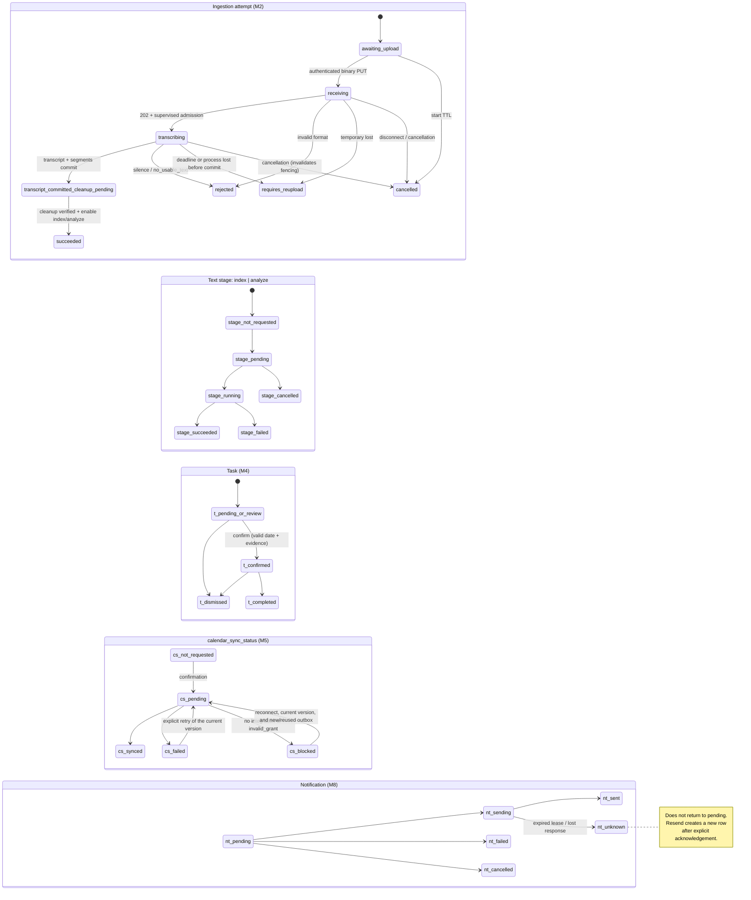

# Maulwurf — Database design, API contract, and detailed sprints

> **Status: design document.** Derived from
> [ESPECIFICACION.md](ESPECIFICACION.md) (source of truth for contracts),
> [PLAN_IMPLEMENTACION.md](PLAN_IMPLEMENTACION.md) (gates G1–G8, decisions D1–D8), and
> [PLAN_SPRINTS.md](PLAN_SPRINTS.md) (per-sprint backlog with claiming). This document defines
> the design contracts; implementation status is tracked in
> [sprints/CLAIMS.md](sprints/CLAIMS.md) and [../README.md](../README.md), not inferred from the
> schemas below. If it contradicts the specification, the specification wins and this file
> is corrected in the same revision.

---

## 1. Current project status (review 2026-09-19; historical)

> This snapshot predates S1. For the current state see
> [sprints/CLAIMS.md](sprints/CLAIMS.md) and [../README.md](../README.md). The web stack is
> Vite + React (ADR-0007), not the Next.js scaffold named below.

| Area | Status observed in the repository |
|---|---|
| Application code | Historical snapshot: the tree now has the S1 foundation and part of S2 (API, ingestion, web, migrations, compose and CI). See `CLAIMS.md` for ticket state. |
| Manifests and dependencies | `apps/api/pyproject.toml` + `uv.lock`, `apps/ingest/pyproject.toml` + `uv.lock`, `apps/web/package.json` + `package-lock.json`, and `requirements-riva.txt` exist. The Riva client is pinned to `2.27.0`; the other ranges belong to the scaffold and do not demonstrate installation, build, or E2E compatibility. |
| Functional contracts | `docs/ESPECIFICACION.md` — modules M1–M9, data model §6, NFRs §8 |
| Delivery plan | `docs/PLAN_IMPLEMENTACION.md` — phases F0–F3, gates G1–G8, decisions D1–D8 |
| Team plan | `docs/PLAN_SPRINTS.md` — S1–S4 backlog per sprint with claiming in `docs/sprints/` |
| Test catalog | `docs/PLAN_TESTS.md` — test layers, fixtures, coverage per sprint |
| ASR provider | `docs/NVIDIA_RIVA.md` — audited parameters; real limits pending the S1 spike |

**Sprints currently proposed** (PLAN_SPRINTS §0):

| Week | Name | One-sentence goal | Exit gate |
|---|---|---|---|
| S1 | **Foundation + spike** | Monorepo, auth, schema, and proven Riva contract | F0: G1 and exactly G2-T or G2-X; D2/D3-Audio/D4/D6 |
| S2 | **Knowledge (F1)** | Upload → transcript → hybrid index → chat with citations | G1, G2-T or G2-X, G3, G4, and G5-F1 |
| S3 | **Action (F2)** | Extraction, review, idempotent Calendar, and read tools | G5-F2, G6, and G7-CAL |
| S4 | **Reminders and close (F3)** | Gmail opt-in, reminders/digests, dashboard, and hardening | G7-MAIL and G8 |

Hard rule in force: **no real ingestion before S1 closes the F0 gate**
(retention D3, limits D2/D4, timestamps D6).

This document establishes:

1. **§2** — full database design (tables, constraints, indexes, state machines) and which
   sprint each piece belongs to.
2. **§3** — the contract of every proposed endpoint (M1–M9) with request/response shapes,
   errors, and SSE.
3. **§4** — a suggested daily sequence by area and ticket. It assigns no people: the real
   owner of each ticket comes exclusively from claiming and is recorded per
   [PLAN_SPRINTS.md](PLAN_SPRINTS.md) §0, keeping the backlog identifiers
   (`A1.3`, `S1.A6`, `J2.4`, `D3.2`, `L3.4`, …).

---

## 2. Database design

### 2.1 General conventions

1. **Engine:** PostgreSQL 16 with `pgvector` (`pgvector/pgvector:pg16`, pinned version). One
   database for data, vectors, and outbox.
2. **Multi-tenancy from F0:** every business table carries `user_id`; references between
   tenant tables use **composite FKs `(user_id, resource_id)`** to avoid cross references;
   authorization is additionally validated in services (API, SSE, tools, and jobs). RLS is
   additional defense with transactional `SET LOCAL app.user_id` and an application role
   without `BYPASSRLS` (test the connection pool and workers too).
3. **Keys and time:** `uuid` PK with `gen_random_uuid()`; `created_at`/`updated_at`
   `timestamptz NOT NULL DEFAULT now()`; `updated_at` maintained by the persistence layer.
4. **Soft delete:** `deleted_at timestamptz` (tombstone) on `users`, `subjects`, `audios`,
   `conversations`. Deleting a class also purges the derivatives (transcripts, segments,
   chunks, embeddings, tasks, summary, associated message citations/snippets, or the whole
   message if it cannot be purged safely).
5. **Enums as `TEXT` + `CHECK`:** contract-closed values; makes controlled extensions easy
   without rewriting types.
6. **No durable audio:** `audios` has no `storage_key`, blob, or path; the outbox contains
   only IDs and non-sensitive configuration; no audio on disk, S3/MinIO, Redis, logs,
   traces, caches, or backups.
7. **Versioning:** transcript by `(audio_id, version)`; chunks by `(transcript_id,
   index_version, ordinal)`; embeddings by `(chunk_id, index_version)` with
   model/dimension recorded; analysis by `processing_runs` `(audio_id, stage,
   transcript_version, config_version)`. Active versions are published atomically (same
   transaction).
8. **Supporting indexes for FKs:** PostgreSQL does not index the referencing side; every
   composite FK or `ON DELETE` gets an index on the child table. Class and account purges
   walk cascades and must not degrade into seq-scans.

Base RLS (additional defense) on every tenant table, with `USING` and `WITH CHECK` (on
`users`, over `id`). Without `missing_ok`: if `app.user_id` is not set, the query fails
(fail-closed):

```sql
ALTER TABLE audios ENABLE ROW LEVEL SECURITY;
CREATE POLICY tenant_isolation ON audios
  USING (user_id = current_setting('app.user_id')::uuid)
  WITH CHECK (user_id = current_setting('app.user_id')::uuid);
```

Same `FOR ALL` template on `subjects`, `audios`, `transcripts`, `segments`, `chunks`,
`chunk_segments`, `embeddings`, `index_generations`, `processing_runs`, `outbox_events`,
`ingestion_attempts`, `variant_confirmation_tokens`, `conversations`, `messages`,
`message_sources`, `tasks`, `task_evidence`, `task_sources`, `task_revisions`,
`calendar_events`, `google_remote_operations`, `notifications`, `sessions`, and
`google_credentials`. Each transaction opens with `SET LOCAL app.user_id = '<uuid>'`
(transactional, hence pool-compatible); workers set it the same way, covered by
I-S1-AN-05 and G3.

Implementation (A2.17, revision `0005`): the runtime roles are `maulwurf_app` (API),
`maulwurf_jobs` (worker/scheduler) and `maulwurf_ingest`; all are `NOLOGIN`, not table
owners and have no `BYPASSRLS`. The DSN owner runs migrations and each transaction
downgrades itself with `SET LOCAL ROLE`. `users` and `sessions` add the only bootstrap
policies (verified Google `sub` and presented session-token hash) because login and session
resolution run before `app.user_id` exists. The dispatcher, reconciler and index claim use
a `jobs_cross_tenant` policy gated by `app.cross_tenant='on'`; the ingest attempt queue has
its own documented policy, recorded in ADR-0006 as an explicit accepted cross-tenant risk.
Runtime grants cover the tenant tables but revoke write access to `alembic_version` (SELECT
stays for diagnostics). S3/S4 tables add their policies and grants in their migrations.

Implementation (A2.18, revision `0009`): every FK now has a non-partial covering index on its
child columns, checked from `pg_index` by I-S2-AN-17. `chunks.index_version` references
`index_generations(user_id, version)`; `chunks` and `message_sources` pin the exact transcript
version; `embeddings.index_version` is part of the FK to its chunk. `dimension` is fixed to the
vector column's 1536 and a transcript's `text` must not be blank. `0009_s2_schema_integrity`
follows `0008`; `alembic check` runs in the integration suite and fails on metadata drift.

Implementation (A2.12, revision `0010`): `messages_by_conversation_order`
`(user_id, conversation_id, created_at, id)` replaces the FK-only
`messages_by_conversation` index. It backs the paginated history order and the
`max(created_at)` aggregate that orders the conversation listing; its prefix still covers the
`(user_id, conversation_id)` FK. The revision only swaps indexes, so no table or column is
added.

### 2.1.1 Extensions

```sql
CREATE EXTENSION IF NOT EXISTS vector;
```

HNSW and GIN indexes are created in S2. **No index is declared without testing plans and
recall with representative data** ([ESPECIFICACION.md](ESPECIFICACION.md) §6.2); the
candidates are detailed in §2.5 and task indexes in §2.8.

### 2.2 Complete ER diagram



All tenant relations add the composite FK `(user_id, resource_id)`; the diagram omits it
for readability.

### 2.3 S1 — Identity, session, and subjects (technical steward: API/DB)

```sql
CREATE TABLE users (
  id             uuid PRIMARY KEY DEFAULT gen_random_uuid(),
  google_sub     text NOT NULL UNIQUE,          -- identity: Google sub, not the email
  email          text NOT NULL,
  email_verified boolean NOT NULL DEFAULT false,
  timezone       text NOT NULL DEFAULT 'UTC',   -- IANA; affects digests, not class dates
  display_name   text,
  status         text NOT NULL DEFAULT 'active'
                   CHECK (status IN ('active','deleting','deleted')),
  created_at     timestamptz NOT NULL DEFAULT now(),
  updated_at     timestamptz NOT NULL DEFAULT now(),
  deleted_at     timestamptz                    -- account tombstone (S4)
);

CREATE TABLE sessions (
  id           uuid PRIMARY KEY DEFAULT gen_random_uuid(),
  user_id      uuid NOT NULL REFERENCES users(id) ON DELETE CASCADE,
  token_hash   text NOT NULL UNIQUE,            -- SHA-256 of the opaque identifier
  csrf_hash    text NOT NULL,                   -- SHA-256 of the session CSRF token
  created_at   timestamptz NOT NULL DEFAULT now(),
  expires_at   timestamptz NOT NULL,
  revoked_at   timestamptz,
  last_seen_at timestamptz,
  deletion_operation_id uuid                     -- A4.4: restricted initiator only
    REFERENCES account_deletions(id) ON DELETE SET NULL
);
CREATE INDEX sessions_user ON sessions (user_id, expires_at);

CREATE TABLE google_credentials (
  user_id           uuid PRIMARY KEY REFERENCES users(id) ON DELETE CASCADE,
  access_token_enc  bytea NOT NULL,             -- AES-GCM with a unique nonce
  refresh_token_enc bytea,                      -- keep the previous one if Google returns no new one
  -- Each blob is nonce(12 B) || ciphertext+tag with its own nonce: a nonce shared
  -- between access and refresh would reuse the nonce under the same key, breaking AES-GCM.
  key_version       integer NOT NULL,           -- key rotation
  scopes            text[] NOT NULL DEFAULT '{}',
  token_expires_at  timestamptz,
  status            text NOT NULL DEFAULT 'connected'
                      CHECK (status IN ('connected','disconnected')),
  last_refresh_at   timestamptz,
  updated_at        timestamptz NOT NULL DEFAULT now()
);

CREATE TABLE subjects (
  id         uuid PRIMARY KEY DEFAULT gen_random_uuid(),
  user_id    uuid NOT NULL REFERENCES users(id) ON DELETE CASCADE,
  UNIQUE (user_id, id),
  name       text NOT NULL,
  color      text NOT NULL DEFAULT '#6366f1',
  teacher    text,
  created_at timestamptz NOT NULL DEFAULT now(),
  updated_at timestamptz NOT NULL DEFAULT now(),
  deleted_at timestamptz
);
CREATE UNIQUE INDEX subjects_active_name
  ON subjects (user_id, lower(name)) WHERE deleted_at IS NULL;
```

Notes:

- `sessions.token_hash` never stores the raw cookie value and `csrf_hash` never stores the
  plain CSRF token. `GET /me` delivers the plain CSRF token only to that session's browser
  with `Cache-Control: no-store`; it does not rotate on every read.
- The CSRF token rotates when the session is created or rotated, is shared across the tabs
  that use the same cookie, and becomes invalid when that session is closed, revoked, or
  replaced. Rotation is confirmed in a single transaction that invalidates the previous
  hash before exposing the new token; a tab holding the previous value receives
  `403 csrf_invalid` and must repeat `GET /me`.
- Google tokens are encrypted with AES-GCM, a unique nonce per blob, AAD `user_id:field`,
  and `key_version`; `invalid_grant` moves the status to `disconnected` without necessarily
  closing the application session.
- Each class's timezone is captured as a snapshot in `audios`; changing the profile does
  not alter already-extracted dates.

### 2.4 S1 skeleton → S2 full — Ingestion and audios (API/DB + Ingestion/ASR)

```sql
CREATE TABLE audios (
  id                        uuid PRIMARY KEY DEFAULT gen_random_uuid(),
  user_id                   uuid NOT NULL REFERENCES users(id) ON DELETE CASCADE,
  UNIQUE (user_id, id),
  subject_id                uuid NOT NULL,
  FOREIGN KEY (user_id, subject_id) REFERENCES subjects (user_id, id),
  title                     text,
  teacher                   text,
  sha256                    text,                -- unknown at reservation; decided on PUT
  class_date                date NOT NULL,
  class_timezone            text NOT NULL,       -- IANA snapshot of the class
  language_code             text NOT NULL,       -- checked allowlist; no 'multi'
  original_bytes            bigint,
  duration_seconds          double precision,    -- validated with ffprobe, not Content-Length
  required_stages           text[] NOT NULL DEFAULT '{index}',
                            -- F1: '{index}'; from F2 on: '{index,analyze}'; explicit backfill
  active_transcript_version integer,
  active_analysis_version   integer,
  active_index_version      text,
  created_at                timestamptz NOT NULL DEFAULT now(),
  updated_at                timestamptz NOT NULL DEFAULT now(),
  deleted_at                timestamptz          -- tombstone: cancels late attempts/jobs
);

-- Exact identity: hash + language + subject + date + timezone; resolved when the PUT finishes.
CREATE UNIQUE INDEX audios_dedupe_identity
  ON audios (user_id, sha256, language_code, subject_id, class_date, class_timezone)
  WHERE deleted_at IS NULL AND sha256 IS NOT NULL;
CREATE INDEX audios_variant_lookup ON audios (user_id, sha256)
  WHERE deleted_at IS NULL AND sha256 IS NOT NULL;
CREATE INDEX audios_library ON audios (user_id, subject_id, class_date DESC)
  WHERE deleted_at IS NULL;

CREATE TABLE ingestion_attempts (
  id                                uuid PRIMARY KEY DEFAULT gen_random_uuid(),
  user_id                           uuid NOT NULL REFERENCES users(id) ON DELETE CASCADE,
  UNIQUE (user_id, id),
  audio_id                          uuid NOT NULL,
  FOREIGN KEY (user_id, audio_id) REFERENCES audios (user_id, id),
  privacy_notice_version            text NOT NULL,
  cloud_processing_accepted_at      timestamptz NOT NULL,
  third_party_voice_acknowledged_at timestamptz NOT NULL,
  declared_providers                jsonb NOT NULL, -- shown names/versions, no secrets
  status                            text NOT NULL
    CHECK (status IN ('awaiting_upload','receiving','transcribing',
                      'transcript_committed_cleanup_pending','succeeded',
                      'requires_reupload','rejected','cancelled')),
  owner_instance                    text NOT NULL,  -- instance owning the reservation/temporary
  fencing_token                     bigint NOT NULL,
  lease_expires_at                  timestamptz,
  heartbeat_at                      timestamptz,
  upload_expires_at                 timestamptz,
  receive_deadline                  timestamptz,
  asr_deadline                      timestamptz,
  received_bytes                    bigint NOT NULL DEFAULT 0,
  expected_bytes                    bigint,
  fragments_done                    integer,
  fragments_total                   integer,
  cleanup_status                    text NOT NULL DEFAULT 'pending'
    CHECK (cleanup_status IN ('pending','verified','failed')),
  cleanup_verified_at               timestamptz,
  cleanup_evidence                  jsonb NOT NULL DEFAULT '{}',
  audio_deleted_at                  timestamptz,
  error_code                        text,
  created_at                        timestamptz NOT NULL DEFAULT now(),
  updated_at                        timestamptz NOT NULL DEFAULT now()
);

-- Only the opaque token's hash is stored. The row expires and is purged; it holds no audio.
CREATE TABLE variant_confirmation_tokens (
  id                    uuid PRIMARY KEY DEFAULT gen_random_uuid(),
  user_id               uuid NOT NULL REFERENCES users(id) ON DELETE CASCADE,
  token_hash            text NOT NULL UNIQUE,
  canonical_audio_id    uuid NOT NULL,
  FOREIGN KEY (user_id, canonical_audio_id)
    REFERENCES audios (user_id, id) ON DELETE CASCADE,
  content_sha256        text NOT NULL,
  subject_id            uuid NOT NULL,
  FOREIGN KEY (user_id, subject_id) REFERENCES subjects (user_id, id),
  class_date            date NOT NULL,
  class_timezone        text NOT NULL,
  language_code         text NOT NULL,
  metadata_digest       text NOT NULL, -- HMAC of the normalized metadata shown to the user
  expires_at            timestamptz NOT NULL,
  consumed_at           timestamptz,
  reserved_audio_id     uuid,
  FOREIGN KEY (user_id, reserved_audio_id) REFERENCES audios (user_id, id),
  created_at            timestamptz NOT NULL DEFAULT now(),
  CHECK (consumed_at IS NULL OR reserved_audio_id IS NOT NULL)
);
CREATE INDEX variant_tokens_expiry
  ON variant_confirmation_tokens (expires_at) WHERE consumed_at IS NULL;
CREATE INDEX variant_tokens_by_canonical
  ON variant_confirmation_tokens (user_id, canonical_audio_id);

-- A single active attempt per class; pending cleanup is still active work.
CREATE UNIQUE INDEX attempts_one_active
  ON ingestion_attempts (audio_id)
  WHERE status IN ('awaiting_upload','receiving','transcribing',
                   'transcript_committed_cleanup_pending');
CREATE INDEX attempts_by_audio ON ingestion_attempts (user_id, audio_id);
```

Design notes ([ESPECIFICACION.md](ESPECIFICACION.md) §6.2):

- `POST /audios` creates a reservation with `sha256=NULL`: it cannot promise dedupe before
  receiving bytes. The first `PUT` computes the hash, cleans up the temporary, and decides
  transactionally between `duplicate_exact`, `duplicate_variant`, or admission to ASR. A
  provisional reservation absorbed by dedupe is removed after cleanup; it is not left
  behind as a duplicate class.
- For a variant, the first `PUT` returns a plain token only in that response; the DB stores
  `token_hash`. The second `POST` consumes the current token exactly once, checks tenant
  and metadata, links the new reservation via `reserved_audio_id`, and requires re-upload.
  The second `PUT` recomputes the hash; a mismatch ends in `rejected` without ASR. Neither
  the token nor the human decision extends the life of the first upload's audio.
- Versioned consents are a snapshot per attempt. A missing or outdated version, or either
  acknowledgement set to `false`, is rejected before reserving capacity.
- `audios` has **no** `storage_key`, blob, or durable path. The hash is deleted with the
  class; re-upload without a transcript reuses the canonical record, except a confirmed
  variant which deliberately creates another class.
- Aggregate status (`processing|ready|partial|failed`) is derived from the attempt and
  `processing_runs`; `not_requested` never counts as success.
- After the commit, the internal status is `transcript_committed_cleanup_pending`; it is
  not exposed as success. An expired lease does not prove deletion: without evidence,
  `cleanup_status` stays `pending` and only the index/analyze outbox remains blocked.
  `cleanup_status='failed'` stops local admission and raises an alert.
- The effective TTLs (10/30/60 min) are published only with the S4.4 benchmark behind
  them; the size/duration limits stay `null` and `limits_validated=false` while D4 is
  blocked.
- Class purge order, fixed by `DELETE /audios/{id}` (A2.7, one transaction, always explicit
  deletes and never the FK cascade, so every count in the `202` body is verifiable):
  conditional `audios.deleted_at` (a second concurrent DELETE loses and gets `404`) →
  active `ingestion_attempts` to `cancelled` with `fencing_token + 1` (a late `ingest`
  commit fails its token check) → `outbox_events` `pending` to `skipped` (never
  `enabled=false`, which the `cleanup_gate` CHECK would reject as a lie) →
  `processing_runs` `pending|running` to `cancelled` → `task_revisions` and
  `task_sources` of the class → `tasks` with `audio_id` = the class (so `tasks.audio_id`
  never blocks the purge) → `message_sources` of the class →
  content-free `messages` (`content=''`, `citas='[]'`) → `embeddings` → `chunk_segments`
  → `chunks` → `segments` → `transcripts` (summary and topics go with the transcript).
  Final attempts keep their `error_code`; existing Google events are kept by default.
  Proven by `I-S2-AN-06` in `apps/api/tests/integration/test_delete_audio.py`.

### 2.5 S2 — Transcript, chunks, embeddings, and index (API/DB + RAG)

```sql
CREATE TABLE transcripts (
  id                  uuid PRIMARY KEY DEFAULT gen_random_uuid(),
  user_id             uuid NOT NULL REFERENCES users(id) ON DELETE CASCADE,
  UNIQUE (user_id, id),
  audio_id            uuid NOT NULL,
  FOREIGN KEY (user_id, audio_id) REFERENCES audios (user_id, id) ON DELETE CASCADE,
  version             integer NOT NULL,
  language_requested  text NOT NULL,
  provider            text NOT NULL DEFAULT 'nvidia-riva',
  model               text NOT NULL,             -- provisional: whisper-large-v3
  model_config        jsonb NOT NULL,            -- sample rate, fragmentation, overlap, ffprobe
  client_version      text,
  timestamp_precision text NOT NULL
                        CHECK (timestamp_precision IN ('word','segment','none')),
  text                text NOT NULL,             -- full durable source of the transcript
  char_count          integer NOT NULL DEFAULT 0
                        CHECK (char_count = char_length(text)),
  quality_flags       jsonb NOT NULL DEFAULT '[]',  -- detected repetitions/silences
  warnings            jsonb NOT NULL DEFAULT '[]',
  fts_config          text NOT NULL,             -- 'spanish' | 'english' | 'simple'
  summary             text,                      -- F2: 3–5 sentences, with analysis_version
  topics              text[],                    -- F2: versioned
  analysis_version    integer,
  created_at          timestamptz NOT NULL DEFAULT now(),
  UNIQUE (audio_id, version)
);

CREATE TABLE segments (
  id             uuid PRIMARY KEY DEFAULT gen_random_uuid(),
  user_id        uuid NOT NULL,
  UNIQUE (user_id, id),
  transcript_id  uuid NOT NULL,
  FOREIGN KEY (user_id, transcript_id)
    REFERENCES transcripts (user_id, id) ON DELETE CASCADE,
  ordinal        integer NOT NULL,               -- stable ID within the version
  text           text NOT NULL,
  char_start     integer NOT NULL,               -- Unicode code points, not bytes/UTF-16
  char_end       integer NOT NULL,
  t_start        double precision,               -- nullable: the ASR's real precision governs
  t_end          double precision,
  CHECK (char_start < char_end),
  CHECK ((t_start IS NULL AND t_end IS NULL)
         OR (t_start IS NOT NULL AND t_end IS NOT NULL
             AND 0 <= t_start AND t_start < t_end)),
  UNIQUE (transcript_id, ordinal)
);

CREATE TABLE chunks (
  id                 uuid PRIMARY KEY DEFAULT gen_random_uuid(),
  user_id            uuid NOT NULL,
  UNIQUE (user_id, id),
  audio_id           uuid NOT NULL,
  FOREIGN KEY (user_id, audio_id) REFERENCES audios (user_id, id) ON DELETE CASCADE,
  transcript_id      uuid NOT NULL,
  FOREIGN KEY (user_id, transcript_id)
    REFERENCES transcripts (user_id, id) ON DELETE CASCADE,
  transcript_version integer NOT NULL,
  index_version      text NOT NULL,              -- index generation
  ordinal            integer NOT NULL,
  content            text NOT NULL,
  char_start         integer NOT NULL,           -- offsets preserved over the full text
  char_end           integer NOT NULL,
  token_count        integer NOT NULL,           -- target ~800, overlap ~100; counted with
                                                 -- the provider's tokenizer (D5)
  t_start            double precision,           -- derived, nullable
  t_end              double precision,
  tsv                tsvector,                   -- built with transcripts.fts_config
  UNIQUE (transcript_id, index_version, ordinal)
);
CREATE INDEX chunks_fts ON chunks USING GIN (tsv);
CREATE INDEX chunks_by_audio ON chunks (user_id, audio_id);

CREATE TABLE chunk_segments (
  user_id      uuid NOT NULL,
  chunk_id     uuid NOT NULL,
  FOREIGN KEY (user_id, chunk_id)
    REFERENCES chunks (user_id, id) ON DELETE CASCADE,
  segment_id   uuid NOT NULL,
  FOREIGN KEY (user_id, segment_id)
    REFERENCES segments (user_id, id) ON DELETE CASCADE,
  overlap_span jsonb,                           -- {segment_ordinal, inicio_char, fin_char,
                                                 --  overlap?: {inicio_char, fin_char, tokens}}
  PRIMARY KEY (user_id, chunk_id, segment_id)
);
CREATE INDEX chunk_segments_by_segment ON chunk_segments (user_id, segment_id);

CREATE TABLE embeddings (
  user_id       uuid NOT NULL,
  chunk_id      uuid NOT NULL,
  FOREIGN KEY (user_id, chunk_id)
    REFERENCES chunks (user_id, id) ON DELETE CASCADE,
  index_version text NOT NULL,
  model         text NOT NULL,                   -- provisional: text-embedding-3-small
  dimension     integer NOT NULL,                -- provisional: 1536
  vector        vector(1536) NOT NULL,
  created_at    timestamptz NOT NULL DEFAULT now(),
  PRIMARY KEY (user_id, chunk_id, index_version)
);
-- Global HNSW and cosine (consistent with the embedding); recall with tenant/version
-- filters is guaranteed by the query (§3.9), not by the index.
CREATE INDEX embeddings_hnsw ON embeddings USING hnsw (vector vector_cosine_ops);

CREATE TABLE index_generations (
  id           uuid PRIMARY KEY DEFAULT gen_random_uuid(),
  user_id      uuid NOT NULL REFERENCES users(id) ON DELETE CASCADE,
  version      text NOT NULL,
  model        text NOT NULL,
  dimension    integer NOT NULL,
  status       text NOT NULL CHECK (status IN ('building','active','retired')),
  chunk_count  integer NOT NULL DEFAULT 0,
  activated_at timestamptz,
  created_at   timestamptz NOT NULL DEFAULT now(),
  UNIQUE (user_id, version)
);
-- a single active generation per user; activation is atomic (G5-F1)
CREATE UNIQUE INDEX index_generations_one_active
  ON index_generations (user_id) WHERE status = 'active';

CREATE TABLE processing_runs (
  id                 uuid PRIMARY KEY DEFAULT gen_random_uuid(),
  user_id            uuid NOT NULL REFERENCES users(id) ON DELETE CASCADE,
  UNIQUE (user_id, id),
  audio_id           uuid NOT NULL,
  FOREIGN KEY (user_id, audio_id) REFERENCES audios (user_id, id),
  stage              text NOT NULL CHECK (stage IN ('index','analyze')),
  transcript_version integer NOT NULL,
  config_version     text NOT NULL,
  prompt_version     text,                       -- analyze
  status             text NOT NULL DEFAULT 'pending'
                       CHECK (status IN ('pending','running','succeeded','failed','cancelled')),
  attempt_count      integer NOT NULL DEFAULT 0,
  error_code         text,
  started_at         timestamptz,
  finished_at        timestamptz,
  created_at         timestamptz NOT NULL DEFAULT now(),
  UNIQUE (audio_id, stage, transcript_version, config_version)
);
```

Notes:

- A chunk is **not** the minimal unit of evidence: `chunk_segments` keeps the segments and
  their spans even when chunks overlap. Each link's `overlap_span` is the validated
  `{segment_ordinal, inicio_char, fin_char, overlap?}` object (segment-local offsets; the
  optional `overlap` region is `{inicio_char, fin_char, tokens}`), matching the §M6
  `Chunk` contract in `apps/api/app/schemas/chunk.py`.
- Chunks and generations: reindexing with a new `index_version` re-chunks — it creates new
  `chunks`/`chunk_segments` rows for that generation and **retires** the previous one
  (`status = 'retired'`). The retired generation keeps its chunks and embeddings
  materialized: they are never deleted inside the activation transaction, so a rollback to
  that version stays possible and a failed activation leaves no half-deleted index. Searches
  already exclude them because they filter by the active generation. Physical cleanup of
  retired generations is a retention policy (J2.4, plan §5), not part of activation. A
  `chunk_id` belongs to exactly one generation; the `index_version` of `embeddings` is
  defensive redundancy and must match the chunk's.
- Vector retrieval with filters (contract §3.9): the query requires
  `hnsw.iterative_scan = strict_order` (pgvector ≥ 0.8; pinned version) and over-fetch
  (the ~30 candidates per branch) so that `user_id`/version filters do not leave the top-k
  with fewer than k candidates; on small corpora, exact scan. G4 evaluates recall **with
  filters active**, not only globally.
- Changing the embedding model/dimension/version requires a **new index generation** and a
  full reindex; versions are never mixed and a partial index is never exposed.
- Deleting a class purges chunks → embeddings and the derived caches/citations; jobs
  re-verify ownership, tombstone, and version before publishing.

### 2.6 S1 (frozen shape) → S2 dispatcher — Outbox

```sql
CREATE TABLE outbox_events (
  id               uuid PRIMARY KEY DEFAULT gen_random_uuid(),
  user_id          uuid NOT NULL REFERENCES users(id) ON DELETE CASCADE,
  type             text NOT NULL,
  -- 'index_requested' | 'analyze_requested' | 'sync_task_event'
  -- | 'task_cancelled' | 'notify' | 'send_digest' | 'delete_event' | 'account_deleted'
  resource_type    text NOT NULL,               -- 'audio' | 'task' | 'user'
  resource_id      uuid NOT NULL,
  resource_version integer,                     -- resource version at emit time
  payload          jsonb NOT NULL DEFAULT '{}', -- only NON-sensitive IDs/config; never audio/tokens
  enabled          boolean NOT NULL,
  blocked_reason   text CHECK (blocked_reason IN ('cleanup_pending')),
  status           text NOT NULL DEFAULT 'pending'
                     CHECK (status IN ('pending','dispatched','completed','failed','skipped')),
  attempts         integer NOT NULL DEFAULT 0,
  max_attempts     integer NOT NULL DEFAULT 3,
  next_attempt_at  timestamptz,
  dedupe_key       text,                        -- consumer idempotency
  published_at     timestamptz,
  completed_at     timestamptz,
  created_at       timestamptz NOT NULL DEFAULT now(),
  UNIQUE NULLS NOT DISTINCT (type, resource_id, resource_version, dedupe_key),
  CHECK (
    (type IN ('index_requested','analyze_requested')
      AND ((enabled AND blocked_reason IS NULL)
        -- IS NOT DISTINCT FROM: with `=`, a NULL blocked_reason would yield NULL and the CHECK
        -- would accept a disabled index/analyze without cause.
        OR (NOT enabled AND blocked_reason IS NOT DISTINCT FROM 'cleanup_pending')))
    OR
    (type NOT IN ('index_requested','analyze_requested')
      AND enabled AND blocked_reason IS NULL)
  )
);
CREATE INDEX outbox_pending
  ON outbox_events (status, next_attempt_at) WHERE enabled AND status = 'pending';
CREATE INDEX outbox_by_user ON outbox_events (user_id) WHERE status <> 'completed';
```

- The **shape** is frozen on S1 Monday. The API/DB area maintains the table and emitters;
  the Infra/Workers area maintains the dispatcher and execution (anti-cycle rule of
  `PLAN_SPRINTS.md` §6a).
- Only `index_requested` and `analyze_requested` are born disabled with
  `blocked_reason='cleanup_pending'` in the transcript transaction. Verified cleanup
  enables them and clears the reason in one transaction; they are never enabled by lease
  expiry.
- Calendar, notifications, and deletions are born `enabled=true`, `blocked_reason=NULL` in
  the same transaction that authorizes their effect. They do not depend on the cleanup of
  a previous ingestion.
- Consumers are idempotent and re-verify tenant, authorization, tombstone, and version.

### 2.7 S2 — Chat (API/DB + RAG)

```sql
CREATE TABLE conversations (
  id         uuid PRIMARY KEY DEFAULT gen_random_uuid(),
  user_id    uuid NOT NULL REFERENCES users(id) ON DELETE CASCADE,
  UNIQUE (user_id, id),
  mode       text NOT NULL CHECK (mode IN ('all','subject','class')),
  subject_id uuid,
  FOREIGN KEY (user_id, subject_id) REFERENCES subjects (user_id, id),
  audio_id   uuid,
  FOREIGN KEY (user_id, audio_id) REFERENCES audios (user_id, id),
  title      text,
  created_at timestamptz NOT NULL DEFAULT now(),
  updated_at timestamptz NOT NULL DEFAULT now(),
  deleted_at timestamptz,
  CHECK (mode <> 'all'    OR (subject_id IS NULL AND audio_id IS NULL)),
  CHECK (mode <> 'subject' OR subject_id IS NOT NULL),
  CHECK (mode <> 'class'  OR audio_id IS NOT NULL)
);

CREATE TABLE messages (
  id                uuid PRIMARY KEY DEFAULT gen_random_uuid(),
  user_id           uuid NOT NULL,
  UNIQUE (user_id, id),
  conversation_id   uuid NOT NULL,
  FOREIGN KEY (user_id, conversation_id)
    REFERENCES conversations (user_id, id) ON DELETE CASCADE,
  role              text NOT NULL CHECK (role IN ('user','assistant','system')),
  content           text NOT NULL DEFAULT '',
  client_message_id text,                        -- send idempotency
  status            text NOT NULL DEFAULT 'completed'
                      CHECK (status IN ('streaming','completed','failed','cancelled')),
  citas             jsonb NOT NULL DEFAULT '[]',
  -- [{audio_id, transcript_version, chunk_id, segment_id, t_start, t_end, quote}]
  -- only references validated in the DB; never timestamps/IDs invented by the LLM
  model             text,
  prompt_version    text,
  input_tokens      integer,
  output_tokens     integer,
  created_at        timestamptz NOT NULL DEFAULT now()
);
-- Idempotency only for user requests: NULLS NOT DISTINCT would collide every message with a
-- NULL client_message_id and would block the assistant's second turn.
CREATE UNIQUE INDEX messages_client_idem
  ON messages (conversation_id, client_message_id)
  WHERE client_message_id IS NOT NULL;
-- A2.12, revision 0010: replaces the FK-only (user_id, conversation_id) index. The trailing
-- keys serve history pagination and `max(created_at)` per conversation.
CREATE INDEX messages_by_conversation_order
  ON messages (user_id, conversation_id, created_at, id);

CREATE TABLE message_sources (
  id                 uuid PRIMARY KEY DEFAULT gen_random_uuid(),
  user_id            uuid NOT NULL,
  message_id         uuid NOT NULL,
  FOREIGN KEY (user_id, message_id)
    REFERENCES messages (user_id, id) ON DELETE CASCADE,
  kind               text NOT NULL
                       CHECK (kind IN ('transcript','calendar','task','general')),
  audio_id           uuid,
  FOREIGN KEY (user_id, audio_id) REFERENCES audios (user_id, id),
  transcript_id      uuid,
  FOREIGN KEY (user_id, transcript_id) REFERENCES transcripts (user_id, id),
  transcript_version integer,
  chunk_id           uuid,
  FOREIGN KEY (user_id, chunk_id) REFERENCES chunks (user_id, id),
  segment_id         uuid,
  FOREIGN KEY (user_id, segment_id) REFERENCES segments (user_id, id),
  delivered_at       timestamptz NOT NULL DEFAULT now(),
  CHECK (kind <> 'transcript' OR
    (audio_id IS NOT NULL AND transcript_id IS NOT NULL
     AND transcript_version IS NOT NULL AND chunk_id IS NOT NULL))
);
CREATE INDEX message_sources_by_audio ON message_sources (user_id, audio_id);
CREATE INDEX message_sources_by_message ON message_sources (user_id, message_id);
```

- `message_sources` records **all** sources delivered to the model (including tool sources
  and the ones inherited from history) so descendant answers can be purged when a source is
  deleted (G5-F1/G5-F2). Already-seen text cannot be retracted; that limit is reported.
- History with a token budget and retention configurable per conversation. Per-turn budget:
  `model_window − output_reserve − margin`; evidence (≤ ~8 chunks × ~800 tokens) takes
  precedence and history is trimmed deterministically (whole turns, oldest first; never
  mid-turn). The budget is verified with the provider's real tokenizer before each call; if
  even the minimal history does not fit, `context_exceeded`.

### 2.8 S3 — Tasks, sources, revisions, Calendar, and settings (API/DB + Integrations)

```sql
CREATE TABLE tasks (
  id          uuid PRIMARY KEY DEFAULT gen_random_uuid(),
  user_id     uuid NOT NULL REFERENCES users(id) ON DELETE CASCADE,
  UNIQUE (user_id, id),
  audio_id    uuid,                              -- nullable: manual/chat tasks
  FOREIGN KEY (user_id, audio_id) REFERENCES audios (user_id, id),
  subject_id  uuid,                              -- denormalized for filters/inbox
  FOREIGN KEY (user_id, subject_id) REFERENCES subjects (user_id, id),
  source      text NOT NULL DEFAULT 'extraction'
                CHECK (source IN ('extraction','chat','manual')),
  tipo        text NOT NULL
                CHECK (tipo IN ('examen','tarea','entrega','lectura',
                                'recordatorio','recomendacion','proyecto')),
  titulo      text NOT NULL,
  detalle     text,
  due_date    date,                              -- full day
  due_at      timestamptz,                       -- instant; mutually exclusive
  timezone    text NOT NULL,                     -- class snapshot
  all_day     boolean NOT NULL,
  date_status text NOT NULL CHECK (date_status IN ('resolved','ambiguous','missing')),
  date_text   text,                              -- original text ("next Friday")
  date_reason text,                              -- reason for needs_review (DST, ambiguous…)
  confidence_score double precision
    CHECK (confidence_score >= 0 AND confidence_score <= 1),
  -- UNCALIBRATED signal; never permission to auto-schedule
  status      text NOT NULL DEFAULT 'needs_review'
                CHECK (status IN ('pending','needs_review','confirmed','dismissed','completed')),
  calendar_sync_status text NOT NULL DEFAULT 'not_requested'
    CHECK (calendar_sync_status IN ('not_requested','pending','synced','failed','blocked')),
  version     integer NOT NULL DEFAULT 1,        -- optimistic locking (PATCH/confirm)
  due_version integer NOT NULL DEFAULT 1,        -- due version (reminders)
  event_start_at             timestamptz,        -- Calendar block with time
  event_end_at               timestamptz,
  event_start_date           date,               -- all-day Calendar block, exclusive end
  event_end_date_exclusive   date,
  calendar_id text,
  calendar_event_id text,
  -- ETag of the last successful Calendar write: the baseline the reconcile must match
  -- before a conditional PATCH. NULL fails closed (no write) until adopt/review (J3.6).
  calendar_etag text,
  confirmed_at timestamptz,
  completed_at timestamptz,
  dismissed_at timestamptz,
  created_at  timestamptz NOT NULL DEFAULT now(),
  updated_at  timestamptz NOT NULL DEFAULT now(),
  -- date CHECK (spec §6.2):
  CHECK (
       (date_status = 'resolved' AND all_day
          AND due_date IS NOT NULL AND due_at IS NULL)
    OR (date_status = 'resolved' AND NOT all_day
          AND due_at IS NOT NULL AND due_date IS NULL)
    OR (date_status IN ('ambiguous','missing')
          AND due_date IS NULL AND due_at IS NULL)
  ),
  CHECK (
       (event_start_at IS NULL AND event_end_at IS NULL
          AND event_start_date IS NULL AND event_end_date_exclusive IS NULL)
    OR (event_start_at IS NOT NULL AND event_end_at IS NOT NULL
          AND event_start_date IS NULL AND event_end_date_exclusive IS NULL
          AND event_start_at < event_end_at)
    OR (event_start_at IS NULL AND event_end_at IS NULL
          AND event_start_date IS NOT NULL AND event_end_date_exclusive IS NOT NULL
          AND event_start_date < event_end_date_exclusive)
  )
);
-- `date` and `timestamptz` are not mixed in an index expression: the session timezone would
-- be ambiguous.
CREATE INDEX tasks_inbox_due_at ON tasks (user_id, status, due_at) WHERE due_at IS NOT NULL;
CREATE INDEX tasks_inbox_due_date ON tasks (user_id, status, due_date) WHERE due_date IS NOT NULL;
-- `ambiguous`/`missing` carry no due column, so the unresolved tray needs the plain key.
CREATE INDEX tasks_inbox_status ON tasks (user_id, status);

CREATE TABLE task_evidence (
  id             uuid PRIMARY KEY DEFAULT gen_random_uuid(),
  user_id        uuid NOT NULL,
  task_id        uuid NOT NULL,
  FOREIGN KEY (user_id, task_id) REFERENCES tasks (user_id, id) ON DELETE CASCADE,
  task_version   integer NOT NULL,
  transcript_id  uuid NOT NULL,
  FOREIGN KEY (user_id, transcript_id) REFERENCES transcripts (user_id, id),
  segment_id     uuid NOT NULL,
  FOREIGN KEY (user_id, segment_id) REFERENCES segments (user_id, id),
  char_start     integer NOT NULL,               -- Unicode offsets over the segment text
  char_end       integer NOT NULL,
  quote          text NOT NULL,                  -- verbatim quote checked against the segment
  CHECK (char_start < char_end)
);
CREATE INDEX task_evidence_by_task ON task_evidence (user_id, task_id, task_version);

-- A transcript/chat-based proposal may reference several classes; the manual task uses zero rows.
-- Parent keys added by A3.1/0012: segments UNIQUE (user_id, transcript_id, id) and
-- transcripts UNIQUE (user_id, audio_id, id); transcripts (user_id, id, version) came from A2.18.
CREATE TABLE task_sources (
  user_id            uuid NOT NULL,
  task_id            uuid NOT NULL,
  FOREIGN KEY (user_id, task_id) REFERENCES tasks (user_id, id) ON DELETE CASCADE,
  audio_id           uuid NOT NULL,
  FOREIGN KEY (user_id, audio_id) REFERENCES audios (user_id, id) ON DELETE CASCADE,
  transcript_id      uuid NOT NULL,
  transcript_version integer NOT NULL,
  FOREIGN KEY (user_id, audio_id, transcript_id)
    REFERENCES transcripts (user_id, audio_id, id),
  FOREIGN KEY (user_id, transcript_id, transcript_version)
    REFERENCES transcripts (user_id, id, version),
  segment_id         uuid NOT NULL,
  FOREIGN KEY (user_id, transcript_id, segment_id)
    REFERENCES segments (user_id, transcript_id, id),
  char_start         integer NOT NULL,
  char_end           integer NOT NULL,
  PRIMARY KEY (user_id, task_id, segment_id, char_start, char_end),
  CHECK (char_start < char_end)
);
CREATE INDEX task_sources_by_audio ON task_sources (user_id, audio_id, transcript_id);
CREATE INDEX task_sources_by_transcript
  ON task_sources (user_id, transcript_id, transcript_version);
CREATE INDEX task_sources_by_segment ON task_sources (user_id, transcript_id, segment_id);

CREATE TABLE task_revisions (
  id                 uuid PRIMARY KEY DEFAULT gen_random_uuid(),
  user_id            uuid NOT NULL,
  UNIQUE (user_id, id),
  task_id            uuid NOT NULL,
  FOREIGN KEY (user_id, task_id) REFERENCES tasks (user_id, id) ON DELETE CASCADE,
  run_id             uuid,
  FOREIGN KEY (user_id, run_id) REFERENCES processing_runs (user_id, id),
  base_task_version  integer NOT NULL,
  revision_type      text NOT NULL CHECK (revision_type IN ('reanalysis','edit_of_confirmed')),
  proposed_fields    jsonb NOT NULL,             -- never mutates the active task
  evidence_validated boolean NOT NULL DEFAULT false,
  status             text NOT NULL DEFAULT 'pending_confirmation'
                       CHECK (status IN ('pending_confirmation','activated','discarded')),
  activated_at       timestamptz,
  created_at         timestamptz NOT NULL DEFAULT now(),
  -- NULL-distinct on purpose: several pending `edit_of_confirmed` rows may share a base
  -- version; a repeated reanalysis of the same run is rejected. See ESPECIFICACION §M4.
  UNIQUE (task_id, base_task_version, revision_type, run_id)
);

CREATE TABLE calendar_events (
  id                 uuid PRIMARY KEY DEFAULT gen_random_uuid(),
  user_id            uuid NOT NULL REFERENCES users(id) ON DELETE CASCADE,
  calendar_id        text NOT NULL,
  event_id           text NOT NULL,              -- remote Google ID
  source             text NOT NULL CHECK (source IN ('google','maulwurf')),
  task_id            uuid,                       -- nullable: most events have no task
  FOREIGN KEY (user_id, task_id) REFERENCES tasks (user_id, id)
    ON DELETE SET NULL (task_id),                -- class purge unlinks, keeps the event
  title              text NOT NULL,
  start_at           timestamptz,                -- pairs with end_at: events with time
  end_at             timestamptz,
  start_date         date,                       -- all-day pair (exclusive end)
  end_date_exclusive date,
  timezone           text,
  etag               text,
  remote_status      text NOT NULL DEFAULT 'confirmed',
  last_synced_at     timestamptz NOT NULL,
  created_at         timestamptz NOT NULL DEFAULT now(),
  updated_at         timestamptz NOT NULL DEFAULT now(),
  UNIQUE (user_id, calendar_id, event_id),
  CHECK ((start_at IS NOT NULL AND end_at IS NOT NULL
            AND start_date IS NULL AND end_date_exclusive IS NULL)
      OR (start_date IS NOT NULL AND end_date_exclusive IS NOT NULL
            AND start_at IS NULL AND end_at IS NULL)),
  CHECK (start_at IS NULL OR start_at < end_at),
  CHECK (start_date IS NULL OR start_date < end_date_exclusive)
);
-- a task has at most one linked event
CREATE UNIQUE INDEX calendar_events_one_link
  ON calendar_events (task_id) WHERE task_id IS NOT NULL;

CREATE TABLE google_remote_operations (
  id          uuid PRIMARY KEY DEFAULT gen_random_uuid(),
  user_id     uuid NOT NULL,                     -- no FK: survives the purge (A4.4)
  kind        text NOT NULL CHECK (kind IN ('delete_event','delete_calendar','account_cleanup')),
  calendar_id text,
  event_id    text,
  authorized  boolean NOT NULL DEFAULT false,    -- explicit user choice
  status      text NOT NULL CHECK (status IN ('pending','running','succeeded','failed')),
  attempts    integer NOT NULL DEFAULT 0,
  error_code  text,
  created_at  timestamptz NOT NULL DEFAULT now(),
  finished_at timestamptz,
  expires_at  timestamptz NOT NULL               -- deleted by the retention job
);
CREATE INDEX google_remote_operations_expiry ON google_remote_operations (expires_at);

-- Residual record without FK: it survives the purge to report the outcome without retaining
-- profile/text. `claimed_at` is the execution lease; a crashed process is reclaimable.
CREATE TABLE account_deletions (
  id            uuid PRIMARY KEY DEFAULT gen_random_uuid(),
  former_user_id uuid NOT NULL,
  status        text NOT NULL
    CHECK (status IN ('pending','running','completed','completed_with_remote_failures')),
  delete_events boolean NOT NULL DEFAULT false,
  error_summary text,
  expires_at    timestamptz NOT NULL,
  created_at    timestamptz NOT NULL DEFAULT now(),
  completed_at  timestamptz,
  claimed_at    timestamptz,
  attempts      integer NOT NULL DEFAULT 0
);
CREATE INDEX account_deletions_expiry ON account_deletions (expires_at);
```

- The task lifecycle (`status`) is **separate** from `calendar_sync_status`; `scheduled` is
  not a task status. A manual task has zero `task_sources`; an extraction/chat grounded in
  the corpus must have at least one validated row before being published.
- Confirming requires a valid date + checked evidence for extracted tasks. A `PATCH` of a
  confirmed task creates `task_revisions(status='pending_confirmation')` with
  `base_task_version`, without mutating active fields or writing to Google. `confirm`
  receives `revision_id` and `expected_version`, activates exactly that revision, bumps the
  version, and creates/reuses the Calendar outbox in a single transaction.
- Remote class/task deletion lives in `google_remote_operations` and **survives** its purge
  until resolved (A4.4 resolves the illustrative `ON DELETE CASCADE` by keeping `user_id` as
  an opaque UUID without a FK). Account deletion creates `account_deletions`, which keeps only
  the former ID, status, redacted error, and expiry; it allows `GET /me/deletion/{id}` after
  profile and tokens are purged. The initiating session is linked through
  `sessions.deletion_operation_id` and stays in restricted mode (status, authorized resume,
  and logout only). Execution uses an atomic `pending -> running` claim with a bounded lease;
  a purge failure after the tombstone leaves a resumable `pending` operation and still answers
  `202`. An hourly scheduled job runs as the cross-tenant jobs role and deletes both residual
  tables once `expires_at` passes; the window is 30 days (D8, A4.5) and matches the backup
  retention.
  `delete_maulwurf_events` defaults to `false`, so Maulwurf-created Google events stay in the
  user's calendar unless the deletion explicitly opts in (the UI must say so; A4.5).
- Complete/dismiss cancels future reminders but keeps the event with a notice, unless
  remote deletion is explicitly requested.

### 2.9 S3 settings Calendar → S4 notifications (stewards: API/DB + Infra)

```sql
-- S3: persists the write/read calendar before connecting Google.
CREATE TABLE settings (
  user_id                    uuid PRIMARY KEY REFERENCES users(id) ON DELETE CASCADE,
  calendar_write_calendar_id text,
  calendar_read_calendar_ids text[] NOT NULL DEFAULT '{}',
  created_at                 timestamptz NOT NULL DEFAULT now(),
  updated_at                 timestamptz NOT NULL DEFAULT now()
);

-- S4: extends the same row; it does not create a second settings table.
ALTER TABLE settings
  ADD COLUMN gmail_opt_in boolean NOT NULL DEFAULT false,
  ADD COLUMN digest_daily_enabled boolean NOT NULL DEFAULT false,
  ADD COLUMN digest_daily_time time NOT NULL DEFAULT '07:00',
  ADD COLUMN digest_weekly_enabled boolean NOT NULL DEFAULT false,
  ADD COLUMN digest_weekday integer NOT NULL DEFAULT 0 CHECK (digest_weekday BETWEEN 0 AND 6),
  ADD COLUMN reminder_offsets_hours jsonb NOT NULL DEFAULT '[48,24,2]',
  ADD COLUMN reminder_allday_offsets_days jsonb NOT NULL DEFAULT '[3,1]';

CREATE TABLE notifications (
  id                  uuid PRIMARY KEY DEFAULT gen_random_uuid(),
  user_id             uuid NOT NULL REFERENCES users(id) ON DELETE CASCADE,
  task_id             uuid,                       -- nullable: digests and test do not depend on a task
  -- A4.1: CASCADE, not SET NULL. A bare composite SET NULL would try to null the NOT NULL
  -- user_id; nulling only task_id would leave a reminder without its due generation and two
  -- deleted tasks would then collide under the NULLS NOT DISTINCT occurrence key.
  FOREIGN KEY (user_id, task_id) REFERENCES tasks (user_id, id) ON DELETE CASCADE,
  type                text NOT NULL CHECK (type IN
    ('reminder_t48','reminder_t24','reminder_t2',
     'reminder_t3d','reminder_t1d','digest_daily','digest_weekly','test')),
  occurrence          date,                       -- target local date
  due_version         integer,
  scheduled_at        timestamptz NOT NULL,
  dedupe_key          text NOT NULL,              -- canonical identity (occurrence_seq suffix if > 0)
  occurrence_seq      integer NOT NULL DEFAULT 0, -- 0 = scheduled; > 0 = manual test/resend
  status              text NOT NULL DEFAULT 'pending'
    CHECK (status IN ('pending','sending','sent','failed','delivery_unknown','cancelled')),
  lease_expires_at    timestamptz,                -- expired 'sending' = uncertain delivery
  attempts            integer NOT NULL DEFAULT 0,
  claimed_by_fence    bigint,                     -- election that moved the row to 'sending'
  sent_at             timestamptz,
  provider_message_id text,
  last_error_code     text,                       -- redacted, no PII
  created_at          timestamptz NOT NULL DEFAULT now(),
  updated_at          timestamptz NOT NULL DEFAULT now(),
  UNIQUE NULLS NOT DISTINCT
    (user_id, type, task_id, due_version, occurrence, occurrence_seq)
);
CREATE INDEX notifications_due ON notifications (status, scheduled_at) WHERE status = 'pending';
```

- Persistent dedupe `(user_id, type, task_id, due_version, occurrence)`; changing the due
  date or preferences cancels obsolete future occurrences; **never** a retrospective burst
  when confirming late. A4.3 owns the rule: only `pending` rows are cancelled (a `sending`
  row may already be leaving through Gmail, and `sent`/`failed`/`delivery_unknown` are
  history); a new `due_version` retires the pending reminders of the previous generation of
  **that** task, and a preference change retires the reminder/digest types no longer
  enabled. The task scope belongs to the due-date rule only: digests are user-level and a
  preference change still evaluates them when both rules are applied together. A stale
  pending row whose instant already passed is cancelled too, so it can
  never fire late. Deleting a task cascades to its reminders (A4.1): an unlinked
  reminder would be undeliverable and would also collide with another deleted task's
  occurrence under `NULLS NOT DISTINCT`.
- A manual test send or warned resend is a new audited occurrence of the same identity; it
  carries `occurrence_seq` 1, 2, … (0 is the scheduled row). Automatic dedupe is unchanged,
  and the original `delivery_unknown` row is never mutated to `pending`.
- DST: nonexistent time → next valid instant; repeated time → a single local occurrence.
  Tasks without a date have no scaled reminders.
- Gmail does not guarantee exactly-once delivery: lost response or expired `sending` lease
  → `delivery_unknown`, **no automatic retry**; visible in the panel; manual resending
  warns about the risk.

J4.2 elects the scheduler role with a global row:

```sql
CREATE TABLE scheduler_leases (
  name              text PRIMARY KEY,          -- notification_scheduler
  holder            text NOT NULL,             -- host:pid:nonce
  fencing_token     bigint NOT NULL DEFAULT 1, -- grows on takeover
  lease_expires_at  timestamptz NOT NULL,
  heartbeat_at      timestamptz NOT NULL DEFAULT now(),
  created_at        timestamptz NOT NULL DEFAULT now(),
  updated_at        timestamptz NOT NULL DEFAULT now(),
  CHECK (lease_expires_at > heartbeat_at),
  CHECK (fencing_token >= 1)
);
```

- There is no tenant column and no RLS: the row is infrastructure state, never user data.
  The `maulwurf_jobs` role owns access; the API and ingest roles cannot read or rewrite the
  election.
- The same holder renews in place and keeps the fence; only an expired row can be taken
  over, and a takeover increments the fence. The cron runs every minute and at startup.
  Election, expiry and due comparisons use PostgreSQL's clock (`now()`), not each host's
  wall clock.
- The claim keeps the occurrence's `dedupe_key` unique and adds a bounded delivery lease;
  `FOR UPDATE SKIP LOCKED` lets multiple workers drain a backlog without claiming twice. It
  also copies the elected `fencing_token` into `notifications.claimed_by_fence` (migration
  `0018`); the J4.1 sender must compare it with the live election before delivering, and a
  row claimed by a superseded scheduler must not be sent.
- The scheduler is disabled by default (`MAULWURF_NOTIFICATION_SCHEDULER_ENABLED=false`)
  until J4.1 consumes `sending`: a disabled tick elects no role and moves no row, so no
  occurrence becomes a false terminal `delivery_unknown` before delivery exists.

### 2.10 State machines (frozen contracts)



(The labels abbreviate the real statuses defined in the CHECKs; the normative contract
is the column values, not the diagram.)

### 2.11 Table → sprint → technical stewardship matrix

`Technical steward` indicates the area that freezes the data contract; it does **not**
assign a person or ticket ownership. The effective owner is looked up in
`sprints/CLAIMS.md`.

| Table | Sprint | Technical steward | Consuming areas |
|---|---|---|---|
| `users`, `sessions`, `google_credentials`, `subjects` | S1 | API/DB | All |
| `audios`, `ingestion_attempts`, `variant_confirmation_tokens` | S1 shape → S2 full | API/DB + Ingestion | Ingestion, Web, Infra/Workers |
| `outbox_events` | S1 shape → S2 dispatcher | API/DB | Infra/Workers |
| `transcripts`, `segments` | S2 | API/DB + Ingestion | RAG, Web |
| `chunks`, `chunk_segments`, `embeddings`, `index_generations` | S2 | API/DB + RAG | RAG, Web |
| `processing_runs` | S2 | API/DB | RAG, Infra/Workers, Ingestion |
| `conversations`, `messages`, `message_sources` | S2 | API/DB + RAG | RAG, Web |
| `tasks`, `task_evidence`, `task_sources`, `task_revisions`, `calendar_events`, `google_remote_operations`, `settings` | S3 | API/DB + Integrations | Web, Infra/Workers, RAG |
| `notifications` and the Gmail/digest extension of `settings` | S4 | API/DB + Infra/Workers | Infra/Workers, Web |

---

## 3. API contract

### 3.1 Common conventions

| Aspect | Contract |
|---|---|
| Origin | Same-origin behind Caddy; absolute routes as in the specification (no `/api` prefix) |
| Session | Opaque cookie `mw_session` (`Secure`, `HttpOnly`, `SameSite=Lax`); the server stores only the hash |
| CSRF | `GET /me` delivers the plain token under `Cache-Control: no-store`; the server keeps only `csrf_hash`. Every mutation (`POST`/`PUT`/`PATCH`/`DELETE`, including binary) requires a valid `X-CSRF-Token` and a matching `Origin`. Rotates with the session, not per read. |
| HTTP privacy | `Cache-Control: no-store` on private content; the service worker (if any, S4) excludes upload/API/transcripts/chat/SSE |
| Identity | `user_id` always from backend session state; never from a payload or LLM output |
| Tracing | JSON logs with `request_id`, `audio_id`, `attempt_id`, `run_id`; no sensitive payloads |
| Pagination | `limit` (1–200, default 50) + opaque `cursor` |
| Quotas | `429` with `Retry-After` for per-user quota; `503` with `Retry-After` for ingestion capacity. Effective values TBD after F0 |
| Language | No preselection or autodetection; `multi` and translation out of MVP/v1. Codes are compared case-insensitively (BCP-47) and stored lowercase |

### 3.2 Error envelope and codes

Successes with special semantics (not errors; documented separately so exception handling
does not treat them as failures):

| Code | HTTP | Usage |
|---|---|---|
| `duplicate_exact` | 200 | Exact dedupe: returns the canonical class |
| `calendar_blocked` | 202 | Confirmed without integration: sync stays `blocked` |

```json
{
  "error": {
    "code": "duplicate_variant",
    "message": "A class with the same hash and a different language exists. Confirmation required.",
    "details": { "existing_audio_id": "8f0c…" }
  }
}
```

Typed codes (no PII or sensitive content):

| Code | HTTP | Usage |
|---|---|---|
| `bad_request` | 400 | Framework-level client error without a more specific code |
| `auth_required` | 401 | No session or expired |
| `csrf_invalid` | 403 | Missing/invalid `X-CSRF-Token` or Origin |
| `forbidden` | 403 | Another tenant's resource |
| `not_found` | 404 | Nonexistent, tombstoned, or unknown route |
| `method_not_allowed` | 405 | HTTP method not allowed on an existing route |
| `validation_failed` | 422 | Invalid fields (per-field detail) |
| `chat_mode_invalid` | 422 | Conversation `mode`/scope mismatch or unknown mode (M7) |
| `language_not_allowed` | 422 | Code outside the tested allowlist |
| `consent_required` | 422 | Missing cloud-processing acceptance |
| `upload_expired` | 410 | Ingestion session TTL expired |
| `attempt_not_active` | 409 | The attempt is not in `awaiting_upload` |
| `payload_too_large` | 413 | Byte/duration limit exceeded |
| `unsupported_format` | 415 | Untested or malformed container/codec |
| `duplicate_variant` | 409 | Same hash, different context: requires confirmation |
| `capacity_unavailable` | 503 | No RAM/concurrency slot |
| `rate_limited` | 429 | Per-user quota |
| `tombstoned` | 409 | Operation on a deleted class |
| `version_conflict` | 409 | Optimistic locking (tasks) |
| `invalid_transition` | 409 | Target status not allowed |
| `transcript_unavailable` | 409 | No usable transcript (re-upload); 404 if the resource does not exist for the tenant |
| `srt_unavailable` | 409 | Invalid timestamps for SRT |
| `variant_hash_mismatch` | 422 | The second `PUT` hash does not match the confirmed variant |
| `session_conflict` | 409 | The session was already rotated or revoked by another request; repeat `GET /me` |
| `subject_name_taken` | 409 | The user already has an active subject with that name (case-insensitive) |
| `subject_has_active_audios` | 409 | The subject has active classes; `details.class_count` says how many |
| `evidence_invalid` | 422 | Span/quote not reconstructible from the DB |
| `context_exceeded` | 422 | History + evidence do not fit after deterministic trimming |
| `date_unresolved` | 422 | Confirming requires a valid date |
| `provider_unavailable` | 503 | LLM/embeddings/Google down |
| `internal_error` | 500 | No sensitive details |

Errors raised by the framework before a router runs use the same envelope: an unknown
route is `404 not_found`, a wrong method is `405 method_not_allowed`, an unmapped 4xx keeps
its status with `bad_request`, and any unhandled exception is `500 internal_error`. The
framework `detail` is never forwarded (it can echo request input) and the 500 body never
carries exception text; the request id is logged with the failure. Uvicorn's own error
logger is redacted too, because it prints the traceback outside the application logger.

Ingest persists a smaller set (S2.13, `maulwurf_ingest/outcomes.py`). The public `PUT`
uses the row below; the stored `error_code` can be more specific than the public code.
`probe_unavailable` is an infrastructure fault and ends `requires_reupload`, not `rejected`.

| Stored `error_code` | Attempt status | Public code |
|---|---|---|
| `url`, `playlist`, `malformed`, `unverified_container`, `not_pcm_s16`, `multi_channel`, `unexpected_container` | `rejected` | `415 unsupported_format` |
| `payload_too_large` | `rejected` | `413 payload_too_large` |
| `no_usable_text` | `rejected` | `409 transcript_unavailable` |
| `variant_hash_mismatch` | `rejected` | `422 variant_hash_mismatch` |
| `probe_unavailable` | `requires_reupload` | `503 capacity_unavailable` |
| `asr_failed`, `asr_timeout`, `asr_rejected`, `supervisor_error`, `reception_abandoned`, `reception_integrity_failed`, `api_error` | `requires_reupload` | `500 internal_error` |
| `reception_interrupted`, `client_disconnected`, `duplicate_exact`, `duplicate_variant` | `cancelled` | no body, or `500 internal_error` |

`401 internal_credential_invalid` is not stored and is not shown to the browser; the public
answer is `500 internal_error`. `409 wrong_instance` and `409 reception_not_held` on admit
are `503 capacity_unavailable`. A capacity `503` always carries `Retry-After` and never marks
itself `retryable=false` in `details`: the header is the retry signal (A2.19).

### 3.3 M1 — Authentication, profile, and integrations (S1; connect/reconnect in S3)

| Method | Route | Sprint | Description | Response |
|---|---|---|---|---|
| `GET` | `/auth/google/start` | S1 | OAuth Authorization Code with `state`, PKCE, and `nonce`; scopes `openid email profile` | `302` to Google |
| `GET` | `/auth/google/callback` | S1 | Validates `nonce`/issuer/audience; creates the user by `sub`; issues an opaque session | `302` to `/` with cookie |
| `POST` | `/auth/logout` | S1 | Revokes the session | `204` |
| `GET` | `/me` | S1 | Profile + non-cacheable CSRF bootstrap; integration status is `GET /integrations/status` | `200` (shape below) |
| `PATCH` | `/me` | S1 | Updates `timezone` (IANA) only | `200` |
| `GET` | `/integrations/status` | S1 | Login/Calendar/Gmail status, scopes, freshness | `200` |
| `POST` | `/integrations/google/connect` | S3 | Incremental OAuth with Calendar scopes (real verification D7) | `302` to Google |
| `POST` | `/integrations/google/reconnect` | S3 | Re-authorization after `invalid_grant` (Testing expires after 7 days) | `302` to Google |
| `GET` | `/me/notifications` | S4 | Current M8 preferences (read companion of the PATCH) | `200` |
| `PATCH` | `/me/notifications` | S4 | M8 preferences (Gmail opt-in, digests, thresholds) | `200` |
| `POST` | `/notifications/test` | S4 | Test send to the verified email | `202` |
| `DELETE` | `/me` | S4 | Account deletion; accepts explicit `delete_maulwurf_events` (default `false` keeps Maulwurf-created Google events), creates the operation, claims it atomically, and requests remote deletions before revoking tokens; a post-tombstone failure still answers `202` and stays resumable | `202 {deletion_operation_id}` |
| `GET` | `/me/deletion/{id}` | S4 | Non-sensitive deletion status; accepts the restricted initiator session | `pending\|running\|completed\|completed_with_remote_failures` |
| `POST` | `/me/deletion/{id}/resume` | S4 | Authorized retry of a `pending`/`running` operation; accepts the restricted initiator session with Origin/CSRF; an already-closed operation is a no-op | `202` (still open) · `200` (closed) · `403` · `404` |

After `DELETE /me`, the session that started the operation enters **restricted mode**: only
`GET /me/deletion/{id}`, `POST /me/deletion/{id}/resume` and `POST /auth/logout`; every other
session is revoked. This way
the client can show the deletion status without keeping access to the rest of the account.

`GET /me` example:

```json
{
  "id": "b2a1…",
  "email": "estudiante@uni.edu",
  "display_name": "Estudiante",
  "timezone": "America/Bogota",
  "csrf_token": "plain-token-only-in-non-cacheable-response"
}
```

`display_name` is read-only here (it comes from the Google profile). Integration state is
**not** embedded in `/me`: `GET /integrations/status` is the single integrations surface
(`google.status`, granted `scopes`, `calendar_id`, token freshness). A2.19 narrowed this
section to the frozen S1 A1.8 contract.

Declining Calendar/Gmail permissions does **not** prevent transcribing or chatting.

### 3.4 M2a — Subjects (S1)

| Method | Route | Description | Responses |
|---|---|---|---|
| `GET` | `/subjects` | Tenant list | `200` `{items:[{id,name,color,teacher,class_count}]}` |
| `POST` | `/subjects` | Creates (`name`, `color`, optional `teacher`) | `201` · `422` · `409 subject_name_taken` |
| `PATCH` | `/subjects/{id}` | Edits only the fields sent; a foreign, missing or deleted subject answers `404` (ADR-0006, not `403`) | `200` · `404` · `422` · `409 subject_name_taken` |
| `DELETE` | `/subjects/{id}` | Deletes (tombstone `deleted_at`); `409 subject_has_active_audios` if there are active classes. `{"force": true}` is accepted by contract but **has no effect in S1**: deleting the classes with the subject is deferred to S2, with the `DELETE /audios/{id}` tombstone | `204` · `404` · `409 subject_has_active_audios` |

A subject name is unique per user among non-deleted subjects, ignoring case and surrounding
spaces; deleting a subject frees its name.

### 3.5 M2b — Ingestion and audios (S1 skeleton; S2 full)

`GET /ingestion/capabilities` publishes only measured values. The size/duration limits stay
hidden while D4 is blocked, but S4.4 publishes the effective TTLs with their own benchmark
source:

```json
{
  "max_upload_bytes": null,
  "max_duration_seconds": null,
  "accepted_input_formats": [],
  "languages": [],
  "language_policy": "explicit_select_required_no_multi",
  "ttl": {"upload_start_minutes": 10, "receive_minutes": 30, "asr_minutes": 60},
  "ttl_source_report": "docs/eval/ttl-benchmark.md",
  "ttl_source_version": "2026-11-01",
  "asr": {"provider": "nvidia-riva", "model": "whisper-large-v3",
           "timestamp_precision": null},
  "active_slots": null,
  "required_stages": ["index"],
  "limits_validated": false
}
```

After F0, non-null size/duration fields must link to the versioned report that measured
them. A TTL publication with only one or two phases is rejected; an explicit all-null TTL
publication is the only way to fall back to the provisional window.

The reservation deadlines are derived from the published TTL, never from an invented
number: `upload_expires_at = now + ttl.upload_start_minutes`, `receive_deadline =
upload_expires_at + ttl.receive_minutes` and `asr_deadline = receive_deadline +
ttl.asr_minutes` (chained, so each ephemeral phase has its own budget and the three values
are monotonic). The TTL publication is independent of `limits_validated`: the effective
10/30/60 min apply while D4 is blocked. The API keeps `MAULWURF_UPLOAD_TTL_MINUTES` only for
an explicit all-null TTL publication and then leaves `receive_deadline`/`asr_deadline` null.
The size limit has ONE value: the API reads `INGEST_MAX_UPLOAD_BYTES` from the shared
configuration and refuses to start when it disagrees with `MAULWURF_UPLOAD_MAX_BYTES`;
`GET /ingestion/capabilities` publishes the effective limit once F0 validates it.

`POST /audios` reserves a session; it cannot deduplicate before knowing the hash.

```json
{
  "subject_id": "5d6e…",
  "class_date": "2026-09-21",
  "class_timezone": "America/Bogota",
  "language_code": "es",
  "title": "Class 03 — integrals",
  "teacher": "…",
  "privacy_notice_version": "2026-09-19",
  "cloud_processing_accepted": true,
  "third_party_voice_acknowledged": true,
  "variant_confirmation_token": null
}
```

`privacy_notice_version` and the two acknowledgements are validated before reserving. The
optional token can only come from a previous `409 duplicate_variant`, belongs to the same
tenant, expires soon, and is consumed once. An unknown, expired, consumed or mismatched
token — including one consumed by a racing request — answers the same opaque
`422 validation_failed` keyed on `variant_confirmation_token`; the state is never disclosed,
so this `POST` has no `409`.

- `201 Created`: `{"audio_id","attempt_id","upload_url","upload_expires_at","outcome":"new"}`.
- `422 consent_required|language_not_allowed|validation_failed`; `429` quota; `503` no slot.
- There is no `duplicate_exact` or `duplicate_variant` response on this POST.

`PUT /audios/{id}/content?attempt_id=…`:

- Authenticated binary: session + CSRF + `attempt_id`; the URL is same-origin relative, it
  is not a public bearer token and does not allow choosing internal hosts.
- Streaming reception into private per-attempt `tmpfs`, incremental SHA-256, cut-off when
  the limit is exceeded; the real hash and duration are validated by ffprobe, not
  `Content-Length`.
- After full reception it computes SHA-256 and cleans up first the temporary data that will
  not follow ASR. `202 Accepted` only for new admitted content:
```json
{ "attempt_id": "c41b…", "status": "transcribing", "received_bytes": 184467440 }
```
- `200 duplicate_exact`: `{"audio_id":"canonical","outcome":"duplicate_exact"}` after
  releasing the reservation. `409 duplicate_variant` includes `existing_audio_id`, an
  opaque `variant_confirmation_token`, and its expiry; the client must make a second POST
  and upload again. The second PUT compares its hash against the token before ASR.
- Errors: `410 upload_expired` · `413 payload_too_large` · `415 unsupported_format` ·
  `409 attempt_not_active` · `422 variant_hash_mismatch` · `429`/`503`.
- Disconnecting the upload before it completes cancels and cleans up the attempt; after
  the `202`, closing the tab/SSE does **not** cancel ASR (it continues under its lease).

`GET /audios?subject_id={uuid}&limit={1..100}` — tenant listing (spec M9): `{ "items": [ … ] }`
with the same per-item fields as the detail below except `audio_retained`, `transcript` and
`exports`. Ordered by `class_date DESC, created_at DESC`; tombstoned classes are excluded and a
foreign or unknown `subject_id` yields an empty list (never a `404`, so it discloses nothing
across tenants).

`GET /audios/{id}` — detail view with independent per-stage statuses (spec M2):

```json
{
  "id": "8f0c…",
  "subject": { "id": "5d6e…", "name": "Calculus II", "color": "#6366f1" },
  "title": "Class 03",
  "class_date": "2026-09-21",
  "class_timezone": "America/Bogota",
  "language_code": "es",
  "duration_seconds": 3725.5,
  "created_at": "2026-09-21T18:02:11Z",
  "attempt": {
    "attempt_id": "c41b…",
    "status": "transcribing",
    "received_bytes": 104857600,
    "fragments_done": 4,
    "fragments_total": null,
    "cleanup_status": "pending"
  },
  "stages": { "index": "pending", "analyze": "not_requested" },
  "aggregate_status": "processing",
  "audio_retained": false,
  "analysis_backfill_available": true,
  "transcript": {
    "version": 2,
    "timestamp_precision": "segment",
    "char_count": 18422,
    "quality_warnings": [
      { "code": "repetition", "count": 3 },
      { "code": "low_confidence", "count": 4, "total": 10 }
    ]
  },
  "exports": { "txt": true, "srt": true }
}
```

`transcript` is `null` without a usable transcript; `exports.srt` is `true` only when a
truthful SRT exists (real precision and ordered times inside `duration_seconds`), so the
client can enable the download without probing the `409`. `transcript.quality_warnings`
carries the non-sensitive ASR signals (`code` plus counts) persisted by ingestion — for
example `repetition`, `empty_segments` and `low_confidence` — so the inbox/class page can
warn before proposing dates or tasks. Unknown fields are dropped and the list is bounded;
no spoken text or provider payload is part of the signal (S3.6).

`analysis_backfill_available` is the explicit S3.1/D3.5 action and mirrors the decision of
`classify_existing_run`, so the class page never offers an action the service resolves as a
no-op. It is `true` only for a live class with a persisted transcript and a latest attempt
with `cleanup_status='verified'` when the `analyze` stage of the current transcript/config
is `not_requested` (F1), `failed` or `cancelled`; without a run for those versions it is
`true` only for an F1 class or when a previous analysis run exists under another version
(reanalysis after a version change, S3.4). While the analysis run is `pending`/`running`
the stage itself is the visible queue and the flag is `false`, so a second click cannot
duplicate work. Queueing never uploads audio or retranscribes: the operator script
(`scripts/backfill_analysis.py`, dry-run by default) upgrades `required_stages` to
`['index','analyze']` and creates the `analyze` run plus its cleanup-gated event. The
upgrade is persisted only on the branch that actually queues a run: `already_analyzed`,
`already_queued` and `unknown_run_state` leave the stage list untouched, and a class that
is already F2 without an `analyze` run is reported as `already_f2_no_run` and keeps
`analysis_backfill_available: false` (its entry point is `POST /audios/{id}/retry`, not the
backfill).

`aggregate_status`: `processing` while required stages are pending/running; `ready` if all
succeeded; `partial` if there is a usable transcript but some required stage failed/was
cancelled; `failed` if there is no usable transcript.

`GET /audios/{id}/progress` (SSE, consumed with `EventSource` because it is a `GET`):

```text
event: snapshot
id: 12
data: {"attempt":{"status":"transcribing","received_bytes":104857600,
        "fragments_done":4,"fragments_total":null},
       "stages":{"index":"pending","analyze":"not_requested"},
       "aggregate":"processing"}

event: progress
id: 13
data: {"received_bytes":110100480,"fragments_done":5,"fragments_total":null}

event: done
id: 20
data: {"aggregate":"ready","stages":{"index":"succeeded","analyze":"not_requested"}}

event: error
id: 21
data: {"code":"asr_deadline_exceeded","detail":"requires_reupload"}
```

Real progress: bytes received and fragments done/total when known; **never invented
percentages**. `: ping` heartbeats every ~15 s keep the connection alive through proxies.
On reconnect with `Last-Event-ID`, the server resends `snapshot` (events are state, not
incremental); polling as fallback.

Other M2 endpoints:

| Method | Route | Sprint | Rules | Responses |
|---|---|---|---|---|
| `POST` | `/audios/{id}/retry` | S2 · S3 | Required body `{stages:["index"\|"analyze"], transcript_version}`; text only, deduplicated by run/config | `202` · `409 transcript_unavailable\|invalid_transition` |
| `POST` | `/audios/{id}/reupload` | S2 | Only without a usable transcript; new ephemeral session with the **same** ingestion identity | `201` new URL · `409` if a transcript already exists |
| `POST` | `/audios/{id}/attempts/{attempt_id}/cancel` | S2 | Cancels an authenticated attempt; after the commit it returns a conflict with the current status and does **not** destroy the transcript | `202` · `409 invalid_transition` |
| `DELETE` | `/audios/{id}` | S2 | Tombstone: cancels attempts/jobs, deletes derived transcripts/chunks/embeddings/tasks/summary/citations; existing Google events are kept by default (notice); removing them requires an explicit option via `google_remote_operations` | `202` |
| `GET` | `/audios/{id}/transcript.txt` | S2 | TXT export of the active transcript, or of one `?segment={segment_id}` (owner-scoped) | `200` · `404` |
| `GET` | `/audios/{id}/transcript.srt` | S2 | SRT export **only** with valid, ordered timestamps within the duration | `200` · `404` sin transcript · `409 srt_unavailable` |

### 3.6 M3 — Internal transcription contract (not a public API)

Ingestion is a separate FastAPI service (`ingest`); its interface with the API/DB has been
frozen since S1:

| Interface | Contract |
|---|---|
| Reservation | The API creates the attempt with lease and fencing token; the `ingest` service is the sole owner during reception/ASR |
| Atomic commit | Single transaction: `transcripts` + `segments` + `index/analyze` events with `enabled=false, blocked_reason=cleanup_pending`; language/model/configuration/version/precision persisted; empty or silence = `rejected/no_usable_text` |
| Cleanup | After the commit the attempt moves to `transcript_committed_cleanup_pending`. `finally` closes and removes temporaries; `succeeded` requires `cleanup_status=verified`. |
| Outbox enabling | Only index/analyze events are enabled after verified cleanup. The post-commit reconciler can verify and enable without retranscribing. Calendar, notifications, and deletions do not use this gate. |
| Fencing | Token per attempt; an expired owner cannot publish; late commits after cancellation/tombstone are rejected |
| Retries | Transient gRPC retries bounded within the attempt with an overall deadline; invalid auth/language/format is not retried; deadline exhausted → `requires_reupload` |
| Timestamps | `word\|segment\|none` as measured; never invent or distribute proportionally; SRT only with valid times |

### 3.7 M4 — Tasks (S3)

| Method | Route | Description | Responses |
|---|---|---|---|
| `GET` | `/tasks?status=&subject_id=&due_from=&due_to=` | Inbox filtered by status (`pending\|needs_review\|confirmed\|dismissed\|completed`) | `200` |
| `GET` | `/tasks/{id}` | Detail with evidence, `calendar_sync_status` **separate**, pending revision if any | `200` · `404` |
| `POST` | `/tasks` | Manual or chat proposal. `manual` uses zero sources; a corpus-grounded proposal requires validated `task_sources` | `201` · `422 evidence_invalid` |
| `PATCH` | `/tasks/{id}` | Body includes `version`. If `confirmed`, creates a `pending_confirmation` revision and does not change active fields; mismatch → `409` with the current status | `200` · `409 version_conflict` |
| `POST` | `/tasks/{id}/confirm` | Body `{expected_version, revision_id?}`. Confirms the active task or promotes exactly the pending revision, and creates/reuses the Calendar outbox atomically | `202` pending/blocked · `409 version_conflict` · `422 date_unresolved\|evidence_invalid` |
| `POST` | `/tasks/{id}/dismiss` | Dismisses; cancels future reminders; keeps the event with a notice | `200` |
| `POST` | `/tasks/{id}/complete` | Completes; cancels future reminders; keeps the event with a notice | `200` |

Task shape:

```json
{
  "id": "3f2a…",
  "audio_id": "8f0c…",
  "sources": [{"audio_id":"8f0c…","transcript_version":1,"segment_id":"a1…",
               "char_start":0,"char_end":48}],
  "subject": {"id": "5d6e…", "name": "Calculus II"},
  "source": "extraction",
  "tipo": "examen",
  "titulo": "Midterm exam — topics 1 to 4",
  "detalle": "Includes trigonometric substitution",
  "due_date": "2026-09-21",
  "due_at": null,
  "timezone": "America/Bogota",
  "all_day": true,
  "date_status": "resolved",
  "date_text": "Monday, September 21",
  "date_reason": null,
  "confidence_score": 0.92,
  "status": "needs_review",
  "calendar_sync_status": "not_requested",
  "version": 1,
  "due_version": 1,
  "event_block": {
    "start_at": null, "end_at": null,
    "start_date": "2026-09-21", "end_date_exclusive": "2026-09-22",
    "duration_default_editable": true
  },
  "evidence": [
    {"segment_id": "a1…", "char_start": 0, "char_end": 48,
     "quote": "the midterm exam will be on Monday, September 21",
     "t_start": 1875.2, "t_end": 1888.9}
  ],
  "pending_revision": {"id":"r1…","base_task_version":1,"status":"pending_confirmation"}
}
```

Calendar block contract (M5): the due date and the Calendar block are not the same thing;
the `event_start_at/event_end_at` (with time) and `event_start_date/event_end_date_exclusive`
(all-day) pairs are mutually exclusive with the end after the start; the default duration is
visible/editable before confirming and the LLM never invents a duration.

### 3.8 M5 — Google Calendar (S3)

| Method | Route | Description | Responses |
|---|---|---|---|
| `GET` | `/calendar/events?from=&to=` | Reads the local mirror (`calendar_events`), proposed window -7/+60 days; reports freshness/coverage | `200` with `last_synced_at` and a coverage notice |
| `POST` | `/calendar/sync` | Forces a full refresh of the window with atomic publication (without mixing `syncToken` with filters); bounded by a per-user cooldown | `202` · `409` · `429` (`Retry-After`) · `503` |
| `GET` | `/calendar/conflicts` | Conflicts: time overlap (events with time) vs concentration of deadlines/exams on the same day | `200` shape below |

J3.7 response shape: `from`/`to` are inclusive local dates; `events` carries each mirror row
with its instant pair or the exclusive all-day pair, plus `from`, `to`, `last_synced_at`,
`coverage_ok`, `stale` and a closed-set `coverage_notice` (`never_synced`,
`no_read_calendars`, `calendar_set_changed`, `outside_coverage`, `stale`). A notice never
hides the rows already mirrored; an inverted or oversized range answers `422
validation_failed`. When only one bound is sent, the other is derived from it (`from` →
`from+60`, `to` → `to-7`) instead of from today's default window, so a future `from` cannot
answer a misleading inverted-range error.

```json
{
  "time_conflicts": [
    {"a": {"event_id": "g1", "start_at": "…", "end_at": "…"},
     "b": {"event_id": "g2", "start_at": "…", "end_at": "…"}}
  ],
  "deadline_clashes": [
    {"date": "2026-09-21", "items": [{"task_id": "3f2a…", "tipo": "examen"}]}
  ],
  "last_synced_at": "2026-09-17T22:00:00Z",
  "coverage_ok": true
}
```

`time_conflicts` pairs only timed events whose half-open intervals overlap; touching
edges (`a.end == b.start`) do not overlap, and all-day, `cancelled` and `missing` rows are
never time conflicts. `deadline_clashes` groups two or more active deadlines/exams
(`pending`, `needs_review`, `confirmed`) by the user-local day: `due_date` is already a
day, `due_at` is converted to the user's IANA zone first, and a lone deadline is not a
clash. A3.1 owns `tasks`; while that migration is absent the endpoint returns an empty
`deadline_clashes` instead of failing. Both lists use the same `from`/`to` window,
selection and freshness envelope as `GET /calendar/events`. `POST /calendar/sync` answers
`202` with the covered window and publication counts; `409 calendar_sync_unavailable`
carries a closed `details.reason` (`no_read_calendars`, `google_not_connected`,
`missing_calendar_scopes`, `google_invalid_grant`, `calendar_read_failed`), and a
transient provider failure answers `503 calendar_sync_temporarily_unavailable` without
touching the mirror. Since `0008_s3_calendar_manual_sync`, `settings` records
`calendar_last_manual_sync_at`: a manual attempt inside the 60-second per-user cooldown
answers `429 rate_limited` with `Retry-After` and
`details.reason=calendar_sync_cooldown` before any Google call. Row locks cover only the
cooldown decision and the token renewal; the Google reads run after those transactions
commit, and a bounded lock wait answers the same transient `503`.

The same contract feeds the dashboard and `get_calendar_events(range)`. When
`/integrations/google/reconnect` completes, the backend looks only for `blocked` tasks of
the current version, atomically moves them to `pending`, and creates/reuses their outbox.
It does not reactivate revisions, tombstoned tasks, or obsolete versions.

### 3.9 M6 — Hybrid search (S2; Ctrl+K in S4)

`GET /search?q=&subject_id=&from=&to=&limit=&cursor=`

```json
{
  "results": [
    {
      "chunk_id": "c9…",
      "audio_id": "8f0c…",
      "subject": {"id": "5d6e…", "name": "Calculus II", "color": "#6366f1"},
      "class_date": "2026-09-03",
      "snippet": "…trigonometric substitution…",
      "segment_id": "a1…",
      "t_start": 1875.0,
      "t_end": 1890.0,
      "score_rrf": 0.031
    }
  ],
  "took_ms": 120,
  "next_cursor": null
}
```

- Both branches (pgvector + FTS with per-language configuration) filter `user_id`, active
  resources, active version, and filters **first**; never global top-k and then filter. The
  vector branch requires `hnsw.iterative_scan = strict_order` and over-fetch (§2.5) to
  sustain that contract; measured alternative: exact scan on small corpora.
- RRF fusion produces a deterministic total order: `ORDER BY score_rrf DESC, chunk_id`; the
  pagination `cursor` includes the generation and the tiebreaker so no results are omitted or
  duplicated. `next_cursor` is additive to the frozen §1.3 example and is `null` when the
  bounded 60-hit window is exhausted.
- `limit` is 1..50 with default 8; there is no deep pagination beyond the 60 fused hits.
- A per-user Redis quota is checked before the embeddings call; exceeding it returns
  `429 rate_limited` with `Retry-After`. The provisional 30/min limit
  (`MAULWURF_SEARCH_RATE_LIMIT_PER_MINUTE`) waits for the D5/F0 provider quota.
- Without reliable offsets, `t_start/t_end` are `null` and the UI shows "segment N".
- Target p95 ≤ 500 ms measured, not guaranteed (spec §8).

### 3.10 M7 — RAG chat (S2; read tools S3)

| Method | Route | Sprint | Description | Responses |
|---|---|---|---|---|
| `POST` | `/chat/conversations` | S2 | Creates a conversation (`mode: all\|subject\|class` + `subject_id`/`audio_id` per mode) | `201` · `422 chat_mode_invalid` |
| `GET` | `/chat/conversations` | S2 | Tenant list, keyset paginated (`limit` 1–100, default 50) | `200` |
| `GET` | `/chat/conversations/{id}/messages` | S2 | Paginated history, deterministic user-before-assistant order | `200` |
| `POST` | `/chat/conversations/{id}/messages` | S2 | Sends a question; **SSE consumed with `fetch`**; an idempotent `client_message_id` returns the existing message without re-executing; at most two concurrent streams per user | `200 text/event-stream` · `429 rate_limited` |
| `DELETE` | `/chat/conversations/{id}` | S2 | Tombstone and purge of content/sources | `204` |
| `POST` | `/chat/conversations/{id}/messages/{message_id}/cancel` | S2 | Cancels the in-flight stream; the partial is left `cancelled` | `202` |

Chat SSE events (frozen in S2; all with `id`): it starts with `snapshot`, continues with
zero or more `delta`/`citation`, and ends exactly once in `done` or `error`. `: ping`
heartbeats between deltas keep the connection alive through proxies; on reconnect, the
`Last-Event-ID` makes it possible to skip what was already sent (the full state lives in
the persisted message) and the client does not resend the same `client_message_id` to ask
for a new generation.

```text
event: snapshot
id: 40
data: {"message_id":"m7…","status":"streaming"}

event: delta
id: 41
data: {"text": "According to your calculus class, "}

event: citation
id: 42
data: {"index": 1, "audio_id": "8f0c…", "transcript_version": 1,
       "chunk_id": "c9…", "segment_id": "a1…",
       "t_start": 1875.0, "t_end": 1888.9,
       "label": "[Calculus II · Class 03 · 31:15]",
       "url": "/biblioteca/8f0c…?segment=a1…"}

event: done
id: 43
data: {"message_id": "m7…", "conversation_id": "k2…",
       "status": "completed",
       "sources": [{"audio_id": "8f0c…", "kind": "transcript"}]}

event: error
id: 44
data: {"code": "insufficient_evidence", "message": "Not enough evidence; ask for more context."}
```

Contract rules:

- Citations only reference IDs validated in the DB; markers are buffered until their ID is
  validated; no arbitrary link from the model is rendered as a source.
- Without reliable offsets the label is "segment N", never an invented minute.
- Without sufficient evidence: explicit abstention, not fabrication.
- F2 tools (allowlist): `get_calendar_events(range)`, `get_pending_tasks()`,
  `propose_task()`; none writes Calendar or sends email; iterations/time are bounded;
  ranges and schemas validated by the backend.
- Modes validated by the `conversations` CHECK; everything within the tenant.
- L2.5 implements `POST .../messages` and `.../cancel` with the minimal turn persistence;
  A2.12 adds conversation create/list/paginated history/delete over the same tables; `DELETE`
  cancels assistant rows still `streaming` in the same transaction and signals their
  producers after the commit, so an in-flight answer stops consuming model tokens.
  `Last-Event-ID` is the last received
  character offset: every connect/reconnect re-sends `snapshot` and skips that prefix from the
  persisted message.
- A turn's two rows are inserted in one transaction, so ordering by `created_at` alone can
  interleave a question and its answer. `RAGService.prepare` reads the turn clock from
  PostgreSQL (`clock_timestamp()`) after taking the conversation lock and writes the user row
  at that mark and the assistant one microsecond later; the database clock keeps turns
  ordered across API hosts whose clocks disagree. The history query, its keyset cursor and
  the RAG history also break a legacy equal-timestamp tie with a `user < system < assistant`
  role rank. The v2 history cursor carries that role, so v1 cursors are rejected instead of
  silently skipping or duplicating a message.
- Both conversation reads are bounded: history pages use `limit` 1–100 (default 50) and the
  listing uses the same keyset pattern. Revision `0010` replaces the FK-only
  `messages_by_conversation` index with
  `messages_by_conversation_order (user_id, conversation_id, created_at, id)`, which supports
  the history order and the per-conversation `max(created_at)` used by the listing.

### 3.11 M8/M9 — Notifications and dashboard (S4)

| Method | Route | Sprint | Description |
|---|---|---|---|
| `GET` | `/me/notifications` | S4 | Current M8 preferences: Gmail opt-in, digest switches/time/weekday, visible thresholds |
| `PATCH` | `/me/notifications` | S4 | M8 preferences: Gmail opt-in, daily digest time/weekday, visible thresholds |
| `POST` | `/notifications/test` | S4 | Test send to the verified email (Gmail `gmail.send`); `202` with an uncertain-delivery warning |
| `GET` | `/notifications?status=&from=&to=&limit=&cursor=` | S4 | Paginated delivery panel; does not mix sensitive payloads |
| `POST` | `/notifications/{id}/resend` | S4 | Required body `{acknowledge_duplicate_risk:true}`; creates a new audited occurrence and does not mutate `delivery_unknown` |

The dashboard (M9) is a composition of the previous contracts: `GET /calendar/events`,
`GET /tasks?status=`, `GET /search`, and the `GET /audios/{id}` detail views; it introduces
no new endpoints in the MVP.

### 3.12 Health and operations (S1)

| Method | Route | Description |
|---|---|---|
| `GET` | `/healthz` | Per process (web/api/ingest/worker/scheduler); liveness |
| `GET` | `/readyz` | API: Postgres/Redis. Ingestion: DB, safe temporaries, cleanup, and operational capacity. **Never** invokes paid providers |

### 3.13 Frozen internal contracts (summary per sprint)

| Week | Frozen contract | Providing area | Consuming areas |
|---|---|---|---|
| S1 | Session/cookie/CSRF contract (`mw_session`, hash, rotation, and `GET /me` bootstrap) | API/DB | All |
| S1 | `POST /audios` + `PUT` (reservation, consent, dedupe in PUT, relative URL) | API/DB + Ingestion | Web |
| S1 | `outbox_events` shape and per-type gate | API/DB | Infra/Workers |
| S1 | Ingestion statuses and SSE | Ingestion + API/DB | Web |
| S2 | Chunks/embeddings and `index(audio_id)` events | RAG + API/DB | Infra/Workers |
| S2 | Chat SSE (`snapshot\|delta\|citation\|done\|error`) and citation format | RAG | Web |
| S2 | `/search` with cursor and filters | RAG + API/DB | Web |
| S3 | `tasks`, `task_sources`, revisions, `calendar_events`, and Calendar settings | API/DB | Web, Infra/Workers |
| S3 | Read tools and iteration limits | RAG | Infra/Workers, Web |
| S4 | Settings/notifications extension and dedupe | API/DB | Infra/Workers, Web |

### 3.14 Endpoint → sprint matrix

| Endpoint | S1 | S2 | S3 | S4 |
|---|---|---|---|---|
| `/auth/google/start`, `/callback`, `/auth/logout`, `/me`, `PATCH /me` | skeleton→full | — | — | — |
| `/integrations/status` | ✓ | — | — | — |
| `/subjects` CRUD | ✓ | — | — | — |
| `/ingestion/capabilities` | — | ✓ | — | — |
| `POST /audios` + binary `PUT` | skeleton | ✓ | — | — |
| `GET /audios*`, progress SSE, `retry`, `reupload`, `cancel`, `DELETE`, TXT/SRT | — | ✓ | — | — |
| `/search` | — | ✓ | — | Ctrl+K (UI) |
| `/chat/*` (conversations + SSE) | — | ✓ | read tools | — |
| `/tasks*` (M4) | — | — | ✓ | — |
| `/calendar/*` (M5) | — | — | ✓ | — |
| `/integrations/google/connect\|reconnect` | — | — | ✓ | — |
| `GET/PATCH /me/notifications`, `POST /notifications/test`, `GET /notifications`, `POST /notifications/{id}/resend` | — | — | — | ✓ |
| `DELETE /me`, `GET /me/deletion/{id}`, `POST /me/deletion/{id}/resume` | — | — | — | ✓ |

---

## 4. Suggested sequence by area and ticket (ownership via claiming)

The following daily sequence is an **ordering proposal**, not an assignment: each person
claims tickets from the open backlog and the owner is recorded in `sprints/CLAIMS.md`. The
identifiers and their dependencies come from the master plan; the tests in `PLAN_TESTS.md`
evidence the ticket.

Suggested sequence, not assignment: the owner comes only from canonical claiming.
Monday = verify gate/capacity, open the sprint, freeze contracts and claims; day 3 = first
consumable integration; days 4–5 = E2E/close; Friday = demo and retro. Nothing merges
without review from an active claim at the affected boundary or from the lead. Definition
of done: closed scope, code/document, planned test or evidence, demonstration, and a
verifiable record.

### 4.1 S1 — Foundation + feasibility spike (F0)

**Objective:** monorepo running, basic auth, initial schema, and a proven real Riva
contract. **Exit criteria:** monorepo §3.3 created; `docker compose up` with the 8 services
without audio storage; working Google login locally; migrations from empty; green CI; spike
report with evidence (versions, calls, languages, formats, limits, timestamps).

**Interfaces frozen on Monday:** session/cookie and CSRF contract; schema of `POST
/audios` + binary `PUT` (relative upload URL); outbox shape; ingestion statuses; progress
SSE response shape (§2.9 and §3.5 of this document).

#### RAG area · quality · coordination (suggested sequence)

| Day | Ticket | Task | Verifiable deliverable |
|---|---|---|---|
| Monday | L1.6 | Freeze S1 interfaces in the master plan | Plan §6 table unchanged all week |
| 1 | L1.1 | Verify/adjust the existing monorepo §3.3 structure; pin versions (Python, Node, Postgres 16, pgvector) and lockfiles | `apps/` + `infra/` + lockfiles verified |
| 1–2 | L1.2 | Short ADRs: structure, versions, lockfile policy, commit/PR format | ADRs in `docs/` reviewed on Friday |
| 2 | L1.3 | Spike protocol: what to measure, report format, D2/D4/D6 criteria | Protocol published before day 2 and used as the single format |
| 3 | L1.4 | Preliminary Pydantic schema for analysis (§M4) and chunk (§M6) as a freeze draft | Schemas in `apps/api/prompts/` (draft) |
| 3–4 | L1.5 | Sketch the G4 dataset: ≥50 questions/language, 15 unanswerable, expected evidence | Annotated dataset in the agreed format |
| Continuous | L1.7 | Review all PRs; maintain the board | PRs with recorded review |

Plan B: if the spike fails (e.g., no timestamps), an extraordinary meeting on **Tuesday**
to decide D6 before S2 depends on it.

#### API area · database (suggested sequence)

| Day | Ticket | Task | Verifiable deliverable |
|---|---|---|---|
| 1 | A1.1 | Verify the `apps/api` scaffold: FastAPI + Pydantic v2 + SQLAlchemy 2 async (routers/services/models/core) and `/healthz` | API boots in compose |
| 1 | A1.2 | Verify/complete Pydantic Settings config; `NVIDIA_API_KEY` and secrets via environment only | Secrets out of code and logs |
| 2–3 | A1.3 | Google OAuth backend: Authorization Code + `state` + PKCE; validates `nonce`/issuer/audience; identity by `sub` | Real login in compose |
| 2–3 | A1.4 | Opaque session: `Secure/HttpOnly/SameSite=Lax` cookie, hash only in `sessions`, expiration/revocation; CSRF and Origin on mutations | Revocation/CSRF tests green |
| 3–4 | A1.5 | Core tables `users/sessions/google_credentials/subjects` with composite FKs and base RLS, plus the S1 shape of `audios`, `ingestion_attempts`, and `outbox_events` | Migrations from empty |
| 4 | A1.6 | Subject CRUD with tenant ownership; deletion blocked with active classes | Demonstrable CRUD |
| 4 | A1.7 | Alembic: from empty and upgrade; test with pool and workers | Commands documented in the README |
| 5 | A1.8 | `POST /audios` + binary `PUT` skeleton (frozen contract); `GET/PATCH /me`, logout, `/integrations/status` | Endpoints responding |
| 5 | A1.9 | Basic isolation tests (B does not see A's resources, not even by guessing IDs) | Partial G3 suite green |

Scope: the S1 binary `PUT` is a **skeleton only**; real reception arrives in S2 on the
frozen contract. Plan B if the OAuth credentials do not arrive by day 2: opaque session +
CSRF with a development login behind a temporary feature flag, never merged to demo.

#### Ingestion area · audio · ASR — critical week, blocking spike

**Part A: contract spike (F0.1)**

| Day | Ticket | Task | Verifiable deliverable |
|---|---|---|---|
| 1 | S1.A1 | In-RAM synthetic audio generator with known expected text (intelligible voice, not just tones); never versioned or a CI artifact | Reproducible script without artifacts |
| 1 | S1.A2 | First real call with `nvidia-riva-client==2.27.0`: TLS `grpc.nvcf.nvidia.com:443`, function-id, Bearer backend-only | Observed call and recorded versions |
| 1–2 | S1.A3 | Candidate languages one by one (Spanish included); invalid/missing/wrong code; no `task:translate` and no fallback to `multi` | Proposed allowlist |
| 2 | S1.A4 | Input format: signed 16-bit mono WAV PCM; effective sample rate (16 kHz candidate, not a guarantee); ffprobe/ffmpeg over mp3/m4a/wav/ogg/opus/flac/webm | Tested formats documented |
| 2–3 | S1.A5 | Limits: max payload, duration, quotas, concurrency, deadlines, cancellation, gRPC errors; without saturating the provider | Measured numbers with budget |
| 2–3 | S1.A6 | Request word/segment offsets; units, order, range, precision over known phrases/silences/boundaries; `word\|segment\|none` decision | Proposed D6 decision |
| 3–4 | S1.A7 | Latency by duration/language, SDK memory, PCM expansion, cost | Measurement table |
| 4 | S1.A8 | Contract report: versions, redacted calls, languages, formats, limits, timestamps; no keys or private audio | Report published on day 4 |
| Friday | S1.A9 | Present the report; the team and the decision role close D2/D3-Audio/D4/D6 | Decisions closed or blocked with a proposal |

**Part B: ephemeral ingestion prototype (F0.2)**

| Day | Ticket | Task | Verifiable deliverable |
|---|---|---|---|
| 2–3 | S1.B1 | Process with read-only root fs, bounded `tmpfs`, non-root user, no swap/core dumps/snapshots; verify the **host**, not just compose | Verified configuration |
| 3–4 | S1.B2 | RAM reservation per slot (original + active fragments + SDK/ffmpeg buffers + margin); the 200 MiB/3 h target is not approved until the test is passed | Sized reservation |
| 3–4 | S1.B3 | Supervisor + lease + fencing + cleanup independent of the ASR process; check descriptors/processes/mounts, not just names | Demonstrated prototype |
| 4–5 | S1.B4 | Failure matrix: success, incomplete upload, rejection, timeout, cancellation, ffmpeg/Riva/DB error, SIGKILL, container and host restart; failure during and after the commit | All 9 scenarios demonstrated |
| 5 | S1.B5 | Verify absence of originals/converted files/fragments on disk/Redis/logs/traces/caches; evidence without audio | Inspections saved without audio |
| 5 | S1.B6 | An expired lease does not mark cleanup verified; without evidence → outbox blocked; cleanup failure → stop admission + alert | Contract proven |

#### Infra area · integrations · quality (suggested sequence)

| Day | Ticket | Task | Verifiable deliverable |
|---|---|---|---|
| 1 | J1.1 | `infra/docker-compose.yml` with the 8 services (`web`, `api`, `ingest`, `worker`, `scheduler`, pgvector `postgres`, `redis`, `caddy`); no MinIO/S3 and no audio volume | `compose up` brings everything up |
| 2 | J1.8 | `ingest` base image with pinned ffmpeg/ffprobe for compose (not hardened yet) | `base` target verified and compared against the spike's ffmpeg 8.0.1 |
| 1–2 | J1.2 | Hardened `ingest`: read-only root fs, per-instance tmpfs, non-root, resource limits, no swap/core dumps | Hardened image |
| 2–3 | J1.3 | Local Caddy TLS: no disk buffering, no cache, no body capture on uploads | No-buffering test documented |
| 2–4 | J1.4 | CI: ruff+ESLint, mypy+tsc, pytest+Vitest, integration with real PG/pgvector/Redis, api/ingest/web builds; no provider secrets in MRs | Green pipeline on MR |
| 3–4 | J1.5 | ARQ skeleton: `worker`+`scheduler` connected to Redis, basic outbox dispatcher, `/healthz` and `/readyz` (api: PG/Redis; ingest: DB, safe temporaries, cleanup, and capacity) | Green healthchecks |
| 4 | J1.6 | Redis with IDs/status only; persistence only for Postgres (and Redis if decided) | Policy applied |
| 5 | J1.7 | README with reproducible commands (up, test, lint) | README reviewed |

#### Web area · UX (suggested sequence)

| Day | Ticket | Task | Verifiable deliverable |
|---|---|---|---|
| 1 | D1.1 | `apps/web` scaffold: Vite + React + TS + Tailwind with lockfile (ADR-0007) | App runs against the local API |
| 1–2 | D1.2 | Base routes `/`, `/biblioteca`, `/chat`, `/materias`, `/settings` with layout | Visible navigation |
| 2–3 | D1.3 | Google login: redirect to `/auth/google/start`, callback, loading/error states; logout | Demonstrable login |
| 3 | D1.4 | HTTP client: same-origin cookies, CSRF on mutations, 401/403/429 interceptors | Tested client |
| 3–4 | D1.5 | Base components: date/timezone/language, status badges, empty states, toasts | Minimal design system |
| 4 | D1.6 | Subject CRUD against the real subjects API (A1.6) | Subjects creatable/editable |
| 5 | D1.7 | Static upload and library drafts (no wiring) to validate UX early | Team review on Friday |
| 5 | D1.8 | Public product landing at `/` for visitors (hero, UPLOAD→FIND→DECIDE flow, privacy panel, FAQ); with an active session `/` remains the dashboard. Minimal design pending team decision | Landing visible without private data |

Plan B: if the A1.6/A1.8 endpoints are delayed, a mock server against the frozen contract
and switch-over on Thursday; the contract is not negotiated unilaterally.

**S1 exit criteria (F0 gate + foundation):** green builds/tests; `compose up` with the 8
services; login/logout/`GET /me` via Caddy; migrations from empty; spike report with
languages/limits/timestamps; complete S1.B4 failure matrix; documented `word|segment|none`
decision; basic isolation proven. Without this, real ingestion stays blocked.

### 4.2 S2 — Knowledge: F1 vertical slice

**Objective:** upload audio → transcript → hybrid index → chat with citations in one
complete vertical slice. **Exit criteria:** real browser → proxy → services E2E with a 1 h
synthetic class and the published effective limit; audio absent before indexing; chat with
valid citations; G1, G2-T or G2-X, G3, and G4 pass; G5-F1 with evidence.

**S2 frozen interfaces:** final chunks/embeddings shape; chat SSE events
(`delta|citation|done|error`); citation format `[Subject · Class · mm:ss]`; `/search`
contract.

#### RAG area (suggested sequence)

| Day | Ticket | Task | Verifiable deliverable |
|---|---|---|---|
| 1–2 | L2.1 | Chunking: ~800 tokens with ~100 overlap, cuts at sentence/segment boundaries, preserved Unicode offsets, `chunk_segments` for evidence | Offset tests green |
| 2–3 | L2.2 | Versioned batch embeddings (`index_version`, model/dimension/version) with a new generation and atomic activation; HNSW cosine | Index activated without partial versions |
| 3–4 | L2.3 | Hybrid search: per-language `tsvector` (spanish/english/simple) + pgvector cosine, RRF fusion; `user_id`/version/tombstone filters **in both branches before top-k** | HNSW recall with filters evaluated |
| 4 | L2.4 | Reusable `SearchService` + `GET /search` (RAG + API/DB contract) | Endpoint with snippet+audio+timestamp |
| 3–5 | L2.5 | SSE chat pipeline: question embedding → 30 candidates/branch → RRF → dedupe/diversity → ~8 chunks under the token budget; `delta/citation/done/error` | Demonstrable streaming |
| 5 | L2.6 | Citations only to DB-validated IDs; "segment N" without offsets; `message_sources` with every delivered source | Zero unauthorized IDs |
| Friday | L2.7 | G4 evaluation on the S1 dataset: answerable Recall@8 ≥ 0.85, citation precision ≥ 0.95, abstention ≥ 0.90 | Per-language numbers with numerator/denominator |
| Friday | L2.8 | Retrieval p95 ≤ 500 ms on the reference corpus | Published measurement |

Plan B: if by Thursday there are <3 real classes, annotated synthetic class transcripts
(text only) for the dataset; never sugarcoat metrics.

#### API area · backend (suggested sequence)

| Day | Ticket | Task | Verifiable deliverable |
|---|---|---|---|
| 1–2 | A2.1 | `transcripts`, `segments`, `processing_runs` tables and adjustments to `audios` (no storage_key), `ingestion_attempts` (lease/heartbeat/fencing/cleanup_status), and `outbox_events` created in A1.5 | Complete schema without an emergency migration |
| 1 | A2.2 | `GET /ingestion/capabilities` with spike data | Effective limits published |
| 2 | A2.3 | `POST /audios`: validates metadata (subject, date, timezone, allowlist language), creates an `awaiting_upload` attempt, returns relative URL + expiry | Contract suite |
| 2–3 | A2.4 | Binary `PUT` with session/CSRF/attempt_id; 202 only after reception/admission; compensate the reservation if the DB fails; cut the stream when the limit is exceeded | Cut-off tests |
| 3 | A2.5 | Dedupe by exact identity: transactional uniqueness; a variant requires confirmation; never hold audio waiting for a decision | Verified concurrency |
| 3 | A2.6 | Independent per-stage statuses + derived aggregate; `not_requested` ≠ success | State machine tested |
| 3–4 | A2.7 | Cancellation, tombstone, and fencing: invalidate the execution token; late commits rejected; `DELETE` with derived-data purge | Late-commit test |
| 4 | A2.8 | `retry` (analyze/index only) and `reupload` (only without a usable transcript); correct conflict in each case | Transition tests |
| 4–5 | A2.9 | `GET /audios?subject_id=`, `GET /audios/{id}`, progress SSE with snapshot from the DB, TXT and conditional SRT | Tested endpoints |
| 5 | A2.10 | Receive the atomic transcript/segments commit from the ingestion service; outbox disabled until `cleanup_status='verified'` | Cleanup gate tested |
| 5 | A2.11 | `GET /search` (RAG + API/DB contract): tenant/subject/date filters; snippet + audio + valid timestamp | Ctrl+K contract |
| 5 | A2.12 | `conversations`/`messages`/`message_sources` tables + M7 endpoints: conversation CRUD (all/subject/class modes), history, idempotent `client_message_id`, stream cancellation | Persisted and isolated chat |

#### Ingestion area · real pipeline (suggested sequence)

| Day | Ticket | Task | Verifiable deliverable |
|---|---|---|---|
| 1–2 | S2.1 | Real service: capabilities with spike limits; streaming reception into private per-attempt tmpfs; incremental SHA-256; ffprobe validates container/codecs/duration/channels; reject playlists/URLs/malformed input | Robust reception |
| 2–3 | S2.2 | ffmpeg without network, without shell interpolation, CPU/memory/output/time limits; WAV PCM 16-bit mono normalization at the validated sample rate; fragmentation per real limits (do not assume 10 min), cuts at silences with proven overlap | Measured fragmentation |
| 3–4 | S2.3 | Sequential processing with backpressure (no decoding 3 h into RAM); boundary reconciliation: duplicated text/words, global timestamps = offset + local, without duplicating the overlap | Reconciliation proven |
| 3–4 | S2.4 | Blocking Riva client isolated from the event loop, tested cancellation/deadlines; bounded transient retries; invalid auth/language/format is not retried | Deterministic gRPC failures |
| 4 | S2.5 | Atomic transcript+segments commit (Ingestion + API/DB contract): language, model/config, version, `timestamp_precision`; empty/silence = no usable text; low quality → warnings | Coherent transaction |
| 4–5 | S2.6 | Cleanup in `finally` when ASR ends (success or error); separate `cleanup_status`; attempt `succeeded` only after commit **and** verified cleanup; enable the outbox then | Red test if `succeeded` without cleanup |
| 5 | S2.7 | Post-commit reconciler: process dead after the commit → verify cleanup and enable the outbox without retranscribing; fencing token | Demonstrated recovery |
| 5 | S2.8 | Cancellation: disconnect during reception cancels and cleans up; after 202 it continues under lease; closing the tab does not cancel; cancelling post-commit → conflict | Tested cases |
| Friday | S2.9 | E2E with a 1 h synthetic class and the published effective limit | End-to-end demo |

#### Infra area · workers · observability (suggested sequence)

| Day | Ticket | Task | Verifiable deliverable |
|---|---|---|---|
| 1–2 | J2.1 | Real outbox dispatcher: publishes only non-sensitive IDs/config to Redis when `cleanup_status='verified'`, never before | Gate tested |
| 2–3 | J2.2 | Idempotent `index(audio_id)` job: consumes the RAG contract; verifies ownership/tombstone/version before publishing; backoff+jitter retries (max 3 transient) | Retries without duplicates |
| 3 | J2.3 | Reconstruction after losing Redis: DB/outbox regenerate durable jobs; test the full path | `FLUSHALL` + regeneration |
| 3–4 | J2.4 | Reconciler: dead attempts marked, stuck outbox re-published, duplicate executions resolved by uniqueness/lease | Fault injection |
| 4–5 | J2.5 | Minimal observability: JSON logs with `request_id/audio_id/attempt_id/run_id` without sensitive payloads; RAM/tmpfs/slots metrics, outbox lag, retries, temporary-file age; immediate alert on cleanup failure | Minimal panel |
| 5 | J2.6 | Automated E2E smoke: upload → transcript → cleanup → index → question with citation, against compose | Smoke on every MR |
| 5 | J2.7 | Fault injection with the API/DB and Ingestion areas: crash before/after the commit; an expired lease does not mark cleanup verified | Documented evidence |

#### Web area · UI (suggested sequence)

| Day | Ticket | Task | Verifiable deliverable |
|---|---|---|---|
| 1–2 | D2.1 | Upload form per M2: subject, class date, timezone, **language without preselection** (capabilities allowlist), optional title/teacher; visible consent (deletion, cloud processing, no playback/retranscription) | Complete form |
| 2–3 | D2.2 | Binary upload: `PUT` to the relative URL with `fetch` stream; real byte progress; cancelling the upload cancels the attempt; no Server Actions | Demonstrable upload |
| 3–4 | D2.3 | Progress: SSE with `EventSource` + polling as fallback; bytes received and fragments completed/total; zero invented percentages; snapshot on reconnect | Honest statuses |
| 3–4 | D2.4 | Library `/biblioteca`: by subject, aggregate status + per-stage statuses; permanent "audio not retained" notice; "upload again" ≠ "retry analyze/index" | Visible `not_requested/processing/ready/partial/failed` statuses |
| 4–5 | D2.5 | `TranscriptReader` at `/biblioteca/[audio_id]`: linkable/highlightable segments (`?segment=`), timestamps only when valid; conditional TXT/SRT export; empty summary if `not_requested` | Linkable reader |
| 4–5 | D2.6 | Chat UI `/chat`: composer with mode (all/subject/class), SSE with `fetch` (not `EventSource`), `delta/citation/done/error` events, cancellation, `streaming/completed/failed/cancelled` statuses | Demonstrable chat |
| 5 | D2.7 | Clickable citations `[Subject · Class · mm:ss]` → `/biblioteca/{audio_id}?segment=…` highlighting text; "segment N" without times; sanitized Markdown | Zero arbitrary links |
| Continuous | D2.8 | Browser privacy: `no-store` on private content, release `File`/object URLs on finish/cancel, no IndexedDB/Cache Storage for private data | Client-side G1 verification |

**S2 exit criteria:** E2E with 1 h and the effective limit; audio absent before indexing;
G1 and G5-F1 with evidence (crash before/after commit resolved; no partial versions or
duplicates after retries); G4 with per-language numbers; measured retrieval p95.

#### Implementation-gap tickets (added after the QA review of 2026-10-11)

These tickets close gaps between the code and the contracts above that no ticket owned. They
have no day in the suggested sequence: they are claimed like any other ticket and prioritized
by the lead. The full text, evidence and priorities are in [plan/S2.md](plan/S2.md) §10.

| Ticket | Area | Task | Priority |
|---|---|---|---|
| A2.13 · S2.11 | API · Ingestion | API↔ingest reception contract and the streaming endpoint in `ingest` | P0 |
| S2.10 | Ingestion | Wire the pipeline to the Riva client; empty text is `rejected` | P0 |
| J2.8 | Infra | Compose/env wiring for `ingest` | P0 |
| L2.10 | RAG · lead | ADR: web stack | P0 |
| A2.14 | API | Reservation lifecycle and `PUT` concurrency (§2.4 states, §3.5 `409`) | P1 |
| A2.16 | API | Fail-closed settings | P1 |
| A2.17 | API | RLS with `SET LOCAL app.user_id` (§2.1) | P1 |
| A2.18 | API | Supporting FK indexes (§2.1.8), version invariants, drift test | P1 |
| A2.19 | API | Contract conformance (§3.2, §3.3, §3.5) | P1 |
| S2.12 · S2.13 | Ingestion | Admission latch, heartbeat, ffprobe limits; error-code catalog (§3.2) | P1 |
| L2.9 | RAG | Align the §M6 `Chunk` contract with §2.5 | P1 |
| J2.10 | Infra | Ingress decision (Caddy only; Cloudflare Tunnel dropped) and Caddy body/timeout limits | P1 |
| A2.15 · J2.9 · L2.11 | API · Infra · lead | Error envelope; CI hygiene; documentation reconciliation | P2 |

### 4.3 S3 — Action: extraction and Calendar (F2)

**Objective:** proposal → review → confirmation → **a single event**; agenda reading and
confirmed editing; no writes without human confirmation. **Exit criteria:** E2E with a
Google test account; G5-F2, G6, and G7-CAL pass.

**S3 frozen interfaces:** `tasks` + revisions contract; `calendar_events` shape; read chat
tools (`get_calendar_events`, `get_pending_tasks`, `propose_task`) and their iteration
limits; prompts v1.

#### RAG area · prompts · validation · dates (suggested sequence)

| Day | Ticket | Task | Verifiable deliverable |
|---|---|---|---|
| 1 | L3.2 | Final §M4 Pydantic schema: type/title/detail, exclusive `due_date`/`due_at`, `date_status`, `confidence_score`, Unicode spans `[start, end)`, verbatim quote | Schema frozen on day 1 |
| 1–2 | L3.1 | `apps/api/prompts/v1/` with extraction system/user prompts and per-version regression tests; `prompt_version` recorded in results | A prompt change without tests does not ship |
| 2–3 | L3.3 | Deterministic post-LLM rules: enums, ranges, segment membership in class/tenant/version, evidence reconstruction from the DB, literal quote checking | Zero proposals with an invented span |
| 3–4 | L3.4 | Date resolution against the **class's** date/timezone (not upload, not "today"): DST, "next Friday", nonexistent/duplicated hours; ambiguous → `needs_review`; never an invented midnight | DST cases → `needs_review` |
| 4 | L3.5 | Windowed analysis with overlap and evidence-based aggregation/dedupe; idempotency with `processing_runs` | Reanalysis does not duplicate |
| 4–5 | L3.6 | `analyze(audio_id)` job with a worker adapter; reanalysis creates a new revision without overwriting edited/confirmed tasks | Explicit backfill |
| Friday | L3.7 | G6 evaluation: ≥50 annotated activities per language (ambiguities/DST included) | Precision ≥ 0.95, recall ≥ 0.85, exact date ≥ 0.95 on resolvables, evidence 100% validated |
| 5 | L3.8 | Summary (3–5 sentences) and versioned topics | Versioned shape |

Plan B: without LLM access on day 1 → validators and aggregation in replay mode with
recorded outputs (no keys or PII); real G6 when an authorized key exists.

#### API area · tasks · evidence · revisions (suggested sequence)

| Day | Ticket | Task | Verifiable deliverable |
|---|---|---|---|
| 1–2 | A3.1 | Complete `tasks` table: type/title/detail, exclusive `due_date`/`due_at` with CHECKs, `date_status`, nullable `confidence_score` [0,1], `status`, separate `calendar_sync_status`, `version`, Calendar start/end pairs, pending revision | Schema without an emergency migration |
| 2 | A3.2 | Persisted evidence: transcript/segments/spans + original date text + review reason + `due_version` + timezone snapshot | Evidence 100% reconstructible |
| 2–3 | A3.3 | M4 endpoints: `GET /tasks?status=`, `PATCH` with version (optimistic locking), `confirm`, `dismiss`, `complete`, manual/chat `POST /tasks` | Contract suite |
| 3 | A3.4 | Atomic confirmation: saves the task + event outbox in one transaction; 202 with `calendar_sync_status=pending`; without integration → confirmed + `blocked` | Atomic transaction proven |
| 3–4 | A3.5 | Reanalysis creates a new revision: do not delete/overwrite edited/confirmed/scheduled tasks; activate the revision only when complete | Double analysis does not duplicate |
| 3–4 | A3.6 | Evidence reconstruction from the DB to validate RAG-contract spans: Unicode offsets per segment; reject invalid membership | No proposal with an invented span |
| 4 | A3.7 | Status rules: resolve date/quality before confirming; confirming requires a valid date + evidence; `scheduled` is not a task status | Tested transitions |
| 4–5 | A3.8 | `calendar_events` mirror table (key `(user_id, calendar_id, event_id)`, all-day separate from instants, ETag, `last_synced_at`) | Ready for the Calendar worker (J3.7) |
| 5 | A3.9 | Tests: double analysis does not duplicate; concurrent editing loses no data; double confirmation does not create a double outbox | Suite green |

#### Ingestion area · analysis support (suggested sequence)

| Day | Ticket | Task | Verifiable deliverable |
|---|---|---|---|
| 1–2 | S3.1 | Explicit analysis backfill for F1 classes: only from persisted text, never re-upload | Demonstrated backfill |
| 2–3 | S3.2 | Analysis windows with efficient overlap and evidence-based dedupe; token/latency cost with real transcripts | Numbers for the G8 budget |
| 3 | S3.3 | Robustness when ASR delivered no offsets: analysis still works (textual evidence); no invented minutes | Classes without offsets analyzed |
| 3–4 | S3.4 | `processing_runs` per transcript/config version: reanalysis reprocesses only what is needed | Versioning tested |
| 4 | S3.5 | ASR cost measurement (effective minutes × rate) and RAM/tmpfs under load | Published table |
| 5 | S3.6 | Hardening: backoff+jitter retries (max 3 transient); ASR quality warnings visible to the inbox | Signals in the UI |

#### Infra area · Google Calendar (suggested sequence)

| Day | Ticket | Task | Verifiable deliverable |
|---|---|---|---|
| 1 | J3.1 | Verify real scopes (D7): `calendar.app.created` + `calendar.events.readonly` + `calendar.calendarlist.readonly` with real calls; record what each allows; do not assume | Findings recorded |
| 1–2 | J3.2 | `GoogleCalendarService`: blocking client isolated from the event loop; bounded 429/5xx retries honoring `Retry-After`; `invalid_grant` disconnects (not every 403 is retryable) | Proven behavior |
| 2 | J3.3 | Single "Maulwurf" secondary calendar on connect; store the ID; reconcile ambiguous creation before retrying | A single calendar |
| 2–4 | J3.4 | `sync_task_event(task_id, task_version)` job: deterministic event ID from the UUID (hex/base32hex); insert timeout → look up that ID; 409 → check identity and reconcile; discard jobs for obsolete versions | Double click does not duplicate |
| 3–4 | J3.5 | Event with the `[Maulwurf]` prefix, details, and an **authenticated link to the text segment** (no audio or tokens in the URL); all-day with exclusive-end `start.date`/`end.date`; with time: valid start/end + IANA timezone; default duration visible/editable before confirming | Correct event in both modes |
| 4 | J3.6 | Patch the event when confirming a revision with ETag control; do not overwrite external changes; complete/dismiss cancels reminders but keeps the event | External change respected |
| 4–5 | J3.7 | Reading: -7/+60 day window with full pagination, expanded recurrences, deletions; atomic publication into `calendar_events`; record coverage and `last_synced_at` | Mirror populated atomically |
| 5 | J3.8 | Time conflict (overlap with time) ≠ concentration of deadlines per day; `GET /calendar/conflicts` and `POST /calendar/sync` | Conflicts endpoint |
| Continuous | J3.9 | Protected Google test account; remote tests create only test resources and clean them up | Documented call budget |

#### Web area · inbox · dashboard (suggested sequence)

| Day | Ticket | Task | Verifiable deliverable |
|---|---|---|---|
| 1–2 | D3.1 | "To confirm" inbox: tasks by status, textual evidence with citation, `date_status` badge (resolved/ambiguous/missing), warning when ASR quality is low | Complete inbox |
| 2–3 | D3.2 | Proposal editing: title/detail, date/time/zone, all-day vs instant, and the **Calendar block kept separate from the due date** (start/end with a visible, editable default duration) | Editing faithful to the contract |
| 3 | D3.3 | Confirm/dismiss/complete with version control: detect the 409 from concurrent editing and refresh; confirmation shows what will be written to Calendar | Human in the loop made visible |
| 3 | D3.4 | "View transcript segment" from the task → `TranscriptReader` with the segment highlighted; timestamp only when it exists | Honest link |
| 4 | D3.5 | Complete class detail view: summary, topics, detected items, analysis/index statuses; backfill/reanalysis visible when applicable | Complete detail view |
| 4–5 | D3.6 | Dashboard with agenda: `CalendarView` (FullCalendar) with Google events + color-coded Maulwurf tasks, **never drawing the task and its linked event twice**; visible sync freshness | Dashboard without duplicates |
| 5 | D3.7 | Per-task sync statuses (`pending/synced/failed/blocked`) + Google reconnection UI; no auto-writing in any flow | Usable reconnection |
| 5 | D3.8 | Read-only chat tools: answers using agenda/tasks distinguish the source; `propose_task` creates an inbox proposal, never a direct agenda write | No write shortcut |

**S3 exit criteria:** E2E with a test account: proposal → review → confirmation → a single
event; agenda reading and confirmed editing; double click/lost response/concurrent retries
do not duplicate; all-day vs instant correct; scope rejection does not break library/chat;
G5-F2, G6, and G7-CAL with evidence.

### 4.4 S4 — Reminders, close, and demo (F3)

**Objective:** Gmail opt-in, reminders/digests, complete dashboard, Ctrl+K, hardening.
**Exit criteria:** real test send observed with an authorized account; dedupe/DST/uncertain
delivery tested; runbooks and security/cost review; final demo.

**S4 frozen interfaces:** preferences/notifications; reminder dedupe; final UI routes.

#### RAG area · quality close-out (suggested sequence)

| Day | Ticket | Task | Verifiable deliverable |
|---|---|---|---|
| 1–2 | L4.1 | Close G4/G6 with final numbers and documented hard slices | Per-language report |
| 2–3 | L4.2 | Cross security review: tenant isolation in SSE/tools/jobs, validated evidence, no writes without confirmation, secrets out of logs/traces | Signed checklist |
| 3 | L4.3 | §9 consistency checklist of the implementation plan checked with evidence | Items with evidence |
| 3–5 | L4.4 | If any contract changed: spec + plan + design updated in the same revision | Consistency with evidence/debt |
| 4 | L4.5 | Demo go/no-go and script (upload → transcript → chat with citation → task → confirmation → event → reminder) | Script rehearsed with the Web area on Thursday |
| Friday | L4.6 | Final retro and prioritized F4 backlog | Prioritized proposal |

#### API area · preferences · deletion · close (suggested sequence)

| Day | Ticket | Task | Verifiable deliverable |
|---|---|---|---|
| 1 | A4.1 | `notifications` table per M8: `scheduled_at`, `due_version`, `dedupe_key`, statuses (`pending\|sending\|sent\|failed\|delivery_unknown\|cancelled`), `provider_message_id`, redacted errors | Tested schema |
| 1–2 | A4.2 | Preferences (`GET/PATCH /me/notifications`), test send, cursor listing and warned resend | Endpoints |
| 2 | A4.3 | Changing the due date/preferences cancels obsolete future occurrences; never a retrospective burst when confirming late | Cancellation tests |
| 2–3 | A4.4 | Observable account deletion: `DELETE /me` → 202 + `deletion_operation_id`; tombstone, session/job blocking, remote deletion **before** revoking, idempotent purge, and `GET /me/deletion/{id}` | Deletion E2E |
| 3 | A4.5 | D8 already approved: validate encrypted text/metadata backups, agreed retention, and tombstones reapplied on restore | Restore verified |
| 3–4 | A4.6 | Final hardening: ownership in API/SSE/tools/jobs; `no-store` on private content; basic rate limits with `429/503` and correct headers | Active limits |
| 4 | A4.7 | Final isolation tests (full G3) and restore support | G3 closed |
| Friday | A4.8 | Support in the demo rehearsal | Demo without dead ends |

#### Ingestion area · hardening (suggested sequence)

| Day | Ticket | Task | Verifiable deliverable |
|---|---|---|---|
| 1–2 | S4.1 | Cleanup/recovery runbook: failed cleanup blocks admission, sweeper every 60 s, host loss, restoration | Runbook executed and reviewed |
| 2–3 | S4.2 | Supervisor hardening: leases/heartbeat, fencing, `audio_deleted_at` only after verifying absence of temporaries | Contract proven |
| 3 | S4.3 | Re-verify G1 under load: zero persistence with concurrent uploads and injected failures | Evidence without audio |
| 4 | S4.4 | Effective TTLs (10/30/60 min proposed; adjust with the benchmark) published in capabilities | Limits backed by the benchmark |
| 4 | S4.5 | Table of real costs per class hour (ASR, RAM, ffmpeg CPU) | Numbers for G8 |
| Friday | S4.6 | Support in the demo rehearsal | Rehearsal |

#### Infra area · Gmail · scheduler · deployment (suggested sequence)

| Day | Ticket | Task | Verifiable deliverable |
|---|---|---|---|
| 1–2 | J4.1 | Gmail opt-in with incremental `gmail.send`; fixed recipient to the verified email; escaped HTML + plain-text templates; no mail GET mutates state; "Snooze" opens authenticated UI | Basic send tested |
| 1–2 | J4.2 | ARQ scheduler with a single active role: every minute it computes dues/local times and claims rows atomically; multiple workers protected by uniqueness and leases; target SLA 15 min | Atomic claim |
| 2 | J4.3 | Scaled reminders: T-48/T-24/T-2 h for instants; T-3d/T-1d at local time for all-day; no date = no reminders; no retrospective burst | Scheduling tested |
| 2–3 | J4.4 | Persistent dedupe `(user_id, type, task_id, due_version, occurrence)`; changing the due date/preferences cancels obsolete occurrences; DST: nonexistent hour → next valid; repeated hour → once | DST cases tested |
| 3–4 | J4.5 | `delivery_unknown` when the response is lost after sending or the `sending` lease expires: **no automatic retry**; visible in the panel; manual resending warns | Uncertain delivery handled |
| 4 | J4.6 | Daily (07:00 configurable) and weekly (Sunday) digests by local date, with the week's conflicts | Digests sent |
| 3–5 | J4.7 | Reference deployment (ARM + domain + Caddy as the only ingress per ADR-0010), versioned images, Alembic as a single job, tested rollback | Deploy with rollback |
| 4–5 | J4.8 | Active budget/alerts (tokens, ASR, quotas) and runbooks: cleanup, provider outage, revoked tokens, restore, account deletion | Active alerts |
| Friday | J4.9 | G8: builds/tests for the 3 apps, verified restore, reminders within target with healthy dependencies | G8 closed |
| Friday | J4.10 | Real test send observed with an authorized account and subsequent cleanup | Send evidence |

#### Web area · final dashboard · Ctrl+K · demo (suggested sequence)

| Day | Ticket | Task | Verifiable deliverable |
|---|---|---|---|
| 1 | D4.1 | Notification preferences at `/settings`: Gmail opt-in, daily digest time/weekday, visible thresholds | Complete screen |
| 2 | D4.2 | Delivery/failed-sync panel: `delivery_unknown` explained, manual resending with a duplicate warning | Honest panel |
| 2–3 | D4.3 | Global Ctrl+K with `GET /search`: snippet + subject + class + valid timestamp; accessible from any screen | Global search |
| 3 | D4.4 | Per-subject statistics: transcribed classes, original duration, covered topics — without exposing audio | Per-subject stats |
| 4 (optional) | D4.5 | Installable PWA only if margin remains: manifest + service worker that **excludes** upload/API/transcripts/chat/SSE from any cache | SW verified |
| 3–4 | D4.6 | Polish: empty states, actionable errors, loading, basic accessibility (labels, focus, contrast) | Polished |
| 4 | D4.7 | Demo rehearsal against the approved script: full flow | Two runs (Thursday and Friday) |
| 5 | D4.8 | Final browser privacy review with the client-side G1 checklist | Checklist verified |

**S4 exit criteria:** real send observed; `delivery_unknown` without automatic retry;
restore does not reintroduce deletions; dedupe/DST tested; complete demo on the reference
deployment with alerts; client-side G1 checklist verified.

### 4.5 G1–G8 gate coverage per sprint

| Gate | What it requires (PLAN_TESTS §5) | S1 | S2 | S3 | S4 |
|---|---|---|---|---|---|
| G1 Privacy | Zero audio persistence on all F0.2 paths; cleanup confirmed before text jobs | initial evidence | re-verification under load | — | final re-verification |
| G2-T Temporal ASR | Ordered/in-range offsets with accepted precision; zero invented times | spike P-S1-SG-07 | E2E with `word\|segment` | — | — |
| G2-X Textual ASR | D6 approved; `none`, null times, SRT/time links disabled | spike + D6 decision | UI/SRT without times | — | — |
| G3 Isolation | Zero cross-tenant access (guessed IDs, search, SSE, tools, jobs, deletion) | basic tests | complete in search/SSE/deletion | extends tools/jobs | full close |
| G4 RAG | ≥50 questions/language (15 unanswerable); Recall@8 ≥ 0.85; citations ≥ 0.95; abstention ≥ 0.90 | dataset format | first measurement | — | final numbers |
| G5-F1 Knowledge retrieval | No partial versions or duplicates; crash resolved; deleting a source blocks late answers/jobs | — | fault injection + reconciler | — | — |
| G5-F2 Action retrieval | Analysis/revisions/Calendar outbox without partials; obsolete versions neither publish nor reactivate | — | — | confirmation/ETag/reconnect | — |
| G6 Extraction | ≥50 activities/language; precision ≥ 0.95; recall ≥ 0.85; exact date ≥ 0.95; evidence 100% | — | — | measurement | close |
| G7-CAL Calendar | Nothing without confirmation; single event; all-day/instants, scopes, ETag, and reconnect | — | — | Calendar | — |
| G7-MAIL Gmail | Opt-in; uncertain delivery without retry; manual resending warned | — | — | — | Gmail |
| G8 Operations | Builds/tests for the 3 apps; restore; reminders ≤ 15 min; budget/alerts | base CI | E2E smoke | — | close |

### 4.6 Anti-cycle summary (master plan §6a rule)

Whoever provides an interface freezes it on Monday and delivers a first consumable
integration no later than day 3, but close-out and the E2Es happen on days 4–5; whoever
consumes builds against the frozen contract (with a double/mock if needed) and switches
when the real code exists. Nobody stays blocked for more than a day without a visible
decision.

| Area | Does not wait for | Consumes from Monday | First real integration arrives |
|---|---|---|---|
| API/DB | Infra (compose) or RAG (versions) in S1; Ingestion (Riva) in S2 | Version decisions (day 1); frozen commit shape | Compose day 1–2; simulated commit with fixtures in S2 |
| Ingestion | Infra (hardened image) or API/DB (endpoints) | Frozen `POST /audios`+`PUT` contract | Base image day 2; endpoints day 2–3 |
| RAG | Ingestion (spike/transcripts) or API/DB (tables) | Its own contracts (it publishes them) | Tables day 2; real transcripts only to measure on Friday |
| Web | API/DB (endpoints) or Infra (compose) | Frozen session/subjects/status contracts | Real API day 3–4; switches on Thursday |
| Infra | API/DB (skeleton) or RAG (real index) | Versions ADR (day 1); frozen index job contract | Stub index → real day 4–5 |

---

## 5. Links

- [ESPECIFICACION.md](ESPECIFICACION.md) — M1–M9 contracts, data model, NFRs.
- [PLAN_IMPLEMENTACION.md](PLAN_IMPLEMENTACION.md) — phases F0–F3, gates with variants
  (G1, G2-T/G2-X, G3, G4, G5-F1/F2, G6, G7-CAL/MAIL, G8) and the D1–D8 matrix.
- [PLAN_SPRINTS.md](PLAN_SPRINTS.md) — S1–S4 sequence, open backlog, and coordination rules.
- [PLAN_TESTS.md](PLAN_TESTS.md) — catalog per sprint and area (stable legacy suffixes).
- [plan/](plan/S1.md) — detailed specifications: [S1](plan/S1.md) · [S2](plan/S2.md) ·
  [S3](plan/S3.md) · [S4](plan/S4.md).
- [NVIDIA_RIVA.md](NVIDIA_RIVA.md) — audited parameters for the S1 spike.
- Claiming: [sprints/CLAIMS.md](sprints/CLAIMS.md) — canonical registry; logbooks at
  [sprints/](sprints/README.md) — per-person evidence and notes.

---

*Living document: update via PR alongside `ESPECIFICACION.md` and
`PLAN_IMPLEMENTACION.md` whenever a contract changes. Nothing described here should be read
as implemented.*
