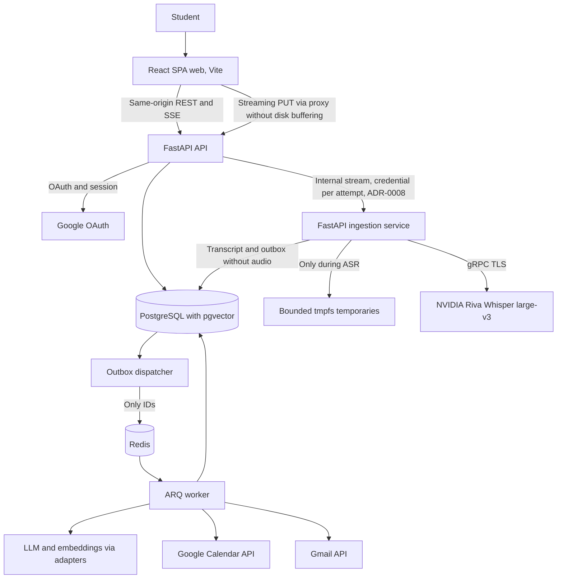
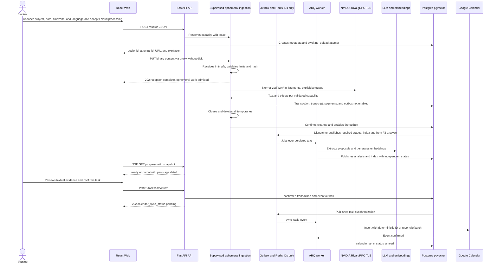
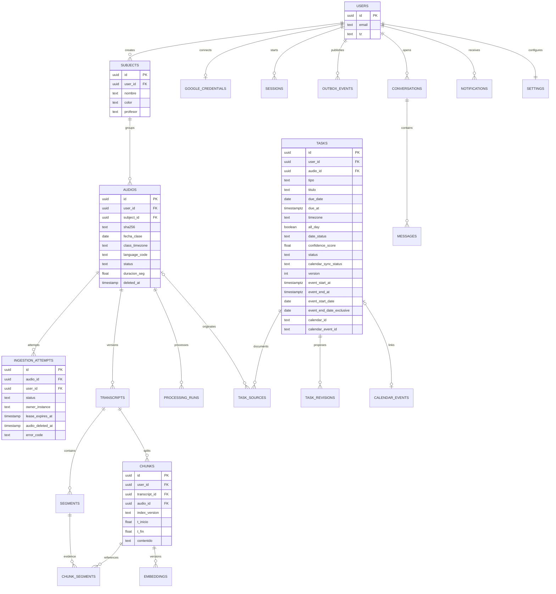

# Maulwurf — Functional and Technical Specification

> *Maulwurf* ("mole" in German): it digs through your class recordings and builds tunnels
> between your notes, your schedule, and your inbox.
>
> **In one sentence:** a NotebookLM **oriented to class audio** that, besides letting you
> chat with your notes, **acts**: it detects the tasks, exams, and to-dos the teacher
> mentions, schedules them in Google Calendar, reminds you by email, and helps you study.

---

## Table of contents

1. [Product vision](#1-product-vision)
2. [Scope](#2-scope)
3. [Architecture and stack](#3-architecture-and-stack)
4. [Functional modules (what must be done and what must exist)](#4-functional-modules)
5. [End-to-end pipeline](#5-end-to-end-pipeline)
6. [Data model](#6-data-model)
7. [Google integrations (details and gotchas)](#7-google-integrations)
8. [Non-functional requirements](#8-non-functional-requirements)
9. [DevOps and delivery](#9-devops-and-delivery)
10. [Estimated costs](#10-estimated-costs)
11. [Roadmap by phase](#11-roadmap-by-phase)
12. [Open questions and pending decisions](#12-open-questions-and-pending-decisions)
13. [Differentiators vs NotebookLM and recommended enhancements](#13-differentiators-vs-notebooklm-and-improvements)

---

## 1. Product vision

### Problem

A student records classes and accumulates hours of audio they **never listen to again**, and
the critical information (exam dates, deadlines, teacher warnings) stays buried in that
audio. Existing tools (NotebookLM included) are for **lookup**: they let you chat with the
document, but they do not turn that knowledge into **action** or alert you.

### Proposal

Maulwurf is a personal study assistant with an automatic pipeline:

```
Audio → Transcription → Task extraction (LLM) → Google Calendar
                    ↘
                      Vector indexing → Multi-subject RAG chat
                    ↘
                      Reminder and digest emails
```

### Design principles

- **Audio as input, text as the durable source:** citations open segments of the
  transcription; there is no audio playback or download. Timestamps are references to the
  original and are shown only with the precision actually available.
- **From lookup to action:** the system proposes tasks, schedules what is confirmed, and
  reminds.
- **Human in the loop:** explicit confirmation before any Calendar write, including chat
  proposals. No auto-confirmation in MVP/v1.
- **Providers behind interfaces:** NVIDIA Riva/Whisper large-v3 transcription over gRPC; LLM
  and embeddings through independent adapters. Changing provider requires capability testing
  and, for embeddings, reindexing.
- **Privacy by design:** no audio persistence in our infrastructure. Text, embeddings, and
  credentials are retained and require protection. The cloud service receives the audio; no
  100% local mode is promised.

### Binding decisions — 2026-09-19 revision

1. **No persistent audio storage:** only buffers and temporary files in RAM (`tmpfs`) while
   receiving, validating, converting, and transcribing. This includes the original,
   fragments, and converted versions. No S3/MinIO, disk, backups, Redis payloads, logs,
   traces, or caches with audio. This is an operational interpretation of "transcribe and
   delete", not a promise that memory buffers never exist.
2. **Start synchronous deletion when transcription finishes or aborts**, before
   extraction/indexing; do not wait for the class to be `ready`. On the normal path, the
   attempt does not reach `succeeded` until cleanup is verified. After `SIGKILL` or host
   loss, instant deletion is not promised: the state stays
   `transcript_committed_cleanup_pending`, the outbox remains blocked, and a supervisor on
   the same host/namespace must verify the absence of temporaries. A transcript storage
   failure never justifies keeping the audio.
3. **Mandatory user-selected language**, with no inferred value or default autodetection.
   The code is validated against an allowlist verified against the deployed endpoint;
   `multi` is out of the MVP. Do not confuse the audio language, the profile locale, and
   the time zone.
4. **NVIDIA Riva over gRPC TLS:** `grpc.nvcf.nvidia.com:443`, model `whisper-large-v3`,
   `function-id` `b702f636-f60c-4a3d-a6f4-f3568c13bd7d`, client `nvidia-riva-client`. Bearer authorization
   only from the server. Transcription operation, never `task:translate`.
5. **Without durable audio there is no durable ASR retry:** if the process/temporary is
   lost, the user must upload the file again. Analysis and indexing are retried from the
   persisted text.
6. **Validation gates:** before building ingestion, the real NVIDIA contract must be tested
   (languages, formats, sample rate, duration/payload, quotas, deadlines, and timestamps).
   The provided example does not demonstrate those limits nor guarantee temporal alignment.
   See the [implementation plan](PLAN_IMPLEMENTACION.md).
7. **Limit of the guarantee:** confirm NVIDIA's and the text providers' processing/retention
   conditions before using real classes. If the "nowhere" requirement demands zero retention
   by third parties too and the provider does not guarantee it, that cloud deployment is
   blocked; a local deletion promise does not paper over it.

---

## 2. Scope

### In scope (MVP + v1)

- Audio file upload and its automatic transcription.
- Structured extraction of: tasks, exams, deliverables, readings, to-dos, and teacher
  recommendations.
- Creating Google Calendar events (after confirmation).
- Storing transcript + embeddings and vector search.
- RAG chat over all your notes, filterable by subject, with timestamp citations.
- Checking the calendar from chat ("what do I have pending this week?").
- Email: escalated task reminders, daily and weekly digest.

### Out of scope (for now)

- Diarization (who speaks), video/link/bot ingestion, and collaboration: backlog with no
  committed phase.
- Audio playback, download, durable archiving, or retranscription without a new upload.
- Automatic language detection, ASR translation, and 100% local mode in MVP/v1.
- Native mobile apps (installable PWA after the web flow; no caching of audio/private data).

---

## 3. Architecture and stack

### 3.1 Overall diagram



### 3.2 Recommended stack

| Layer | Decision | Alternative | Rationale |
|---|---|---|---|
| Frontend | React SPA built with Vite + React Router + TypeScript + Tailwind, served as static files by a minimal Express process ([ADR-0007](adr/ADR-0007-web-stack.md)) | Next.js App Router (replaced on 2026-10-11) | Pin versions and lockfile; no SSR; optional PWA without caching private data |
| Backend | FastAPI + Pydantic v2 + SQLAlchemy 2 async | — | API and isolated ingestion service; blocking calls outside the event loop |
| Relational DB | PostgreSQL 16 | — | Data + vectors + outbox in a single DB |
| Vectors | **pgvector**, HNSW cosine | — | Hybrid search with tenant filters before retrieval |
| Queue / jobs | **ARQ + Redis** | — | Only durable work over text/IDs; native ARQ cron, not Celery beat |
| Transcription | **NVIDIA Riva / whisper-large-v3**, `nvidia-riva-client`, gRPC TLS | — | Explicit language and contract tested in F0; not an OpenAI-compatible REST API |
| Ephemeral conversion | ffmpeg/ffprobe in ingestion + bounded `tmpfs` | — | Per-fragment normalization, no audio on disk |
| LLM | **gpt-4o-mini** via **LiteLLM**, provisional | — | Pin model/versions and validate quality in Spanish and other enabled languages |
| Structured LLM | JSON schema + Pydantic v2 | instructor if the adapter requires it | Additional semantic validation; valid JSON does not imply true content |
| Embeddings | `text-embedding-3-small`, 1536 dimensions | — | Record model/dimension/version; changing requires a new index and reindexing |
| Auth | Google OAuth managed by FastAPI + opaque session cookie | — | One session authority; Next issues no JWT and holds no Google tokens |
| Durable audio | **None** | — | No bucket, persistent volume, or playback endpoint |
| Mail | **Gmail API**, incremental connection | — | Opt-in; tokens encrypted in the backend; explicit delivery limitations |

### 3.3 Proposed monorepo structure

```
maulwurf/
├── apps/
│   ├── api/            # FastAPI
│   │   ├── app/
│   │   │   ├── routers/        # audios, chat, tasks, calendar, subjects...
│   │   │   ├── services/       # transcription, extraction, rag, calendar, mail
│   │   │   ├── workers/        # ARQ jobs
│   │   │   ├── models/         # SQLAlchemy
│   │   │   └── core/           # config, security, logging
│   │   ├── prompts/            # versioned prompts (see §4.4)
│   │   ├── alembic/
│   │   └── tests/
│   └── web/            # React SPA (Vite), ADR-0007
│       └── src/
│           ├── pages/          # React Router routes
│           ├── components/
│           ├── lib/
│           └── server/         # Express: static files + SPA fallback only
├── infra/
│   ├── docker-compose.yml
│   └── Caddyfile               # reverse proxy + TLS
└── docs/
```

---

## 4. Functional modules

Each module defines: **purpose**, **what it must do** (functional requirements), **what must
exist** (components), and main **endpoints**.

### M1 — Authentication and profile

**Purpose:** identify the student and connect their Google account (needed for Calendar and
Gmail).

**What it must do:**

- FastAPI starts and resolves OAuth Authorization Code with `state`, PKCE, and validation of
  the ID token's `nonce`/issuer/audience. Identity uses the Google `sub`, not the email as an
  immutable identifier.
- Login with `openid email profile`; Calendar/Gmail permissions only when connecting each
  feature. Rejecting those permissions does not prevent transcribing or chatting.
- Random opaque session in a `Secure`, `HttpOnly`, `SameSite=Lax` cookie; store only the
  identifier hash in `sessions`, with expiration/revocation. Next and API under the same
  origin. `GET /me` returns the plain CSRF token in the body under `Cache-Control: no-store`;
  `sessions` stores only `csrf_hash`. Every mutation, including the binary upload, requires
  `X-CSRF-Token` and a same-origin `Origin`. The token rotates when the session is
  created/rotated, is shared by that session's tabs, and becomes invalid when the session is
  closed/revoked.
- Store the Google `refresh_token` **encrypted** (AES-GCM with a unique nonce and key
  version); never send it to the browser. Coordinate renewal to avoid races; keep the
  previous refresh token if Google does not return a new one.
- Revocation/`invalid_grant` marks the integration `disconnected` and asks for reconnection,
  without necessarily ending the application session.
- Profile: IANA timezone, local digest time, and opt-in preferences. Each class's timezone is
  captured as a snapshot so profile changes do not alter already-extracted dates.
- All access, SSE, tools, and jobs are isolated by `user_id`; the backend takes it from the
  session, never from the user payload or the LLM.

**What must exist:**

- `sessions` and `google_credentials` tables (user_id, encrypted tokens, granted scopes,
  expiration, status, key version).
- A FastAPI dependency in the API to validate session, CSRF, and resource ownership. The API
  is the only session authority: ingestion never receives the session cookie and accepts only
  the per-attempt internal credential of [ADR-0008](adr/ADR-0008-api-ingest-reception.md).
- User settings page and incremental consent.

**Endpoints:** `GET /auth/google/start`, `GET /auth/google/callback`, `POST /auth/logout`,
`GET /me`, `PATCH /me`, `GET /integrations/status`, `POST /integrations/google/connect`,
`POST /integrations/google/reconnect`.

---

### M2 — Audio upload and management

**Purpose:** ingest a class; `audios` is the technical name of the source record, not a
retained file.

**What it must do:**

- Target input formats: `mp3, m4a, wav, ogg, opus, flac, webm`. Enable only those tested
  with ffprobe/ffmpeg. The formats accepted by the UI are not the formats sent to Riva.
- Maximum input target: **200 MiB / 3 h**, subject to F0 capacity testing. Publish effective
  limits at `/ingestion/capabilities`; validate size during streaming and real duration with
  ffprobe, not just `Content-Length` or extension.
- Before transferring bytes, request **subject, class date, timezone, and audio language**;
  language without silent preselection. Optional: title and teacher. The request includes
  `privacy_notice_version`, `cloud_processing_accepted=true`, and
  `third_party_voice_acknowledged=true`; the server records user, version, instant, and
  declared providers. A missing or outdated version is rejected before reserving capacity or
  accepting bytes.
- `POST /audios` only validates metadata/consent, reserves RAM capacity, and creates the
  attempt; it cannot yet decide deduplication because it has not received the content. The
  binary upload uses `PUT` with `fetch`, not a framework upload helper or `UploadFile` with default spooling to
  disk. No resumable upload in MVP. The `PUT` terminates in the API, which streams it to the
  ingestion service over the internal network with backpressure and no buffering
  ([ADR-0008](adr/ADR-0008-api-ingest-reception.md)); ingestion holds the bytes only in the
  attempt's tmpfs until the API admits or discards them.
- The `PUT` computes SHA-256 incrementally and decides deduplication **by user and ingestion
  identity**: hash, language, subject, class date, and timezone (not title/teacher). Exact
  match: clean up the upload, release the reservation, and return the canonical class without
  ASR. Same hash with different language/context: clean up and return `409 duplicate_variant`
  with an opaque `variant_confirmation_token`, single use, short expiry, and bound to
  user/hash/metadata/previous class. A second `POST /audios` with that token creates a variant
  reservation and requires uploading again; when the second `PUT` finishes, the server checks
  that the hash matches before transcribing. Audio is never retained while awaiting a
  decision. A confirmed variant creates another class without mutating existing evidence or
  tasks. Transactional uniqueness resolves concurrent uploads toward the canonical class.
- Ephemeral ASR:
  `awaiting_upload → receiving → transcribing → transcript_committed_cleanup_pending → succeeded`;
  from the active states it can also end in `requires_reupload | rejected | cancelled`.
  `awaiting_upload` expires to `cancelled`; format/silence without usable text ends
  `rejected` with a typed code; technical loss of the temporary/process ends
  `requires_reupload`. No final state allows keeping temporaries.
- **Analysis and index have independent states**
  `not_requested | pending | running | succeeded | failed | cancelled`. Required stages are
  captured per class: F1 index only; from F2 analysis and index for new classes (explicit
  backfill for earlier ones). `not_requested` does not equal success. Aggregate status:
  `processing` while required stages are pending/running; `ready` if all succeed; `partial`
  if there is a usable transcript but a required stage fails or is cancelled; `failed` if
  there is no usable transcript. During ingestion the attempt status is exposed, without
  declaring success for having zero text stages started. A correct index allows chat even if
  analysis fails; correct tasks allow review even if indexing fails. Summary/topics are F2
  and do not block F1.
- Explicit attempt cancellation via an authenticated endpoint; disconnecting the upload
  before completing it cancels and cleans up. After the 202, closing the tab/SSE does not
  cancel ASR: it continues under its lease. Cancelling after the commit does not destroy the
  transcript; it returns a conflict with the current state. Cancelling or deleting invalidates
  the execution token to prevent late commits; the supervisor cancels the subprocess/gRPC and
  cleans up.
- Real progress: bytes received, fragments done/total when known; never invented percentages.
  SSE with a snapshot from the DB and polling as fallback.
- Deleting a class cancels attempts/jobs via tombstone and prevents late writes. It deletes
  the transcript, chunks, embeddings, derived tasks, summary, and associated message
  content/citations; if provenance cannot be safely separated, it replaces the message and
  its descendants with a content-free tombstone. `invalidated` never keeps text recoverable
  via API, search, prompts, or tools. Existing Google events are kept by default with a
  notice; deleting them requires an explicit option and traceable remote work.

**What must exist:**

- Subject CRUD with tenant ownership (`GET/POST /subjects`, `PATCH/DELETE /subjects/{id}`);
  prevent deleting a subject with active classes until they are moved or their deletion is
  explicitly confirmed.
- `audios` (metadata only), `ingestion_attempts`, and `processing_runs` tables; attempt owner
  and lease, per-stage states, typed errors without sensitive content.
- Ingestion service with private per-attempt `tmpfs` temporaries, resource reservation, task
  supervisor, and independent cleanup. Do not queue ASR in ARQ or pass temporary paths to
  remote workers. F0/F1 deploys a single ingestion instance; scaling requires routing to the
  reservation owner, without moving files. The upload URL is same-origin relative and
  validated with session/CSRF/attempt_id; it is not a public bearer token and does not allow
  choosing internal hosts.
- Class library with transcript reader, language, status, and the permanent "audio not
  retained" notice.

**Endpoints:** `GET /ingestion/capabilities`; `POST /audios` (metadata/consent JSON and
optional `variant_confirmation_token` → `audio_id`, `attempt_id`, URL, and expiration);
`PUT /audios/{id}/content?attempt_id=…` (binary → `202` after reception/admission,
`200 duplicate_exact` or `409 duplicate_variant`, always after cleanup);
`GET /audios?subject_id=`; `GET /audios/{id}`; `GET /audios/{id}/progress` (SSE);
`POST /audios/{id}/retry` with `{stages:["index"|"analyze"], transcript_version}`;
`POST /audios/{id}/reupload` (only without a usable transcript);
`POST /audios/{id}/attempts/{attempt_id}/cancel`; `DELETE /audios/{id}`;
`GET /audios/{id}/transcript.txt`; `GET /audios/{id}/transcript.srt` (only with valid
timestamps); `GET /audios/{id}/runs` (durable run history with the transcript, configuration
and prompt version each run applied, its status/timestamps and whether it is the run of the
active transcript and current versions). The `GET /audios/{id}` detail reports the derived
per-stage states, whether the explicit analysis backfill is available, and the non-sensitive
ASR quality warnings (`code` from the closed ingestion set `repetition`, `empty_segments`,
`low_confidence`, plus counts) for the inbox/class page; the backfill queue is the `analyze`
stage over the persisted transcript, never a reupload or retranscription.

---

### M3 — Transcription

**Purpose:** convert audio to text in its original language with verifiable temporal
traceability, without retaining audio.

**What it must do:**

- Use `nvidia-riva-client` with TLS, configurable host/function-id, and
  `authorization: Bearer …` metadata in the backend. Do not use the OpenAI SDK for ASR. Pass
  the selected language code; do not send `task:translate` or silently fall back to `multi`.
- The NVIDIA example requires 16-bit mono in WAV/OPUS/FLAC. Normalize initially to
  **WAV PCM signed 16-bit mono**, with the sample rate set after testing the endpoint
  (16 kHz as a candidate, not a guarantee). Record the effective configuration and
  client/model version.
- ffprobe validates container, codecs, duration, and channels; ffmpeg runs without network,
  without shell interpolation, and with CPU, memory, output, and time limits. Reject
  playlists/URLs and malformed files. All temporary input/output goes to `tmpfs`.
- Fragment according to Riva's real payload/duration limit, **do not assume 10 minutes**.
  Look for cuts at silences and use a small tested configurable overlap; reconcile duplicated
  words and text at the boundaries. Global timestamps = fragment offset + local times; do not
  double-count the overlap.
- Convert/process fragments sequentially with backpressure, without decoding 3 h entirely
  into RAM. Keep at most the temporary original + active fragments + bounded buffers. Size
  `tmpfs` and concurrency using the measured PCM expansion and SDK memory, not only the
  upload's MB.
- Validate whether Riva delivers word or segment offsets when requesting the corresponding
  capability. Derive segments from words only when valid offsets exist. If there is only
  text, store `timestamp_precision=none` and null times; never invent them with the LLM or
  distribute them proportionally. Reliable timestamps are an F1 exit gate; a text-only
  alternative requires explicit product acceptance.
- Persist transcript and segments in **one transaction**, with the requested language,
  model/configuration, transcript version, and precision `word | segment | none`. Do not
  publish an incomplete transcript as complete. An empty/silent response is a result without
  usable text, not a hallucination to fill in.
- Detect repetitions, empty segments and low confidence as quality signals; do not
  automatically delete legitimate phrases from the teacher. Store warnings and traceable
  normalized text; low quality requires review before proposing dates/tasks.
- Release buffers, close files/client, and delete original/converted/fragments in `finally`
  when ASR ends (success or error). No core dumps or persistent swap; read-only root
  filesystem and `TMPDIR` on `tmpfs`. This prevents recoverable persistence on disk; it does
  not promise cryptographic erasure of RAM.
- Retry transient gRPC errors within the same ephemeral attempt, with an attempt limit and a
  total deadline. Invalid auth/language/format are not retried. When the deadline is
  exhausted or the process is lost: delete, mark `requires_reupload`, and explain that it
  cannot be retranscribed from the server.
- Export TXT whenever a transcript exists; SRT only with valid, ordered times within the
  duration. Citations remain textual even without SRT.

**What must exist:**

- `TranscriptionService` and an `NvidiaRivaTranscriptionService` adapter with contract
  tests. The interface decouples the provider, but does not include a local backend in
  MVP/v1.
- ASR processing under the ingestion service's supervisor; not `FastAPI BackgroundTasks` as
  a durable guarantee nor ASR retries from Redis. Blocking gRPC client isolated from the
  event loop, with tested cancellation/deadlines.
- Heartbeat and lease per attempt in the DB. The local supervisor cleans expired folders even
  if the DB fails; a reconciler marks dead attempts and publishes work over text if the
  transaction already committed.
- Text outbox created alongside the transcript, enabled after cleanup; the reconciler
  verifies the attempt's release before dispatching the required stages (index in F1, also
  analysis from F2). The attempt only moves to `succeeded` after commit and verified cleanup.
  Failed cleanup blocks new ingestions on that instance and raises an alert; successful
  deletion is never declared without checking it.
- An expired lease does not prove deletion: record `cleanup_status=pending|verified|failed`
  separately from ASR. A supervisor on the same host/namespace must verify the absence of
  files and the termination of processes holding buffers/descriptors; a container dying does
  not imply its tmpfs mount is gone. For host loss, require evidence from the infrastructure
  plane of memory/mount destruction without snapshots/swap. Until there is a check, keep the
  cleanup state pending and block the outbox, without asking to retranscribe if text is
  already confirmed. Coordination uses a fencing token per attempt; an expired owner cannot
  publish.
- ffmpeg/ffprobe in the **ingestion** image, with no audio volume shared with ARQ.

---

### M4 — LLM analysis and activity extraction

**Purpose:** the differential core. From the transcript, extract **structure** (tasks,
dates, recommendations) with traceability to the source.

**What it must do:**

- Send the transcript (in chunks if long, with final aggregation) together with
  **context**: subject, teacher, class date, and the class's timezone snapshot.
- Produce **structured output validated with Pydantic** (JSON mode / instructor), never free
  text. Schema:

```json
{
  "items": [
    {
      "tipo": "examen | tarea | entrega | lectura | recordatorio | recomendacion | proyecto",
      "titulo": "Calculus II midterm exam — topics 1 to 4",
      "detalle": "Includes trigonometric substitution",
      "due_date": "2026-09-21",
      "due_at": null,
      "timezone": "America/Mexico_City",
      "all_day": true,
      "date_status": "resolved",
      "confidence_score": 0.92,
      "fuente": { "spans": [{ "segment_id": "…", "inicio_char": 0, "fin_char": 48 }] },
      "cita_textual": "the midterm exam will be on Monday, September 21"
    }
  ],
  "resumen_clase": "…3 to 5 sentences…",
  "temas": ["integration by parts", "trigonometric substitution"]
}
```

- **Dates:** resolve against the date and timezone captured for the class, not the upload
  date or the server's "today". `due_date` (DATE) for a full day, `due_at` (TIMESTAMPTZ) for
  an instant; mutually exclusive. No date/ambiguous: both null,
  `date_status=missing|ambiguous`, and `needs_review`. Validate impossible dates, "next
  Friday" ambiguity, and local times that do not exist or are duplicated under DST; do not
  invent midnight as a due time.
- `confidence_score` is an uncalibrated signal, **not a certainty probability** and not
  permission to auto-schedule. Pydantic validation plus deterministic rules: dates, enums,
  ranges, and segment membership in class/tenant/version.
- The LLM returns allowed IDs and spans/literal quote; offsets
  `[inicio_char, fin_char)` in Unicode code points of each segment's immutable text (not
  bytes or JavaScript UTF-16 indices). The backend reconstructs the evidence from the ordered
  spans, checks the quote against the text, and resolves `audio_id` and times from the DB. Do
  not trust invented timestamps or IDs. The transcript and the teacher's instructions are
  untrusted data, not instructions for executing tools.
- **Recommendations** never go straight to Calendar: they are manually converted into a
  task/study block with a date and explicit confirmation.
- Generate a summary (3–5 sentences) and topics; keep evidence per item. Windowed analysis
  with overlap and aggregation/dedupe by evidence, without sending full transcripts that
  exceed the context.
- **Idempotency:** `processing_runs` unique per class, stage, transcript version, and
  configuration. Upsert proposals with an evidence/type key; re-analysis creates a new
  revision and does not delete or overwrite edited, confirmed, or scheduled tasks. Activate a
  revision only when complete; do not publish partial results.

**What must exist:**

- **Versioned** `prompts/` folder (v1, v2, …) with per-version regression tests; the result
  stores `prompt_version`.
- ARQ job `analyze(audio_id)`.
- Review inbox with the literal quote and a "view transcript segment" button; timestamp only
  if it exists. Editing of date/time/timezone before confirming.
- `tasks`, `task_evidence`, `task_sources`, and `task_revisions` tables (see the data model).
  A manual task uses `source=manual` and zero sources. An extraction/chat proposal based on
  the corpus requires at least one validated source; a general suggestion without evidence is
  identified as such and is not presented as an extracted activity.
- Editing a `confirmed` task creates
  `task_revision(status=pending_confirmation, base_task_version, proposed_fields)` without
  altering the active fields. Confirming receives `revision_id` and `expected_version`; in
  one transaction it promotes the revision, increments `tasks.version`, and creates the
  outbox. A stale revision → `409 version_conflict`. Re-analysis uses the same mechanism and
  never activates partial results. Completing or dismissing also increments `tasks.version`
  (a Calendar job queued for the previous version is discarded) and keeps the linked event
  with a notice.

**Endpoints:** `GET /tasks?status=&subject_id=&due_from=&due_to=`; `GET /tasks/{id}`;
`PATCH /tasks/{id}` with `version`; `POST /tasks/{id}/confirm` with
`{expected_version, revision_id?}`; `POST /tasks/{id}/dismiss`; `POST /tasks/{id}/complete`;
`POST /tasks` (manual/chat proposal). `calendar_sync_status` and `pending_revision` are
returned separately.

---

### M5 — Google Calendar integration

**Purpose:** write events (tasks → agenda) and read them (conflicts, "what do I have this
week?").

**What it must do:**

*Writing:*

- Confirming stores the task and outbox atomically; it returns 202 with `status=confirmed`,
  `calendar_sync_status=pending`. The worker creates the event, not the confirmation request.
  Without a connected integration, the task stays confirmed and syncing is `blocked`.
- Event prefixed `[Maulwurf]`, with detail and an **authenticated link to the text segment**
  (no audio or tokens in the URL). Avoid copying the full transcript to Google. All-day uses
  `start.date`/`end.date` with an exclusive end; a timed event requires valid start/end and
  an IANA timezone. For due dates without duration, propose a visible, editable default
  duration before confirming.
- A single "Maulwurf" secondary calendar per user, created when Calendar is connected. Store
  the ID and reconcile an ambiguous creation before retrying; do not create one per subject
  in MVP.
- Remote idempotency: deterministic event ID derived from the task UUID in a format Google
  allows (hex/base32hex), tied to the target calendar. On insert timeout, look up that ID; on
  409, verify identity and reconcile. A local unique index does **not** prevent duplicates
  after a lost response.
- Date/time/title changes to an already-confirmed task stay in a pending revision until a new
  explicit confirmation; a local `PATCH` does not write to Google. When confirming the
  revision, trigger a `patch` of the linked event with version/ETag control; do not silently
  overwrite changes made in Google. Completing/dismissing a task cancels future reminders but
  keeps its event with a notice unless remote deletion is explicitly requested. Deleting a
  class also does not delete events by default.
- Agenda contract: the due date and the Calendar block are not the same thing. Store
  `event_start_at/event_end_at` for timed events, or
  `event_start_date/event_end_date_exclusive` for all-day; mutually exclusive pairs with end
  after start. The UI shows and confirms these fields next to the due date. The LLM does not
  invent a duration; a product default is visible/editable. Reminders use `due_at/due_date`,
  not the end of the block.

*Reading:*

- Sync upcoming events (window: -7 to +60 days) into a local cache (`calendar_events`)
  refreshed on demand / hourly, with full pagination, expanded recurrences, deletions, and
  explicit selection of read calendars. MVP: full window refresh with atomic publication,
  without mixing `syncToken` with incompatible filters; record coverage and last sync.
- Endpoint used by the **chat as a tool** and by the **dashboard**; report a stale cache or
  insufficient coverage.
- **Conflict detection:** distinguish time overlap from same-day deadline/exam
  concentration. Do not call events without a time "time conflicts".

**What must exist:**

- `GoogleCalendarService` with a blocking client isolated from the event loop; bounded
  retries for 429/5xx and transient quota errors, respecting `Retry-After`. `invalid_grant`
  disconnects; do not treat every 403 as retryable.
- Idempotent `sync_task_event(task_id, task_version)` job;
  `calendar_sync_status=not_requested|pending|synced|failed|blocked` separate from the task
  lifecycle. Discard jobs for stale versions. When reconnecting Calendar, current-version
  `blocked` tasks move atomically to `pending` and create/reuse their outbox; stale revisions
  or versions are not reactivated.
- `calendar_events` mirror table, unique key `(user_id, calendar_id, event_id)`, all-day
  dates separate from instants, ETag, remote status, and `last_synced_at`. The dashboard does
  not draw the task and its linked event twice.

**Endpoints:** `GET /calendar/events?from&to`, `POST /calendar/sync` (force),
`GET /calendar/conflicts`.

---

### M6 — Database, embeddings, and vector search

**Purpose:** store the queryable knowledge and retrieve it precisely.

**What it must do:**

- **Chunking:** target ~800 tokens with ~100 overlap, preferring sentence/segment
  boundaries. If a sentence exceeds the maximum, split it with preserved character offsets.
  Store `segment_ids`, spans, transcript version, and nullable derived times; a chunk is not
  the minimum evidence unit.
- **Persisted `Chunk` contract:** `audio_id`, `transcript_id`, `transcript_version`,
  `index_version`, `ordinal`, `content`, `char_start`, `char_end`, `token_count`, nullable
  `t_start`/`t_end`, and at least one `segment_id` link. Every field maps to a column of
  `chunks`/`chunk_segments`; `user_id` comes from the authenticated tenant and `tsv` is
  derived at write time, so neither is part of the contract. Each link stores its
  `chunk_segments.overlap_span` payload: segment-local `segment_ordinal`, `inicio_char`,
  `fin_char` and an optional `overlap` region `{inicio_char, fin_char, tokens}` shared with
  the previous chunk. Offsets are Unicode code points (`[start, end)`), never UTF-16 units
  or bytes; `content` is exactly the transcript slice of `[char_start, char_end)`.
- Batch embeddings in the `index(audio_id)` job; unique key per chunk and embedding version.
  Create a new index generation and activate it atomically when complete; do not mix
  versions/dimensions or expose a partial index.
- **Hybrid search from F1:** pgvector cosine + Postgres full-text, merged with RRF.
  `tsvector` with per-language configuration (`spanish`, `english`, etc.; `simple` for
  languages without a suitable configuration). Query with a compatible configuration per
  language partition; multilingual semantic search may retrieve other languages without
  silently translating the transcript.
- In **both branches** filter first by `user_id`, active resources, active version, and
  subject/date/class filters; do not do a global top-k and filter tenant afterwards. Evaluate
  HNSW recall with selective filters, using exact search for small corpora or adjustments
  supported by the pinned version.
- Class deletion → chunks → embeddings and purging of caches/derived citations; jobs
  re-verify ownership, tombstone, and version before publishing.

**What must exist:**

- Extensions: `vector`, HNSW index (`vector_cosine_ops`), and GIN on tsvector.
- `SearchService` with the RRF merge (reusable by chat).
- Fast search endpoint (used by the frontend's global Ctrl+K).

**Endpoints:** `GET /search?q=&subject_id=&from=&to=&limit=&cursor=` → paginated results
with snippet, subject, class, segment, nullable `t_start/t_end`, and `score_rrf`.
`next_cursor` is additive: an opaque keyset over the bounded RRF window; `limit` is 1..50
(default 8) and there is no deep pagination beyond that window. A per-user Redis quota is
checked before the embeddings call and returns `429 rate_limited` with `Retry-After`; its
provisional 30/min value is replaced by the D5/F0 measured provider quota.

---

### M7 — Multi-subject RAG chat

**Purpose:** chat with **all** your notes and your agenda in a single conversation.

**What it must do:**

- **Streaming** of the response (SSE), token by token.
- F1 pipeline: question → embedding → vector and lexical candidates (e.g. 30 per branch) →
  RRF → dedupe/diversity → ~8 chunks under the token budget → grounded answer. Initial
  values, not demonstrated thresholds. Optional re-ranker in F3 only if it improves metrics
  with acceptable latency/cost.
- Citations `[Calculus II · Class 03 · 31:15]` open
  `/biblioteca/{audio_id}?segment={segment_id}` and highlight the text. Without reliable
  offsets, show "segment N", not an invented minute. The backend delivers a citation
  registry with allowed IDs; the model only references those IDs, validated before rendering
  links.
- In streaming, keep citation markers buffered until their ID is validated; never render
  arbitrary model links as sources. Record every source delivered to the model (not only the
  cited ones), including those inherited from history/summaries, in `message_sources`. When
  deleting a source, purge dependent content/citations or replace messages and descendants
  with content-free tombstones; revalidate tombstone/version before persisting and emitting
  `done`. Text already seen by the user or sent to a provider cannot be withdrawn; state
  that limit.
- Without enough evidence: say so and ask for context; do not fabricate sources/dates.
  Distinguish transcript evidence, Calendar data, and general explanation. History does not
  replace current retrieval nor authorize using deleted sources.
- **F2 tool calling:** allowlist `get_calendar_events(range)`, `get_pending_tasks()`, and
  `propose_task()`. User/permissions are injected by the backend; ranges/schemas validated,
  maximum iterations/time. No chat tool writes to Calendar or sends email; always confirm in
  the UI.
- Transcript, tool results, and messages are untrusted data: resist embedded instructions,
  do not execute extracted commands or URLs. Sanitized Markdown rendering, no unsafe HTML,
  and redaction of provider traces.
- Persistent history with a token budget and configurable retention; conversations and
  messages isolated per tenant. Idempotent `client_message_id`; states
  `streaming|completed|failed|cancelled`, cancellation, and explicit partial-response
  handling.
- At most two concurrent SSE streams per user. A third `POST` is rejected with
  `429 rate_limited` before the turn is persisted.
- Modes: all subjects, a subject, or a class, always within the tenant. Tutor system prompt
  with guidance without claiming more than the sources.

**What must exist:**

- `conversations` and `messages` tables (role, content, JSON citations).
- `RAGService` (reuses `SearchService`) + tool orchestrator.
- UI: composer with mode selector, clickable citation rendering, follow-up suggestions.

**Endpoints:** `POST /chat/conversations`; `GET /chat/conversations`;
`GET /chat/conversations/{id}/messages`; `POST /chat/conversations/{id}/messages` (SSE
consumed with `fetch`, not `EventSource`);
`POST /chat/conversations/{id}/messages/{message_id}/cancel`;
`DELETE /chat/conversations/{id}`. The stream emits an initial `snapshot`, then `delta*`,
`citation*`, and exactly one terminal `done|error`, all with a monotonic ID. Reconnection
consults the persisted message; it does not re-run the LLM with the same
`client_message_id`. The ingestion SSE GET is recovered via snapshot.

---

### M8 — Email and notifications

**Purpose:** the student should not need to open the app to avoid missing anything.

**What it must do:**

- **Escalated reminder** per confirmed task not completed/dismissed: **T-48 h**, **T-24 h**,
  and **T-2 h** for timed instants (configurable). "View in Calendar" only if the event
  exists; alternative link to the task. "Snooze" opens an authenticated UI; it never mutates
  state through an email GET.
- **Daily digest** (configurable time, e.g. 07:00): today's pending items + what is due
  tomorrow.
- **Weekly digest** (Sunday evening): overview of the week, newly detected tasks, calendar
  conflict warning.
- Sending via **Gmail API** (the same OAuth account; zero extra providers in MVP/v1). Resend
  or another provider is out of scope and requires a new decision, privacy/retention review,
  delivery contract, budget, and a joint update of the specification and plan.
- **Anti-spam:** group reminders and deduplicate scheduling with a unique key
  `(user_id, tipo, task_id, due_version, occurrence)`. Digest per user/local date. Changing
  the due date/preferences cancels stale future occurrences; never send all expired
  thresholds retrospectively for a newly confirmed task.
- Gmail does not offer exactly-once delivery with `gmail.send`: if the response is lost
  after sending, mark `delivery_unknown` and do not retry automatically to avoid duplicates.
  Show it in the panel; a manual resend warns about the risk. A stable `Message-ID` does not
  guarantee remote dedupe.
- Dates **without time**: T-3d/T-1d reminders at the configured local time, not T-2h. DST: a
  nonexistent time moves to the next valid instant and a repeated time runs only once (single
  local occurrence). Tasks without a date have no escalated reminders.

**What must exist:**

- Native ARQ cron scheduler with a single active role; it computes due dates/local times
  every minute and claims rows atomically. Target send SLA within 15 min, not second-level
  exactness; multiple workers protected by uniqueness and leases.
- HTML + plain-text templates, escaped content and minimal data; recipient limited to the
  user's verified email in MVP. Do not expose arbitrary sending to the LLM.
- `notifications`: `scheduled_at`, `due_version`, `dedupe_key`,
  `status=pending|sending|sent|failed|delivery_unknown|cancelled`, `sent_at`,
  `provider_message_id`, attempts, and a redacted error. An expired `sending` lease counts
  as uncertain delivery, not automatically pending.

**Endpoints:** `PATCH /me/notifications` (preferences); `POST /notifications/test`;
`GET /notifications?status=&from=&to=&limit=&cursor=`; `POST /notifications/{id}/resend`
with `{acknowledge_duplicate_risk:true}`. Resending creates a new audited occurrence and
never changes a `delivery_unknown` delivery to `pending`.

---

### M9 — Student dashboard

**Purpose:** a command view: agenda + pending tasks + ingestion status, on one screen.

**What it must do:**

- Calendar (FullCalendar) showing Google events + Maulwurf tasks (color per subject).
- "To confirm" inbox: tasks with textual evidence and editable dates, distinguishing
  ambiguity and ASR quality.
- Upcoming due dates, Calendar sync status, and Google reconnection.
- Per-subject statistics: transcribed classes, original duration, and topics covered (no
  stored audio).
- Class page: **transcript reader** with linkable/highlightable segments, timestamps when
  they exist, summary, topics, and detected items. No `<audio>`, signed URLs, karaoke
  playback, or a retranscribe button without a new upload.
- Upload UI with mandatory language, effective limits, and consent; "upload again" for lost
  ASR and "retry analysis/index" for failures over text, without confusing them.

**What must exist per phase:**

- F1: `AudioUploadForm`, library, `TranscriptReader`, ingestion/index status, and chat.
- F2: `TaskInbox`, `CalendarView`, conflicts, sync status, and reconnection.
- F3: delivery/notification panel, final preferences, `SubjectStats`, and Ctrl+K. A "complete
  dashboard" means the sum of these capabilities; it does not pull Gmail forward to F2.
- Next routes: `/` (public landing without session and dashboard with session),
  `/biblioteca`, `/biblioteca/[audio_id]`, `/chat`, `/materias`, `/settings`.

---

## 5. End-to-end pipeline

Full sequence, from upload to the Calendar event:



**Error handling:** ASR only supports bounded retries during the ephemeral lease; losing
audio before the commit requires a re-upload. If the commit exists and the process dies
before publishing, the reconciler cleans/verifies the attempt and enables the outbox without
retranscribing. Analysis and index are retried independently from text (initial maximum 3
for transient errors, backoff with jitter); provider 4xx responses other than 408/429,
protocol/configuration errors and non-retryable database errors are permanent and are not
retried. An analysis failure does not block chat with a valid index. Calendar keeps `confirmed` with pending/failed/blocked syncing; the worker
reconciles the remote ID before inserting. Redis can be lost: the DB/outbox allow rebuilding
durable work, **not** rebuilding audio. The UI does not declare a stage done or a temporary
deleted without the corresponding confirmation.

---

## 6. Data model

### 6.1 ER diagram



### 6.2 Design notes

The ER is a summary; it does not replace the migrations. Additional minimum contracts:

- All tenant tables contain `user_id`; composite foreign keys `(user_id, recurso_id)` avoid
  cross-references, in addition to authorization in services. RLS as an additional defense
  with transactional `SET LOCAL` and an application role without bypass; also test the
  connection pool and workers.
- `audios` has no `storage_key`, blob, or durable path. SHA nullable until the upload
  completes; partial unique `(user_id, sha256, language_code, subject_id, fecha_clase,
  class_timezone)` for non-deleted classes with a known hash; context fields NOT NULL and
  normalized. Non-unique index `(user_id, sha256)` detects variants requiring confirmation
  per M2. Concurrent inserts resolve the conflict transactionally toward the canonical
  record; deleting also deletes the hash. Failed attempts reuse the record, they do not
  create duplicates. Store the required stages per class and the active
  transcript/analysis/index versions.
- `ingestion_attempts`: a single active attempt per class, byte counters, owner/lease/
  heartbeat, fencing token, `cleanup_status`, cleanup evidence without sensitive payload,
  reception/ASR/cleanup timestamps, and a typed error. It also records
  `privacy_notice_version`, `cloud_processing_accepted_at`,
  `third_party_voice_acknowledged_at`, and the declared providers' set/versions.
  `audio_deleted_at` only after verifying the absence of temporaries. Proposed initial
  expirations: 10 min to start the upload, 30 min of reception, 60 min from complete
  reception for ASR; adjust with the F0 benchmark and publish effective limits. Sweeper
  target every 60 s; normal cleanup is immediate, it does not wait for the TTL.
- `transcripts`: unique `(audio_id, version)`, text, requested language,
  provider/model/configuration, `timestamp_precision`, quality, and summary/topics with the
  analysis version. `segments`: stable ID within a version, ordinal, text, and character
  offsets; `t_inicio/t_fin` nullable, with `0 ≤ start < end ≤ duration` when present. Do not
  duplicate a mutable segments JSON and rows as two sources of truth.
- `chunk_segments` links chunks to segments/spans and keeps evidence even with overlap.
  `overlap_span` is a validated JSON object with the segment-local `segment_ordinal`,
  `inicio_char`, `fin_char` and an optional `overlap` `{inicio_char, fin_char, tokens}`
  sub-range shared with the previous chunk; it is omitted when there is no overlap. A
  chunk's coverage of a segment is therefore self-describing, and the derived chunk times
  never publish a zero-length range (`t_start < t_end` when both are present).
  `embeddings`: chunk, model, dimension, version, and fixed-dimension vector; HNSW per
  compatible generation. `processing_runs` unique per
  `(audio_id, stage, transcript_version, config_version)` with status and error; an
  `analyze` run also stores its `prompt_version`, and the configuration version is derived
  from it so a prompt change creates a new run. A version bump never overwrites the previous
  row: old runs remain queryable and only the run of the active transcript and current
  versions feeds the derived stage state. Active versions are published atomically.
- `tasks.status`: `pending|needs_review → confirmed|dismissed`;
  `confirmed → completed|dismissed`. Resolve date/quality before confirming; confirming
  requires a valid date and checked evidence for extracted tasks. `calendar_sync_status`
  separate; `scheduled` is not a task status. `audio_id` may be kept as an optional primary
  source, but normative provenance lives in `task_sources` to support chat proposals with
  zero, one, or several classes.
- `task_sources` links task, audio, transcript version, segment, and validated span;
  deleting a source invalidates/purges pending proposals that depend on it.
  `task_revisions` stores `base_task_version`, proposed fields, state
  `pending_confirmation|activated|discarded`, and a tenant-aware relation to the run that
  produced it.
- Date CHECK: resolved all-day → only `due_date`; resolved with time → only `due_at`;
  ambiguous/no date → both null. Store the original date text, review reason, due version,
  and timezone snapshot. Persist `event_start_at/event_end_at` or
  `event_start_date/event_end_date_exclusive` directly on `tasks`, with mutually exclusive
  pairs and end after start. Confirming validates the due date, the agenda block, and the
  revision. `confidence_score` nullable on manual tasks, bounded [0,1], no probabilistic
  semantics.
- `calendar_events`: key `(user_id, calendar_id, event_id)`; nullable link to task and
  source `google|maulwurf`. A task has at most one linked event; other Google events have no
  task. Persist the write calendar in settings, the selected read calendars, and sync
  status/ETag/coverage.
- `messages.citas` references
  `{audio_id, transcript_version, chunk_id, segment_id, t_inicio, t_fin}` and validated
  text; normalize links in `message_sources` to locate/purge derived responses when deleting
  a source. Do not keep orphan snippets or trust unvalidated JSON from the LLM.
- `outbox_events`: ID, tenant, type, resource, version, `blocked_reason`, attempts, and
  publication date; **only IDs/non-sensitive configuration**, never audio or tokens. The
  `cleanup_pending` gate applies only to `index_requested` and `analyze_requested` derived
  from an ingestion. Calendar, notifications, and deletions are created enabled in their own
  transaction after validating authorization/tombstone/version. Consumer jobs idempotent;
  outbox and stuck-execution reconciliation. The requested remote deletion uses an
  independent operation record that survives the purge until resolved.
- `notifications` per M8 and `sessions` per M1. `settings` exists at most in F2 for the
  write/read calendar and is extended in F3 with Gmail/digest preferences. For tasks use two
  partial indexes —`(user_id,status,due_at)` and `(user_id,status,due_date)`—; do not cast
  `date` to `timestamptz` in an index. GIN/HNSW indexes are validated with representative
  plans and recall.

---

## 7. Google integrations

| Aspect | Detail |
|---|---|
| OAuth scopes | Login: `openid email profile`. Calendar, incremental: evaluate `calendar.app.created` to manage the app-created secondary calendar + `calendar.events.readonly` and `calendar.calendarlist.readonly` to read the selected ones. Confirm exact permissions with real calls in F0/F2; do not assume any scope can create calendars. Gmail: `gmail.send`, opt-in in F3 |
| Flow | FastAPI owns OAuth/tokens and the opaque session; Next is UI only. Granted scopes are recorded and checked per operation |
| Refresh | Renew before expiry, coordinated per user; `invalid_grant` disconnects the integration. Timeout/5xx is not revocation |
| Calendar | Secondary "Maulwurf" calendar on connect; store the ID and reconcile uncertain responses. Do not modify the primary or others' events by default |
| Quotas | Measure effective per-project/user quotas; rate limit, backoff with jitter, and a budget per integration. Do not promise unlimited capacity |
| Testing/verification | Review consent status, test users, and current policies. In external Testing mode, refresh tokens with additional scopes usually expire after 7 days; not irrelevant for personal use. Production may require verification depending on scopes and audience |
| Google Tasks | A public API does exist; its dates do not replace a full model of times/duration/agenda blocks. We chose Calendar for the product, not because Tasks is missing |
| Gmail delivery | `gmail.send` does not allow reconciling by searching sent messages; do not expand scopes automatically. Uncertain deliveries are handled per M8 |

---

## 8. Non-functional requirements

### Security

- Google tokens encrypted with AES-GCM and key rotation; DB/backups encrypted for text and
  embeddings. Secrets injected by the deployment manager, never in the repository, frontend,
  or traces.
- Opaque session and CSRF per M1; end-to-end TLS where applicable, restrictive CORS. Auth.js
  is not used as an implicit JWT/JWKS issuer.
- Distributed rate limit and per-user quotas: audio bytes/minutes, ingestion slots, LLM
  tokens, chat, and Google. Admission rejects before receiving audio when there is no
  capacity (`429`/`503` with retry), without a queue of files waiting on disk.
- Ingestion defense per M2/M3: streaming parser, byte/duration/time limits, ffmpeg sandbox,
  random internal names. Proxy without disk buffering, caching, or body capture; do not use a
  CDN that stores upload requests.
- No audio, transcript, full prompts, credentials, or PII in logs/Sentry/traces. Only IDs,
  duration, sizes, status, and redacted errors. Disable core dumps, persistent swap, and
  memory snapshots/hibernation on ingestion hosts; tmpfs alone is **not** enough if it can
  swap.
- Browser: `Cache-Control: no-store` for private content; the service worker excludes
  upload, API, transcripts/chat, and SSE responses; do not store audio in IndexedDB/Cache
  Storage. Release `File`/object URLs on finish/cancel; the user's local original is not
  deleted by the application.
- Account deletion: `DELETE /me` returns `202 {deletion_operation_id}`. The flow applies
  tombstones, blocks sessions/jobs, leaves the initiating session in a restricted mode (check
  the deletion status and sign out; other sessions are revoked), requests authorized remote
  deletions while credentials exist, purges data, and then removes tokens.
  `GET /me/deletion/{id}` exposes `pending|completed|completed_with_remote_failures`; the
  residual record keeps only remote IDs, authorization, status, redacted error, and
  expiration. Do not delete other people's events; without permissions, deletion in Google
  is not guaranteed.
- Backups only of encrypted text/metadata, proposed maximum retention 30 days, and a
  deletion log reapplied on restore. The UI distinguishes deletion of active data, backup
  expiration, and data already sent to third parties. Consent for third-party voices and
  cloud processing before the upload.

### Performance

- The upload holds one connection during reception; ASR continues supervised after the 202,
  without audio durability. Blocking gRPC/Google outside the event loop; analysis/index via
  ARQ.
- Objectives to be measured, not guarantees: chat first token p95 ≤ 5 s (separate cold
  start), hybrid retrieval p95 ≤ 500 ms on a reference corpus. Measure ASR by duration/
  language and concurrency before setting an SLA.
- 200 MiB / 3 h target conditioned on real memory/capacity. Proxy limits aligned with
  admission and the reception timeout; SSE without buffering, with heartbeats. Cancellation,
  disconnection, and restart tested, not an infinite "no timeout".

### Observability

- JSON logs with `request_id`, `audio_id`, `attempt_id`, and `run_id`, without sensitive
  payloads.
- Metrics: RAM/tmpfs/slots, ASR latency, temporary age, failed cleanup, expired leases,
  outbox lag, retries, tokens/cost, recall/invalid citations, sync/uncertain delivery.
  Immediate alert when cleanup is not met; per-stage failure panel.
- `GET /healthz` per process; the API's `GET /readyz` checks Postgres/Redis, and the
  ingestion one checks the DB, safe temporaries, cleanup, and operational capacity. Do not
  invoke paid providers on every healthcheck.

---

## 9. DevOps and delivery

### 9.1 Local / VPS environment (docker-compose)

Services: `web`, `api`, `ingest` (FastAPI, supervisor, ffmpeg, and the Riva client),
`worker` (ARQ), `scheduler` (single ARQ cron role + reconciliation/outbox), `postgres`
(`pgvector/pgvector:pg16`, pinned version), `redis`, `caddy`. **No MinIO/S3 and no audio
volume**. API and ingestion share auth code, not temporaries.

Persistence for PostgreSQL and, if configured, Redis with IDs/status only. Ingestion with
per-instance `tmpfs`, read-only root, non-root user, resource limits, no swap/core dumps. On
restart/drain, cancel or finish ASR within the deadline and clean up; a deployment may
require re-upload. Do not scale/relocate attempts as if audio were durable. Verify on the
host that the memory configuration meets the policy.

### 9.2 CI/CD (GitHub Actions)

Team decision 2026-09-20; the runner and registry are formally recorded in the L1.2 ADR.

- **MR:** lint (ruff + ESLint), types (mypy + tsc), tests (pytest + Vitest), integration
  with Postgres/pgvector/Redis, E2E, and API/ingest/web builds. Pipeline without provider
  secrets on untrusted MRs.
- **Main branch:** versioned images published from Actions to the project registry
  (GitHub Container Registry as candidate); controlled deployment with approval and
  rollback, no automatic updates without tests. Alembic as a single prior job, migrations
  compatible with application rollback.
- Explicit/manual or scheduled cloud tests with budget and protected credentials; do not
  confuse a mock with a validated Riva/Google contract.

### 9.3 Quality

- Unit: dates/DST, textual evidence, token limits, ASR offsets/overlap, RRF, states/
  idempotency, dedupe, and reminder calculation.
- Integration: real DB/queue services, a test gRPC server for deterministic errors, real
  proxy and ffmpeg, tenant isolation, and restarts. Real Riva/Google contracts in a separate
  suite. An LLM mock validates orchestration, not extraction/RAG quality.
- E2E: upload with mandatory language → transcription → deletion → index → question with a
  literal citation → review → Calendar → reminder; include independent analysis/index
  failure and Google revocation.
- Synthetic test audio generated **in RAM at execution time**, never versioned or kept as a
  CI artifact. Persist only non-sensitive metrics and textual expectations. Test deletion on
  success/error/timeout/cancellation/SIGKILL/restart and no writing to disk/Redis/logs/cache.
- Text dataset annotated per language with tasks/dates/evidence and answerable/unanswerable
  queries; compare versioned models/prompts. Measurable acceptance gates and test plan in
  `PLAN_IMPLEMENTACION.md`.

---

## 10. Estimated costs

Scenario: 1 student, ~10 h of class/week (40 h/month), ~200 chat questions/month.

There is no validated budget yet. **40 h are 2400 minutes**: the earlier calculation of
$2.40 at $0.006/min was incorrect (it would be $14.40), and that rate also does not
necessarily correspond to NVIDIA Riva.

| Item | How to estimate / pending |
|---|---|
| NVIDIA ASR | Ask about pricing, credits, quotas, and endpoint availability for the account; measure effective minutes, overlap, and retries. Do not assume free credits are production capacity |
| Extraction + chat | Input/output tokens per model, overlapping windows, history, and retries; ~200 questions is not 200 fixed-size sessions |
| Embeddings | Initial tokens + queries + reindexing on model change |
| Infrastructure | ffmpeg CPU, RAM/tmpfs per slot, DB/vectors/backups, Redis, TLS, and transfer. Size from the benchmark; do not promise a $5 VPS for 3 h/arbitrary concurrency |
| Monthly total | Pending F0/F1 measurement; set budget and alerts before accepting real load |

Durable audio storage is removed, and with it that cost — **not** the memory, processing, or
cloud-processing costs. A local mode would have hardware/operation costs and is not part of
the current commitment.

---

## 11. Roadmap by phase

| Phase | Content | Exit criterion |
|---|---|---|
| **F0 — Feasibility and foundation** | Real Riva/privacy/timestamps/languages/limits spike; ephemeral architecture; monorepo, CI, opaque auth, schema, subjects | Contract and capacity documented; cleanup under failure tested; session/isolation and builds/tests pass. Without this, real ingestion is not enabled |
| **F1 — Knowledge** | Ephemeral ingestion → transcript → hybrid index → reader → chat with literal citations | 1 h class E2E and effective limit; G1, G2-T or G2-X, G3, G4, and G5-F1 approved |
| **F2 — Action** | Versioned extraction, human review, idempotent Calendar, reading agenda/tools, and conflicts | G5-F2, G6, and G7-CAL approved; events only after confirmation; all-day/DST and reconnection tested |
| **F3 — Reminders** | Opt-in Gmail, digests, reminders, delivery panel, statistics, and Ctrl+K | G7-MAIL and G8 approved; dedupe/DST/uncertain delivery and a real test send observed |
| **F4 — Uncommitted backlog** | Quizzes, exports, study plan, briefing | Requires its own prioritization; does not block the MVP nor imply persisting audio |

The [detailed plan](PLAN_IMPLEMENTACION.md) defines dependencies, deliverables, and tests
per phase. Week estimates are not kept without a capacity spike or a defined team.

---

## 12. Open questions and pending decisions

The ephemeral-audio, mandatory-language, and Riva-provider decisions are closed (§1); they
are not offered again as retention/autodetection options. Real pending items:

| ID | Pending decision/validation | Effect and gate |
|---|---|---|
| D1 | Personal deployment initially; confirm whether there will be a SaaS | Multi-tenant from F0. Google audience/consent and privacy review before opening to third parties |
| D2 | Riva contract: exact languages, timestamps, formats/rate, limits, concurrency, quotas, and pricing | Blocking F0 spike; allowlist only with tested codes. `en`/`fr` appear in the provided example; they do not prove support for every needed language |
| D3 | Provider retention/processing and permission for third-party voices | **D3-Audio** closes in F0 before real audio. **D3-Text** closes per provider/model before the first real transcript is sent to embeddings/LLM; changing provider reopens the decision |
| D4 | Size/duration/deadlines and RAM per slot | 200 MiB/3 h target, initial lease values in §6; the F0 benchmark determines published limits and instance capacity |
| D5 | Quality/cost of the proposed LLM and embeddings | F1/F2 evaluation per language; do not assume valid JSON or high confidence implies accuracy |
| D6 | Timestamps unavailable or insufficient at the endpoint | Blocks F1's temporal promise; decide validated ephemeral alignment or accept a text-only product. Do not implement a hidden fallback |
| D7 | Minimum scopes and real Google behavior | **D7-CAL** before F2; **D7-MAIL** and uncertain delivery before F3. Each half requires a real contract and a protected account |
| D8 | Text/chat retention and backups | Approve the policy before persisting the first non-synthetic transcript/chat; F3 validates restore, expiration, and reapplication of deletions |

Out of MVP/v1: diarization, URL/bot sources, collaboration, local mode, per-subject
calendars, and other task managers. Future diarization would have to run during ingestion or
request a re-upload; it cannot be recovered from already-deleted audio.

---

## 13. Differentiators vs NotebookLM and improvements

### 13.1 Direct comparison

An indicative product comparison, **not a current audit of NotebookLM**: its capabilities/
limits change and were not verified in this review. Avoid basing decisions on the
competitor's supposed shortcomings.

| Capability proposed in Maulwurf | Commitment |
|---|---|
| Audio ingestion | Ephemeral, capacity-limited, no retention or playback |
| Chat with citations | Linked textual evidence; timestamps only when validated against ASR |
| Tasks/exams | Extraction with evidence, reviewable dates, and human confirmation |
| Google Calendar | Secondary calendar, idempotent sync, and reading tools |
| Reminders | Opt-in, due dates/digests, explicit Gmail delivery limits |
| Multi-subject search | Hybrid and multilingual, always isolated per user |
| Privacy | Audio without first-party persistence; declared cloud processing, not "100% local" |
| Summaries/topics | Based on the transcript, versioned, and subject to ASR/LLM quality |

### 13.2 Core differentiators (already within this spec's scope)

1. **From lookup to action:** integrated flow transcription → proposal → confirmation →
   Calendar → reminder.
2. **Traceable citations without keeping audio:** open the text segment with a time
   reference when available. The citation shows what the system transcribed; it does **not**
   guarantee that ASR heard a date correctly, which is why human review is essential.
3. **Human in the loop:** nothing enters Calendar without confirmation and visible evidence,
   no score-based auto-confirmation.
4. **Agenda as context:** notes + tasks + authorized events, indicating sync coverage and
   freshness.

### 13.3 Recommended enhancements (student extras) — prioritized

**Exploratory backlog, not committed scope.** Any future audio source respects the same
ephemeral deletion and explicit language selection. Every external write requires
confirmation; no enhancement recovers deleted audio. The P1–P4 priorities are not the F1–F4
phases.

**P1 — Active study (turns Maulwurf into a tutor, not just an archive):**

- **Exam mode:** generates quizzes and cards from your notes for a subject (multiple choice,
  fill in, flashcards) with **Anki export** (`.apkg` / CSV). Active review > rereading.
- **Spaced repetition:** flashcards with an evaluated algorithm (SM-2 as a candidate);
  proposes review blocks the user confirms.
- **Backward study plan:** from a confirmed exam date, proposes blocks in available gaps.
  Recalculating produces another proposal; it does not modify Calendar automatically.
- **Pre-class briefing:** the night before each class (detected by subject/day pattern), a
  5-line email with the essentials of the previous class + "3 questions you could ask
  tomorrow".
- **Overlap detector:** 2 exams in the same week → suggests redistributing the study plan.

**P2 — Frictionless capture:**

- **Telegram/WhatsApp bot:** you forward the class group's voice note or record straight to
  the bot → it appears in your library already transcribed. Reduces the friction of "opening
  the web and uploading a file" to almost zero.
- **Link ingestion:** requires legal review, SSRF defense, and strictly ephemeral download
  before using the Riva pipeline; not enabled in MVP/v1.
- **Installable PWA + quick capture:** a record button on the phone that uploads when the
  class ends.
- **Global Ctrl+K (F3):** hybrid search from any screen, with links to transcript segments,
  not audio.

**P3 — Organization and understanding:**

- **Topic map per subject:** graph of topics mentioned across classes ("this connects with
  class 4") — detects thematic threads across audios, impossible to see in an isolated
  notebook.
- **Editable per-subject glossary:** correction of recurring badly transcribed terms
  (theorem names, acronyms) with re-indexing.
- **"Summary of 3 things":** when an audio finishes processing, a push/email with the 3 key
  ideas — digestible in 30 seconds.
- **Follow-up suggestions after each chat answer** (like NotebookLM, but aimed at study:
  "want me to make a quiz of this?").
- **Export:** class summary to Markdown/PDF; a subject's notes to a review document.

**P4 — Techniques/community:**

- **Future local deployment:** a separate feasibility project (ASR, LLM, embeddings,
  hardware, and operation), not a magic flag or a current capability. It requires deciding
  which cloud integrations are disabled.
- **Shared notebooks:** sharing a subject with 2–3 classmates (each with their own Calendar,
  tasks split among them).
- **Own Audio Overview:** a version of NotebookLM's podcast but **customized to the next
  exam** ("review the Friday exam topics with me").
- **Simple public API:** so Maulwurf can be the study database of other tools (Notion,
  Alfred/Raycast).

### 13.4 Anti-features (what to copy from NotebookLM and what NOT to do)

- **Copy:** extreme UI simplicity; sources with visible citations; question suggestions.
- **Avoid:** turning this into a generic notes manager (Obsidian-like apps already exist).
  Maulwurf is **audio + action**; any feature that does not fit that sentence goes to the
  bottom of the backlog.

---

*Living document: update via PR. The pending decisions from §12 are resolved in this file
and recorded with a date.*
