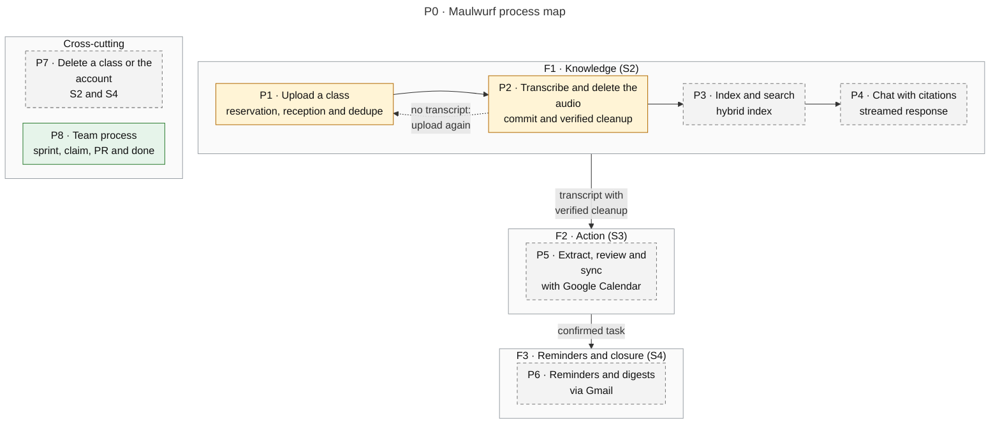
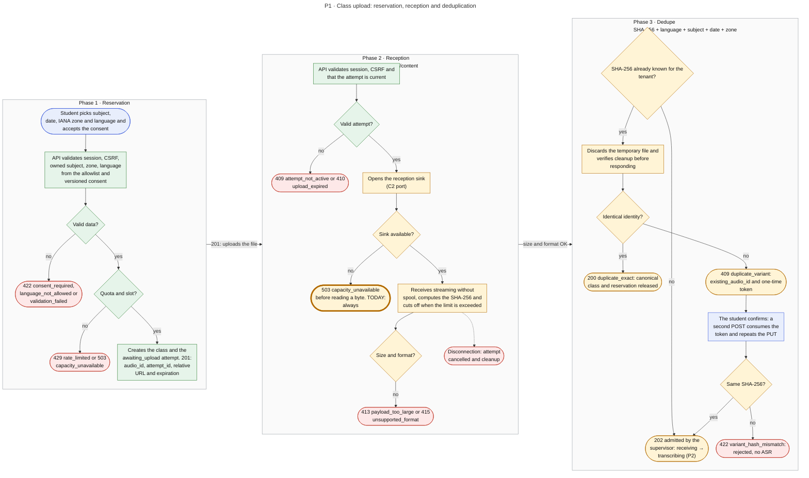
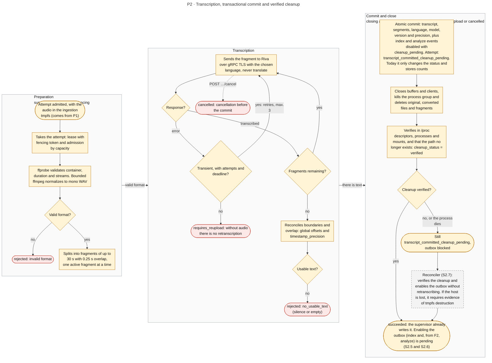
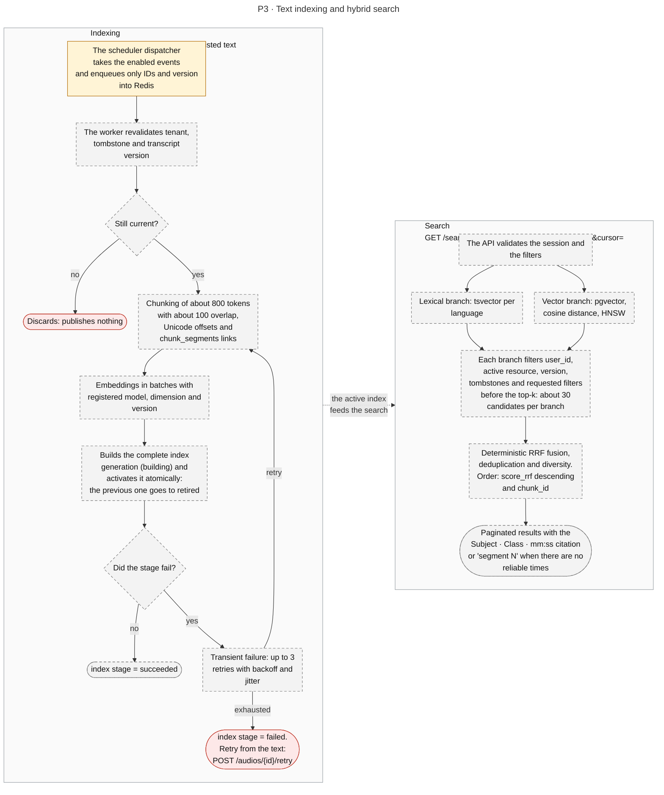
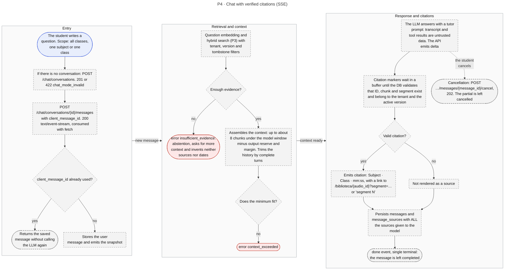
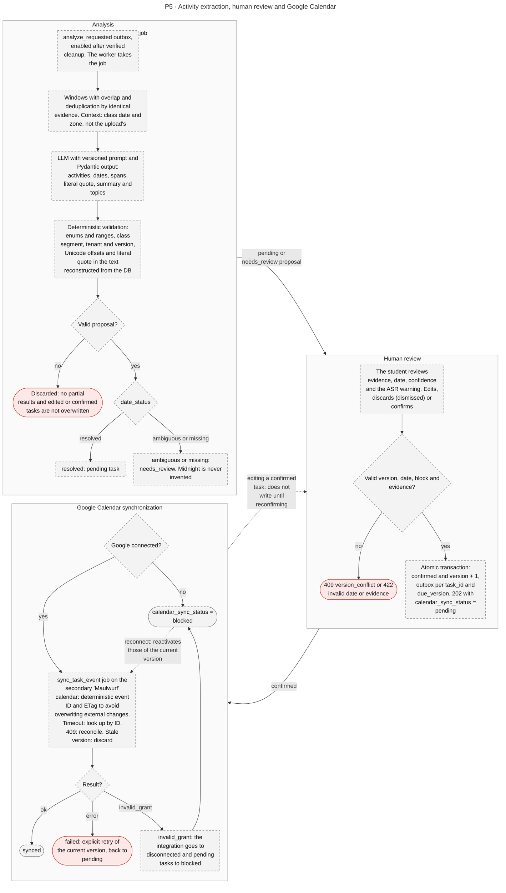
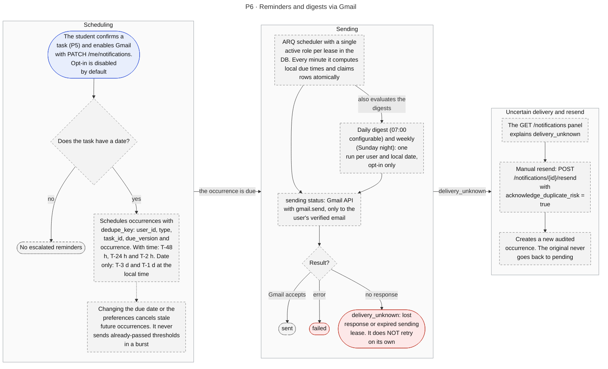
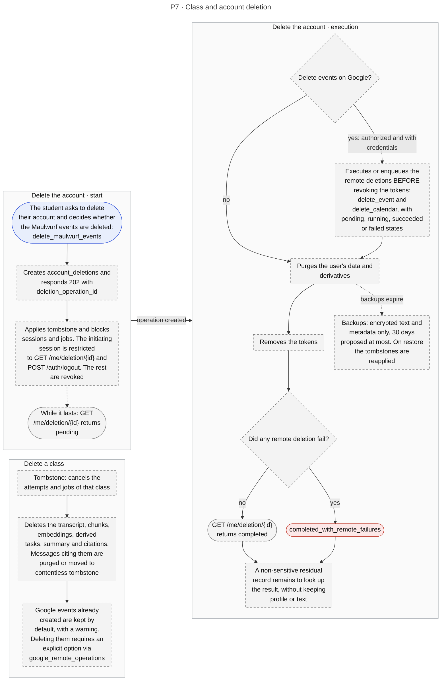
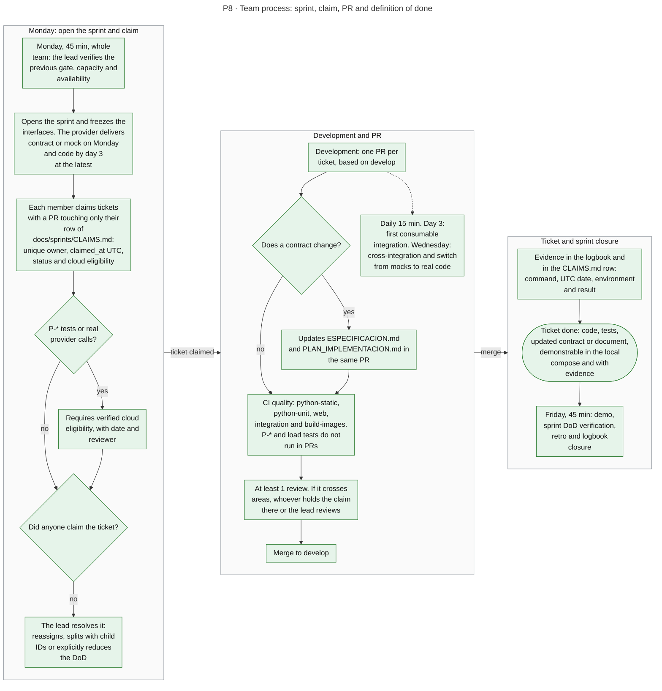

# Process Diagrams — Maulwurf

> **Status:** processes derived from [ESPECIFICACION.md](ESPECIFICACION.md) (modules M1–M9 and
> §5), from [DISENO_BD_API_SPRINTS.md](DISENO_BD_API_SPRINTS.md) (§2.10 and §3) and from the
> plans [S1](plan/S1.md)–[S4](plan/S4.md), contrasted with the `develop` code at `16cf45b`
> (2026-10-30). They create no contracts: on any difference, the specification and the
> [implementation plan](PLAN_IMPLEMENTACION.md) prevail. The architecture is in
> [ARCH.md](ARCH.md).

## 1. What a Process Diagram Is

A **process diagram** describes a workflow from start to finish: who acts, in what order, which
decisions open branches and how each one ends (success, error or cancellation). It is the "how
it happens" of a use case. It does not replace the project's other diagrams:

| Diagram | Answers | Where it is |
|---|---|---|
| Architecture | Which pieces exist and how they connect | [ARCH.md](ARCH.md) |
| **Process** | Which steps, decisions and error branches a flow has | This document |
| Sequence | Which messages the participants exchange and in what order | [ESPECIFICACION §5](ESPECIFICACION.md#5-end-to-end-pipeline) |
| States | Which states an entity has and which transitions are valid | [DISENO §2.10](DISENO_BD_API_SPRINTS.md#210-state-machines-frozen-contracts) |
| Data | Which tables and relations exist | [ESPECIFICACION §6.1](ESPECIFICACION.md#61-er-diagram) |

## 2. How to Read Them

| Style | Meaning |
|---|---|
| Green fill | Implemented and in use |
| Amber fill | Exists in the code, but the process does not work end to end |
| Gray fill, dashed border | Specified or planned only |
| Red fill | Error or rejection terminal |
| Blue fill | External actor or system |
| Diamond | Decision; branches carry their condition |
| Rounded terminal | Outcome, with its HTTP code or status |

| Process | Phase and sprint | Status (reconciled 2026-10-30) | SVG |
|---|---|---|---|
| P0 · Process map | All | — | [proc-00-mapa.svg](diagrams/proc-00-mapa.svg) |
| P1 · Upload: reservation, reception and dedupe | F1 · S2 | Partial: default sink answers 503 | [proc-01-subida.svg](diagrams/proc-01-subida.svg) |
| P2 · Transcription, commit and cleanup | F1 · S2 | Partial: internal routes and library; default sink 503 | [proc-02-transcripcion.svg](diagrams/proc-02-transcripcion.svg) |
| P3 · Indexing and hybrid search | F1 · S2 | Implemented API-side; no browser flow | [proc-03-indexacion-busqueda.svg](diagrams/proc-03-indexacion-busqueda.svg) |
| P4 · Chat with citations | F1 · S2 | Implemented API-side; no browser flow | [proc-04-chat.svg](diagrams/proc-04-chat.svg) |
| P5 · Extraction, review and Calendar | F2 · S3 | Planned | [proc-05-extraccion-calendar.svg](diagrams/proc-05-extraccion-calendar.svg) |
| P6 · Reminders and digests | F3 · S4 | Planned | [proc-06-recordatorios.svg](diagrams/proc-06-recordatorios.svg) |
| P7 · Class and account deletion | S2 and S4 | Planned | [proc-07-borrado.svg](diagrams/proc-07-borrado.svg) |
| P8 · Team process | All | In force | [proc-08-equipo.svg](diagrams/proc-08-equipo.svg) |

## 3. P0 · Process Map

<!-- svg: proc-00-mapa -->

Indexing (P3) and analysis (P5) hang off the same transcript and advance with independent
states: F1 does not depend on F2 extraction.

## 4. P1 · Class Upload: Reservation, Reception and Dedupe

<!-- svg: proc-01-subida -->

**Status: partial.** `POST /audios` (A2.3) and the `PUT` validations (A2.4) are implemented.
The API has an `IngestReceptionSink` client (A2.13) and `ingest` serves the internal reception
routes (S2.11), but the default configuration does not set `MAULWURF_INGEST_URL` or the ingest
credential, so the `PUT` responds `503` before reading the body. Phase 2 and phase 3 are tested
with an injected sink (`test_put_content_dedupe.py`); the default local configuration cannot
reach them.

| Rule | Detail |
|---|---|
| Identity | SHA-256, language, subject, date and time zone; the title and the teacher do not participate |
| Order on duplicates | First the temporary file is discarded and verified, then `200` or `409` is answered |
| Quota and slot | `429` and `503` are conditional mechanisms (A2.3, D4): without configuration they do not limit |
| Variant token | Opaque, single-use and with TTL; only its hash lives in the DB, bound to tenant, hash and metadata |
| Confirmed variant | Does not mutate the evidence or the tasks of the existing class |
| Tab closing | Before the `202` it cancels; afterwards it does **not** cancel the ASR (see P2) |

## 5. P2 · Transcription, Transactional Commit and Verified Cleanup

<!-- svg: proc-02-transcripcion -->

**Status: partial.** The supervisor, lease with fencing, ffprobe/ffmpeg, fragmentation,
reconciliation, Riva client, atomic transcript commit, cleanup gate and post-commit reconciler
exist with tests. `ingest` exposes the internal reception routes (S2.11) and the API has the
`IngestReceptionSink` client (A2.13), but the default local configuration answers `503` before
reading a byte (C2), so the upload flow is not demonstrated end to end in Compose. `asr_job`
uses the Riva client with stub or scripted transports in tests; no real NVIDIA channel is
exercised.

**Retry or reupload** (A2.8). Both endpoints exist:

| Situation | Action | Response |
|---|---|---|
| Usable transcript exists | `POST /audios/{id}/retry` with `{stages, transcript_version}` (`index` or `analyze`): idempotent runs over the text. The button says "retry analysis/index" | `202`; `409 transcript_unavailable` or `409 invalid_transition` |
| No usable transcript | `POST /audios/{id}/reupload`: new ephemeral session with the same identity; the student uploads again. The button says "upload again" | `201` with a new URL; `409` if a transcript already exists |

**Cancellation** (S2.8, A2.7):

| Moment | Result |
|---|---|
| Disconnection during reception | Cancels and cleans |
| After the `202` | Continues under lease; closing the tab or the SSE does **not** cancel |
| `POST /audios/{id}/attempts/{attempt_id}/cancel` before the commit | Invalidates the fencing; the supervisor cancels the subprocess and the gRPC, and cleans up. `202` |
| Cancel after the commit | `409` with the current status; the transcript is not destroyed |

**Other rules.** If the cleanup evidence fails, the instance closes admission of new uploads and
triggers an alert (S1.B6); an expired lease that leaves `pending` only blocks the outbox. If the
container dies (`SIGKILL`), the tmpfs disappears with it and the attempt is left with an expired
lease and `cleanup_status = pending`. A TTL is not deletion. The final state of a **non-transient**
provider error is not specified.

## 6. P3 · Text Indexing and Hybrid Search

<!-- svg: proc-03-indexacion-busqueda -->

**Status: implemented API-side** (L2.1–L2.4, J2.1–J2.2, A2.11). Chunking, embeddings, the
index job, the dispatcher and the cleanup gate exist; `GET /search` returns hybrid results with
a stable cursor. `analyze` remains a no-op and there is no browser flow. Design rules:

- An `index_requested` event is only dispatched if the latest attempt has `cleanup_status` at
  `verified`.
- Embeddings have a fixed model and dimension per index generation; changing them requires a new
  generation and reindexing, never mixing vectors.
- Without D3-Text closed for the provider, only synthetic or authored text is indexed.
- The RRF `k`, the candidate window and the `GET /search` response are implemented in
  `apps/api/app/services/search.py` and `apps/api/app/routers/search.py`.

## 7. P4 · Chat with Verified Citations

<!-- svg: proc-04-chat -->

**Status: implemented API-side** (L2.5–L2.6, A2.12; `D2.5`–`D2.7` are still open). The chat
SSE route and turn persistence exist; citations are revalidated against the database. There is
no browser flow yet.

| Aspect | Contract |
|---|---|
| SSE events | Initial `snapshot`, then `delta` and `citation`, and exactly one terminal `done` or `error`; all with monotonic ID |
| Reconnection | `: ping` heartbeats between deltas; `Last-Event-ID` allows skipping what was already sent |
| Message states | `streaming`, `completed`, `failed` and `cancelled` |
| History | Newest page returned oldest-first; same-timestamp turns keep the question before its answer; opaque keyset cursor |
| Conversation list | Bounded keyset pages ordered by last activity |
| Idempotency | Repeating `client_message_id` returns the saved message |
| Without reliable times | The citation shows "segment N", never an invented minute (D6) |
| Sources | All sources given to the model are recorded, including those inherited from the history |

## 8. P5 · Activity Extraction, Human Review and Google Calendar

<!-- svg: proc-05-extraccion-calendar -->

**Status: planned** (S3). There are no analysis, task or Calendar routes, jobs or services;
Calendar sync appears in `services/outbox` with no consumer and a draft Pydantic analysis schema
exists.

| Aspect | Contract |
|---|---|
| Task states | `pending`, `needs_review`, `confirmed`, `dismissed` and `completed`; `scheduled` is not a state |
| `calendar_sync_status` | `not_requested`, `pending`, `synced`, `failed` and `blocked` |
| Calendar write | Only after human confirmation; the chat tools never write to Calendar |
| Later editing | Editing a confirmed task creates a revision and does not write to Google until reconfirmed |
| Retry | `failed` only returns to `pending` with an explicit retry of the current version |

## 9. P6 · Reminders and Digests via Gmail

<!-- svg: proc-06-recordatorios -->

**Status: planned** (S4: J4.1–J4.6, A4.1). `me.py` states that Gmail and digest preferences
arrive in S4; there are no notification jobs, only the `notify` and `send_digest` event types
cataloged in the outbox.

| Aspect | Contract |
|---|---|
| States | `pending`, `sending`, `sent`, `failed`, `delivery_unknown` and `cancelled` |
| Delivery | Gmail does not offer exactly-once with `gmail.send`; a stable `Message-ID` does not guarantee remote dedupe |
| Target | Delivery within 15 minutes, not second-level accuracy; several workers protected by uniqueness and leases |
| Dates without time | T-3 d and T-1 d at local time; a nonexistent DST hour moves to the next valid instant and a repeated one runs only once |
| Mail | HTML and plain-text templates with escaped content; "Snooze" opens an authenticated UI and no mail GET mutates state |
| Unspecified | How a `failed` delivery is recovered |

## 10. P7 · Class and Account Deletion

<!-- svg: proc-07-borrado -->

**Status: partial.** Class deletion (`DELETE /audios/{id}` tombstone) is implemented (A2.7);
account deletion is implemented at the API level in A4.4 (`DELETE /me` creates the observable
operation and `GET /me/deletion/{id}` reports it). The Web client flows are D4.x.

| Aspect | Contract |
|---|---|
| Google events | No third-party events are deleted, nor deletions without authorization; without permissions deletion in Google is not guaranteed |
| Residual record | `account_deletions` keeps only what is needed to report the result, without profile or text |
| Operation states | `pending`, `completed` and `completed_with_remote_failures` |
| Backups | Encrypted text and metadata only; deletions are reapplied on restore (validated in F3) |

## 11. P8 · Team Process: Sprint, Claim, PR and Definition of Done

<!-- svg: proc-08-equipo -->

Sources: [sprints/README.md](sprints/README.md), [PLAN_SPRINTS §0 and §7](PLAN_SPRINTS.md),
[ADR-0004](adr/ADR-0004-commits-pr.md), the PR template and `.github/workflows/quality.yml`.
Transferring or abandoning a ticket requires an atomic PR with the motive and the evidence
handover.

## 12. Discrepancies Between Documents

While drawing the processes, inconsistencies worth resolving appeared. Each diagram follows the
indicated column.

| Topic | One document says | Another says | This document follows |
|---|---|---|---|
| `PUT` destination | ESPECIFICACION §5: the web uploads to ingestion | `infra/Caddyfile` and `routers/audios.py`: `api` receives it and the C2 sink is pending | The code |
| Lease on reservation | `plan/S2.md` (A2.3): reservation "with lease" | `services/audios.py`: `lease_expires_at` stays `NULL` until ingestion takes the attempt | The code |
| Calendar outbox event | DISENO §2.6: `sync_task_event` | `plan/S3.md` (A3.4): `calendar.event.sync` | Only names the `sync_task_event` job |
| Order of the SSE events | ESPECIFICACION M7: `delta*` and then `citation*` | DISENO §3.10: `delta` and `citation` in any order | Does not fix the order |
| Weekly digest content | ESPECIFICACION M8: includes new tasks | `plan/S4.md` (J4.6): only upcoming ones and conflicts | Does not detail the content |
| Remote operations after the purge | DISENO §2.8: `google_remote_operations` survives the purge | The same table declares `user_id ... ON DELETE CASCADE` | The code (A4.4): `user_id` is an opaque UUID without a FK, so the residual remote ids, authorization, status and redacted error survive the purge |

## 13. Maintenance

The diagrams are Mermaid blocks preceded by `<!-- svg: name -->`. After editing them, run
`python3 scripts/docs/export_diagrams.py` to regenerate `docs/diagrams/*.svg` (see
[ARCH.md §8](ARCH.md#8-maintenance)). When merging a ticket that changes what is implemented,
update the colors, the status tables and the header commit.
