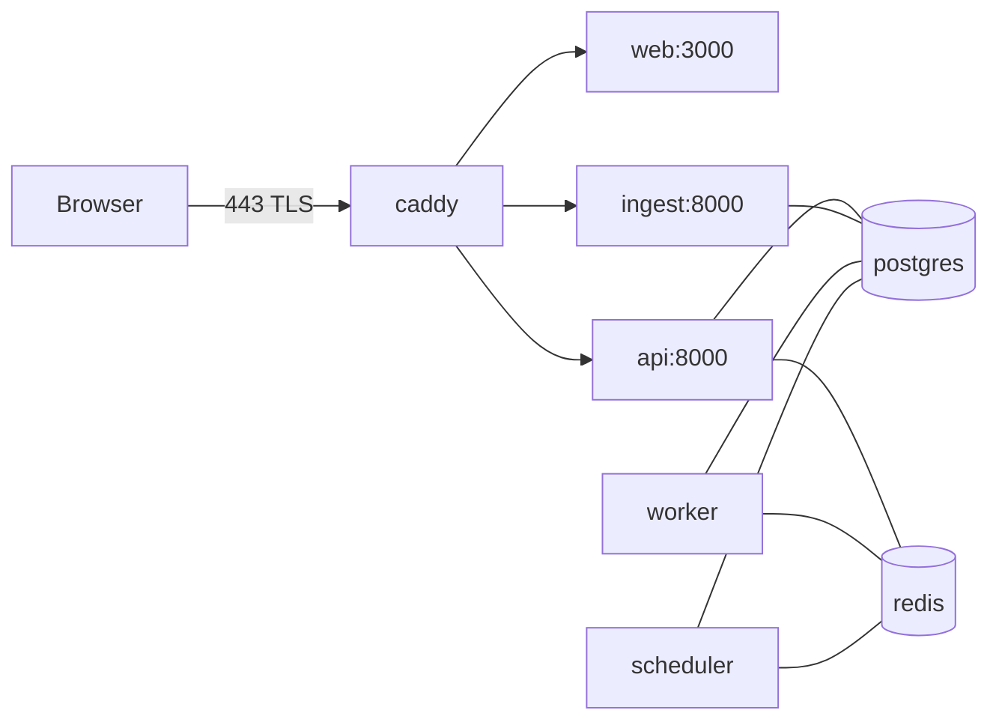

# J1.1 — `docker-compose.yml` with the 8 services

> Prior execution plan. **Does not replace** the claim in
> [../../sprints/CLAIMS.md](../../sprints/CLAIMS.md) nor the evidence in the logbook.
> Sources: [../S1.md](../S1.md) §5 (J1.1), [../../PLAN_SPRINTS.md](../../PLAN_SPRINTS.md) §2,
> [../../PLAN_TESTS.md](../../PLAN_TESTS.md) §1.4, [../../ESPECIFICACION.md](../../ESPECIFICACION.md)
> §3 and §9.1.

> **Status verified (2026-09-25):** S1 open; L1.1/L1.2/L1.3 and S1.A1–A5 `hecho`
> (owner `satnovaOG`); J1.x without claims. L1.1 dependency **satisfied**:
> Python 3.12.14, Node 22.20.0, uv 0.12.18, `pgvector/pgvector:pg16`
> ([../../VERSIONES.md](../../VERSIONES.md)). PR format: ADR-0004 and
> [../../../.github/pull_request_template.md](../../../.github/pull_request_template.md).
> Integration base: `develop`.

## 1. Ticket summary

- **Objective:** deliver an `infra/docker-compose.yml` that brings up the `web`, `api`,
  `ingest`, `worker`, `scheduler`, `postgres` (pinned pgvector), `redis` and `caddy`
  services, with no volume or mount that persists audio.
- **Scope:** compose, networks, internal healthchecks, base Dockerfiles for `api` and
  `web`, optional `env_file`, image pinning by digest.
- **Out of scope:** hardening `ingest` (J1.2), final Caddyfile (J1.3), CI (J1.4), real
  dispatcher and `/readyz` (J1.5), Redis policy (J1.6), migrations (A1.7), real ingestion
  app (S1.B1/S1.B2).
- **Typed dependency:** `code` J1.1 ← L1.1 (versions and lockfiles pinned).
  **L1.1 is `hecho`** (pins in [../../VERSIONES.md](../../VERSIONES.md), ADR-0002): use
  Python 3.12, Node 22 and `pgvector/pgvector:pg16` as-is; do not introduce new numbers.
- **Operational dependency:** Docker Engine + Compose v2 on the owner's machine.
- **Deliverables:** `infra/docker-compose.yml`, `apps/api/Dockerfile`,
  `apps/web/Dockerfile`, a minimal provisional `infra/Caddyfile` (J1.3 replaces it), and a
  minimal `ingest` entrypoint so the service can start (see §5).
- **Acceptance criteria:**
  - [ ] `docker compose up -d --build --wait` leaves the 8 services `healthy`.
  - [ ] `pgvector/pgvector:pg16` is pinned by digest in addition to the tag.
  - [ ] No volume, bind or persistent tmpfs holding audio exists; `docker compose config`
    audited.
  - [ ] `worker`/`scheduler` use the same image as `api` with a different command.
- **Tests/evidence:** I-S1-JF-01 (compose smoke of the 8 services) — the `/readyz` part is
  closed by J1.5; J1.1 evidences per-process `/healthz` and `compose ps`.
- **Planned files:** `infra/docker-compose.yml`, `infra/Caddyfile`,
  `apps/api/Dockerfile`, `apps/web/Dockerfile`, `apps/ingest/Dockerfile` (if J1.8 has not
  delivered it), and the `ingest` health entrypoint.

## 2. Delivery design

### 2.1 Topology



- `edge` network: `caddy`, `web`, `api`, `ingest`.
- `data` network: `postgres`, `redis`, `api`, `ingest`, `worker`, `scheduler`.
- Only `caddy` publishes ports (`80`, `443`). Healthchecks run **inside** each container;
  Caddy does not publish `/healthz`.

### 2.2 Volumes (privacy rule)

| Volume | Use | Audio? |
|---|---|---|
| `pgdata` | PostgreSQL data | no |
| `caddy_data` | local CA and certificates | no |
| `caddy_config` | Caddy autosave | no |
| — | Redis | no volume by default; J1.6/ADR-0005 decides persistence |

Forbidden: bind mounts to `apps/ingest`, the host `/tmp`, upload folders or any path that
could contain audio. Ingestion temporaries are private per-container `tmpfs` (J1.2).

### 2.3 Environment variables

- `env_file: ../.env` with `required: false` (the repo does not commit `.env`).
- `MAULWURF_DATABASE_URL` and `MAULWURF_REDIS_URL` are **overridden** in compose with the
  service names (`postgres`, `redis`), as `.env.example` warns.
- Provider secrets (`NVIDIA_API_KEY`, `GOOGLE_*`) are not declared as explicit
  `environment`; they enter only through the local `env_file`. Never in the versioned
  compose or in logs.

### 2.4 Healthchecks

| Service | Check | Command |
|---|---|---|
| `postgres` | `pg_isready -U maulwurf -d maulwurf` | shell |
| `redis` | `redis-cli ping` | shell |
| `api` | `GET /healthz` with Python stdlib | `python -c "import urllib.request;..."` |
| `ingest` | `GET /healthz` same | same |
| `web` | `fetch('http://127.0.0.1:3000/')` with Node | `node -e "..."` |
| `worker`/`scheduler` | Redis ping + ARQ health key | `python -m app.workers.health` (J1.5) |
| `caddy` | not required (fast process, depends on the three being healthy) | — |

API and ingest `/readyz` are wired up in J1.5/A; J1.1 only guarantees `/healthz`.

### 2.5 Images and Dockerfiles

- `postgres`: `pgvector/pgvector:pg16@sha256:<digest captured at implementation>`.
- `redis`: `redis:7.4-alpine@sha256:<digest>` with the J1.6 policy command (no
  persistence by default).
- `caddy`: `caddy:2.8-alpine@sha256:<digest>`.
- `api`/`worker`/`scheduler`: a single `maulwurf-api:local` image (build
  `apps/api/Dockerfile`, target `runtime`); `worker` and `scheduler` change only the
  `command`.
- `ingest`: `apps/ingest/Dockerfile` target `base` from J1.8; J1.2 adds the hardened
  `runtime` target and updates the compose.
- `web`: `apps/web/Dockerfile` (Node LTS pinned by L1.1), `npm ci` + `npm run build` +
  `npm run start`, non-root user.

## 3. Step by step

1. **Claim first:** atomic PR to `docs/sprints/CLAIMS.md` (`claim` action, single owner,
   `claimed_at` UTC, eligibility `no aplica`, reviewers from area J or the lead).
2. Create branch `s1/j1.1-docker-compose` from an up-to-date `develop` (base per
   ADR-0004).
3. Capture the real digests:
   ```bash
   docker pull pgvector/pgvector:pg16 && docker inspect --format '{{index .RepoDigests 0}}' pgvector/pgvector:pg16
   docker pull redis:7.4-alpine && docker inspect --format '{{index .RepoDigests 0}}' redis:7.4-alpine
   docker pull caddy:2.8-alpine && docker inspect --format '{{index .RepoDigests 0}}' caddy:2.8-alpine
   ```
4. Write `apps/api/Dockerfile` (multi-stage, `uv sync --frozen --no-dev`,
   `uvicorn app.main:app`, no root). Do not copy `alembic.ini` until A1.7 delivers it.
5. Write `apps/web/Dockerfile`.
6. Confirm with the ingestion owner the minimal entrypoint (`/healthz`) and build the
   image from the J1.8 target; if J1.8 does not exist yet, agree on who advances it.
7. Write `infra/docker-compose.yml` with the §2 design and a minimal `infra/Caddyfile`
   (`tls internal`, routes to `web`, `api` and `ingest`); J1.3 hardens it.
8. Bring up and wait for health:
   ```bash
   cd infra && docker compose up -d --build --wait
   docker compose ps --format json
   docker compose exec api python -c "import urllib.request;print(urllib.request.urlopen('http://localhost:8000/healthz').status)"
   ```
9. Audit the absence of audio and of persistent mounts:
   ```bash
   docker compose config --volumes
   docker inspect $(docker compose ps -q ingest) --format '{{json .Mounts}}'
   ```
10. `docker compose down` and record evidence (UTC date, environment, versions, digests,
    `compose ps` output) in the logbook; open the PR.

## 4. Verification and evidence

- Associated test: **I-S1-JF-01** (J1.1 part). Record command, date, environment and
  result.
- Written evidence: `docker compose ps` output, image digests, `docker compose
  config` with no audio volumes, `/healthz` 200 from the processes that already expose it.
- Mark explicitly what remains pending for J1.5 (real `/readyz`) and for J1.2/J1.3
  (hardening and final Caddy).

## 5. Coordination and risks

- **Provisional Caddyfile:** J1.3 owns the final file; J1.1 creates a minimal one so the
  service can start. Record the handover in the PR.
- **`ingest` entrypoint:** the package is empty; without a minimal ASGI the service does
  not start. Agree with owner S whether J1.1 creates it (placeholder) or S1.B1 on day 1.
- **`alembic.ini` does not exist** (A1.7 delivers it): do not copy it into the image
  until then.
- **Versions:** already pinned by L1.1/ADR-0002 (Python 3.12, Node 22, PG16); do not
  reopen them in this ticket.

## 6. PR format

> **Canonical:** [ADR-0004](../../adr/ADR-0004-commits-pr.md) (accepted 2026-09-23) and
> [../../../.github/pull_request_template.md](../../../.github/pull_request_template.md).
> Base `develop`; 1–3 point summary; test plan/checklist; at least 1 review; a claim PR
> touches only its own row of `CLAIMS.md`; no secrets, `.env`, audio or provider payloads.

- **One ticket per PR.** Branch `s1/j1.1-docker-compose`.
- **Title:** `J1.1 — docker-compose.yml with the 8 services`.
- **Body:**
  ```markdown
  ## Ticket and claim
  - Ticket: J1.1 · Claim: CLAIMS.md row (PR #…)
  - Area: J- · Verified dependencies: L1.1

  ## Objective and scope
  - Deliverable: ...
  - Not delivered (explicit): ingest hardening, final Caddy, CI, real readyz

  ## Main changes
  | File | Purpose |
  |---|---|

  ## How to verify (reproducible)
  - Exact commands and expected result

  ## Evidence
  - Date (UTC) · environment · versions and digests · redacted output · link to logbook

  ## Tests
  - I-S1-JF-01 (partial); P-* does not run in MR

  ## Checklist
  - [ ] At least 1 review (affected area or lead)
  - [ ] CI/QA without secrets; no audio/PII in diff, logs or fixtures
  - [ ] `docs/`/ADR/README updated if applicable
  - [ ] CLAIMS.md row updated with evidence
  ```
- **Commits:** prefixed with the ticket, e.g. `J1.1: describe the change in imperative`.
- **Review:** touching `apps/ingest` and `apps/web` requires review from whoever has an
  active claim on those folders or from the lead if there is no claim.
- The `.github/workflows/trigger-hoplite-qa.yml` workflow triggers external QA on every
  PR; it does **not** replace the J1.4 quality pipeline.
